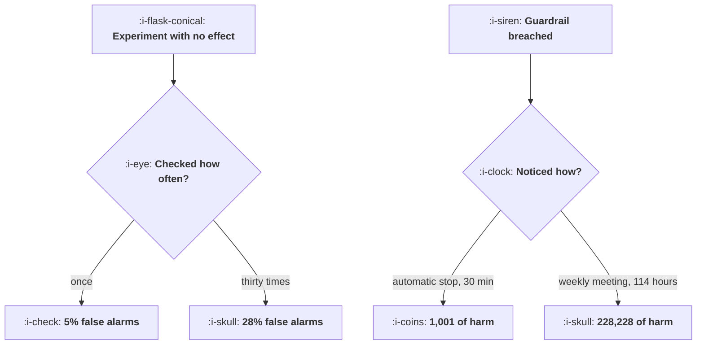

# Guardrails and Automatic Stops

```text
Level: Advanced
Prerequisites: Assignment and Exposure
Estimated difficulty: 4/5 | Estimated time: 40 min
```

## The idea in one minute

Two different mechanisms get called guardrails and they need separating. The first is statistical:
checking an experiment repeatedly and stopping at the first significant reading turns a 5 percent
false alarm rate into 28 percent after thirty looks, which is to say a change that does nothing
will be declared a winner more than a quarter of the time by a team that reads the dashboard every
morning. The fix is a wider threshold agreed in advance, which costs about a third more effect to
detect. The second is operational: a metric that stops the experiment on its own. It does not need
to be clever, it needs to fire within the hour, because every other way of noticing a breakage
takes at least a day and the cost is linear in time.

## A picture



The top half is an inference problem and the bottom half is an operations problem. Only one of them
is about statistics.

## How it really works

### Peeking is a different test, and a much worse one

An experiment's test statistic wanders. With no real effect it behaves like a random walk divided
by the square root of the sample, so it will cross any fixed threshold eventually if you keep
watching. Stopping at the first crossing means your test is "does the walk ever cross", not "is the
walk beyond the line at the end", and those have completely different error rates.

The program computes it exactly for a lattice walk: 5.3 percent for one look, 8.2 for two, 13.0 for
four, 19.3 for ten, 27.8 for thirty and 38.2 for a hundred. The one look figure is 5.3 rather than
5.0 because a walk on a lattice crosses in discrete jumps; the pattern is what matters.

What makes this the most common error in the field is that it requires no bad intent. A team reads
the experiment dashboard in the morning, sees significance, and ships. Nobody chose to run thirty
tests.

### The corrected threshold, decided in advance

If you want to look ten times, use the threshold that gives 5 percent across ten looks, which is
2.56 rather than 1.96. That means you need an effect about 30 percent larger to call it, and the
same trade at thirty looks is 2.72, or 39 percent larger.

That is usually a good trade, because the ability to stop early on a clear winner or a clear loser
is worth more than the lost sensitivity. The requirement is that the number of looks and the
threshold are fixed before the experiment starts. Choosing the threshold after seeing the data is
the same error with extra steps.

Two standard approaches, both fine. A constant wider threshold, as computed here, which is simple
and easy to explain. Or a spending approach where the threshold starts very high and relaxes as the
sample accumulates, which is harder to explain and gives better sensitivity at the planned end
point. Pick one, write it in the plan, and never negotiate it mid flight.

### Guardrails are an operational mechanism and the arithmetic is different

A guardrail is a metric that stops the experiment automatically when it moves beyond a threshold.
Its purpose is not inference, it is limiting damage, so the statistical niceties above do not apply:
you want it to be twitchy, because the cost of a false stop is one restarted experiment and the
cost of a missed one is the bottom row of the table.

The cost is linear in time live. At 1,400 users an hour, half in the variant, 11 percent hitting the
broken path and 26 per harmed user, the costs run 1,001 for an automatic stop within half an hour,
4,004 for a page to the on call engineer, 38,038 for somebody checking a dashboard the next day,
and 228,228 for the weekly growth meeting.

The gap between the first row and the third is a factor of 38, and it is entirely about detection
latency rather than about the quality of the metric.

### Which metrics should be guardrails

Four categories, and the list should be short enough that every one is genuinely monitored.

* **Revenue per user.** The one guardrail nobody should be allowed to omit.
* **Error and failure rates.** Per arm, because an error rate that rises in one arm is the clearest
  possible signal and it is often invisible in the aggregate.
* **Latency at the high percentiles.** A variant that is slower for the slowest tenth loses exactly
  the users who were already struggling, and it shows up as a conversion loss nobody can explain.
* **Support contacts and complaints.** Slow, noisy, and the only guardrail that catches a change
  that works and is hated.

Set the thresholds as a relative degradation against the control, not against a historical
baseline, because the control moves with seasonality and the comparison should not.

### What not to make a guardrail

The metric the experiment is trying to move. A guardrail that stops an experiment for moving its
own primary metric in the wrong direction is just peeking with an automatic trigger, and it has
exactly the false alarm problem from the first half of this lesson.

Also anything too noisy to have a stable threshold, which usually means anything measured on a
small subpopulation. A guardrail that fires weekly gets muted within a month, and a muted guardrail
is worse than none because it creates the belief that you have one.

### What fills the box in 2026

Platforms have largely standardised on sequential testing, which solves the peeking problem
properly and is the right default. The two things to verify: whether it is switched on, since many
default to a fixed horizon test and show a running p value anyway, and whether the stopping
boundary is displayed, because a team that can see the boundary stops arguing about when to call a
result. On the operational side, automatic stops are widely supported and widely configured to
notify rather than to stop, which is the difference between the first and third rows of the cost
table.

## Run the numbers

Compute the peeking inflation exactly, then price the detection latency.

```go
// guardrails.go: what peeking costs, what the corrected threshold is, and
// what an automatic stop is worth.
package main

import (
	"fmt"
	"math"
)

// The test statistic of an experiment with no real effect behaves like a
// random walk divided by the square root of the sample. Checking it
// repeatedly and stopping at the first significant reading is a different
// test from checking it once, and a much worse one. The walk below is exact:
// the distribution is carried forward step by step and the mass that crosses
// the threshold at each look is removed and counted.
func falseAlarmRate(looks int, steps int, threshold float64) float64 {
	n := 2*steps + 1
	dist := make([]float64, n)
	dist[steps] = 1 // the walk starts at zero
	alarm := 0.0
	per := steps / looks
	for s := 1; s <= steps; s++ {
		next := make([]float64, n)
		for i, p := range dist {
			if p == 0 {
				continue
			}
			if i > 0 {
				next[i-1] += p / 2
			}
			if i < n-1 {
				next[i+1] += p / 2
			}
		}
		dist = next
		if s%per == 0 {
			// Z is the walk divided by the root of the steps taken
			cut := threshold * math.Sqrt(float64(s))
			for i := range dist {
				if math.Abs(float64(i-steps)) > cut {
					alarm += dist[i]
					dist[i] = 0
				}
			}
		}
	}
	return alarm
}

func main() {
	const steps = 1200
	fmt.Println("an experiment with no effect at all, checked repeatedly:")
	fmt.Printf("%-16s %18s %16s\n", "times checked", "false alarm rate", "vs one check")
	base := falseAlarmRate(1, steps, 1.96)
	for _, k := range []int{1, 2, 4, 10, 30, 100} {
		r := falseAlarmRate(k, steps, 1.96)
		fmt.Printf("%16d %17.1f%% %15.1fx\n", k, 100*r, r/base)
	}
	fmt.Println("\nChecking a dashboard every morning for a month and stopping at the")
	fmt.Println("first significant reading gives a 1 in 4 chance of declaring a win")
	fmt.Println("for a change that does nothing. That is the single most common")
	fmt.Println("error in experimentation and it requires no bad intent at all.")

	fmt.Println("\nthe threshold that gives back the 5% you wanted:")
	fmt.Printf("%-16s %18s %20s\n", "times checked", "threshold needed", "effect you can see")
	for _, k := range []int{1, 4, 10, 30} {
		lo, hi := 1.96, 6.0
		for i := 0; i < 40; i++ {
			mid := (lo + hi) / 2
			if falseAlarmRate(k, steps, mid) > 0.05 {
				lo = mid
			} else {
				hi = mid
			}
		}
		// the smallest effect you can detect scales with the threshold
		fmt.Printf("%16d %18.2f %19.2fx\n", k, hi, hi/1.96)
	}
	fmt.Println("\nSo looking ten times is allowed, at the price of needing an effect")
	fmt.Println("about a third larger to call it. That trade is usually worth making")
	fmt.Println("and it has to be made in advance, not after the result arrives.")

	fmt.Println("\nwhat an automatic stop is worth on a guardrail:")
	fmt.Printf("%-34s %12s %14s %14s\n",
		"how the breakage is noticed", "hours live", "users harmed", "cost")
	const (
		usersPerHour = 1_400.0
		harmRate     = 0.11 // share of exposed users who hit the broken path
		harmCost     = 26.0 // cost of one harmed user: refund, support, churn
		armShare     = 0.50
	)
	for _, c := range []struct {
		how   string
		hours float64
	}{
		{"an automatic stop on the guardrail", 0.5},
		{"the on call engineer is paged", 2.0},
		{"somebody checks the dashboard", 19.0},
		{"a customer complains loudly", 61.0},
		{"the weekly growth meeting", 114.0},
	} {
		harmed := usersPerHour * armShare * harmRate * c.hours
		fmt.Printf("%-34s %12.1f %14.0f %14.0f\n",
			c.how, c.hours, harmed, harmed*harmCost)
	}
	fmt.Println("\nThe guardrail does not need to be clever. It needs to fire in under")
	fmt.Println("an hour, because the cost is linear in time and every other way of")
	fmt.Println("noticing takes at least a day.")
}
```

The first table is the headline and it needs no interpretation: 5.3, 8.2, 13.0, 19.3, 27.8, 38.2
percent false alarms for 1, 2, 4, 10, 30 and 100 looks. The four look row is the one most teams are
actually in, having checked the experiment a handful of times over two weeks, and it is a 13 percent
false alarm rate rather than 5.

The threshold table is the fix and its price: 1.96, 2.37, 2.56, 2.72 for 1, 4, 10 and 30 looks,
costing 1.00, 1.21, 1.30 and 1.39 times the effect to detect. Put the number of planned looks in the
test plan and compute the threshold from it.

The guardrail table is a separate calculation and the useful thing is the ratio rather than the
absolute numbers, which depend entirely on your traffic and your harm cost. Automatic stop against
next day discovery is 38 times. Automatic stop against the weekly meeting is 228 times. Replace
`usersPerHour`, `harmRate` and `harmCost` with your own and the ratios will hold.

## The AI layer

Two uses, and the second is the one that matters.

Setting guardrail thresholds is a genuinely awkward problem: too tight and they fire on noise, too
loose and they do not fire at all, and the right level differs per metric, per surface and per
season. A model with your historical metric distributions can propose thresholds with an expected
false alarm rate attached, which is better than the usual method of picking a round number and
loosening it after the first nuisance alert.

The more valuable use is deciding whether a breach is real. Most guardrail breaches are not
breakages: a seasonal shift, a marketing campaign changing the traffic mix, a deploy unrelated to
the experiment. A model with the deploy log, the traffic composition and the per arm error rates can
distinguish those from a genuine variant problem and say which it thinks it is, and that is what
makes an automatic stop tolerable to a team, because the alternative is stopping experiments for
reasons nobody can explain.

The thing to refuse is a model adjudicating the experiment's primary result, including deciding
whether to stop early for success. Early stopping for a winner is exactly the peeking problem, and a
model making that call introduces an unspecified number of looks with an unspecified threshold,
which is the worst of both halves of this lesson. Stopping rules are arithmetic agreed in advance;
keep them there.

## Sector lens

| Sector | What the guardrails must cover here |
|---|---|
| [Enterprise B2B SaaS](../../product-management/product-by-sector/01-enterprise-b2b-saas.md) | Per account error rates, because one large customer breaking matters more than an aggregate shift |
| [Fintech](../../product-management/product-by-sector/02-fintech.md) | Transaction failure and verification drop off, both of which are regulatory matters as well as product ones |
| [Ecommerce and D2C](../../product-management/product-by-sector/03-ecommerce-and-d2c.md) | Revenue per visitor and checkout error rate, with a tight threshold, because the cost per hour is the highest of any sector |
| [Marketplaces](../../product-management/product-by-sector/04-marketplaces.md) | Fill rate and time to match on both sides. A variant that helps one side can starve the other |
| [Devtools and Infra](../../product-management/product-by-sector/05-devtools-and-infrastructure.md) | API error rate and latency percentiles. A variant that breaks a customer's build is an incident, not an experiment result |
| [Healthtech](../../product-management/product-by-sector/06-healthtech-and-regulated-care.md) | Clinical safety signals, which are governance mandated, must stop automatically and cannot be traded against conversion |
| [Vertical SaaS](../../product-management/product-by-sector/07-vertical-saas.md) | Support contact volume, because with few customers it is the fastest signal you have and the sample is too small for anything else |

## Remember this

* Peeking changes the test. One look is 5 percent false alarms, four is 13, ten is 19, thirty is 28.
* It happens without bad intent: reading the dashboard each morning and shipping on significance is
  thirty looks.
* The fix is a wider threshold fixed in advance: 2.56 for ten looks, costing about 30 percent more
  effect to detect.
* That trade is usually worth making, and choosing the threshold after seeing the data is the same
  error with extra steps.
* Guardrails are operational, not statistical. Make them twitchy; a false stop costs one restart.
* Cost is linear in detection latency: 1,001 for a half hour automatic stop against 228,228 for the
  weekly meeting.
* Guardrail set: revenue per user, error rates per arm, high percentile latency, support contacts.
* Set thresholds as a relative degradation against the control, not against a historical baseline.
* Never guardrail the experiment's own primary metric. That is peeking with a trigger.
* Verify that your platform's sequential testing is switched on and that automatic stops actually
  stop rather than notify.

## Try it

1. Count how many times somebody looked at your last experiment's results before it concluded. Find
   that row in the first table.
2. Decide your number of planned looks, compute the threshold from `guardrails.go`, and put both in
   your test plan template so the next experiment inherits them.
3. Check whether your automatic stops stop or notify, and compute your own version of the cost table
   using your traffic and a defensible harm cost.

## Check yourself

1. Your team checks an experiment dashboard three times a week for three weeks and ships on the
   first significant reading. What is the real false alarm rate, and what threshold should they have
   used?
2. Why is it correct to make a guardrail twitchy and incorrect to make a primary metric test
   twitchy?
3. A variant raises the 95th percentile latency by 400 milliseconds and conversion looks flat. What
   do you expect to find, and in which population?
