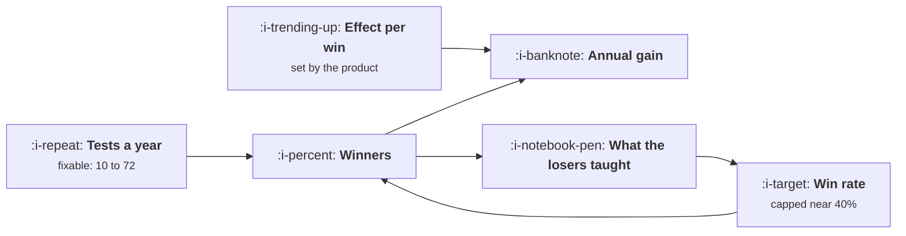

# Experiment Velocity

```text
Level: Advanced
Prerequisites: Guardrails and Automatic Stops
Estimated difficulty: 3/5 | Estimated time: 35 min
```

## The idea in one minute

Three teams, one careful with 10 experiments a year at a 40 percent win rate, one prolific with 72
at 13 percent and half the effect per win, and they land within a point of each other on annual
gain. That is the first thing to understand: idea quality and volume buy exactly the same thing,
arithmetically. The second is that only one of them is available. Win rates above about 40 percent
are not observed anywhere, and the effect per winner is a property of your product rather than of
your team, while the count of experiments is limited by things you can fix. Over three years the
prolific team pulls clearly ahead, because the experiments that failed moved its win rate and the
careful team's barely moved.

## A picture



The loop at the bottom is why the symmetry breaks: only the count feeds back into the win rate.

## How it really works

### The arithmetic, and why it is symmetric

A year of experimenting compounds. Each winner multiplies the metric, so the annual gain is one
plus the average winning effect raised to the number of winners, and the number of winners is tests
multiplied by win rate.

That means tests and win rate are perfectly interchangeable in the formula. Doubling either doubles
the winners. Anybody arguing that quality beats quantity, or the reverse, on arithmetic grounds is
mistaken: the arithmetic is indifferent.

### Why velocity is nonetheless the lever

The ranges are not symmetric.

**Win rate** is bounded above by how well anybody can predict what users want, and across published
programmes and private ones the number sits between 10 and 35 percent with remarkable consistency.
A team claiming a sustained 50 percent win rate is either testing only obvious changes, which caps
the effect size, or calling results early, which is the peeking problem from
[Guardrails and Automatic Stops](04-guardrails-and-automatic-stops.md).

**Effect per winner** is mostly a property of the surface and the product. You can choose to test
bigger changes, which raises it and lowers the win rate, and the product of the two is roughly
preserved. It is not a dial the team turns.

**Test count** is limited by build days, waiting time, decision latency and traffic, all of which
are addressable. Going from 10 to 70 experiments a year is a known and repeated achievement; going
from a 22 percent win rate to 37 is at the ceiling of what has ever been observed.

The second table makes this concrete: to add ten points of annual gain you can go from 26 to 44
tests, from a 22 to a 37 percent win rate, or from a 2.2 to a 3.7 percent effect per winner. Only
the first is something a team can decide to do.

### The feedback loop

Volume has a second effect the arithmetic above does not capture. Experiments that fail are the
cheapest information you can buy about what your users do not want, and a team that has concluded
200 experiments knows things about its users that a team with 30 cannot know.

Model that as a win rate that rises with cumulative experiments and the three year picture
separates: 43, 58 and 66 percent cumulative gain for the three teams. The careful team's win rate
moves two points in three years; the prolific team's moves four and from a lower base, and it
applies to far more tests.

This is also the argument against the common instinct to raise the bar on which ideas get tested. A
higher bar raises the win rate and lowers the count, which is neutral on this year's arithmetic and
negative on the learning, because the tests you refused to run were the ones that would have told
you something you did not already believe.

### What actually limits the count

Five constraints, in the order they usually bind.

* **Days to build a variant.** Addressed by a component library, flags that make the control path
  trivial, and reusable scaffolding.
* **Waiting for significance.** Addressed by fewer metrics, bigger changes, exposure based analysis
  from [Assignment and Exposure](03-assignment-and-exposure.md), and sequential testing.
* **Waiting for a decision.** The most common and least acknowledged. A test that has concluded and
  is waiting for a meeting is occupying its surface and its traffic. Agree the decision rule before
  the test starts.
* **Traffic on the surface.** Addressed by testing upstream surfaces where traffic is larger, or by
  accepting wider intervals and larger minimum effects.
* **People who can design a test.** Addressed by a template and a review, not by hiring a
  specialist, because a specialist becomes the queue.

### The number to put on a wall

Experiments concluded per quarter, with a decision recorded. Not started, not running, concluded
with a decision, because the other two can be gamed and this one cannot. A team that reports it
weekly tends to find its own bottleneck within a month, which is most of the value of measuring it.

### What fills the box in 2026

The build cost of a variant has fallen substantially, which moves the binding constraint for most
teams from the first item on that list to the third. That is an uncomfortable place for the
constraint to be, because decision latency is organisational rather than technical and cannot be
bought. The practical consequence is that the highest leverage experimentation investment for a
team with a working platform is now usually a written decision rule and a standing slot to apply
it, which is [Growth Process and Cadence](../growth-process-and-cadence/README.md).

## Run the numbers

Compare three teams, then see what each input would have to do.

```go
// velocity.go: why the count of experiments predicts output better than the
// quality of the ideas.
package main

import (
	"fmt"
	"math"
)

// A year of experimenting compounds: each winner multiplies the metric, so
// the annual gain is one plus the average winning effect, raised to the
// number of winners.
type team struct {
	name  string
	tests float64 // experiments concluded in a year
	win   float64 // share that win
	eff   float64 // average effect of a winner
}

func (t team) winners() float64 { return t.tests * t.win }

func (t team) annual() float64 {
	return math.Pow(1+t.eff, t.winners()) - 1
}

func main() {
	teams := []team{
		{"careful: few tests, strong ideas", 10, 0.40, 0.030},
		{"balanced", 26, 0.22, 0.022},
		{"prolific: many tests, weak ideas", 72, 0.13, 0.014},
	}

	fmt.Printf("%-36s %8s %8s %9s %10s %12s\n",
		"team", "tests", "win", "effect", "winners", "annual gain")
	for _, t := range teams {
		fmt.Printf("%-36s %8.0f %7.0f%% %8.1f%% %10.1f %11.0f%%\n",
			t.name, t.tests, 100*t.win, 100*t.eff, t.winners(), 100*t.annual())
	}
	fmt.Println("\nThe prolific team has a third of the win rate and half the effect")
	fmt.Println("per win, and it still finishes ahead, because it concluded seven")
	fmt.Println("times as many experiments. The three teams are within a point of")
	fmt.Println("each other, which is the first thing to notice: idea quality and")
	fmt.Println("volume buy the same thing.")

	fmt.Println("\nwhat it takes to add ten points of annual gain:")
	base := teams[1]
	target := base.annual() + 0.10
	fmt.Printf("%-28s %16s %16s %s\n", "change this", "from", "to", "feasible?")
	// tests needed
	n := base.tests
	for math.Pow(1+base.eff, n*base.win)-1 < target {
		n += 0.1
	}
	fmt.Printf("%-28s %16.0f %16.0f %s\n", "tests a year", base.tests, n, "yes, with a platform")
	w := base.win
	for math.Pow(1+base.eff, base.tests*w)-1 < target {
		w += 0.001
	}
	feas := "yes"
	switch {
	case w > 0.40:
		feas = "no, nobody sustains this"
	case w > 0.30:
		feas = "at the ceiling of what is seen"
	}
	fmt.Printf("%-28s %15.0f%% %15.0f%% %s\n", "win rate", 100*base.win, 100*w, feas)
	e := base.eff
	for math.Pow(1+e, base.winners())-1 < target {
		e += 0.0002
	}
	feas = "yes"
	switch {
	case e > 0.05:
		feas = "no, not at any volume"
	case e > 0.030:
		feas = "no, not at this volume"
	}
	fmt.Printf("%-28s %15.1f%% %15.1f%% %s\n", "effect per winner", 100*base.eff, 100*e, feas)

	fmt.Println("\nAll three routes are arithmetically equivalent. Only one of them is")
	fmt.Println("available, which is why velocity is the lever: win rates above about")
	fmt.Println("40% are not observed, and effects per winner are a property of the")
	fmt.Println("product rather than of the team.")

	fmt.Println("\nthe second reason count wins: losers teach you things")
	fmt.Printf("%-16s %14s %14s %16s\n",
		"tests a year", "win rate y1", "win rate y3", "three year gain")
	for _, n := range []float64{10, 26, 72} {
		// each hundred concluded experiments raises the win rate by two points
		var w1 float64
		switch n {
		case 10:
			w1 = 0.40
		case 26:
			w1 = 0.22
		default:
			w1 = 0.13
		}
		e := 0.030 - 0.00022*(n-10)
		g := 1.0
		w := w1
		for y := 1; y <= 3; y++ {
			g *= 1 + (math.Pow(1+e, n*w) - 1)
			w += 0.02 * n / 100
		}
		fmt.Printf("%16.0f %13.0f%% %13.0f%% %15.0f%%\n", n, 100*w1, 100*w, 100*(g-1))
	}
	fmt.Println("\nOver three years the prolific team is a long way ahead, because the")
	fmt.Println("tests that failed moved its win rate while the careful team's barely")
	fmt.Println("moved. Running experiments is how a team learns what its users want,")
	fmt.Println("and there is no other instrument for it.")

	fmt.Println("\nwhat actually limits the count:")
	rows := []struct{ limit, fix string }{
		{"days to build a variant", "component library, flags, generated scaffolding"},
		{"waiting for significance", "fewer metrics, bigger changes, sequential tests"},
		{"waiting for a decision", "a written rule agreed before the test starts"},
		{"traffic on the surface", "test upstream surfaces, or accept wider intervals"},
		{"people who can design a test", "a template and a review, not a specialist"},
	}
	for _, r := range rows {
		fmt.Printf("  %-30s %s\n", r.limit, r.fix)
	}
}
```

The first table is the symmetry: 13, 13 and 14 percent annual gain from completely different
profiles. If somebody in your organisation believes that running more tests is sloppy and running
fewer better ones is rigorous, this is the table to show them, because it says their position is
arithmetically equivalent rather than superior.

The second table is where the symmetry breaks, and the feasibility column is the argument. Tests a
year from 26 to 44 is a platform project. Win rate from 22 to 37 percent is at the edge of what has
ever been sustained. Effect per winner from 2.2 to 3.7 percent at 26 tests a year is not something
anybody has arranged on purpose.

The three year table adds the learning effect. Gains of 43, 58 and 66 percent, with the win rate
moving from 40 to 41, 22 to 24, and 13 to 17 percent. The prolific team ends the period with a win
rate still well below the careful team's and a cumulative gain half again as large.

Put your own tests concluded, win rate and average winning effect in. If you do not know your win
rate, counting it is the first thing to do, and most teams are surprised to find it lower than they
assumed.

## The AI layer

This is the clearest case in the course where a model moves the number that matters, because the
binding constraint on velocity has historically been engineering days per variant.

Building a variant is mechanical work against a known specification: implement the change behind a
flag, keep the control path intact, add the exposure event. A model does a large share of that, and
halving the build cost raises the test count proportionally, which by the table above is the one
input with room to move. Teams that have done this report going from single digit to double digit
experiments a month, and the arithmetic says that is worth more than any improvement in idea
quality they could have bought instead.

Two second order uses worth having. Generating variant copy and layouts widens the set of things
you can afford to test, with the caveat from
[Testing a Channel Properly](../acquisition-channels/03-testing-a-channel-properly.md) that forty
variants on a budget sized for two is not a test. And summarising concluded experiments into the
results store, which is the input to the learning loop and is otherwise the task that always slips.

The failure mode is raising test count without raising decision throughput. A team that doubles its
experiments and keeps one weekly meeting to decide them develops a queue, and a queued experiment
holds its surface and its traffic while contributing nothing. If the build cost halves, the
decision process has to double, and that is a scheduling change rather than a tooling one.

## Sector lens

| Sector | What caps velocity here |
|---|---|
| [Enterprise B2B SaaS](../../product-management/product-by-sector/01-enterprise-b2b-saas.md) | Account counts in the hundreds, so most changes cannot be tested at all. Velocity comes from qualitative cycles, not experiments |
| [Fintech](../../product-management/product-by-sector/02-fintech.md) | Compliance review per test. Velocity is won by pre approving categories of change rather than by building faster |
| [Ecommerce and D2C](../../product-management/product-by-sector/03-ecommerce-and-d2c.md) | Nothing structural. The highest velocity sector, where 100 or more tests a year is normal and the constraint is ideas and discipline |
| [Marketplaces](../../product-management/product-by-sector/04-marketplaces.md) | Geographic assignment collapses the unit count, so each test takes much longer and velocity is low by construction |
| [Devtools and Infra](../../product-management/product-by-sector/05-devtools-and-infrastructure.md) | Adoption cycles of weeks, so the waiting term dominates everything. Test the website and the docs, where cycles are fast |
| [Healthtech](../../product-management/product-by-sector/06-healthtech-and-regulated-care.md) | Governance approval per study. Velocity is a matter of batching approvals, and the ceiling is low and correctly so |
| [Vertical SaaS](../../product-management/product-by-sector/07-vertical-saas.md) | Too few customers for statistical testing. Velocity means cycles of change and conversation, counted the same way |

## Remember this

* Annual gain is one plus the winning effect raised to the number of winners, and winners are tests
  times win rate.
* So volume and idea quality are arithmetically interchangeable. Three very different teams land
  within a point of each other.
* The ranges are not interchangeable. Win rates sit between 10 and 35 percent everywhere; test
  counts can rise sevenfold.
* Effect per winner is a property of the product and the surface, not a dial the team turns.
* Losers are the cheapest information about what users do not want, so count feeds back into win
  rate and quality does not feed back into count.
* Raising the bar on which ideas get tested is neutral this year and negative over three.
* The five constraints: build days, waiting for significance, waiting for a decision, traffic, and
  people who can design a test.
* Measure experiments concluded with a decision recorded. Started and running can both be gamed.
* A model halves the build cost, which moves the one input with room to move.
* If build cost halves, decision throughput has to double, or you build a queue of experiments
  holding surfaces hostage.

## Try it

1. Count your experiments concluded with a decision over the last four quarters, your win rate and
   your average winning effect. Run `velocity.go` with them.
2. Time the five constraints for your last ten experiments: days to build, days running, days
   waiting for a decision. The largest is your bottleneck and it is usually the third.
3. Agree a written decision rule for one experiment before it starts, and measure how many days
   earlier it concludes than the previous one.

## Check yourself

1. Team A runs 12 tests a year at a 35 percent win rate with 3 percent effects. Team B runs 60 at
   12 percent with 1.5 percent effects. Which gains more this year, and which in three years?
2. Why is raising the bar for which ideas get tested arithmetically neutral and strategically
   negative?
3. Your build cost per variant halves. What breaks first, and what do you change alongside it?
