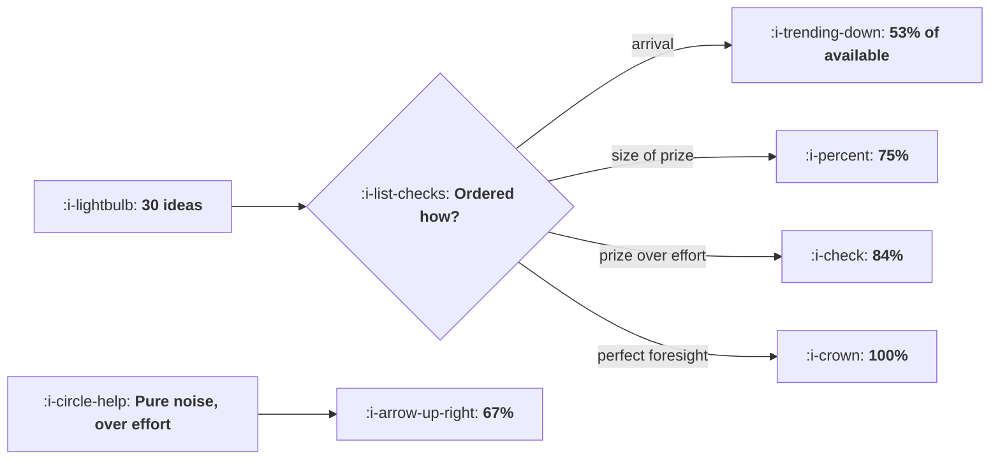

# The Backlog

```text
Level: Advanced
Prerequisites: Experiment Velocity
Estimated difficulty: 3/5 | Estimated time: 35 min
```

## The idea in one minute

A scoring framework is worth having and almost none of its value is in the score. Ordering a
backlog by estimated value over effort captures 84 percent of what perfect foresight would get,
against 53 percent for running whatever arrived first. But a score made entirely of noise still
beats arrival order by 27 percent, purely because it divides by effort. So most of what the
framework buys comes from writing down the expected effect and the cost at all, and only the
remainder comes from being right about them. That changes what the ritual is for: it is a
mechanism for making people state two numbers, not a device for computing a priority.

## A picture



Note where the noise row sits: above arrival order and most of the way to a careful estimate.

## How it really works

### Divide by effort, which is the part that matters

The dominant term in the ordering is effort, not value. A backlog has a few expensive ideas and
many cheap ones, and a fixed capacity, so running cheap things first gets more of them done.
Ranking on the size of the prize alone, which is what most teams do informally, captures 75
percent of what is available; cheapest first, with no value estimate at all, captures 74.

Combining both gets 84 percent. That is the useful ordering and it is a division.

### Why a noisy score still works

If your value estimate is uncorrelated with the truth, ranking by score over effort is effectively
ranking by one over effort with a shuffle, which is cheapest first with noise, and that beats
arrival order by 27 percent.

This is worth internalising because it reframes the usual argument. Teams debate whether their
scoring inputs are accurate, and the answer is usually that they are weakly informative at best,
and it does not matter very much. What matters is that every idea has an effort estimate and that
the queue is sorted.

### What the estimate quality is actually worth

From pure noise to perfect foresight, the value runs 7.36, 7.60, 8.52, 9.96, 10.97. Going from
noise to a 40 percent signal is worth 1.16; going from 40 percent to perfect is worth 2.45.

So the estimates are worth improving, and the return is modest and gradual. Nobody should spend a
week arguing about whether an idea scores a 6 or an 8, and everybody should spend ten minutes
making sure both numbers exist.

### What the frameworks are and what they share

The named frameworks differ in cosmetics. All of them are a numerator divided by effort, and the
numerator is some combination of how much you expect the metric to move, how many users it touches
and how confident you are.

Two practical notes. Confidence belongs in the numerator because it is a multiplier on expected
value, which is correct. And effort must be the whole cost of concluding the experiment, including
the analysis and the decision, not just the build, because
[Experiment Velocity](05-experiment-velocity.md) shows that the decision is often the longest part.

### What the backlog ritual is really for

Three things, none of which is the number.

**It forces an effort estimate.** The dominant term, and the one engineers can actually supply.

**It makes an expectation explicit before the result.** An idea with a written expected effect can
be wrong, which is how a team learns. An idea with no written expectation is retrospectively
correct whatever happens.

**It surfaces the ideas nobody would have raised.** A list everybody can add to produces a
different set from a list the senior person dictates, and the second is systematically narrower in
exactly the direction the senior person is already confident about.

### How to handle certainty

The hardest practical problem is not scoring, it is somebody being certain. Two mechanisms that
work.

Write the expected effect down with a range, and record it. After two quarters you have a
calibration record per person, and the conversation changes from whose judgement is better to
whose predictions have been closer. This is uncomfortable and it is the only thing that settles it.

And reserve a share of capacity, perhaps a fifth, for ideas that score badly but that somebody
believes in. It costs a fifth of the ordering benefit, which is about three points of the 84, and
it buys the willingness of the team to put ideas into the system at all.

### What fills the box in 2026

Nothing structural has changed about prioritisation. What has changed is the denominator: build
effort has fallen for many kinds of experiment, which compresses the effort column and therefore
reduces how much the division buys. If every idea costs between two and four days instead of two
and twenty, the effort term stops dominating and the value estimate matters more than this lesson's
figures suggest. Recompute with your own effort spread rather than assuming the historical one.

## Run the numbers

Average over many quarters, because any single quarter is mostly luck.

```go
// backlog.go: what the order of the queue is worth, and what a scoring
// framework is actually for.
package main

import (
	"fmt"
	"sort"
)

// Thirty ideas, a fixed number of engineering days, and a choice about what
// to run first. The true value of each idea is unknown in advance; all
// anybody has is an estimate, and how good the estimate is decides how much
// the ordering is worth. Every figure below is averaged over 400 backlogs,
// because any single quarter is mostly luck.
type idea struct {
	id     int
	value  float64 // what it is really worth, in points of the metric
	effort float64 // engineering days
	score  float64 // what the team estimates it is worth
}

// a small deterministic generator, so the figures are the same every run
type rng uint64

func (r *rng) next() float64 {
	*r = *r*6364136223846793005 + 1442695040888963407
	return float64((*r>>11)&0xFFFFF) / float64(0x100000)
}

const (
	capacity = 120.0 // engineering days in the quarter
	trials   = 400
)

func build(noise float64, seed uint64) []idea {
	r := rng(seed)
	out := make([]idea, 30)
	for i := range out {
		// most ideas are worth little and a few are worth a lot
		v := 0.1 + 3.2*r.next()*r.next()*r.next()
		e := 2 + 18*r.next()
		// the estimate is the truth plus error; noise 0 is perfect foresight
		est := v*(1-noise) + noise*3.3*r.next()
		out[i] = idea{i + 1, v, e, est}
	}
	return out
}

// run down a given order until the capacity is used up
func realised(ideas []idea) (value, run, days float64) {
	for _, it := range ideas {
		if days+it.effort > capacity {
			continue
		}
		days += it.effort
		value += it.value
		run++
	}
	return value, run, days
}

func order(ideas []idea, by func(a, b idea) bool) []idea {
	out := append([]idea{}, ideas...)
	sort.Slice(out, func(i, j int) bool { return by(out[i], out[j]) })
	return out
}

var orders = []struct {
	name string
	by   func(a, b idea) bool
}{
	{"by estimated value over effort", func(a, b idea) bool {
		return a.score/a.effort > b.score/b.effort
	}},
	{"by estimated value, ignoring effort", func(a, b idea) bool {
		return a.score > b.score
	}},
	{"cheapest first", func(a, b idea) bool { return a.effort < b.effort }},
	{"whatever arrived first", func(a, b idea) bool { return a.id < b.id }},
	{"perfect foresight, for reference", func(a, b idea) bool {
		return a.value/a.effort > b.value/b.effort
	}},
}

// average value, ideas run and days used across many backlogs
func average(noise float64, by func(a, b idea) bool) (v, n, d float64) {
	for s := uint64(1); s <= trials; s++ {
		a, b, c := realised(order(build(noise, s*7919), by))
		v, n, d = v+a, n+b, d+c
	}
	return v / trials, n / trials, d / trials
}

func main() {
	fmt.Printf("30 ideas, %.0f engineering days a quarter, averaged over %d quarters\n\n",
		capacity, trials)

	fmt.Printf("%-40s %10s %12s %14s %10s\n",
		"the order you run them in", "ideas run", "days used", "value gained", "of perfect")
	perfect, _, _ := average(0.45, orders[4].by)
	for _, o := range orders {
		v, n, d := average(0.45, o.by)
		fmt.Printf("%-40s %10.1f %12.0f %13.2f %9.0f%%\n",
			o.name, n, d, v, 100*v/perfect)
	}
	fmt.Println("\nOrdering by estimated value over effort captures 84% of what a")
	fmt.Println("perfect ranking would get. Ignoring effort and ranking on the size")
	fmt.Println("of the prize captures 75%, and it runs three fewer experiments to")
	fmt.Println("do it, which also costs the learning from lesson five.")

	fmt.Println("\nhow good the estimate has to be:")
	fmt.Printf("%-34s %16s %18s %14s\n",
		"quality of the estimate", "value gained", "vs arrival order", "of perfect")
	arrival, _, _ := average(0.45, orders[3].by)
	for _, n := range []float64{0.00, 0.30, 0.60, 0.90, 1.00} {
		v, _, _ := average(n, orders[0].by)
		p, _, _ := average(n, orders[4].by)
		label := fmt.Sprintf("%.0f%% signal, %.0f%% noise", 100*(1-n), 100*n)
		fmt.Printf("%-34s %16.2f %17.0f%% %13.0f%%\n",
			label, v, 100*(v/arrival-1), 100*v/p)
	}
	fmt.Println("\nA score made entirely of noise still beats arrival order by 27%,")
	fmt.Println("because it at least divides by effort. That is the useful finding:")
	fmt.Println("most of what a scoring framework buys comes from writing down the")
	fmt.Println("effort and the expected effect at all, and only the rest comes from")
	fmt.Println("being right about them.")
}
```

The first table is the ranking of rankings: 84, 75, 74 and 53 percent of what perfect foresight
achieves. The two numbers to hold are 84 for value over effort and 53 for arrival order, because the
gap between them is what the ritual is worth.

Look at the ideas run column too. Value over effort runs 15.1 experiments and ignoring effort runs
11.7, so the effort aware ordering also produces more learning, which compounds through the
feedback loop in lesson five and is not counted in these figures.

The second table is the surprising one. Pure noise over effort reaches 67 percent of perfect and
beats arrival order by 27 percent. The practical reading: if your team cannot agree on value
estimates, sort by effort and start, because you will capture two thirds of the available benefit
while you argue.

Replace the value and effort distributions with your own. The key input is the spread of effort: if
your ideas all cost about the same, the division buys nothing and the whole lesson inverts towards
caring about the value estimate.

## The AI layer

Two genuine uses and one trap that is specific to prioritisation.

The first is effort estimation, which is the dominant term and the one humans are worst at
estimating consistently. A model with your codebase and your history of similar changes produces
effort estimates that are at least consistently biased rather than inconsistently biased, and
consistency is what the ordering needs: a uniform overestimate does not change the sort order at
all.

The second is backlog hygiene. Deduplicating ideas, matching a new idea against the results store
to see whether it has already been tested, and grouping ideas that would be better run as one
bigger test are all tedious and well suited to a model. The match against previous results is the
most valuable of the three, because rerunning a test somebody ran two years ago is the most
annoying waste in this field and it happens constantly.

The trap is asking a model to estimate the value. It will produce a plausible number with a
plausible rationale, and the number will be anchored on what is typical for that kind of change
rather than on anything about your product. That is not useless, it is a prior, and its danger is
that it is far more confident and more uniform than a human estimate, which means it will
systematically down rank the unusual ideas, which are the ones with the information in them. If you
use it, use it as one input beside the team's and keep the disagreements visible, because the
disagreements are where the interesting tests are.

## Sector lens

| Sector | What the backlog has to account for here |
|---|---|
| [Enterprise B2B SaaS](../../product-management/product-by-sector/01-enterprise-b2b-saas.md) | Most ideas cannot be tested, so the backlog mixes experiments and judgement calls. Keep them in separate lists with separate rules |
| [Fintech](../../product-management/product-by-sector/02-fintech.md) | Compliance review is part of effort and varies tenfold between ideas. Putting it in the effort estimate reorders the queue substantially |
| [Ecommerce and D2C](../../product-management/product-by-sector/03-ecommerce-and-d2c.md) | Seasonality makes timing part of value: the same idea is worth more in November. Score with a date window |
| [Marketplaces](../../product-management/product-by-sector/04-marketplaces.md) | Ideas affect two sides and the value estimate has to say which. A supply side win that starves demand scores well and is negative |
| [Devtools and Infra](../../product-management/product-by-sector/05-devtools-and-infrastructure.md) | Effort includes documentation and client library changes, which are usually larger than the feature itself |
| [Healthtech](../../product-management/product-by-sector/06-healthtech-and-regulated-care.md) | Governance approval dominates effort and is lumpy, so batching ideas by approval category beats ordering them individually |
| [Vertical SaaS](../../product-management/product-by-sector/07-vertical-saas.md) | The backlog is largely customer requests, so value is known better than usual and effort is the whole decision |

## Remember this

* Ordering by estimated value over effort captures 84 percent of what perfect foresight would get;
  arrival order captures 53.
* Effort is the dominant term. Cheapest first with no value estimate gets 74 percent.
* A score made of pure noise beats arrival order by 27 percent, because it still divides by effort.
* So most of the framework's value is in forcing two numbers to exist, and only the rest is in
  being right.
* Improving estimates is worth having and gradual. Do not argue about a 6 against an 8.
* All the named frameworks are a numerator over effort. Put confidence in the numerator and put the
  whole cost of concluding, including the decision, in the denominator.
* Effort aware ordering also runs more experiments, which compounds through the learning loop.
* Record expected effects with ranges, and build a calibration record per person. It is the only
  thing that settles an argument from certainty.
* Reserve about a fifth of capacity for low scoring ideas somebody believes in, to keep ideas
  flowing into the system.
* If your ideas all cost about the same, the division buys nothing and the value estimate becomes
  the whole decision.

## Try it

1. Take your current backlog and add an effort estimate to every item that lacks one. Sort by
   estimated value over effort and compare against the order you were going to run them in.
2. Run `backlog.go` with your own effort spread. If your efforts are all within a factor of two,
   note that the lesson's conclusion weakens and the value estimate matters more.
3. Start recording expected effects with ranges before each test concludes. In two quarters you
   will have a calibration record, which is worth more than any scoring refinement.

## Check yourself

1. Why does ranking by the size of the prize, ignoring effort, capture less than ranking by effort
   alone with no value estimate at all?
2. Your team cannot agree on value scores and the debate has taken three weeks. What do you do, and
   what does it cost you?
3. Build cost falls so that every experiment takes two to four days instead of two to twenty. What
   happens to the conclusions of this lesson?
