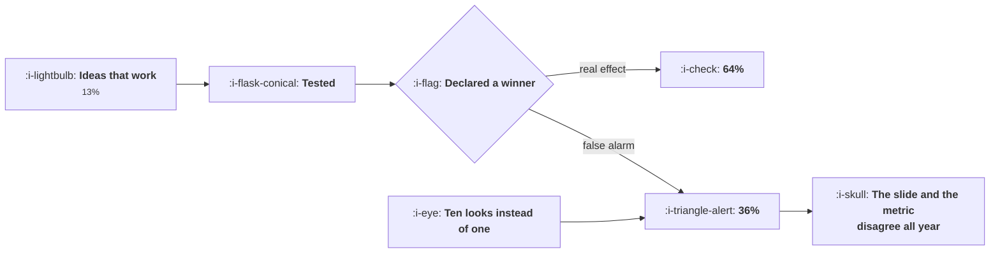

# Writing the Result

```text
Level: Advanced
Prerequisites: The Backlog
Estimated difficulty: 4/5 | Estimated time: 40 min
```

## The idea in one minute

The hardest number to put in a result memo is the chance the result is real, and it is computable.
At a 13 percent win rate and 60 percent power, which is where plenty of growth teams genuinely
sit, 64 percent of declared winners are real effects. Add the peeking from checking ten times and
it falls to 54 percent. The consequence is the gap between the slide and the metric: six declared
wins at 2.1 points each is a 12.6 point quarter on the slide and between 3.5 and 10.3 points in
the business, depending entirely on how the experiments were run. A memo that states the power and
the number of looks lets a reader compute that for themselves, which is what makes it believed.

## A picture



The false alarm branch is not a statistical footnote. It is where the credibility of the programme
goes.

## How it really works

### The chance a winner is real depends on your win rate

A 5 percent threshold means 5 percent of the ideas that do nothing will be declared winners. If
most of your ideas do nothing, that false alarm pool is large relative to the true winner pool.

Work it through: with a 13 percent win rate, 80 percent power and a 5 percent threshold, out of a
hundred experiments about 10 are true winners found and about 4 are false alarms, so 71 percent of
your declared winners are real. At a 6 percent win rate it is 51 percent.

This is not a criticism of anybody's statistics. It is what a 5 percent threshold means in a world
where most ideas do not work, and the first table makes it legible.

### Power is half the problem and is the half nobody mentions

An underpowered experiment does not just fail to find real effects, it changes the composition of
the winners it does find, because it only detects the large ones and false alarms are unaffected by
power. Going from 90 to 40 percent power at a 13 percent win rate takes the share of real winners
from 73 to 54 percent.

So a memo reporting a win from an experiment that was underpowered is reporting something
substantially less likely to be true than the same p value from a well powered one, and the p value
does not show it. State the power. It is the single most informative number you can add.

### Peeking shows up here as well

The effective threshold after multiple looks, from
[Guardrails and Automatic Stops](04-guardrails-and-automatic-stops.md), feeds straight into this
calculation. At a 22 percent win rate and 80 percent power, one look gives 81 percent real winners
and ten looks gives 54.

That is why the number of planned looks belongs in the memo. A reader who knows the looks and the
threshold can compute the share of winners that are real; a reader who does not has to take the
conclusion on trust, and the whole purpose of the document is to make trust unnecessary.

### The portfolio statement, which is the honest version of a quarterly review

Multiply the claimed gain by the share of winners that are real and you get the expected delivered
gain. Six wins at 2.1 points each is 12.6 points claimed, and 10.3, 9.2, 7.0 or 3.5 points
delivered depending on the regime.

This arithmetic explains the most common pattern in growth reporting, which is a year of wins and
a flat metric, and it explains it without anybody having lied. The remedy is to report the
portfolio with the discount applied and the assumptions shown, which is uncomfortable the first
time and ends the argument permanently.

### The memo, in order

Eight items. The order is deliberate: the decision first, because that is what a reader needs, and
the methodology after, because that is what a sceptic needs.

1. The decision, in one sentence, at the top.
2. What was changed, precisely enough that somebody could rebuild it.
3. The population: assigned or exposed, and how many.
4. The primary metric, its effect and its interval.
5. The guardrails and what they did.
6. The planned looks and the threshold used.
7. What you expected before you started.
8. What you now believe, and what would change your mind.

Item seven is the one teams omit and the one that makes the memo worth keeping. A recorded
prediction that turned out wrong is the only part of the document that teaches anybody anything,
and it is also the input to the calibration record in [The Backlog](06-the-backlog.md).

### Writing a null result

A result with no detectable effect is the most common outcome and the hardest to write well,
because the temptation is to find something in a segment. The honest form states the effect and the
interval, says what effect size the test could have detected, and separates the two claims that get
conflated: there was no effect, and we could not detect one. If the interval includes effects you
would have cared about, the second is true and the first is not.

Segment findings in a null result are hypotheses, and they should be labelled as such with the
number of segments examined, because examining ten segments at a 5 percent threshold produces a
significant one 40 percent of the time.

### What fills the box in 2026

Platforms increasingly report a probability that the variant is better rather than a p value, which
is a genuine improvement for readers and does not remove the need for this lesson: those
probabilities use a prior, often an uninformative one, and your win rate is the informative prior.
Where the platform lets you set it, set it to your measured win rate and the reported numbers
become directly usable. Where it does not, compute the adjustment yourself and put it in the memo.

## Run the numbers

Compute the share of your declared winners that are real, then apply it to the quarter.

```go
// result.go: the chance a declared winner is real, and what to put in the memo.
package main

import "fmt"

// Of the experiments you declare winners, some are real effects and some are
// false alarms. The share that are real depends on how many of your ideas
// work at all, how much power the test had, and what threshold you used.
func realGivenWin(prior, power, alpha float64) float64 {
	truePos := prior * power
	falsePos := (1 - prior) * alpha
	return truePos / (truePos + falsePos)
}

func main() {
	fmt.Println("the chance a declared winner is a real effect:")
	fmt.Printf("%-28s %12s %12s %12s %12s\n",
		"ideas that really work", "power 90%", "power 80%", "power 60%", "power 40%")
	for _, prior := range []float64{0.35, 0.22, 0.13, 0.06} {
		fmt.Printf("%27.0f%%", 100*prior)
		for _, power := range []float64{0.90, 0.80, 0.60, 0.40} {
			fmt.Printf(" %11.0f%%", 100*realGivenWin(prior, power, 0.05))
		}
		fmt.Println()
	}
	fmt.Println("\nAt a 13% win rate and 60% power, which is an ordinary place for a")
	fmt.Println("growth team to be, barely two thirds of your declared winners are")
	fmt.Println("real. Nothing is wrong with the statistics; this is what a 5%")
	fmt.Println("threshold means when most ideas do not work.")

	fmt.Println("\nthe same thing once somebody has been peeking:")
	fmt.Printf("%-24s %14s %16s %16s\n",
		"times checked", "effective alpha", "winners real", "vs one check")
	base := realGivenWin(0.22, 0.80, 0.053)
	for _, c := range []struct {
		looks int
		alpha float64
	}{{1, 0.053}, {4, 0.130}, {10, 0.193}, {30, 0.278}} {
		p := realGivenWin(0.22, 0.80, c.alpha)
		fmt.Printf("%24d %13.0f%% %15.0f%% %15.0f%%\n",
			c.looks, 100*c.alpha, 100*p, 100*(p/base-1))
	}
	fmt.Println("\nChecking ten times takes the share of real winners from 81% to 54%.")
	fmt.Println("A team in that position is shipping a coin flip and reporting a")
	fmt.Println("result, and it will spend the next year unable to explain why the")
	fmt.Println("metric did not move.")

	fmt.Println("\nwhat a quarter of claimed wins is actually worth:")
	fmt.Printf("%-30s %14s %14s %14s\n",
		"situation", "wins claimed", "real", "gain delivered")
	const claimedEach = 0.021
	for _, s := range []struct {
		name                string
		prior, power, alpha float64
		wins                float64
	}{
		{"well run, well powered", 0.22, 0.85, 0.053, 6},
		{"well run, underpowered", 0.22, 0.50, 0.053, 6},
		{"peeking, well powered", 0.22, 0.85, 0.193, 6},
		{"peeking and underpowered", 0.13, 0.50, 0.193, 6},
	} {
		p := realGivenWin(s.prior, s.power, s.alpha)
		fmt.Printf("%-30s %14.0f %13.1f %13.2f%%\n",
			s.name, s.wins, s.wins*p, 100*s.wins*p*claimedEach)
	}
	fmt.Println("\nSix declared wins at 2.1 points each is a 12.6 point quarter on the")
	fmt.Println("slide and between 3.5 and 10.3 points in the metric, depending on")
	fmt.Println("how the experiments were run. The gap is the whole reason a result")
	fmt.Println("memo has to state the power and the number of looks.")

	fmt.Println("\nwhat the memo must contain, in this order:")
	for i, line := range []string{
		"the decision, in one sentence, at the top",
		"what was changed, precisely enough to rebuild",
		"the population: assigned or exposed, and how many",
		"the primary metric, its effect and its interval",
		"the guardrails and what they did",
		"the planned looks and the threshold used",
		"what you expected before you started",
		"what you now believe, and what would change your mind",
	} {
		fmt.Printf("  %d. %s\n", i+1, line)
	}
	fmt.Println("\nThe seventh line is the one teams omit and the one that makes the")
	fmt.Println("memo worth keeping, because a prediction that was wrong is the only")
	fmt.Println("thing in the document that teaches anybody anything.")
}
```

The first table is the one to put in your team's handbook. Find your win rate on the left and your
typical power along the top, and that is the share of your declared winners that are real effects.
Most teams land between 54 and 82 percent, and almost nobody has ever computed it.

The peeking table compounds it: 81, 63, 54, 45 percent for 1, 4, 10 and 30 looks at a 22 percent
win rate. The drop from one look to four is 22 percent of your credibility, for a habit nobody
thinks of as a methodological choice.

The portfolio table is the one to take into a quarterly review. The same six claimed wins deliver
10.3 points in a well run programme and 3.5 in a badly run one, and the difference is not the
quality of the ideas, it is power and looks.

Put your own win rate in, measured by counting your last forty experiments. If you do not know it,
that count is the prerequisite for every number in this lesson.

## The AI layer

Drafting the memo is the obvious application and it is genuinely good, with one condition.

A model given the experiment configuration, the results engine output and the plan can produce
seven of the eight items correctly, and it will do it in the same structure every time, which is
worth more than the time saved: a standard shape makes results comparable and makes the results
store searchable. The condition is that item seven, what you expected before you started, has to
come from the record made before the test ran. A model asked to reconstruct the expectation after
the fact will produce something consistent with the result, which is exactly the failure the item
exists to prevent.

Two further uses. Checking a draft memo for the common errors is a good fit: a conclusion stronger
than the interval supports, a segment finding presented as a result, a null result described as no
effect when the interval is wide. And searching the results store for prior experiments on the same
surface when a new one concludes, which is how an organisation stops contradicting itself.

The thing to be careful about is a model writing the conclusion. The decision sentence at the top is
a judgement that includes things not in the data: how much the team believes the mechanism, what
else is shipping, what the downside is if it is wrong. A fluent conclusion generated from the
numbers alone reads more confident than the evidence warrants, and because it is fluent, it is
harder to argue with. Write that sentence yourself.

## Sector lens

| Sector | What the memo must carry here |
|---|---|
| [Enterprise B2B SaaS](../../product-management/product-by-sector/01-enterprise-b2b-saas.md) | The account count and which accounts, because a result driven by two large customers is not a result |
| [Fintech](../../product-management/product-by-sector/02-fintech.md) | The compliance review reference and any regulatory metric, because the memo is an auditable record |
| [Ecommerce and D2C](../../product-management/product-by-sector/03-ecommerce-and-d2c.md) | The trading period and whether it spanned a promotion, because seasonality explains more results than variants do |
| [Marketplaces](../../product-management/product-by-sector/04-marketplaces.md) | The effect on both sides and the randomisation unit, since geographic assignment changes what the interval means |
| [Devtools and Infra](../../product-management/product-by-sector/05-devtools-and-infrastructure.md) | Client versions in scope and the adoption lag, because a result measured before adoption completes is measuring early adopters |
| [Healthtech](../../product-management/product-by-sector/06-healthtech-and-regulated-care.md) | The governance approval, the safety signals, and the clinical reviewer. The memo is part of the regulatory record |
| [Vertical SaaS](../../product-management/product-by-sector/07-vertical-saas.md) | An explicit statement that the evidence is qualitative, with the named accounts, rather than a number with a false interval |

## Remember this

* The chance a declared winner is real depends on your win rate, your power and your threshold, and
  it is computable.
* At a 13 percent win rate and 60 percent power, 64 percent of declared winners are real. At a 6
  percent win rate it is 43.
* Power changes the composition of your winners, not just how many you find, and a p value does not
  show it. State the power.
* Ten looks instead of one takes real winners from 81 to 54 percent at a 22 percent win rate.
* Report the portfolio with the discount applied: six wins at 2.1 points each delivers between 3.5
  and 10.3 points.
* That arithmetic explains a year of wins and a flat metric without anybody having lied.
* Eight items in order: decision, change, population, metric and interval, guardrails, looks and
  threshold, prior expectation, new belief.
* Item seven, the prediction made in advance, is the only part that teaches anybody anything.
* In a null result, separate there was no effect from we could not detect one, and give the
  detectable effect size.
* Ten segments at a 5 percent threshold produce a significant one 40 percent of the time. Label
  segment findings as hypotheses with the count.

## Try it

1. Count your last forty experiments and compute your win rate. Then find your cell in the first
   table and tell the team what share of your declared winners are likely real.
2. Apply the discount to last quarter's claimed gains and compare the result against the metric's
   actual movement. The agreement or disagreement is the most informative thing you will learn this
   quarter.
3. Add items six and seven to your memo template, and require the expectation to be written before
   the experiment starts rather than at the end.

## Check yourself

1. Your win rate is 18 percent, your experiments typically run at 55 percent power, and the team
   checks results twice a week for three weeks. Roughly what share of your winners are real?
2. Why does stating the power matter more than stating the p value, when the p value is what
   determines significance?
3. An experiment shows no significant effect and one segment with a 6 percent lift across eleven
   segments examined. How do you write that up?
