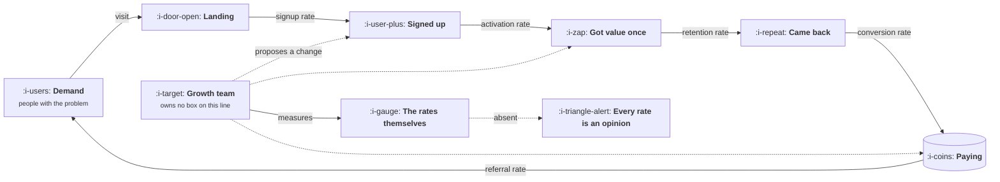

# What a Growth Team Actually Does

```text
Level: Foundations
Prerequisites: None
Estimated difficulty: 1/5 | Estimated time: 30 min
```

## The idea in one minute

A growth team does not own a feature. It owns a rate. Its three jobs are to find which rate in the
system is worth changing, to change it with the smallest intervention that could plausibly work,
and to prove the change was real. The asymmetry that defines the job is that nearly every rate it
owns is set by a surface somebody else builds and maintains, so the team is judged on percentage
points it can only move through other people's code. That is why growth work turns out to be
mostly instrumentation, argument and evidence rather than building, and it is why a growth team
without trusted measurement is not a growth team, it is an opinion with a budget.

## A picture



Notice that the growth team connects to the system with dotted lines everywhere except one: the
solid arrow goes to measurement. The only thing the team owns outright is the ability to say what
happened, which is exactly why that is the first thing it has to build.

## How it really works

### Job one: find the rate worth changing

The output of the system is the product of its rates. A hundred thousand visitors multiplied by a
signup rate, an activation rate, a retention rate and a conversion rate produces some number of
paying users, and improving any one of those rates by ten percent improves the output by ten
percent. This is the single most important and least intuitive fact about the job, because it means
**the lowest rate in your funnel is not automatically the one to work on.**

Most people pick the lowest rate. It looks like the leak. But a proportional improvement anywhere
in a chain of multiplications is worth exactly the same at the end, so the stage's own rate cancels
out of the decision entirely. What is left are two things that do not appear on the funnel chart at
all: how much proportional improvement is realistically available at that stage, and what it costs
to attempt. The program below makes this concrete, and it is worth running before reading on,
because the ranking it produces contradicts the chart almost everyone starts from.

A rate is worth working on when three things are true. There is evidence that it is below what the
product could support, which usually means a comparable segment or a comparable competitor does
better. You can name a mechanism for why it is low rather than a feeling. And the intervention is
small enough that if it works you will know why.

### Job two: change it with the smallest intervention that could work

A growth change is almost never the best possible version of the change. It is the cheapest version
that would move the number if the hypothesis is right, which is a different design target and
produces different work.

The reason is attribution, not laziness. Change the headline, the form, the pricing table and the
onboarding sequence in one release and you will have an answer about the release and no answer
about anything in it. You will also have no idea what to do next, which is the real cost, because
the next decision is worth more than this one.

* One hypothesis per change, written before the change.
* The smallest surface that carries the hypothesis, not the surface you wish existed.
* A prediction with a number in it, recorded before the result is visible.
* A decision rule chosen in advance: at what result do you ship, kill, or iterate.

The fourth is the one teams skip, and skipping it is how a flat result becomes a six week argument.

### Job three: prove it was real

Growth claims are the easiest claims in the company to fake, and mostly they are faked by accident.
A number moves, a team was working nearby, and the two get stapled together in a slide. Seasonality,
a marketing push, a pricing change, a dropped tracking event and a change in traffic mix will each
produce a convincing lift that nobody caused.

So the standard is higher here than elsewhere, and it is a standard about method rather than
outcome: a result counts when the comparison was defined before the change, the population was
split in a way nobody could influence, and the measurement would have been believed had it gone the
other way. The last clause is the honest test. A team that only scrutinises losses is not measuring,
it is advocating.

### What the team owns, and what it only influences

| Thing | Who owns it | What growth actually has |
|---|---|---|
| The signup form, the paywall, the empty state | A product team, usually | A hypothesis, a prototype and an argument |
| The event schema and the definitions of each rate | Growth, if anyone | Real ownership, which is the source of everything else |
| The experiment platform and the rollout mechanism | Platform or growth engineering | Shared ownership, and a veto when it is broken |
| The messaging calendar | Marketing, lifecycle, or nobody | A seat at the table, and a frequency cap to defend |
| The price | Finance, product, the founder | Influence, and the arithmetic |
| Whether the quarter worked | Growth | Full accountability, which is the asymmetry |

### Where the authority comes from

Four sources, in roughly descending reliability. None of them are positional, which is the same
pattern the product function has and for the same underlying reason.

1. **The instrumentation.** If you built the event model and you maintain it, you are the person
   who can say what happened. Every other source of authority depends on this one.
2. **Velocity.** You can answer in a week a question the roadmap would take a quarter to schedule.
   Teams give surface area to whoever reduces their uncertainty fastest.
3. **The written result.** A readout that was believed when it reported a loss is worth more than
   ten that reported wins.
4. **The arithmetic.** A growth model that has been right twice will kill a bad idea without a
   meeting, which is the only form of influence that scales.

Source one decays quietly rather than quickly. Events break silently, a release stops firing one of
them, and nobody notices for a month because the dashboard still draws a line.

### What fills the box in 2026

Product analytics is Amplitude, Mixpanel, PostHog or a warehouse with a query tool on top.
Experimentation is Statsig, Optimizely, GrowthBook or LaunchDarkly, and for a company under roughly
a million monthly users a warehouse plus a flag service is a legitimate answer. Event collection is
Segment, RudderStack or a thin wrapper you write yourself. Lifecycle messaging is Braze,
Customer.io or Intercom. The warehouse is Snowflake, BigQuery, Databricks or Postgres for longer
than people expect. None of these do job one, and buying the whole stack before anyone has written a
tracking plan is the most common and most expensive way to begin.

## Run the numbers

The claim above is that the lowest rate in the funnel is the wrong default target. This program
takes a four stage funnel, applies a realistic proportional improvement to one stage at a time, and
ranks the stages three ways: by their own rate, by the absolute gain, and by gain per week of work.

```go
// ratestack.go: which rate in the funnel is actually worth a quarter of the team?
package main

import (
	"fmt"
	"sort"
)

type stage struct {
	name  string
	rate  float64 // conversion from the previous stage
	lift  float64 // the relative improvement a quarter of work is realistically worth
	weeks float64 // engineering and design weeks to attempt it
}

func main() {
	visitors := 100_000.0
	stack := []stage{
		{"visit to signup", 0.040, 0.15, 6},
		{"signup to activated", 0.350, 0.25, 8},
		{"activated to repeat", 0.550, 0.10, 10},
		{"repeat to paying", 0.120, 0.20, 4},
	}

	base := visitors
	for _, s := range stack {
		base *= s.rate
	}
	fmt.Printf("%.0f visitors a month, %.0f of them end up paying\n\n", visitors, base)

	type row struct {
		stage
		gain float64
	}
	rows := make([]row, len(stack))
	for i, s := range stack {
		out := visitors
		for j, t := range stack {
			r := t.rate
			if i == j {
				r *= 1 + s.lift
			}
			out *= r
		}
		rows[i] = row{s, out - base}
	}

	fmt.Printf("%-22s %7s %10s %7s %9s %12s\n", "stage", "rate", "lift", "weeks", "new payers", "per week")
	for _, r := range rows {
		fmt.Printf("%-22s %6.1f%% %9.0f%% %7.0f %9.0f %12.1f\n",
			r.name, 100*r.rate, 100*r.lift, r.weeks, r.gain, r.gain/r.weeks)
	}

	sort.Slice(rows, func(i, j int) bool {
		return rows[i].gain/rows[i].weeks > rows[j].gain/rows[j].weeks
	})
	fmt.Printf("\nwork on: %s\n", rows[0].name)
	fmt.Printf("the lowest rate in the funnel is: %s\n", lowest(stack).name)
	fmt.Printf("\nevery gain above equals %.0f x its own lift. The stage's rate cancels out.\n", base)
}

func lowest(stack []stage) stage {
	out := stack[0]
	for _, s := range stack {
		if s.rate < out.rate {
			out = s
		}
	}
	return out
}
```

Three questions, three different answers, which is the entire point. The lowest rate is visit to
signup at 4 percent. The largest absolute gain is signup to activated, at 23 extra paying users a
month. The best use of the quarter is repeat to paying, at 4.6 paying users per week of work,
because it is the cheapest stage to attempt even though it is neither the lowest rate nor the
biggest prize.

Look at the gain column against the lift column: 15 percent buys 14 users, 25 percent buys 23, 10
percent buys 9 and 20 percent buys 18. Every one of them is the baseline of 92 multiplied by its
own lift. The stage's rate genuinely does cancel out, so a funnel chart cannot rank your work, and
the two columns that can rank it, available lift and weeks of effort, are both estimates you have
to defend rather than measurements you can read off a dashboard. That is the real content of job
one.

## The AI layer

The useful place for a model in this job is the step between noticing a rate is low and having a
hypothesis about why. That step is reading: cancellation reasons, support tickets, session replay
notes, sales call transcripts, the free text field nobody has looked at in two years. A thousand
cancellation reasons at roughly fifty tokens each is fifty thousand input tokens, which at the
three dollars per million input and fifteen dollars per million output that frontier models cost in
late 2026 is about twenty cents to cluster into themes with a quote attached to each. That is a task
that used to be a week of somebody's time and is now cheaper than the meeting about whether to do
it.

It fails in a way that is specifically dangerous for growth work. Asked why a rate is low, a model
will produce a fluent, well structured and entirely plausible answer assembled from the general
shape of such answers rather than from your data, and it will not flag that it has done so. Growth
is unusually vulnerable to this because the plausible answers are all true somewhere, so nothing in
the output looks wrong.

The protection is mechanical rather than a matter of care. A model may cluster and quote evidence
you supplied, and it may propose hypotheses. It may never confirm one. Confirmation is the
experiment, and a hypothesis with no quote attached to it gets deleted rather than softened.

What it cannot touch is job three. The reason a result is believed is that the method was fixed
before the data arrived, and no amount of analysis after the fact substitutes for that.

## Sector lens

| Sector | What changes about the function |
|---|---|
| [Enterprise B2B SaaS](../../product-management/product-by-sector/01-enterprise-b2b-saas.md) | The user and the buyer are different people, so the rates growth can move stop short of revenue. Expect to be judged on qualified pipeline instead |
| [Fintech](../../product-management/product-by-sector/02-fintech.md) | Compliance holds a real veto over onboarding, which is where most of the available lift sits. Job two gets a second approver |
| [Ecommerce and D2C](../../product-management/product-by-sector/03-ecommerce-and-d2c.md) | Volume makes job three easy and fast, so the binding constraint moves to idea quality rather than measurement |
| [Marketplaces](../../product-management/product-by-sector/04-marketplaces.md) | There are two funnels with opposed interests, and a rate improvement on one side can destroy the other. Nothing is a single number |
| [Devtools and Infra](../../product-management/product-by-sector/05-devtools-and-infrastructure.md) | Users block analytics and read your source. Instrumentation is partly a consent problem, so authority source one is the hardest to build |
| [Healthtech](../../product-management/product-by-sector/06-healthtech-and-regulated-care.md) | Some rates may not be optimised at all, because the step exists to protect the patient rather than to convert |
| [Vertical SaaS](../../product-management/product-by-sector/07-vertical-saas.md) | Traffic is too low for most experiments to reach power, so job three runs on holdouts and before and after rather than on tests |

## Remember this

* Three jobs: find the rate, change it with the smallest intervention, prove it was real.
* The output is a product of rates, so a proportional gain anywhere is worth the same. The lowest
  rate in the funnel is not the default target.
* Available lift and cost to attempt are what rank the work, and both are arguments rather than
  readings.
* One hypothesis per change, with the decision rule written before the result is visible.
* A result counts only if you would have believed the measurement had it gone the other way.
* Authority starts at the instrumentation. Everything else the team has depends on it, and it
  decays silently.

## Try it

1. Run `ratestack.go`. Then set every `lift` to the same value and rerun. The ranking by absolute
   gain should collapse into a tie, which is the arithmetic proof that the funnel chart was never
   ranking your work.
2. Put your own four rates, your own honest lift estimates and your own week counts in. If you
   cannot fill in the lift column with anything better than a guess, that gap is your actual first
   project.
3. Take the last growth change your team shipped. Write down the hypothesis, the prediction and the
   decision rule that should have accompanied it. Were any of the three recorded before the result?

## Check yourself

1. Two stages sit at 4 percent and 55 percent. Why is this fact alone not an argument for working
   on either one?
2. A teammate reports that signups rose 12 percent the week after their change. Name three
   explanations other than the change, and the one piece of setup that would have ruled all three
   out.
3. Your event tracking has been broken for five weeks and nobody noticed because the dashboard kept
   drawing a line. Which of the four sources of authority have you lost, and in what order do they
   come back?
