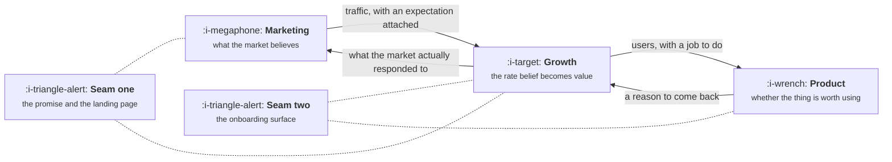

# Growth, Marketing and Product

```text
Level: Foundations
Prerequisites: What a Growth Team Actually Does
Estimated difficulty: 2/5 | Estimated time: 30 min
```

## The idea in one minute

The three functions are not divided by activity, and every famous turf war comes from trying.
Asking who owns email, the pricing page or the onboarding screen produces an argument with no
correct answer, because all three functions have a legitimate interest in each. They divide
cleanly by accountability instead: marketing is accountable for what the market believes about
you, product for whether the thing is worth using, and growth for the rate at which belief becomes
use and use becomes value. Once the division is written that way, the contested surfaces stop
being contested, because a surface is not owned by whoever touches it but by whoever is answerable
for the number it moves.

## A picture



The loop runs in both directions, which is the part org charts leave out: growth is the function
that tells marketing what the market actually responded to, as opposed to what it clicked on.

## How it really works

### Divide by accountability, not by activity

| Function | Accountable for | Judged on | Time horizon |
|---|---|---|---|
| Marketing | What the market believes about you | Qualified demand, and whether the belief is accurate | Quarters to years |
| Product | Whether the thing is worth using | Whether people who understand it keep choosing it | Quarters |
| Growth | The rate at which belief becomes use, and use becomes value | Conversion, activation, retention and expansion rates | Weeks to a quarter |

Read the time horizon column, because it explains most of the friction. Growth operates on a
cadence an order of magnitude faster than the other two, which is why its proposals keep arriving
mid quarter for surfaces somebody else has already planned. That is not rudeness, it is the
function working as designed, and an organisation that treats every such proposal as a planning
violation has converted its fastest learning loop into its slowest.

### Seam one: the promise and the landing page

Marketing is rewarded for demand. Growth is rewarded for what that demand becomes. When the two
are measured separately, the organisation reliably buys traffic that signs up and does not stay,
because the person buying it is being graded before the point at which the problem appears.

This is the single most expensive seam in the company and it is almost never a disagreement about
facts. Both sides are reading the same dashboard and answering different questions correctly. The
program below is that argument with numbers in it, and the reversal it produces is the normal case
rather than a constructed one.

The fix is not a meeting. It is an objective: the shared number is cost per activated user, or
cost per paying user if your cycle is short enough to measure it, and it is owned jointly. Any
objective measured before activation will buy traffic that does not activate, no matter who is
holding it.

### Seam two: the onboarding surface

Product owns the onboarding flow because it is product. Growth wants to change it weekly because
it is where the activation rate lives. Both of those sentences are true, and the argument they
produce has a shape worth recognising, because it repeats.

Growth proposes the smallest intervention that carries its hypothesis. Product sees a change that
hard codes an assumption, bypasses the design system and will have to be unpicked later. Both are
right: the smallest intervention that could work is usually, from the perspective of the people
who maintain the surface, a mess.

Three arrangements resolve it, in descending order of how well they work.

1. **Growth gets its own surfaces.** Agreed areas where growth may ship without review, typically
   the empty state, the upgrade prompt, the paywall copy, the lifecycle messages and anything
   behind a flag at under ten percent of traffic. Everything else goes through the owning team.
2. **Growth ships behind a flag and product owns the cleanup.** Winners get rebuilt properly by
   the owning team within an agreed window. This works when the window is real and fails quietly
   when it is not, leaving a layer of permanent temporary code.
3. **Growth proposes and product builds.** The safest and the slowest. It lowers experiment
   velocity to the owning team's planning cadence, which usually means a quarter, and at that
   speed the function cannot pay for itself.

### The seams nobody names

Two more exist and they fail silently rather than loudly, which is why they do more damage.

**Growth and the data team.** Growth needs event schema changes constantly, and the data team's
job is to keep the schema stable. If growth can add events without review the warehouse rots; if
it cannot add events at all the function stops. The workable rule is that growth owns the tracking
plan and the data team owns the pipeline, with a published turnaround time for new events that
both sides are measured against.

**Growth and support.** Support sees the activation failures first, in words, weeks before they
appear as a rate change. Most companies route none of that to growth, then reconstruct the same
finding from session replay three months later at considerably greater expense.

### What fills the box in 2026

Nothing in this lesson is a tooling problem, which is worth saying plainly because it is usually
treated as one. Shared dashboards in Amplitude, Mixpanel or a warehouse make the seam visible; they
do not resolve it, because the seam is an objective problem rather than a visibility problem. Two
teams looking at the same chart and being paid for different columns of it is the actual
condition, and the only fix is in the compensation and the goal, not in the chart.

## Run the numbers

Three channels, the same budget on each. Marketing is graded on cost per signup and growth on what
those signups become.

```go
// seam.go: the landing page argument, settled with arithmetic.
package main

import "fmt"

type channel struct {
	name    string
	spend   float64
	clicks  float64
	signup  float64 // clicks that sign up
	activ   float64 // signups that reach first value
	convert float64 // activated users that go on to pay
}

func (c channel) signups() float64 { return c.clicks * c.signup }
func (c channel) payers() float64  { return c.signups() * c.activ * c.convert }

func main() {
	chans := []channel{
		{"broad paid social", 40_000, 200_000, 0.060, 0.22, 0.09},
		{"brand search", 40_000, 25_000, 0.180, 0.55, 0.21},
		{"comparison content", 40_000, 60_000, 0.035, 0.61, 0.26},
	}

	fmt.Printf("%-20s %9s %8s %7s %9s %11s %11s\n",
		"channel", "signups", "activ", "payers", "cost/sign", "cost/payer", "ratio")
	cheapSign, cheapSignName := 1e18, ""
	cheapPay, cheapPayName := 1e18, ""
	for _, c := range chans {
		cps, cpp := c.spend/c.signups(), c.spend/c.payers()
		fmt.Printf("%-20s %9.0f %7.0f%% %7.0f %9.2f %11.2f %10.1fx\n",
			c.name, c.signups(), 100*c.activ, c.payers(), cps, cpp, cpp/cps)
		if cps < cheapSign {
			cheapSign, cheapSignName = cps, c.name
		}
		if cpp < cheapPay {
			cheapPay, cheapPayName = cpp, c.name
		}
	}

	fmt.Printf("\ncheapest signups:  %-20s at %.2f each\n", cheapSignName, cheapSign)
	fmt.Printf("cheapest payers:   %-20s at %.2f each\n", cheapPayName, cheapPay)
	fmt.Println("\nSame spend, same dashboard, opposite recommendation.")
	fmt.Println("The seam is not a disagreement about facts. It is two correct answers")
	fmt.Println("to two different questions, and nobody wrote down which one was being asked.")
}
```

Broad paid social wins the marketing scorecard outright. It produces 12,000 signups at 3.33 each,
nearly three times the volume of brand search at well under half the price, and on a cost per
signup dashboard it is not close.

It is also the worst channel in the table. Those signups activate at 22 percent and the channel
ends up buying paying users at 168.35 each, against 76.96 for brand search, which produced 2.7
times fewer signups and 2.2 times more payers with the same money.

The ratio column is the one to internalise. It is the multiple between what a signup costs and
what a payer costs, and it is 50.5 for broad paid social against 6.3 for comparison content. That
multiple is a direct measure of how much the traffic misunderstood what it was signing up for, and
it is invisible at the top of the funnel where the buying decision is actually made. Change the
numbers to your own and the shape usually survives: the cheapest traffic is cheap because of who
it is, and who it is determines everything downstream of the click.

## The AI layer

A model collapses the cost of producing landing pages, ad variants and lifecycle copy to roughly
nothing. A hundred page variants at about a thousand output tokens each is a hundred thousand
output tokens, which at the fifteen dollars per million that frontier models cost in late 2026 is
about a dollar fifty. The constraint on variant production has genuinely gone, and that is a real
change in what this seam can do: a team can now test the promise itself rather than the wording of
it.

The failure mode is seam one made industrial. Generated copy is optimised against the signal it is
given, and the signal available at generation time is almost always the click. A model will
reliably find language that raises signups by overstating the product, because that language is
abundant in its training data and it works on the metric it was handed. You can now do the wrong
thing a hundred times a week for a dollar fifty.

Two protections. Generate against the downstream objective, meaning activation or payment, which
usually means waiting longer before declaring a variant a winner and accepting fewer conclusive
results. And keep a claims list that no variant may exceed, checked mechanically rather than by
review, because at a hundred variants a week nobody is reading them all.

The thing a model does not change is which number the two teams are paid on. That is the whole
lesson, and it is an organisational fact rather than a technical one.

## Sector lens

| Sector | What changes about the boundary |
|---|---|
| [Enterprise B2B SaaS](../../product-management/product-by-sector/01-enterprise-b2b-saas.md) | A fourth function sits in the loop: sales owns the late funnel, so seam one is marketing to sales and growth is adjudicating between them on data neither trusts |
| [Fintech](../../product-management/product-by-sector/02-fintech.md) | Compliance review sits across both seams, and approved copy is an asset with a change cost. Variant volume stops being free |
| [Ecommerce and D2C](../../product-management/product-by-sector/03-ecommerce-and-d2c.md) | The cycle is short enough that cost per paying customer is measurable the same week, so seam one is the easiest to close here and is still usually open |
| [Marketplaces](../../product-management/product-by-sector/04-marketplaces.md) | Two markets means two marketing functions and one growth team holding the balance between them. The shared objective has to be liquidity, not signups on either side |
| [Devtools and Infra](../../product-management/product-by-sector/05-devtools-and-infrastructure.md) | Developer relations occupies the whole of seam one, and overstated copy is punished publicly and permanently. The claims list is the most important artifact in this lesson |
| [Healthtech](../../product-management/product-by-sector/06-healthtech-and-regulated-care.md) | Claims are regulated, so the claims list is a legal document and generated copy needs a named human approver before it ships |
| [Vertical SaaS](../../product-management/product-by-sector/07-vertical-saas.md) | The market is small enough that marketing and growth are often one person, and the seam moves inside their own week rather than between teams |

## Remember this

* Divide the three functions by accountability, never by activity. Who owns email is a question
  with no answer.
* Marketing owns belief, product owns worth, growth owns the rate between them.
* Growth runs an order of magnitude faster than the other two, and most friction is that fact
  rather than anybody behaving badly.
* Seam one is settled by a shared objective measured after activation. Nothing measured before it
  will do.
* Seam two is settled by naming the surfaces growth may ship on without review.
* The ratio between cost per signup and cost per payer measures how badly the traffic
  misunderstood the promise.

## Try it

1. Run `seam.go`, then raise broad paid social's activation rate from 22 percent to 40 percent and
   rerun. How much of the gap closes, and what does that tell you about whether the problem is the
   channel or the landing page?
2. Write your own version of the accountability table with real names in it. Give a copy to one
   person in each function and compare what comes back. Disagreement on a row is a seam you are
   currently paying for.
3. List the five surfaces your growth team would most like to change weekly. For each, name the
   owning team and which of the three arrangements currently applies. If the answer is the third
   for all five, estimate your experiment velocity in tests per quarter.

## Check yourself

1. Why does "who owns the pricing page" have no correct answer, and what is the question that does?
2. Marketing hits its cost per signup target for three quarters running while activation falls
   every quarter. Nobody is behaving badly. What exactly is wrong, and who can fix it?
3. Your company picks arrangement two, growth ships behind a flag and product cleans up the
   winners. What has to be true about the cleanup window for this not to become arrangement one by
   accident, with worse code?
