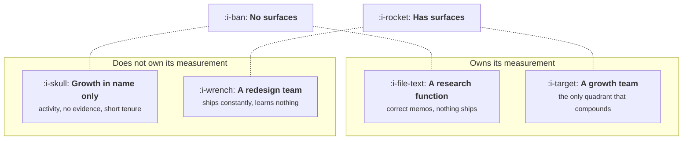

# Where Growth Sits

```text
Level: Foundations
Prerequisites: What a Growth Team Actually Does
Estimated difficulty: 2/5 | Estimated time: 30 min
```

## The idea in one minute

The reporting line is the question everyone asks and very nearly the least important one. Two
other things decide whether a growth team works: whether it owns its own measurement, and whether
it has surfaces it is allowed to ship on without asking. A team with both compounds regardless of
who it reports to. A team with measurement and no surfaces becomes a research function that
produces correct memos nobody acts on, and a team with surfaces and no measurement becomes a
redesign team that ships constantly and learns nothing. There is also a hard floor underneath all
of it: below a certain traffic volume no arrangement can prove anything, and the right answer is
not a growth team at all.

## A picture



The reporting line appears nowhere on this chart. That is the argument: an organisation can put
growth anywhere it likes as long as the arrangement lands the team in the top right, and no
reporting line rescues a team that lands anywhere else.

## How it really works

### The four arrangements

| Arrangement | What it reliably produces | What it reliably fails at | Right when |
|---|---|---|---|
| **Standalone team** with its own engineers and designers | Velocity, and cross funnel work nobody else will do | Getting access to surfaces other teams own, and trust in its numbers during year one | You have the traffic, and a funnel wide problem nobody owns |
| **Embedded** growth people inside each product team | Deep surface access and no permission problem | The loops. Nobody owns the whole funnel, so cross surface work never happens | The product is one surface, or the company is small |
| **A pod that borrows** engineers per project | Flexibility, and a low standing cost | Continuity. Instrumentation decays between projects because nobody maintains it | You are testing whether the function is worth staffing |
| **Nobody**, split across product and marketing | Nothing, slowly, while everybody believes somebody else is doing it | Everything, including noticing that it is failing | Never, although it is the most common arrangement |

The fourth row is not a joke. Distributed growth is the default state of most companies, and its
distinguishing feature is that the failure is invisible: every individual team is working on
something reasonable, the rates between their surfaces belong to nobody, and no single person can
see the whole number getting worse.

### The two things that actually decide it

**Measurement ownership** means the team defines the events, maintains the tracking plan, and is
the authority on what a rate means. Delegate this and every result becomes negotiable, because
somebody else can always redefine the denominator after the fact. This is the axis that produces
the bottom half of the chart, and the bottom half is where growth teams go to die.

**Surface access** means an agreed list of places the team may change without review. Not all
places; an agreed list, written down, typically the empty state, the upgrade prompt, lifecycle
messages, the paywall copy, and anything behind a flag below some traffic share. Without a list
the team negotiates every change individually, which costs more than the change and sets velocity
to the slowest partner's planning cadence.

Both are decisions somebody has to make explicitly. Neither arrives with a reporting line.

### What the reporting line does change

It changes which failure you get, which is worth knowing in advance.

* **To the CEO or founder.** Maximum surface access, minimum patience. The team gets what it asks
  for and has roughly two quarters to produce something believable before the access quietly
  returns to the teams it came from.
* **To the product leader.** The most workable default. Surfaces are negotiable inside one
  function, and the cost is that growth competes with the roadmap for the same engineers, which it
  loses whenever the roadmap is behind.
* **To the marketing or revenue leader.** Budget is easy and product surfaces are hard, which is
  the exact opposite of what the function needs. This is the most common arrangement and it
  produces the top left quadrant: a team that measures well, writes good memos, and ships only on
  the pages marketing already owned.
* **To engineering or data.** Instrumentation gets built properly and the demand side disappears
  from the team's view. Rare, and it fails late rather than early, which makes it expensive.

### The floor underneath all of it

None of this matters if the team cannot reach a conclusive result. Job three is proving the change
was real, and proof needs volume: the program below computes how long a test takes at a given
traffic level, and the answer at the low end is measured in quarters.

At three conclusive tests a year, a standalone experimentation team is not a sensible way to spend
money. That is not an argument against growth work at low volume, it is an argument against this
shape of growth work. Below the floor the function still exists and changes method: qualitative
research, holdouts and before and after comparisons rather than tests, fewer and larger changes,
and growth people embedded in product rather than a team of their own. The statistics behind the
threshold belong to
[A/B Testing and When It Lies](../../product-management/funnel-retention-and-experiments/README.md);
what belongs here is the organisational consequence, which is that traffic volume is an input to
the org chart and almost nobody treats it as one.

### What fills the box in 2026

A functioning standalone team is usually a growth product manager, two to four engineers who are
comfortable across the stack, a designer at half time or better, and an analyst or a growth
engineer who owns the tracking plan. The last of those is the role companies cut first and should
cut last, because it is the one that holds the measurement axis of the chart above.

The growth engineer title has stabilised to mean a full stack engineer who also owns
instrumentation, the experiment platform wiring and the data flowing out of it. A team without
that person has a tracking plan maintained by nobody, and the bottom half of the chart is where it
ends up within about a year.

## Run the numbers

Whether an arrangement is viable depends on how long a conclusive test takes, and that is
arithmetic rather than opinion.

```go
// viable.go: how much traffic an arrangement needs before a growth team can prove anything.
package main

import "fmt"

// Sample size per variant for a two sided test at 95% confidence and 80% power,
// using the standard normal approximation n = 16 p(1-p) / d^2. The statistics
// themselves belong to the product course; what matters here is the week count.
func perVariant(p, relLift float64) float64 {
	d := p * relLift
	return 16 * p * (1 - p) / (d * d)
}

func main() {
	const baseline = 0.10 // the rate being tested
	traffic := []struct {
		name    string
		perWeek float64
	}{
		{"vertical SaaS", 2_000},
		{"early B2B", 8_000},
		{"growing B2C", 40_000},
		{"consumer scale", 400_000},
	}
	lifts := []float64{0.05, 0.10, 0.20}

	fmt.Printf("baseline rate %.0f%%, two variants, 95%% confidence, 80%% power\n\n", 100*baseline)
	fmt.Printf("%-16s %10s", "traffic", "per week")
	for _, l := range lifts {
		fmt.Printf("%14s", fmt.Sprintf("%.0f%% lift", 100*l))
	}
	fmt.Println()

	for _, t := range traffic {
		fmt.Printf("%-16s %10.0f", t.name, t.perWeek)
		for _, l := range lifts {
			weeks := 2 * perVariant(baseline, l) / t.perWeek
			if weeks > 52 {
				fmt.Printf("%14s", "never")
				continue
			}
			fmt.Printf("%13.1fw", weeks)
		}
		fmt.Println()
	}

	fmt.Println("\nconclusive tests a year, allowing one week of setup each:")
	for _, t := range traffic {
		weeks := 2*perVariant(baseline, 0.10)/t.perWeek + 1
		fmt.Printf("  %-16s %5.1f  at a 10%% minimum detectable lift\n", t.name, 50/weeks)
	}
}
```

The first row is the one that should change an org decision. At two thousand relevant visitors a
week, a five percent improvement is not detectable inside a year at all, a ten percent improvement
takes 14.4 weeks, and the team gets 3.2 conclusive tests a year. Three tests a year is not a
testing function. Hire for research and judgement there, and spend the money on fewer, larger,
better argued changes.

The jump from early B2B to growing B2C is the other thing to notice: five times the traffic buys
2.7 times the tests, from 10.9 a year to 29.1, and the final row shows the ceiling. At consumer
scale the limit is 46.6 tests against a theoretical 50, which means traffic has stopped being the
constraint entirely and the constraint is now the one week of setup. Every arrangement question at
that end of the table is really a question about how fast the team can design and ship, not about
how fast the data arrives.

## The AI layer

A model lowers the cost of two things that this lesson treats as expensive, and the second one
genuinely changes an arrangement decision.

The cheap one is analysis. Drafting the readout, summarising a week of experiment results, turning
a messy set of events into a first explanation: cents per document, and worth doing. It does not
change the chart.

The one that matters is that a model makes the bottom left quadrant survivable for longer, which
is bad. Generated dashboards, generated explanations and generated weekly summaries all produce
confident narrative on top of instrumentation nobody is maintaining, and narrative is exactly what
the bottom half of the chart was previously short of. A team that would have been visibly failing
at month four now reads well at month twelve. The protection is unglamorous and mechanical: a
monthly check that each event in the tracking plan actually fired, with volumes compared against
the previous month, run by a person who is paid to find breakage rather than to summarise it.

It changes nothing about surface access, which is a permission question, and nothing about the
traffic floor, which is arithmetic.

## Sector lens

| Sector | What changes about where it sits |
|---|---|
| [Enterprise B2B SaaS](../../product-management/product-by-sector/01-enterprise-b2b-saas.md) | Traffic is usually below the floor, so the standalone testing team is the wrong shape. Growth sits closer to revenue operations and works on account level evidence |
| [Fintech](../../product-management/product-by-sector/02-fintech.md) | The surface list needs a compliance signatory on it, so write it once formally rather than renegotiating per change |
| [Ecommerce and D2C](../../product-management/product-by-sector/03-ecommerce-and-d2c.md) | Comfortably above the floor, so standalone works and the real fight is surface access to the checkout, which no one gives up willingly |
| [Marketplaces](../../product-management/product-by-sector/04-marketplaces.md) | Two sides means two surface lists, and a team that sits under one side's leader will optimise that side at the other's expense |
| [Devtools and Infra](../../product-management/product-by-sector/05-devtools-and-infrastructure.md) | Measurement ownership is partly outside your control because users block analytics, so weight the arrangement towards surface access instead |
| [Healthtech](../../product-management/product-by-sector/06-healthtech-and-regulated-care.md) | Clinical surfaces are not available at any reporting line. The real surface list is short, and the arrangement should be built around the short list rather than against it |
| [Vertical SaaS](../../product-management/product-by-sector/07-vertical-saas.md) | Below the floor almost always. Embed growth in product and judge it on research and shipped changes rather than on test counts |

## Remember this

* Two axes decide it: measurement ownership and surface access. The reporting line decides which
  failure you get, not whether you fail.
* Measurement and no surfaces makes a research function. Surfaces and no measurement makes a
  redesign team. Neither compounds.
* Reporting into marketing or revenue is the most common arrangement and the one most likely to
  strand the team without product surfaces.
* The surface list must be written down. Negotiating each change individually sets your velocity
  to your slowest partner's planning cadence.
* Below roughly three conclusive tests a year, do not build a testing function. Change the method
  instead of hiring for the old one.
* The person who owns the tracking plan is the one to cut last.

## Try it

1. Run `viable.go` with your own weekly traffic on the rate you most want to improve. If the ten
   percent column exceeds about six weeks, write down what your growth process should be instead,
   before anyone proposes a test backlog.
2. Place your own company on the two by two. For the measurement axis, ask who can change the
   definition of your activation rate without telling you. For the surface axis, produce the
   written list. If no list exists, you are on the left.
3. Ask three people in different functions who owns the rate between signup and first value. Three
   different answers means you are in the fourth arrangement, whatever the org chart says.

## Check yourself

1. A growth team reports directly to the CEO, has all the access it asks for, and cannot get
   anyone to accept its activation numbers. Which quadrant is it in, and which of the two axes is
   the problem?
2. Your traffic supports three conclusive tests a year. Name two methods for job three that do not
   require reaching statistical power, and say what each one gives up.
3. Why does a model make the bottom left quadrant more dangerous rather than less, and what is the
   specific check that catches it?
