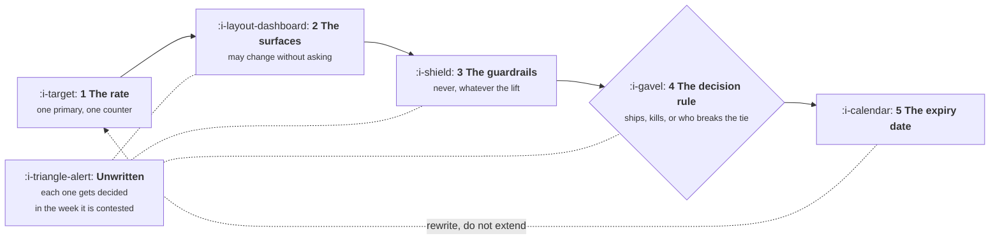

# The Growth Charter

```text
Level: Foundations
Prerequisites: Where Growth Sits
Estimated difficulty: 2/5 | Estimated time: 35 min
```

## The idea in one minute

A growth charter is not a mission statement, and the ones that read like mission statements are
the ones that fail. It is a permissions document, written before the first argument rather than
during it, and it has exactly five sections: the one rate the team owns this quarter, the surfaces
it may change without asking, the guardrails it may never cross whatever the lift, the rule that
decides what ships, and the date the whole thing expires. Everything else in a charter template is
decoration. The point of writing it early is that each of those five decisions is easy to make in
a calm week and nearly impossible to make in the week somebody is holding a result they like.

## A picture



The five sections are in dependency order: you cannot write the surface list until you know the
rate, and the decision rule is meaningless without the guardrails. The dotted node is what each
section becomes if you skip it.

## How it really works

### Section one: the rate, singular

One primary rate per quarter, with a number attached, and one counter metric that would reveal the
cheapest way of gaming it. Not three rates. A team with three primary rates has no primary rate,
because the first time two of them point in different directions the team will pick whichever one
it is currently winning on.

The counter metric is the non negotiable half. Every rate has a degenerate solution: activation
rate rises if you redefine activation downwards, trial conversion rises if you make the trial
worse, signup rate rises if you remove the pricing information. Naming the counter metric in the
charter costs one line and removes a whole class of argument later.

### Section two: the surfaces

A written list of places the team may change without review, and by implication everything absent
from the list requires the owning team's consent. Write both halves, because a list of permissions
with no stated boundary gets read as a claim on everything adjacent.

A workable starting list looks like this, and the right version is specific to your product rather
than copied.

* The empty state and the first run experience.
* Upgrade prompts, paywall copy and the pricing page below the fold.
* Lifecycle messages, within the frequency cap in section three.
* Any change behind a flag at or below ten percent of traffic, for a stated maximum duration.
* Not: the checkout, the permissions model, anything a regulator reads, anything on the critical
  path of the core job the product does.

### Section three: the guardrails

A guardrail is a number that can veto a win. It exists because conversion is cheap to buy with
something you are not measuring, and the something is usually support load, refunds, trust or
performance.

Guardrails come in two kinds and the charter should separate them.

**Absolute prohibitions** apply whatever the lift, and they are short: no claim the product cannot
support, no consent pattern designed to be misread, no cancellation flow that takes more steps
than the signup did, no messaging outside the frequency cap, no change that degrades the critical
path beyond a stated budget.

**Numeric thresholds** are the ones with arithmetic underneath, and this is where most charters go
vague. "Do not harm support load" is not a threshold. The program below computes the actual
movement in each guardrail that would exactly cancel a given win, which turns the threshold into a
number you can write down and then measure against.

### Section four: the decision rule

Three outcomes, agreed in advance: at what result does it ship, at what result is it killed, and
who breaks a tie. The third is the one to get in writing, because the tie is the common case and
the person who breaks it is almost never the person everybody assumed.

A flat result is the case to think hardest about, because it is the most frequent single outcome
and the rule for it is less obvious than it looks. The useful default is that a flat result ships
only if it is cheaper to maintain than what it replaces, and is otherwise reverted. Teams that
ship flat results by default accumulate complexity at a constant rate with no measured benefit,
and three years later nobody can explain why the onboarding has eleven steps.

### Section five: the expiry date

One quarter, or two at the outside. Then rewrite it rather than extend it, because the rate you
should own changes when the constraint moves and the surface list changes as trust accumulates.

A charter with no expiry becomes a claim rather than an agreement. The teams that granted the
surfaces stop remembering that they granted them, and the first time somebody new arrives in one
of those teams the whole thing is renegotiated from zero under pressure.

### What a charter is not

| Not this | Why the difference matters |
|---|---|
| A mission statement | "We drive sustainable growth" grants no permission and resolves no argument. It cannot be violated, which means it cannot be used |
| A set of objectives | Objectives say what you are aiming at. A charter says what you may touch to get there, which is the part that gets contested |
| A roadmap | A roadmap commits to specific changes. A charter deliberately does not, because the whole function depends on changing its mind weekly |
| A permanent document | See section five. The value is in the rewrite |

### What fills the box in 2026

This is a one page document in whatever the company already writes in, and the tooling question is
genuinely irrelevant. What is not irrelevant is where it lives: it needs to be findable by somebody
who was not in the conversation, which in practice means linked from the team's channel topic and
from the experiment template, not filed in a folder. The most common failure of a good charter is
that the people it was written to persuade have never read it.

## Run the numbers

Section three asks for numeric thresholds. This computes them: for a given win, how far can each
guardrail move before the win is entirely cancelled.

```go
// guardrail.go: the movement in each guardrail that exactly cancels a win.
package main

import "fmt"

type guardrail struct {
	name string
	unit string
	cost float64 // cost of one bad unit, in pounds
	base float64 // where the guardrail sits today
}

func main() {
	const (
		visitors   = 100_000.0
		conversion = 0.10
		lift       = 0.08  // the relative conversion lift the experiment produced
		grossYear  = 240.0 // annual gross profit per customer
	)

	before := visitors * conversion
	after := before * (1 + lift)
	won := (after - before) * grossYear

	fmt.Printf("a %.0f%% conversion lift turns %.0f customers into %.0f,\n", 100*lift, before, after)
	fmt.Printf("worth %.0f a year in gross profit\n\n", won)

	rails := []guardrail{
		{"support contacts", "per customer", 12, 0.400},
		{"refunds", "rate", grossYear, 0.030},
		{"first year churn", "rate", grossYear * 0.5, 0.250},
	}

	fmt.Printf("%-18s %-14s %8s %12s %14s\n",
		"guardrail", "measured as", "today", "cancels at", "charter line")
	for _, g := range rails {
		gap := won / (g.cost * after)
		fmt.Printf("%-18s %-14s %8.3f %12.3f %14.3f\n",
			g.name, g.unit, g.base, g.base+gap, g.base+gap/2)
	}

	fmt.Println("\nThe charter line sits halfway to break even, because the guardrail is")
	fmt.Println("measured with error and a win that only just survives is not a win.")
}
```

The refund row is the one worth sitting with. An eight percent conversion lift, worth 192,000 a
year, is cancelled in full if refunds rise from 3 percent to 10.4 percent. That is not an exotic
amount of damage. It is the ordinary consequence of converting people who were not ready, and it
is entirely invisible on the dashboard the experiment was judged on, because refunds arrive weeks
after the result is declared.

Support contacts look more forgiving, with break even at 1.881 contacts per customer against 0.4
today, and that reflects a real asymmetry: at 12 per contact, support is a cheap way to absorb
confusion compared with losing the customer. Churn sits in between, and the 0.5 multiplier on its
cost is the single most arguable input in the program, because it encodes how much of a first year
customer's value you lose when they leave early. Change that one number and the churn line moves
more than anything else in the table.

The charter line column is the number to actually write down. It sits halfway between today and
break even, for a reason worth stating explicitly: a guardrail measured on the same traffic as the
experiment has error bars of its own, so a win that survives by a hair has not survived. Half the
distance is a convention rather than a derivation, and any team that prefers a third of the
distance should say so in the charter and move on.

## The AI layer

The charter is where a model stops being free. Sections two and three were written for a world in
which producing a change was the expensive step, and once copy, variants and even small flows can
be generated in minutes, two of the five sections need extra lines.

**The surface list needs a volume clause.** "May change lifecycle messages" was a reasonable grant
when writing one took an afternoon. The same grant now permits a few hundred generated variants a
week at well under a dollar of inference each, which is a different thing from what was agreed. The
fix is a rate limit in the charter: how many live variants, on how much traffic, for how long.

**The prohibitions need to be machine checkable.** An absolute prohibition that depends on a person
reading every variant is not a prohibition once nobody can read them all. This means the claims
list from the previous lesson becomes an actual artifact: a list of statements the product can
support, checked automatically against generated copy before it goes live, with a cost of about a
cent per variant to run a second model over the first one's output. That check will miss things. It
will also catch the overstated claim that a hundred variant test will otherwise ship on a Thursday
because it converted.

The failure mode to name in the charter is specific. A model optimising copy against a conversion
signal reliably discovers overstatement, because overstatement works on that signal and the cost
lands in the guardrails weeks later. The arithmetic above is the argument for taking it seriously:
the refund row shows a win disappearing entirely on a movement most teams would not bother to
report.

## Sector lens

| Sector | What changes about the charter |
|---|---|
| [Enterprise B2B SaaS](../../product-management/product-by-sector/01-enterprise-b2b-saas.md) | Section one cannot be a revenue rate, because the buyer is not the user. Own a qualified pipeline rate and name the sales handover as the counter metric |
| [Fintech](../../product-management/product-by-sector/02-fintech.md) | Section three is partly written by regulation rather than by you, and the prohibitions have a signatory. Expect the surface list to exclude the whole of onboarding |
| [Ecommerce and D2C](../../product-management/product-by-sector/03-ecommerce-and-d2c.md) | Refunds and returns are the live guardrail and they resolve fast enough to measure properly. Put the return rate threshold in writing, with the arithmetic |
| [Marketplaces](../../product-management/product-by-sector/04-marketplaces.md) | Section one needs a rate on each side plus a balance condition, because a win on supply that breaks demand passes every single sided guardrail |
| [Devtools and Infra](../../product-management/product-by-sector/05-devtools-and-infrastructure.md) | Performance belongs in the prohibitions with a hard budget, and the claims list is the most consequential page in the document because your users will test every claim |
| [Healthtech](../../product-management/product-by-sector/06-healthtech-and-regulated-care.md) | Clinical safety sits above the decision rule entirely: some results do not ship whatever they say, and the charter has to name who holds that veto |
| [Vertical SaaS](../../product-management/product-by-sector/07-vertical-saas.md) | Low traffic means the decision rule cannot rest on tests. Write what evidence does count, or the rule will be decided by whoever is most senior in the room |

## Remember this

* Five sections: the rate, the surfaces, the guardrails, the decision rule, the expiry date.
  Anything else is decoration.
* One primary rate, with one counter metric that blocks the degenerate solution.
* Write both halves of the surface list, what is granted and what is not.
* A guardrail without a number is not a guardrail. Compute the movement that cancels the win, then
  set the line at half of it.
* Agree the flat result rule in advance, and default to reverting, or complexity accumulates with
  no measured benefit.
* Charters expire. Rewrite rather than extend, because an unrenewed charter becomes a claim
  somebody will dispute at the worst moment.

## Try it

1. Run `guardrail.go` with your own gross profit per customer and your own guardrail costs. The
   churn cost multiplier is the most arguable input, so run it at 0.3 and at 0.7 and see which
   thresholds you would actually be willing to sign.
2. Write section two for your team in one sitting, both halves. Then show it to the team that owns
   the largest surface on the granted list. Their reaction is the real information.
3. Find a win your company shipped in the last year. Work out which guardrails were not measured
   at the time, and whether the movement that would have cancelled it was inside the range nobody
   was watching.

## Check yourself

1. Why does a charter with three primary rates behave, in practice, as if it had none?
2. An activation experiment wins by 6 percent and support contacts rise by 0.9 per customer. Using
   the method in the program rather than its specific numbers, what do you need to know to decide,
   and which single input will the argument actually turn on?
3. Your charter says the team may change lifecycle messages. A model now produces two hundred
   variants a week. Which two sections need a new line, and what does each line have to constrain?
