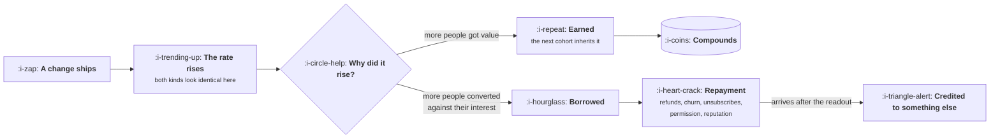

# What Growth Is Not

```text
Level: Foundations
Prerequisites: The Growth Charter
Estimated difficulty: 3/5 | Estimated time: 35 min
```

## The idea in one minute

Several of the practices the word growth attracts do not create growth. They borrow it from the
future, at an exchange rate nobody calculates, and the repayment arrives after the readout that
credited them. The test that separates the two is a single question: did the rate rise because
more people got value, or because more people were converted against their own interest?
Both answers look identical on the dashboard the week the change ships, which is exactly why the
distinction has to be made with arithmetic rather than with judgement. The useful version of this
lesson is not a moral position. It is that borrowed growth is usually a bad trade on its own
terms, and you can prove it before you make it.

## A picture



The two paths are indistinguishable at the only moment anyone is looking, and they diverge at a
point where the organisation has already moved on. Everything difficult about this lesson is that
timing.

## How it really works

### The term meant the opposite of what it now suggests

Sean Ellis coined growth hacker in a post published on 26 July 2010,
[Find a Growth Hacker for Your Startup](https://www.startup-marketing.com/where-are-all-the-growth-hackers/),
and it is worth reading because the original is almost the inverse of the connotation it picked
up. His definition is "a person whose true north is growth", and the post asks for discipline
above everything: a process of prioritising ideas, testing them, and being "analytical enough to
know which tested growth drivers to keep and which ones to cut". It also states plainly that the
role comes after product market fit and a working conversion process have been proven, not before.

Nothing in the source is about tricks. The drift from that to a genre of listicles happened
quickly, and it matters here only because it explains why the function so often has to argue for
rigour against people who think they hired the other thing.

### The four things that get borrowed

Each of these raises a real number. Each repays in a different currency and over a different
period, and the period is always longer than the review cycle that praised it.

| What is borrowed | How it is raised | What repays it | How long until it shows |
|---|---|---|---|
| Readiness | Pressure to convert before the value is understood | Refunds, early churn, support load | Weeks to one cycle |
| Attention | More messages, more notifications, more channels | Unsubscribes, muting, permission that never comes back | One to two quarters |
| Consent | Defaults and flows designed to be misread | Chargebacks, complaints, regulatory attention | Quarters, then all at once |
| Trust | Claims the product does not support | Reversal on first use, and public correction | Immediate, and permanent |

The second row is the one teams underrate, because the asset being spent does not appear on any
balance sheet. A person's willingness to hear from you is finite, non renewable in practice, and
spent at a rate you choose. The program below prices it.

### Three practices that are not what they claim

**Testing as an end in itself.** A team that reports the number of experiments it ran has
substituted an input for an outcome. Velocity matters enormously, and the next lesson is largely
about it, but velocity is valuable because it produces learning, and a test with no hypothesis
produces a number rather than learning. The tell is a backlog of ideas with no stated mechanism:
twelve button colours and no sentence beginning "we believe".

**Paid acquisition described as a loop.** Paid is a channel, and a good one. It is a loop only if
the customers it buys produce the money that buys the next ones, within a period you can finance.
Otherwise it is a drip: the number goes up while the money flows, and it stops the day the money
does. Calling it a loop is not a vocabulary error, it is a forecasting error, because the growth
model treats the two completely differently.

**Growth as the owner of a redesign.** The largest change is almost never the most informative
one, and a growth team that is given a redesign has been handed a project with a single
unattributable outcome. It will ship, something will move, and nobody will know which of the forty
changes did it. This is how the second quadrant from the previous lesson is entered with
everybody's best intentions.

### The honest version of the question

The useful framing is not ethics against growth. It is this: borrowed growth is a loan, and a loan
is fine if the rate is good and you have somewhere to put the money.

So the question to ask of any proposal is whether the thing being borrowed can be repaid. Readiness
can be: a customer converted slightly early may still get value and stay, and the cost is a known
refund rate you can price. Attention largely cannot be, because permission does not grow back on
the timescale of a business. Consent and trust cannot be repaid at all, which puts them in the
prohibitions section of the charter rather than in the arithmetic.

That gives a clean rule. **Price what can be repaid, prohibit what cannot.** A charter that treats
all four rows as a single ethical question will either prohibit too much and lose to a competitor
that does not, or prohibit nothing and discover the bottom row the hard way.

### What fills the box in 2026

The practices in this lesson have been commodified into features, which is new and worth naming.
Cancellation flow products, exit intent tools, consent management platforms and notification
engines all ship with defaults tuned for short term conversion, because that is what their own
case studies are measured on. The default configuration of a bought tool is a position on this
lesson that somebody else took on your behalf. Read it, and change it deliberately.

## Run the numbers

Two arms of the same product, and a mailing list at three send frequencies. Nothing here is a
moral argument; all of it is cumulative gross profit and list size.

```go
// borrowed.go: two ways a win repays itself, and when the repayment lands.
package main

import "fmt"

// arm is one version of the product: a conversion rate and the monthly
// retention of the customers that conversion rate produces.
type arm struct {
	name      string
	conv      float64
	retention float64
}

// cumulative gross profit after n months, one cohort arriving each month.
func cumulative(a arm, trials, margin float64, n int) float64 {
	total := 0.0
	for month := 1; month <= n; month++ {
		for age := 0; age < month; age++ {
			total += trials * a.conv * pow(a.retention, age) * margin
		}
	}
	return total
}

func pow(x float64, n int) float64 {
	out := 1.0
	for i := 0; i < n; i++ {
		out *= x
	}
	return out
}

func main() {
	const (
		trials = 10_000.0
		margin = 20.0 // gross profit per customer per month
	)
	base := arm{"unchanged", 0.100, 0.95}
	real := arm{"earned win", 0.104, 0.95}
	lent := arm{"borrowed win", 0.112, 0.89}

	fmt.Println("part one: conversion pressure against retention")
	fmt.Printf("%-16s %7s %10s", "arm", "conv", "retention")
	months := []int{1, 3, 6, 12, 24}
	for _, m := range months {
		fmt.Printf("%12s", fmt.Sprintf("m%d", m))
	}
	fmt.Println()
	for _, a := range []arm{base, real, lent} {
		fmt.Printf("%-16s %6.1f%% %9.2f", a.name, 100*a.conv, a.retention)
		for _, m := range months {
			fmt.Printf("%12.0f", cumulative(a, trials, margin, m))
		}
		fmt.Println()
	}
	for _, m := range months {
		if cumulative(lent, trials, margin, m) < cumulative(real, trials, margin, m) {
			fmt.Printf("\nthe borrowed win falls behind the earned one by month %d\n", m)
			break
		}
	}

	fmt.Println("\npart two: send frequency against permission")
	const (
		list        = 100_000.0
		joinPerWeek = 2_000.0
	)
	for _, sends := range []float64{1, 2, 4} {
		// unsubscribe rate rises faster than linearly with frequency
		unsub := 0.002 * sends * sends
		size := list
		for w := 1; w <= 52; w++ {
			size = size*(1-unsub) + joinPerWeek
		}
		fmt.Printf("  %.0f sends/week: unsub %.2f%%/wk, after a year %7.0f, settles at %9.0f\n",
			sends, 100*unsub, size, joinPerWeek/unsub)
	}
	fmt.Println("\nUnsubscribes rise with the square of frequency, so the audience you")
	fmt.Println("settle at falls with the square of it. Four sends a week buys four")
	fmt.Println("times the inboxes this week and one sixteenth of the list in the end.")
}
```

Part one is the whole lesson in one table. The borrowed win is the best arm in the first month,
at 22,400 against 20,800, and it is still winning at month three. It falls behind the earned win
by month six. By month twelve it has produced 1,202,975 against the earned win's 1,359,006, and
the number that should stop a meeting is in the row above it: at month twelve the borrowed win is
behind **doing nothing at all**, which stands at 1,306,737.

Three percentage points of extra conversion, paid for with six points of monthly retention, turns
out to be worse than shipping nothing. It takes half a year to find out, and by then the change
has been in the quarterly review as a win, the person who shipped it has moved on, and the
retention decline is being investigated as a separate problem by a different team. That sequence
is the normal one, not the cynical one.

Part two prices the thing most companies spend without recording. Because unsubscribes rise faster
than linearly with frequency, the audience you settle at falls with the square of it: one send a
week settles at a million addresses, four sends a week settles at 62,500. A year in, the four send
list has shrunk from 100,000 to 69,411 while the one send list has nearly doubled. The four send
team is hitting its monthly reach target every single month on the way down.

Both halves share a shape. The borrowed version wins the period it is measured in, and the
measurement period is shorter than the repayment period. That is not a coincidence or a
conspiracy. It is what makes the trade attractive in the first place.

## The AI layer

Everything above gets cheaper to do badly, which is the entire AI layer for this lesson.

The concrete change is in the attention row. Generating a personalised message costs well under a
cent at the frontier prices of late 2026, so the cost of a send has fallen to roughly the cost of
delivering it while the cost to the recipient has not moved at all. Every incentive in that
arithmetic points at more sends. The arithmetic in part two does not care how cheap the message
was to write: the unsubscribe rate is a function of how often you appear, and the audience you
settle at falls with the square of it.

There is a second effect that is specific to models and harder to see. A system optimising copy
against a conversion signal will find the borrowed win faster than a person would, because the
borrowed win is genuinely the local maximum on that signal. It is not making a mistake. It is
answering the question it was asked, at a scale where nobody is reading the individual answers.
If the objective you hand it ends at the conversion event, you have built a machine for
discovering pressure tactics and given it a budget.

Three protections, in order of how much they are worth. Optimise against a delayed objective even
though it costs you conclusive results. Put the prohibitions into a mechanical check rather than
a review step. And keep a holdout that never receives anything, permanently, because the only
reliable measure of what the whole machine is doing to your audience is a group it has never
touched.

## Sector lens

| Sector | What changes about the trade |
|---|---|
| [Enterprise B2B SaaS](../../product-management/product-by-sector/01-enterprise-b2b-saas.md) | Readiness is borrowed from a named person who will be in the renewal conversation. The repayment has a face and a contract date |
| [Fintech](../../product-management/product-by-sector/02-fintech.md) | Consent and trust are not priceable at all here. They sit with the regulator, and the repayment can exceed the lifetime value of the whole cohort |
| [Ecommerce and D2C](../../product-management/product-by-sector/03-ecommerce-and-d2c.md) | The repayment is fast and legible, in returns and chargebacks, which makes this the one sector where the arithmetic is routinely done |
| [Marketplaces](../../product-management/product-by-sector/04-marketplaces.md) | Borrowing from one side repays on the other, so the loan and the repayment appear in different teams' numbers and neither sees both |
| [Devtools and Infra](../../product-management/product-by-sector/05-devtools-and-infrastructure.md) | Trust is the whole asset and the repayment is public. One overstated claim is discussed in a thread that outranks your own documentation |
| [Healthtech](../../product-management/product-by-sector/06-healthtech-and-regulated-care.md) | Pressure to convert can harm a patient, so the entire top row moves from the priceable column to the prohibited one |
| [Vertical SaaS](../../product-management/product-by-sector/07-vertical-saas.md) | The market is small and people talk to each other. Reputation damage compounds in a way that a large anonymous market absorbs and a small one does not |

## Remember this

* The test is whether the rate rose because more people got value or because more people were
  converted against their interest. Both look the same on the day.
* Four things get borrowed: readiness, attention, consent and trust. Each repays in a different
  currency on a different schedule.
* Price what can be repaid, prohibit what cannot. Readiness is priceable. Consent and trust are
  not.
* A conversion win paid for with retention can end up behind shipping nothing, and it takes about
  two quarters to find out.
* Unsubscribes rise with the square of frequency, so your eventual audience falls with the square
  of it.
* A model handed an objective that ends at conversion will find the borrowed win faster than a
  person would, and it is not making a mistake.
* The original definition of the term was about discipline and came after product market fit, not
  before it.

## Try it

1. Run `borrowed.go` and reduce the borrowed arm's retention penalty from six points to two. Find
   the retention cost at which the trade becomes genuinely good, then ask whether anyone in your
   company could measure a difference that small.
2. Take your own message frequency and your own weekly joiners. Compute the audience you settle
   at. Compare it with the number in next year's plan.
3. Find a conversion win your company shipped more than six months ago. Pull the retention curve
   for the cohort it produced against the one before it. If nobody can produce that comparison,
   that is the finding.

## Check yourself

1. Why is "did it raise the rate" the wrong question, and what is the question that distinguishes
   the two cases?
2. Attention is described as non renewable while readiness is priceable. What exactly is the
   difference, and which section of the charter does each one belong in?
3. Your messaging platform ships with a recommended send frequency. Whose objective was that
   default tuned against, and what would you need to know to accept it?
