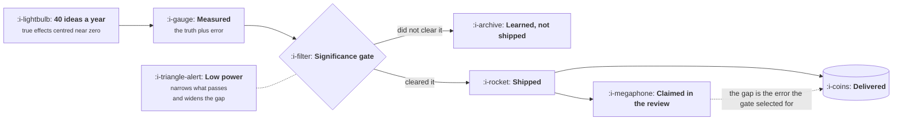

# What Good Looks Like

```text
Level: Foundations
Prerequisites: What Growth Is Not
Estimated difficulty: 3/5 | Estimated time: 40 min
```

## The idea in one minute

A growth team's output is a distribution, not a sequence of wins, and published experience is that
only about a third of well designed experiments improve the metric they targeted. That single fact
invalidates the three ways companies normally judge the function. Win rate selects for tests small
enough to be safe. Experiment count selects for tests trivial enough to be fast. The sum of
reported lifts selects for tests underpowered enough to exaggerate, which is the worst of the
three because it looks like rigour. What good looks like is three different things: the number of
conclusive decisions reached, the effect actually delivered as measured on a holdout nobody
touched, and whether the team's losses are believed by people who did not want to hear them.

## A picture



A gate that only lets through large measured effects preferentially lets through the ones whose
error happened to point upwards. Nobody is cheating anywhere on this diagram, and the gap between
claimed and delivered opens anyway.

## How it really works

### A third is the ceiling, not a failure

The most useful published number in this field comes from Microsoft's experimentation programme.
In *Online Experimentation at Microsoft*, Kohavi and colleagues report that of well designed and
executed experiments intended to improve a key metric, "only about one third were successful at
improving the key metric". A later summary of twelve years of testing puts it as roughly a third
positive and significant, a third flat, and a third significantly negative, and notes that at Bing
the success rate was lower still. The same figures appear in Kohavi, Tang and Xu, *Trustworthy
Online Controlled Experiments* (Cambridge University Press, 2020), which is the standard reference
for the whole subject.

That is not a story about Microsoft being bad at ideas. It is the base rate for serious attempts
at improving a mature product, and it has been reproduced across many companies. Any judgement of
a growth team that implicitly assumes a higher rate is asking for one of two things: smaller
ambitions, or dishonesty.

### The three wrong ways to judge the team

| Judged on | What it selects for | How it fails |
|---|---|---|
| Win rate | Tests small and safe enough to be near certain | The team stops attempting anything that could fail, which is the entire set of things worth attempting |
| Experiment count | Tests trivial enough to ship in a day | Activity rises, learning does not, and the backlog fills with ideas that have no stated mechanism |
| Sum of reported lifts | Tests underpowered enough to exaggerate | Looks the most rigorous of the three and is the most misleading. See the arithmetic below |

The third deserves the most attention because almost nobody suspects it. If you reward a team for
the total lift it reported last year, the most efficient response is not to lie. It is to run
smaller samples, which raises the measured effect of everything that passes the significance gate,
and produces an annual figure that is both larger and genuinely computed.

### Why the reported number is always too big

A test ships when the measured effect clears a threshold. The measured effect is the true effect
plus error. So among the tests that clear the threshold, the ones with upward error are
overrepresented, and the average true effect of your shipped winners is smaller than the average
measured effect of your shipped winners. This is selection, not bias in anyone's analysis, and it
happens in a perfectly run programme.

The size of the gap depends entirely on how well powered the tests were, and that relationship is
sharper than most people expect. The program below computes it.

### The three right ways

**Conclusive decisions per quarter.** Count the decisions, not the wins: a test that killed an
expensive idea counts the same as one that shipped a cheap improvement, because both removed
uncertainty. This is the one number that correlates with the team being worth its cost, and it is
the one that connects back to the traffic floor in
[Where Growth Sits](03-where-growth-sits.md): a team that cannot reach power cannot produce
conclusive decisions, and should be judged on something else entirely.

**Delivered effect, measured on a holdout.** The only honest answer to "what did the growth team
produce this year" comes from a group that received none of it. A permanent holdout of one to five
percent of users, excluded from every change the team ships, read once or twice a year. It costs
you the improvements that group does not get, and it is the only measurement in this lesson that
is not vulnerable to the selection effect above, because the holdout comparison is not conditional
on anything having passed a gate.

Most companies do not run one. The usual objection is the cost of withholding improvements from
the holdout, which is a coherent argument only if you already know the improvements are real,
which is the thing the holdout exists to establish.

**Whether the losses are believed.** This is qualitative and it is the best single indicator.
If the team reports a loss and the organisation accepts it without relitigating the method, the
measurement function is working. If losses trigger a search for what went wrong with the test
while wins are accepted unexamined, the team is doing advocacy and its wins are worth nothing
either. A growth team whose published results include a respectable number of losses, at roughly
the base rate above, is a team whose wins you can believe.

### What a good year leaves behind

Four artifacts, and a team that cannot produce them has had an eventful year rather than a good one.

* A charter rewritten at least twice, with the rate it owns having changed at least once.
* A count of conclusive decisions, including the killed ideas, with the expensive ones named.
* One holdout readout with a number in it, and the gap between that number and the sum of the
  year's claimed lifts stated plainly rather than explained away.
* A searchable archive of what was tested and what happened, including the flat results, which are
  the most reused and least recorded category in the entire function.

### What fills the box in 2026

Experiment tracking lives in Statsig, Optimizely, GrowthBook or a warehouse table, and for the
archive specifically a plain searchable document store beats all of them, because the thing you
need in two years is the hypothesis and the conclusion rather than the variant configuration.
Holdout management is the capability to check before buying anything in this category: a surprising
number of platforms make a permanent global holdout awkward, because their model assumes an
experiment is a short lived thing rather than a standing exclusion.

## Run the numbers

This simulates a year of experiments at four levels of statistical power, and compares what the
year reports against what it actually delivered.

```go
// curse.go: what a year of experiments claims, and what it delivers.
package main

import (
	"fmt"
	"math/rand"
)

// Published experience is that only about a third of well designed experiments
// improve the metric they targeted. True effects are therefore drawn centred on
// zero: most ideas do nothing much, a few help, a few hurt.
const (
	tests     = 40    // attempts in a year
	trueSD    = 0.015 // spread of real effects, 1.5 percentage points
	threshold = 1.96  // two sided, 95% confidence
	years     = 2000  // simulated years, so the answer is not one seed's luck
)

type result struct {
	shipped, claimed, delivered, harmful float64
}

// year runs one year of experiments at a given standard error.
func year(r *rand.Rand, stdErr float64) result {
	var out result
	for i := 0; i < tests; i++ {
		truth := r.NormFloat64() * trueSD
		measured := truth + r.NormFloat64()*stdErr
		if measured <= threshold*stdErr {
			continue // not significant, nothing ships
		}
		out.shipped++
		out.claimed += measured
		out.delivered += truth
		if truth < 0 {
			out.harmful++
		}
	}
	return out
}

func average(stdErr float64) result {
	r := rand.New(rand.NewSource(7))
	var sum result
	for y := 0; y < years; y++ {
		o := year(r, stdErr)
		sum.shipped += o.shipped
		sum.claimed += o.claimed
		sum.delivered += o.delivered
		sum.harmful += o.harmful
	}
	n := float64(years)
	return result{sum.shipped / n, sum.claimed / n, sum.delivered / n, sum.harmful / n}
}

func main() {
	fmt.Printf("%d experiments a year, effects spread %.1f%%, averaged over %d years\n\n",
		tests, 100*trueSD, years)

	fmt.Printf("%-12s %9s %9s %11s %11s %9s\n",
		"std error", "shipped", "win rate", "claimed", "delivered", "harmful")
	for _, se := range []float64{0.005, 0.010, 0.020, 0.030} {
		o := average(se)
		fmt.Printf("%11.1f%% %9.1f %8.0f%% %10.1f%% %10.1f%% %9.1f\n",
			100*se, o.shipped, 100*o.shipped/tests,
			100*o.claimed, 100*o.delivered, o.harmful)
	}

	well, poor := average(0.005), average(0.030)
	fmt.Printf("\nwell powered: %.0f%% of ideas win, and the year really delivers %.1f%%\n",
		100*well.shipped/tests, 100*well.delivered)
	fmt.Printf("underpowered: %.0f%% of ideas win, the year reports %.1f%% and delivers %.1f%%\n",
		100*poor.shipped/tests, 100*poor.claimed, 100*poor.delivered)
	fmt.Printf("\nthe underpowered team overstates by %.1fx and ships %.1f changes a year\n",
		poor.claimed/poor.delivered, poor.harmful)
	fmt.Println("that make the metric worse, each one recorded as a win.")
}
```

The top row is a healthy programme. At a half point standard error, 27 percent of ideas pass, which
is close to the published base rate, and the year delivers 18.7 percent against 20.7 percent
claimed. An overstatement of about a tenth is the irreducible cost of having a significance gate at
all, and it is not worth worrying about.

Now read down the claimed column against the delivered column. Claimed barely moves: 20.7, 15.8,
11.5, 11.2. Delivered collapses: 18.7, 11.0, 4.2, 2.3. The team at a three point standard error
reports a bit more than half what the well powered team reports, and delivers about an eighth of
it. On a slide, those two teams look comparable. One of them produced eight times the value.

This is the mechanism by which an organisation that rewards reported lift gets exactly what it
asked for. The underpowered team is not lying, its arithmetic is correct, and every individual
result would survive an audit. It is simply measuring with an instrument coarse enough that only
lucky noise clears the bar, and then adding up the luck at the end of the year.

Two secondary things in the table are worth noting. The shipped column shows that low power costs
you decisions as well as accuracy: 10.7 conclusive wins a year becomes 1.6, which is the
arithmetic behind the traffic floor in lesson 03 arriving from a different direction. And the
harmful column, while small at these parameters, is never zero: a programme running at low power
ships changes that make the metric worse, records each one as a win, and has no mechanism that
will ever find out.

## The AI layer

A model raises the number of things you can test, and the table above is an argument about what
that is worth. Generating two hundred landing page variants is now cheap, and splitting a fixed
amount of traffic across two hundred variants moves you from the top row of the table to the
bottom one. Volume bought with power is not volume, it is the fourth row industrialised, and it
arrives wrapped in exactly the language of rigour that makes it hard to argue with.

There is a second statistical problem that scale makes serious. Testing many variants at once
raises the chance that one clears the threshold by luck alone, and at two hundred variants with a
five percent false positive rate you should expect around ten apparent winners from a set of
changes that do nothing whatever. This is a solved problem, with corrections for multiple
comparisons and sequential methods, but the solution has to be applied deliberately and the
platform defaults will not apply it for you.

Where a model genuinely helps this lesson is the archive. The most valuable artifact in the
function is the record of what has already been tried, and its usual failure is not that nobody
wrote things down but that nobody can find them. Semantic search over several years of experiment
writeups, at fractions of a cent per query, is the first thing that has made that archive usable,
and it turns the flat results, which are the bulk of them, from waste into the most consulted
category in the repository.

What a model cannot do is tell you whether a result is real. That is the holdout, and the holdout
is a decision about who does not get your improvements rather than a thing anyone can compute.

## Sector lens

| Sector | What changes about the judgement |
|---|---|
| [Enterprise B2B SaaS](../../product-management/product-by-sector/01-enterprise-b2b-saas.md) | Too few accounts to reach power on most things, so judge on conclusive decisions reached by any method, and hold out whole accounts rather than users |
| [Fintech](../../product-management/product-by-sector/02-fintech.md) | A permanent holdout may be impossible where a change was made for compliance reasons, so the holdout covers a subset of surfaces and the readout says which |
| [Ecommerce and D2C](../../product-management/product-by-sector/03-ecommerce-and-d2c.md) | Enough volume for the top row of the table, so there is no excuse for the others. Seasonality is the live threat instead, and it is what the holdout controls for |
| [Marketplaces](../../product-management/product-by-sector/04-marketplaces.md) | Users affect each other, so a naive split leaks between arms and overstates everything. Holdouts have to be by region or by time, not by user |
| [Devtools and Infra](../../product-management/product-by-sector/05-devtools-and-infrastructure.md) | Adoption is slow and deliberate, so the measurement window is quarters. Judge a year on decisions, and read the holdout over two years rather than one |
| [Healthtech](../../product-management/product-by-sector/06-healthtech-and-regulated-care.md) | Withholding an improvement from a holdout can be an ethical question rather than a commercial one, and the answer is sometimes no. Say so in the readout |
| [Vertical SaaS](../../product-management/product-by-sector/07-vertical-saas.md) | Well below the power floor, so the entire table is advisory. Judge on decisions, on research quality, and on whether losses are reported at all |

## Remember this

* About a third of well designed experiments improve their target metric. That is the base rate,
  not an indictment, and any judgement assuming better is asking for timidity or dishonesty.
* Win rate selects for safe tests, experiment count for trivial ones, and reported lift for
  underpowered ones. The third looks the most rigorous and does the most damage.
* The reported figure always exceeds the delivered one, because the gate selects for upward error.
  Nobody has to do anything wrong for this to happen.
* The size of that gap is set by statistical power, and at low power the gap is large while the
  annual slide looks fine.
* Judge on conclusive decisions, on delivered effect measured against a holdout, and on whether
  the team's losses are believed.
* A permanent holdout of one to five percent is the only measurement here that is not conditional
  on something having passed a gate.
* Flat results are the bulk of what you learn and the thing nobody records.

## Try it

1. Run `curse.go`, then change `trueSD` to 0.005, meaning your ideas are less consequential than
   assumed. Which rows survive, and what does that say about a mature product where the easy wins
   are gone?
2. Add up the lifts your company claimed from growth work last year and compare the total against
   the actual change in the underlying rate over the same period. If the first is much larger,
   you have measured the gap in this lesson without needing a holdout.
3. Propose a one percent permanent holdout to whoever would have to approve it. Write the proposal
   in terms of what the company currently cannot answer, not in terms of statistics. The objection
   you get back tells you which of the three judgement failures you are living in.

## Check yourself

1. A team reports a 92 percent win rate. Why is this bad news, and what would you ask to see?
2. Explain, without using the word bias, why the average shipped winner delivers less than it
   measured, in a programme where nobody made an error.
3. Two teams each report about 11 percent of total lift for the year. One ran 40 well powered
   tests, the other ran 40 underpowered ones. What single piece of evidence separates them, and
   why can neither team's own results provide it?
