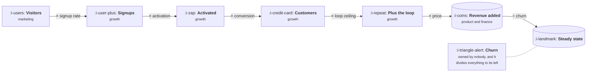

# Your Business as One Equation

```text
Level: Foundations
Prerequisites: Drawing Your Own Loop
Estimated difficulty: 3/5 | Estimated time: 35 min
```

## The idea in one minute

A growth model is one equation with about seven terms in it, and its value is not that it
forecasts well, because it will not. Its value is that it makes every assumption in the business
visible at the same time, in a form where changing one shows you what happens to the rest. The
single most useful thing it reveals is ownership: write the equation, put a name against each
term, and the terms nobody owns stand out immediately. In most companies the unowned term is
churn, which sits in the denominator and therefore divides everything the rest of the business
produces, and nobody in the room is paid to move it.

## A picture



Six multiplications and one division. The division is the term with no name against it, and it is
the one with the most leverage over the result.

## How it really works

### The equation

New customers a month is a chain of multiplications, each one a rate somebody can be held to:

visitors, times the share who sign up, times the share of those who activate, times the share of
those who pay, times the loop ceiling from
[Funnels Leak, Loops Compound](../loops-and-compounding/01-funnels-leak-loops-compound.md).

Revenue then follows from two more terms: what a customer pays per month, and the rate at which
customers leave. At steady state, when arrivals and departures balance, monthly revenue settles at
new customers times price divided by churn.

That is the whole model. Seven numbers. Everything else a growth team argues about is a claim that
one of these seven should be different.

### Why seven and not seventy

The temptation is always to add terms, and the resulting model is worse rather than better for two
specific reasons.

The first is that error multiplies. Every term you add brings its own uncertainty into a product,
and lesson 04 shows what seven terms of ordinary uncertainty already do to the output range. A
thirty term model is not more precise, it is less, and it conceals this by looking thorough.

The second is ownership. A model is useful when each term has a person who can be asked about it.
Beyond about ten terms the mapping to people breaks down, nobody feels responsible for any
individual number, and the model becomes a thing the analyst maintains rather than a thing the
company argues with.

If a term you want to add would not change a decision, leave it out. If it would, it probably
belongs inside one of the seven as a thing to investigate rather than as a term of its own.

### Steady state is further away than it looks

The steady state figure is the one everybody quotes, and it is the most misread output of the
model. It is where revenue settles if nothing changes, and getting there takes much longer than
anyone expects, because each month's additions are partly offset by churn against a base that is
still filling up.

The program below runs the same model forward month by month. At the end of three full years it
has reached 69 percent of its own steady state. That is not a slow business or a pessimistic
assumption, it is what a 3.2 percent monthly churn rate does to accumulation, and it means a
steady state number quoted in a board deck is describing a year that is not inside anybody's plan.

Quote the month 12 and month 24 figures. Keep steady state for the question of whether the
business is worth building at all.

### Finding the unowned term

Write the equation, then put a name against each term. Not a function, a person. The exercise
takes ten minutes and the result is reliably uncomfortable.

Churn is the usual orphan, for a structural reason rather than a careless one. It is produced by
the product being insufficiently useful, which is a product team concern, and it shows up in a
revenue number, which is a finance concern, and it is moved by things that happen months after
anyone shipped anything. So it ends up as a line item that everybody reports and nobody owns, and
it sits in the denominator where it governs the whole result.

The second most common orphan is the loop factor, for the reason the previous topic gave: nothing
computes it, so nobody reports it, so nobody is accountable for it.

### What fills the box in 2026

A spreadsheet, and this is one of the few places where the obvious tool is genuinely the right
one. The model needs to be opened by people who do not write code, argued with in a meeting, and
changed while somebody is talking. Purpose built planning tools do this adequately and add a
licence and an access problem; notebooks do it badly because the audience cannot edit them.

The one thing worth automating is the inputs. Hand typed actuals go stale and quietly diverge from
the warehouse, so the sheet should pull its historical values from the same place the dashboards
do, with the assumptions kept clearly separate from them. Lesson 03 is about that separation.

## Run the numbers

The seven terms, the output, the path to steady state, and the ownership check.

```go
// model.go: the whole business as one equation, with an owner on every term.
package main

import "fmt"

type term struct {
	name  string
	value float64
	unit  string
	owner string
}

func main() {
	terms := []term{
		{"visitors a month", 120_000, "people", "marketing"},
		{"signup rate", 0.035, "share", "growth"},
		{"activation rate", 0.420, "share", "growth"},
		{"paid conversion", 0.110, "share", "growth"},
		{"loop factor k", 0.250, "share", "growth"},
		{"revenue per customer", 45.00, "per month", "product and finance"},
		{"monthly churn", 0.032, "share", "nobody"},
	}

	v := map[string]float64{}
	fmt.Printf("%-22s %12s %-12s %s\n", "term", "value", "unit", "owner")
	for _, t := range terms {
		v[t.name] = t.value
		fmt.Printf("%-22s %12.3f %-12s %s\n", t.name, t.value, t.unit, t.owner)
	}

	ceiling := 1 / (1 - v["loop factor k"])
	newCust := v["visitors a month"] * v["signup rate"] * v["activation rate"] *
		v["paid conversion"] * ceiling
	steady := newCust * v["revenue per customer"] / v["monthly churn"]

	fmt.Printf("\nnew customers a month   %.0f\n", newCust)
	fmt.Printf("  of which from the loop %.0f\n", newCust-newCust/ceiling)
	fmt.Printf("steady state revenue    %.0f a month\n", steady)
	fmt.Printf("  which is new customers x price / churn\n")

	fmt.Println("\nthe path there, from nothing:")
	mrr := 0.0
	for m := 1; m <= 36; m++ {
		mrr = mrr*(1-v["monthly churn"]) + newCust*v["revenue per customer"]
		if m%6 == 0 {
			fmt.Printf("  month %2d  %10.0f  %3.0f%% of steady state\n",
				m, mrr, 100*mrr/steady)
		}
	}

	fmt.Println("\nterms with no owner:")
	for _, t := range terms {
		if t.owner == "nobody" {
			fmt.Printf("  %s, which divides everything above it\n", t.name)
		}
	}
}
```

The model produces 259 new customers a month, of which 65 come from the loop. That second figure
is worth pausing on: a quarter of all new customers arrive from a loop factor of 0.25, which many
teams would describe as not having a referral programme worth measuring.

Steady state revenue is 363,825 a month. Then read the path to it: 64,499 at month six, 117,563 at
month twelve, 197,138 at month twenty four, and 251,000 at month thirty six, which is 69 percent
of the destination. Three years in, with every assumption holding perfectly and nothing going
wrong, the business is at two thirds of the number on the slide.

The ownership check at the end prints one line, and in this model it prints churn. Change the
owner strings to the real names in your company and run it again. The exercise is trivial and the
output is usually the most useful sentence the model produces all year, because an unowned term in
the denominator is a structural problem rather than a performance one, and no amount of effort on
the numerator fixes it.

## The AI layer

The model gains one term when there is a model inside the product, and loses a convenient
assumption.

The new term is cost per active customer, which belongs next to price rather than inside it,
because the two scale differently: price is fixed per month and inference cost rises with usage.
A seven term model becomes an eight term model, and gross margin stops being a constant you can
leave out. The arithmetic of that belongs to
[AI Cost and Margin](../../product-management/ai-cost-and-margin/README.md), and what belongs here
is the structural point: your most engaged cohort is now also your most expensive, so revenue and
cost no longer move together in the simple way the classic model assumes.

The assumption that breaks is that price per customer is independent of volume. Under usage based
pricing it is not, and a model that multiplies customers by a flat price will overstate revenue in
the months growth is fastest, which is exactly when people are relying on it.

Separately, a model is good at the thing this lesson asks you to do by hand: given a messy set of
company documents, extracting the seven numbers and where each was last stated. It is not good at
deciding which seven, because that is a judgement about what your business actually depends on,
and the generic answer it will produce is the generic model rather than yours.

## Sector lens

| Sector | What changes about the equation |
|---|---|
| [Enterprise B2B SaaS](../../product-management/product-by-sector/01-enterprise-b2b-saas.md) | The unit is accounts, not users, and a seat expansion term matters more than the loop term. Churn is annual and lumpy, so a monthly rate misleads |
| [Fintech](../../product-management/product-by-sector/02-fintech.md) | Revenue per customer is a function of their activity rather than a price, so that term becomes a distribution and the average hides most of it |
| [Ecommerce and D2C](../../product-management/product-by-sector/03-ecommerce-and-d2c.md) | No subscription, so the churn divisor is replaced by purchase frequency and the model is in orders rather than months |
| [Marketplaces](../../product-management/product-by-sector/04-marketplaces.md) | Two equations with a shared term, and a take rate on top. One equation cannot represent it honestly |
| [Devtools and Infra](../../product-management/product-by-sector/05-devtools-and-infrastructure.md) | A long free period means activation and conversion are separated by quarters, so the model needs a lag and the steady state is years out |
| [Healthtech](../../product-management/product-by-sector/06-healthtech-and-regulated-care.md) | The loop term is usually zero by design, and a contracting cycle sits between activation and revenue |
| [Vertical SaaS](../../product-management/product-by-sector/07-vertical-saas.md) | Visitors is not the top term, because the market is a countable list of firms. Replace it with accounts remaining and the model becomes finite |

## Remember this

* The model is one equation with about seven terms. Its value is visibility and ownership, not
  forecasting accuracy.
* New customers is a chain of multiplications. Revenue at steady state is new customers times
  price divided by churn.
* More terms make the model less precise, not more, because error multiplies and ownership
  dissolves.
* Steady state is much further away than it looks. Three years of perfect execution reached 69
  percent of it in this model.
* Quote month 12 and month 24. Keep steady state for whether the business is worth building.
* Put a person's name against every term. The unowned one is usually churn, and it sits in the
  denominator.
* Under usage based pricing, price is not independent of volume and the simple model overstates
  revenue exactly when growth is fastest.

## Try it

1. Run `model.go` with your own seven numbers and your own owner names. The line it prints at the
   end is the finding.
2. Change churn from 0.032 to 0.024 and note the new steady state and the month 36 figure. Compare
   that against what tripling the loop factor does. Which one has anybody been working on?
3. Write the equation on one side of one page and give it to somebody in finance. If they produce
   a different equation for the same company, the two of you have been planning different
   businesses.

## Check yourself

1. Why does adding more terms to a growth model usually make the forecast worse rather than
   better? Give both reasons.
2. The model reaches 69 percent of steady state after three years. What does that imply about
   using a steady state figure in a fundraising deck, and what should be used instead?
3. Churn sits in the denominator and has no owner. Explain why this is a structural problem rather
   than a sign that somebody is slacking.
