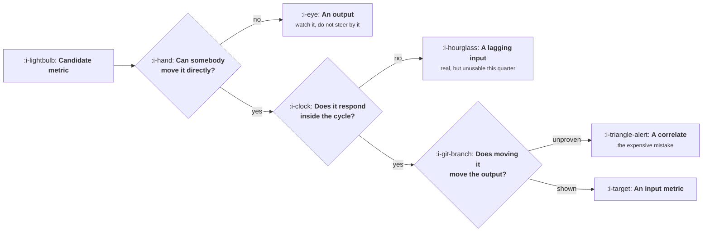

# Finding the Input Metrics

```text
Level: Foundations
Prerequisites: Your Business as One Equation
Estimated difficulty: 2/5 | Estimated time: 30 min
```

## The idea in one minute

Almost every number on a company dashboard is an output: it tells you what happened and offers no
handle for making something else happen. An input metric is one you can actually move this week,
by doing something specific, with the movement showing up before the quarter ends. Three tests
separate them, and a candidate has to pass all three: somebody can change it directly, it responds
within your planning cycle, and a change in it causes a change in the output rather than merely
accompanying one. The reason this matters is that a team steering by output metrics is reading the
speedometer and looking for the steering wheel, and the usual symptom is a quarterly plan whose
actions are not connected to its targets by anything you could write down.

## A picture



Three gates, and the third is the one that is almost never actually tested. Most metrics declared
as inputs have passed the first two and been assumed through the last.

## How it really works

### The three tests

**Can somebody move it directly?** Name the person and the action. "Improve retention" fails,
because nobody can do retention on a Tuesday. "Number of accounts that complete the data import in
their first week" passes, because there is a team, a surface and a set of changes. The test is
whether you could write the next five tickets.

**Does it respond inside your planning cycle?** If the effect of this quarter's work on this
metric appears in two quarters, it is still a real input and you cannot steer by it this quarter.
Keep it, track it, and do not put it on the weekly dashboard where its silence will be read as
failure.

**Does moving it move the output?** This is the hard one, and it is the difference between an
input metric and a correlate. Lots of numbers move with revenue. Very few cause it.

### The correlate trap

The classic failure runs like this. An analyst notices that users who do some action in week one
retain far better than users who do not. The action becomes a target, the team drives the number
up, and retention does not move at all.

What happened is that the action was a symptom of intent rather than a cause of value. People who
were already going to stay did the thing on their way to staying. Making indifferent users do it
produced the symptom without the underlying condition.

The tell is in the mechanism, and the question that exposes it is simple: **why would doing this
make someone more likely to stay?** If the answer describes the user getting something they
wanted, you have a candidate cause. If the answer is that people who stay tend to do it, you have
found a correlate and a target that will absorb a quarter and change nothing.

Three ways to tell them apart, in order of cost. Look for a dose response: if two of the action
is better than one, and three better than two, causation is more plausible. Find a natural
experiment where the action was unavailable for a period. Or run a test that moves the action
deliberately for a random group, which is the only conclusive method and is what the rest of the
course is for.

### How many input metrics

One primary per team per quarter, with two or three supporting ones that are checked but not
targeted. This is the same discipline as the single rate in the charter and for the same reason:
when two targets conflict, and they will, a team with two primaries picks the one it is winning.

The supporting metrics exist to catch the degenerate solution. If the primary input is the share
of new accounts completing import, the supporting set includes how long the import takes and how
many imports are abandoned halfway, because the cheapest way to raise the primary is to make the
import trivial by removing what it imports.

### Finding yours from the model

The seven term model gives you the shortlist for free, and this is the main practical use of
having written it. Each term is either an output you watch or decomposes into inputs you can move.

Take activation rate at 42 percent. It is not an input; nobody can move activation directly. It
decomposes into things that are: the share of signups who reach the setup step, the share who
complete it, the median time they take, the share who hit a specific error. Those are things a
team can change on a Tuesday, and each one is a candidate that still has to pass the third test.

Do this for each term and you will generate perhaps twenty candidates. Most will fail test one or
two. Of the survivors, the ones you can show cause the output are your input metrics, and there
will be fewer than you expect.

### The metrics that are neither

Some numbers are worth watching and are not inputs, outputs or correlates. They are conditions:
page load time, error rate, support response time. They do not drive growth when they are good
and they destroy it when they are bad, which makes them guardrails rather than targets. Put them
in the charter's section three and leave them off the growth dashboard, because a guardrail
treated as an input produces a quarter spent making a healthy number healthier.

The formal distinction between leading, lagging and vanity metrics, along with the denominator
problems that corrupt all three, belongs to
[How to Read a Metric](../../product-management/how-to-read-a-metric/README.md). What this lesson
adds is the specific question of which ones you can steer with.

### What fills the box in 2026

The dashboard tool is not the issue and switching it will not help. What helps is a written
definition next to each input metric saying what it is, who moves it, which output it is claimed
to cause, and what evidence supports that claim. That last field is the one that does the work:
most metric definitions in most companies have never had it filled in, and filling it in is how
a correlate gets caught before a quarter is spent on it.

## Sector lens

| Sector | What makes a good input here |
|---|---|
| [Enterprise B2B SaaS](../../product-management/product-by-sector/01-enterprise-b2b-saas.md) | Account level actions within the first thirty days. Anything measured on individual users will be dominated by which accounts signed up |
| [Fintech](../../product-management/product-by-sector/02-fintech.md) | Completion of each verification step. These are genuinely causal because an incomplete step blocks the product entirely |
| [Ecommerce and D2C](../../product-management/product-by-sector/03-ecommerce-and-d2c.md) | Short cycle inputs that respond within days, which makes the third test cheap to run properly. The sector with the least excuse for correlates |
| [Marketplaces](../../product-management/product-by-sector/04-marketplaces.md) | Liquidity measures, such as the share of listings that get a response within a day. Single sided inputs mislead badly |
| [Devtools and Infra](../../product-management/product-by-sector/05-devtools-and-infrastructure.md) | Time to first successful call, and the share who reach it. One of the few inputs in software with a well established causal story |
| [Healthtech](../../product-management/product-by-sector/06-healthtech-and-regulated-care.md) | Workflow completion inside a clinical session. Patient outcome measures are outputs and sometimes not yours to target at all |
| [Vertical SaaS](../../product-management/product-by-sector/07-vertical-saas.md) | Depth of configuration, because the product only becomes useful once it matches how that particular firm works |

## Remember this

* Three tests, all required: somebody can move it directly, it responds inside your cycle, and
  moving it moves the output.
* The third test is almost never run, which is how a correlate becomes a quarterly target.
* The question that exposes a correlate: why would doing this make somebody more likely to stay?
  If the answer is that stayers tend to do it, stop.
* Dose response, natural experiments, then a real test. In that order of cost.
* One primary input per team per quarter, plus two or three supporting metrics chosen to catch
  the degenerate solution.
* Decompose each model term into candidates. Most fail the first two tests, and the survivors
  still have to earn the third.
* Conditions such as latency and error rate are guardrails, not inputs. A guardrail treated as a
  target wastes a quarter improving a healthy number.

## Try it

1. Take your team's current primary metric and run it through the three gates honestly. If it
   fails the first, find what it decomposes into. If it fails the third, say what evidence would
   settle it and how much that evidence costs.
2. For each of your seven model terms, write down two candidate inputs. You should end with about
   fourteen and keep about three.
3. Find a metric your company has targeted for more than two quarters. Ask what evidence exists
   that moving it moves anything. If the answer is a correlation from an analysis nobody can
   locate, you have found this lesson in the wild.

## Check yourself

1. Users who invite a colleague in week one retain at twice the rate of those who do not. What is
   the cheapest piece of evidence that would tell you whether driving invitations up will move
   retention?
2. Why does a team with two primary input metrics behave, in practice, as though it had none?
3. Your page load time is excellent and your team wants to target it next quarter. Which category
   does it belong in, and what is the argument against the project?
