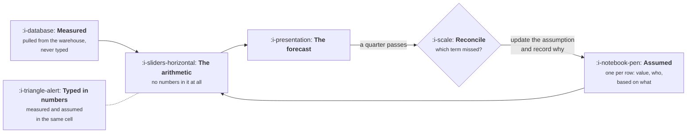

# Building the Model

```text
Level: Foundations
Prerequisites: Finding the Input Metrics
Estimated difficulty: 3/5 | Estimated time: 40 min
```

## The idea in one minute

A model that nobody can argue with is a model nobody will use, and the thing that makes a model
arguable is a hard separation between the numbers you measured and the numbers you assumed. Keep
them in different places, label every assumption with who made it and what it was based on, and
disagreement becomes a conversation about one cell rather than a conversation about whether the
model is any good. The second half of building a model is the half almost nobody does: when the
quarter ends and the forecast was wrong, decompose the miss term by term, because knowing which
assumption failed is worth more than the forecast was. A model that is never reconciled is not a
model, it is a document.

## A picture



Two inputs, one of which is never typed by a human, and a return arrow from the reconciliation
that is the part most models are missing.

## How it really works

### Three layers, kept apart

**Measured.** Historical actuals, pulled from the same source as your dashboards, on a schedule.
Never typed. A hand typed actual diverges from the warehouse within a month, and when the model
and the dashboard disagree the meeting is about which is right rather than about what to do.

**Assumed.** Every forward looking number, each one a row carrying four things: the value, who set
it, what it was based on, and when it was last revisited. The fourth field is the one that pays
for itself, because an assumption set eighteen months ago by somebody who has left is the most
common load bearing error in a growth model.

**Arithmetic.** The equation, containing no numbers whatsoever. Every value referenced from one of
the two layers above. If a constant appears inside a formula it is an undocumented assumption, and
it will be the one that turns out to matter.

The separation sounds fussy and it is the entire difference between a model that survives a change
of owner and one that does not.

### Write the assumption, not the number

An assumption row saying "signup rate: 3.5%" is almost useless. The same row saying "signup rate
3.5%, set by Priya in March, from the trailing twelve week median excluding the launch spike,
revisit when the new landing page has run four weeks" can be challenged by anybody, inherited by
anybody, and will trigger its own revision.

The practical rule: an assumption should contain enough that somebody who disagrees knows exactly
what evidence would change your mind. Without that, disagreement has nowhere to go and gets
settled by seniority.

### Version the model, not the spreadsheet

Keep a dated copy each time the assumptions change, and keep them all. The value is not
housekeeping, it is that the sequence of versions is the only honest record of how the company's
beliefs moved, and it answers the question that comes up in every planning cycle: were we wrong
about this before?

A team that can say "we assumed 4.1 percent in January, cut it to 3.5 in April after the test, and
it came in at 3.4" has credibility that no single forecast can buy. A team that only ever has the
current version is reasoning from scratch every quarter.

### Reconciliation: the half that gets skipped

At the end of the period, the forecast was wrong. The useful question is not by how much, it is
which assumption was responsible, and that has a precise answer you can compute.

The method is substitution: start with the forecast, replace one assumption at a time with what
actually happened, and record how much the output moved at each step. The steps sum exactly to
the total miss, so nothing is unexplained.

There is a real subtlety and it is worth being honest about rather than hiding. Because the terms
multiply, the effect attributed to each one depends on the order you substitute them, since fixing
a term is worth more when the other terms are already fixed. The program below runs the
substitution forwards and backwards and prints both. The totals agree exactly; the individual
shares differ by up to about fifteen percent.

The right way to read that is: **use the ranking, never the exact figures.** Both orders agree
about which assumption did the damage, and that is the output you need. A model that reports
attribution to three decimal places without mentioning path dependence is overstating what the
method can deliver.

For teams who want the rigorous version, averaging across all orderings gives a unique answer, and
for seven terms that is five thousand orderings and perfectly cheap to compute. It is rarely worth
it, because it does not change the ranking.

### What reconciliation is for

Not blame. The output of a reconciliation is a set of updated assumptions with a reason attached
to each, which is why the arrow in the diagram points back into the assumption layer.

The specific thing it protects against is a team that misses a forecast and responds by changing
every assumption at once in the direction of the miss, which is how a model stops being a model
and becomes a trailing average with extra steps. Reconciliation tells you that one term was wrong
and six were approximately right, so you change one.

### What fills the box in 2026

A spreadsheet with three clearly separated sheets, the measured one populated by a scheduled job.
Whatever your warehouse tooling is will do that part; the important choice is that the assumption
sheet has four columns rather than one, which is a discipline rather than a feature.

## Run the numbers

The quarter ended fifteen percent below plan. This computes which assumption was responsible, two
ways, and shows how much the two disagree.

```go
// reconcile.go: the forecast missed. Which assumption was wrong, and by how much?
package main

import "fmt"

type inputs struct {
	visitors, signup, activation, conversion, k, arpu, churn float64
}

var names = []string{"visitors", "signup rate", "activation", "conversion",
	"loop factor", "price", "churn"}

func (in inputs) get(i int) float64 {
	return []float64{in.visitors, in.signup, in.activation,
		in.conversion, in.k, in.arpu, in.churn}[i]
}

func (in *inputs) set(i int, v float64) {
	switch i {
	case 0:
		in.visitors = v
	case 1:
		in.signup = v
	case 2:
		in.activation = v
	case 3:
		in.conversion = v
	case 4:
		in.k = v
	case 5:
		in.arpu = v
	case 6:
		in.churn = v
	}
}

// mrr after a fixed number of months, starting from nothing.
func (in inputs) mrr(months int) float64 {
	newCust := in.visitors * in.signup * in.activation * in.conversion / (1 - in.k)
	out := 0.0
	for m := 0; m < months; m++ {
		out = out*(1-in.churn) + newCust*in.arpu
	}
	return out
}

// walk substitutes actual values into the forecast one term at a time, in the
// given order, and records how much the output moved at each step. The steps
// sum exactly to the total miss.
func walk(plan, actual inputs, order []int, months int) []float64 {
	cur := plan
	out := make([]float64, len(order))
	prev := cur.mrr(months)
	for j, i := range order {
		cur.set(i, actual.get(i))
		now := cur.mrr(months)
		out[j] = now - prev
		prev = now
	}
	return out
}

func main() {
	const months = 12
	plan := inputs{120_000, 0.035, 0.420, 0.110, 0.250, 45.00, 0.032}
	actual := inputs{98_000, 0.041, 0.390, 0.110, 0.210, 47.00, 0.038}

	p, a := plan.mrr(months), actual.mrr(months)
	fmt.Printf("month %d planned %.0f, actual %.0f, a miss of %.0f (%.0f%%)\n\n",
		months, p, a, a-p, 100*(a-p)/p)

	fwd := []int{0, 1, 2, 3, 4, 5, 6}
	rev := []int{6, 5, 4, 3, 2, 1, 0}
	f := walk(plan, actual, fwd, months)
	r := walk(plan, actual, rev, months)

	back := map[int]float64{}
	for j, i := range rev {
		back[i] = r[j]
	}

	fmt.Printf("%-14s %12s %12s %14s %14s\n",
		"term", "planned", "actual", "effect fwd", "effect rev")
	for j, i := range fwd {
		fmt.Printf("%-14s %12.3f %12.3f %14.0f %14.0f\n",
			names[i], plan.get(i), actual.get(i), f[j], back[i])
	}

	var sf, sr float64
	for i := range f {
		sf += f[i]
		sr += r[i]
	}
	fmt.Printf("%-14s %25s %14.0f %14.0f\n", "total", "", sf, sr)

	fmt.Println("\nBoth orders explain the whole miss and disagree about the shares,")
	fmt.Println("because the terms multiply: the value of fixing one depends on the")
	fmt.Println("others. Use the ranking, never the exact figures, and rerun both ways.")
}
```

The quarter came in at 100,336 against a plan of 117,563, a miss of 15 percent, and the useful
finding is that this was not a bad quarter in general. Two assumptions were wrong in the right
direction and four in the wrong one.

Visitors is the culprit: 98,000 against a planned 120,000, costing about 21,500 or 22,500
depending on substitution order. Nothing else is close. The signup rate was substantially better
than planned, 4.1 percent against 3.5, recovering about 16,500 to 18,000, which is the second
important finding and the one that would be lost in a conversation about missing the number.

So the honest summary is that the growth team beat its assumptions and marketing missed its
volume, and the company landed 15 percent down. Without the reconciliation the available summary
is "we missed by 15 percent", under which everybody is implicated equally and the correct response
is unavailable.

Note the two effect columns. Visitors shows 21,553 forwards and 22,525 backwards, the loop factor
5,288 and 6,024. The rankings are identical and the figures differ by around ten to fifteen
percent, which is exactly the path dependence described above. Report the ranking, name the
responsible term, and do not put the individual numbers in a slide as though they were measured.

## The AI layer

Two uses, one of which is better than it sounds and one worse.

The better one is the assumption layer. The four column discipline above fails in practice because
writing the basis for every assumption is tedious, so it does not get done. Given a quarter of
documents, test readouts and meeting notes, a model will produce a first draft of that column
with sources attached, which converts an hour of work nobody does into a review of a draft, which
people will do. Use it for that and check every row, because a missing source will be filled with
a plausible one.

The worse one is forecasting. There is a persistent temptation to replace the seven term equation
with something fitted to history, and for growth modelling this is usually a mistake. Not because
the fit is poor, which it often is not, but because the fitted thing has no terms anybody owns, no
assumptions anybody can argue with, and nothing to reconcile at the end of the quarter. You lose
every property this topic has been building. A fitted model that predicts slightly better and
cannot be interrogated is a worse instrument for running a company than a transparent one that
predicts slightly worse.

The place a fitted approach genuinely helps is as a check: if its output and your model's output
diverge badly, one of your assumptions is wrong and it is worth finding which.

## Sector lens

| Sector | What changes about building it |
|---|---|
| [Enterprise B2B SaaS](../../product-management/product-by-sector/01-enterprise-b2b-saas.md) | Small numbers of large deals mean the reconciliation is dominated by two or three accounts. Model named accounts separately from the rest |
| [Fintech](../../product-management/product-by-sector/02-fintech.md) | Some assumptions are regulatory and change by decree rather than by evidence. Mark those rows so nobody tries to argue with them |
| [Ecommerce and D2C](../../product-management/product-by-sector/03-ecommerce-and-d2c.md) | Strong seasonality, so reconciling against a plan without a seasonal term attributes the season to whichever assumption is listed first |
| [Marketplaces](../../product-management/product-by-sector/04-marketplaces.md) | Two models and a coupling term. Reconcile each side separately or the cross effects land on the wrong team |
| [Devtools and Infra](../../product-management/product-by-sector/05-devtools-and-infrastructure.md) | Long lags mean the quarter you reconcile reflects decisions from a year ago. Date the assumptions against when their effect lands, not when they were set |
| [Healthtech](../../product-management/product-by-sector/06-healthtech-and-regulated-care.md) | Procurement cycles dominate, so the honest model has a timing assumption that is larger than every growth assumption combined |
| [Vertical SaaS](../../product-management/product-by-sector/07-vertical-saas.md) | Few enough customers that the model can be a list. When you can enumerate the market, do that instead of estimating rates |

## Remember this

* Three layers kept apart: measured, assumed, arithmetic. The arithmetic contains no numbers.
* Never type an actual. A hand typed historical value diverges from the warehouse within a month.
* Every assumption carries four things: the value, who set it, what it was based on, and when it
  was last revisited.
* An assumption is written well when somebody who disagrees knows what evidence would change your
  mind.
* Keep every dated version. The sequence of beliefs is more credible than any single forecast.
* Reconcile by substitution. The steps sum exactly to the miss, and the attribution is order
  dependent, so use the ranking and not the figures.
* Reconciliation exists so that you change one assumption rather than all of them.

## Try it

1. Run `reconcile.go` with your last plan and your last actuals. The term at the top of the
   ranking is the conversation your next planning meeting should start with.
2. Open your current model and find every number typed inside a formula. Each one is an
   undocumented assumption; move it to the assumption sheet with its four columns filled in.
3. Find the oldest assumption in your model and work out who set it and on what basis. If neither
   is recoverable, that is the one to re derive first.

## Check yourself

1. Why must the arithmetic layer contain no numbers at all, when a constant inside a formula is
   obviously faster to write?
2. Forwards and backwards substitution give the same total and different shares. Explain why in
   one sentence, and say what you should therefore report.
3. A team misses its forecast by 15 percent and lowers every assumption by 15 percent for next
   quarter. What has gone wrong, and what should the reconciliation have told them instead?
