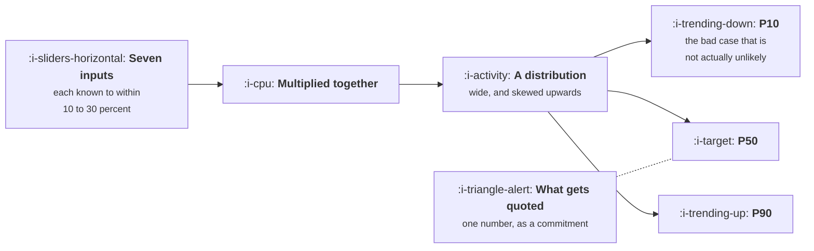

# What a Forecast Can and Cannot Promise

```text
Level: Foundations
Prerequisites: Building the Model
Estimated difficulty: 3/5 | Estimated time: 35 min
```

## The idea in one minute

A growth forecast is a single number produced by multiplying seven estimates together, and the
uncertainty in those estimates does not average out, it compounds. With the ordinary amount of
error that real inputs carry, the honest range on a two year forecast spans something like three
times from the low end to the high end, and the point forecast everybody quotes has roughly a
coin flip chance of being beaten. This is not a criticism of anyone's modelling. It is what
multiplying uncertain numbers does, and the only responses available are to quote a range, to
state what the forecast is conditional on, and to stop treating the middle of the distribution as
a commitment.

## A picture



The model produces the shape on the right. What leaves the room is one point on it, usually
without the shape attached.

## How it really works

### Why error compounds rather than cancels

Intuition says that if some estimates are too high and some too low, they will offset. For a sum
that is roughly true. For a product it is not, and the growth model is a product.

Multiplying independent uncertain quantities multiplies their relative errors, so the spread of
the result is wider than the spread of any input. Seven inputs each known to within fifteen or
twenty percent produce an output known to within considerably worse than that, and the effect
gets stronger with every term you add, which is the arithmetic behind the warning in lesson 01
against thirty term models.

There is a second effect that makes the result asymmetric. Because the terms multiply, the
distribution of the output is skewed: the downside is bounded at zero and the upside is not, so
the mean sits above the median and the tail on the right is long. A forecast quoted as a single
number is usually near the middle of a shape that is not symmetric around it.

### Reading the range properly

The program below runs the seven term model fifty thousand times with realistic input
uncertainty. The result is a P10 of 109,462 and a P90 of 306,672, a span of 2.8 times, around a
point forecast of 197,138 that gets beaten 45 percent of the time.

Two things follow that matter more than the specific figures.

**The low end is not a disaster scenario.** A P10 outcome happens one year in ten, which over the
life of a company is a thing that will happen to you. It should be planned for as an ordinary
contingency, not described as a worst case, because it is not the worst case. The worst case is
well below it.

**Beating the point forecast is close to a coin flip.** If the point forecast is also the
commitment, the company has committed to something it has slightly under even odds of achieving,
while everybody involved believes it is the expected outcome. This single mismatch produces more
organisational damage than any modelling error, because it converts an ordinary statistical
outcome into a story about a team that failed.

### What a forecast can honestly promise

Four things, and only these.

* **A range with probabilities on it.** Here is the tenth, fiftieth and ninetieth percentile.
* **Conditionality.** This assumes visitors hold at 120,000 and churn at 3.2 percent. If those
  break, the forecast is void rather than merely wrong.
* **A comparison between options.** Relative answers are far more reliable than absolute ones,
  because the errors are shared between the arms and largely cancel when you subtract.
* **A falsification point.** By week six, new customers should be above some number, and if they
  are not then an assumption is wrong and the forecast should be rebuilt rather than defended.

The fourth is the one that makes a forecast useful rather than ceremonial, and it costs one
sentence to add.

### Where the uncertainty actually comes from

Worth separating, because the responses differ.

**Measurement error** is not knowing the current value precisely. It is the cheapest to fix: run
the query properly, wait for a bigger sample, fix the tracking.

**Estimation error** is not knowing where a rate will settle after a change. This is irreducible
before the change ships, and it is what experiments are for.

**Structural error** is the model being the wrong shape: a term that is not independent of
another, a lag you did not include, seasonality you left out. This one does not appear in the
range at all, which is the most important limitation of the whole exercise. A simulation like the
one below shows you the uncertainty you have modelled, and says nothing about the uncertainty you
have not.

So the range is a lower bound on how wrong you might be, never an upper bound. Anybody who treats
a P10 as the floor has misunderstood what was computed.

### What fills the box in 2026

Spreadsheets do this badly and the workarounds are worse than they look, since the common trick of
running three scenarios by setting every input pessimistically at once produces a combination far
less likely than the P10 it is meant to represent. A fifty line program like the one below, run
once a quarter, is a better answer than any add in, and it has the advantage that the assumptions
about uncertainty are written down next to the assumptions about values.

## Run the numbers

The same seven term model, run with the error the inputs actually carry.

```go
// forecast.go: the same model, run with the uncertainty the inputs actually have.
package main

import (
	"fmt"
	"math/rand"
	"sort"
)

func mrr(visitors, signup, activation, conversion, k, arpu, churn float64, months int) float64 {
	newCust := visitors * signup * activation * conversion / (1 - k)
	out := 0.0
	for m := 0; m < months; m++ {
		out = out*(1-churn) + newCust*arpu
	}
	return out
}

// jitter draws a multiplicative error of the given relative size, floored
// so that a rate never goes negative.
func jitter(r *rand.Rand, v, rel float64) float64 {
	out := v * (1 + rel*r.NormFloat64())
	if out < v*0.05 {
		out = v * 0.05
	}
	return out
}

func main() {
	const (
		months = 24
		runs   = 50_000
	)
	point := mrr(120_000, 0.035, 0.420, 0.110, 0.250, 45.00, 0.032, months)
	fmt.Printf("the point forecast everyone will quote: %.0f at month %d\n\n", point, months)

	fmt.Printf("%-14s %10s\n", "input", "+/- error")
	unc := []struct {
		name string
		rel  float64
	}{
		{"visitors", 0.20}, {"signup rate", 0.15}, {"activation", 0.15},
		{"conversion", 0.20}, {"loop factor", 0.30}, {"price", 0.10}, {"churn", 0.25},
	}
	for _, u := range unc {
		fmt.Printf("%-14s %9.0f%%\n", u.name, 100*u.rel)
	}

	r := rand.New(rand.NewSource(11))
	out := make([]float64, runs)
	for i := range out {
		out[i] = mrr(
			jitter(r, 120_000, 0.20), jitter(r, 0.035, 0.15), jitter(r, 0.420, 0.15),
			jitter(r, 0.110, 0.20), jitter(r, 0.250, 0.30), jitter(r, 45.00, 0.10),
			jitter(r, 0.032, 0.25), months)
	}
	sort.Float64s(out)
	at := func(p float64) float64 { return out[int(p*float64(runs))] }

	fmt.Printf("\n%-10s %12s\n", "percentile", "month 24")
	for _, p := range []float64{0.10, 0.25, 0.50, 0.75, 0.90} {
		fmt.Printf("%9.0f%% %12.0f\n", 100*p, at(p))
	}
	fmt.Printf("\nthe 10 to 90 range spans %.1fx, from %.0f to %.0f\n",
		at(0.90)/at(0.10), at(0.10), at(0.90))

	var hit int
	for _, v := range out {
		if v >= point {
			hit++
		}
	}
	fmt.Printf("chance of reaching the point forecast or better: %.0f%%\n",
		100*float64(hit)/runs)

	fmt.Println("\nThe single number is not the forecast. It is one draw from this")
	fmt.Println("distribution, and it is roughly a coin flip whether you beat it.")
}
```

The input uncertainties in that table are deliberately unexceptional. Twenty percent on visitors
is what you get from an ordinary channel mix, fifteen percent on activation is a well measured
rate, and thirty percent on the loop factor is generous given that most companies do not compute
it at all. None of these represent a badly run company.

They produce a P10 of 109,462 and a P90 of 306,672. The business that is doing fine and the
business that is in trouble are both inside the ordinary range of the same plan, and no action by
anybody separates them.

The 45 percent figure is the one to carry into a planning meeting. The point forecast is not the
expected outcome in any useful sense; it is marginally less likely than not. Committing to it and
treating the shortfall as a performance problem is a category error that will nevertheless happen,
which is the argument for putting the whole distribution into the document rather than the middle
of it.

Try raising the loop factor uncertainty from 30 percent to 60 percent, which is honest for a
company that has never measured it. The range widens noticeably, and that widening is the value of
the measurement work in the previous topic expressed in the only currency a planning conversation
recognises.

## The AI layer

Products with a model inside them have systematically wider forecast ranges, for three reasons
that stack.

**Cost per customer is uncertain in a way price is not.** A subscription is a known number; the
inference a customer consumes is a distribution with a long tail, and it enters the model as a
term that is both uncertain and correlated with engagement. Adding a term with thirty percent
uncertainty to the product widens everything downstream of it.

**The input prices move.** Frontier model pricing has fallen repeatedly, which sounds like good
news for a forecast and is actually just variance: a cost term that may halve or may not is wider
than one that holds steady, whichever direction it eventually moves.

**Behaviour is less stable.** Activation and retention rates for a feature whose quality changes
with every model release are genuinely less predictable than for a deterministic feature, and the
honest response is a wider input range rather than a confident one.

The practical consequence is that the same modelling discipline produces a wider range for an AI
product, and that wider range is correct. A team that reports the narrow range because the wide
one is unwelcome has removed the only accurate thing in the document.

## Sector lens

| Sector | What widens the range here |
|---|---|
| [Enterprise B2B SaaS](../../product-management/product-by-sector/01-enterprise-b2b-saas.md) | A handful of large deals, so the distribution is lumpy rather than smooth and percentiles from a smooth simulation understate the tails |
| [Fintech](../../product-management/product-by-sector/02-fintech.md) | Regulatory timing, which is a structural uncertainty and therefore absent from the range entirely. State it separately as a condition |
| [Ecommerce and D2C](../../product-management/product-by-sector/03-ecommerce-and-d2c.md) | Seasonality, which is predictable and belongs in the model rather than the error. Leaving it out inflates every uncertainty estimate |
| [Marketplaces](../../product-management/product-by-sector/04-marketplaces.md) | The two sides are correlated, so independent sampling understates the range badly in both directions |
| [Devtools and Infra](../../product-management/product-by-sector/05-devtools-and-infrastructure.md) | Long adoption lags mean a two year forecast is mostly determined by decisions already made, which narrows it. One of the few sectors where it helps |
| [Healthtech](../../product-management/product-by-sector/06-healthtech-and-regulated-care.md) | Procurement timing dominates every growth term, and it is binary per account rather than continuous |
| [Vertical SaaS](../../product-management/product-by-sector/07-vertical-saas.md) | A countable market means you can enumerate outcomes instead of sampling them, which is both narrower and more honest |

## Remember this

* Multiplying seven uncertain inputs compounds the error rather than cancelling it, and skews the
  result upwards.
* With ordinary input uncertainty, a two year range spans close to three times from P10 to P90.
* The point forecast has roughly even odds of being beaten. Committing to it commits to a coin
  flip.
* A P10 outcome is a one in ten year, not a disaster. Plan for it as a contingency.
* A forecast can promise four things: a range with probabilities, its conditions, a comparison
  between options, and a falsification point.
* Separate measurement error, which is cheap to fix, from estimation error, which needs an
  experiment, from structural error, which does not appear in the range at all.
* The range is a lower bound on how wrong you might be. It is never an upper bound.
* Setting every input to its pessimistic value at once produces a case far less likely than the
  P10 it is meant to stand for.

## Try it

1. Run `forecast.go`, then set the loop factor uncertainty to 0.60 and rerun. The widening is the
   cost of not having measured it, in the units your planning meeting actually uses.
2. Take your company's current forecast and find out whether it is a P50 or a target. If nobody
   can say, that is the finding, and it is the most common one.
3. Write the falsification point for your current plan: by which week should which number be
   above what, for the forecast to still be live? One sentence, in the plan document.

## Check yourself

1. Why does error compound rather than cancel in this model, and what would have to be true about
   the equation for the intuition about offsetting to hold?
2. Your plan's P10 is 109,000 and your board commitment is 197,000. What exactly have you
   committed to, in probability terms, and what should the commitment have been?
3. Which of the three sources of uncertainty does the simulation fail to capture, and why does
   that make the range a floor rather than a ceiling?
