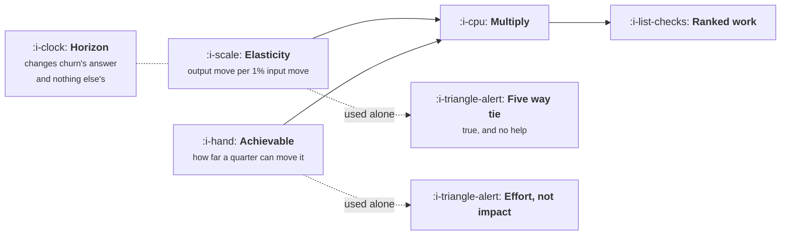

# Sensitivity

```text
Level: Foundations
Prerequisites: What a Forecast Can and Cannot Promise
Estimated difficulty: 3/5 | Estimated time: 35 min
```

## The idea in one minute

Sensitivity analysis asks how much the output moves when one input moves, and run naively on a
growth model it produces a surprising and useless answer: most of the terms are exactly equally
important, because the model multiplies them. The informative version multiplies each term's
sensitivity by how far that term can realistically be moved, which produces a completely
different ranking and is the one that should decide what the team works on. Two terms break the
tie on their own, the loop factor and churn, and both do so for structural reasons worth
understanding: the loop factor because it enters through one divided by one minus itself, and
churn because its importance depends entirely on how far ahead you are looking.

## A picture



Neither column is useful alone. The left one is a property of the model and the right one is a
property of your team, and only the product of the two ranks a quarter's work.

## How it really works

### Why most terms tie

Elasticity is the percentage change in the output per one percent change in an input. For any
term that appears once as a simple multiplication, that elasticity is exactly 1, because doubling
a factor in a product doubles the product.

Visitors, signup rate, activation, conversion and price are all simple multiplications, so all
five have an elasticity of 1 and the model says they are equally important. This is correct and
it is also the reason a plain sensitivity table is so often ignored: it tells you five things
matter the same amount, which is not advice.

The useful move is to stop asking which term the model is most sensitive to and start asking
which term the team can move furthest. That number is not in the model at all. It comes from
evidence about what comparable changes have achieved, what the competitive benchmark is, and what
the team has managed before, and it is an argument rather than a calculation.

### The two terms that do not tie

**The loop factor** enters as one divided by one minus k, so its elasticity is k divided by one
minus k. At a k of 0.25 that is 0.33, meaning a one percent improvement in the loop factor is
worth a third of a one percent improvement in signup rate. At a k of 0.75 it is 3.0, which is
three times more valuable than any other term in the model. The loop factor is the one input
whose importance depends on its own current value, which is the convexity from the previous topic
showing up in the sensitivity table.

**Churn** has an elasticity that depends on the horizon, and this one catches people out. At
steady state, revenue is new customers times price divided by churn, so the elasticity is 1. But
you are never at steady state: at month 12 it is 0.17, at month 24 it is 0.33, and at month 60 it
is 0.68, climbing towards 1 as the base fills up.

So churn is a weak lever on a one year view and the strongest available lever on a five year
view, using identical numbers. A sensitivity table with no horizon written on it is not finished,
and two teams can produce opposite and equally correct rankings by choosing different ones.

### Elasticity times achievable

Multiply the two columns and the ranking changes completely. In the program below, five terms tie
at an elasticity of 1.00 and the work ranks as activation first at 49,285 of revenue, then signup
rate at 39,428, then visitors at 29,571, purely because a quarter can plausibly move activation
by 25 percent and visitors by 15.

Price is last among the tied terms, at 15,771, despite having the same elasticity as the winner,
because an eight percent price change is a large one and a 25 percent activation improvement is
an ordinary one.

Three cautions about the achievable column, since it is doing all the work.

It is an estimate and should be sourced like any other: what did the last three attempts achieve,
what does a comparable company report, what does the benchmark say. An achievable column made of
intuition produces a ranking made of intuition with a decimal point on it.

It should be the achievable change per unit of effort, not per quarter, if the projects differ
greatly in size. The version here assumes each is roughly a quarter of the team, which is the
usual case and should be checked rather than assumed.

And it is not independent of history. A term that has already been worked on twice has a smaller
achievable change remaining, which is why the ranking moves between years even when nothing in
the model does.

### What sensitivity analysis cannot tell you

It assumes the terms are independent, and they are not. Raising conversion by tightening the
offer often lowers activation. Raising visitors through a broader channel lowers every rate
downstream of it, which is the arithmetic from
[Growth, Marketing and Product](../the-growth-function/02-growth-marketing-and-product.md)
appearing in a different form. A one at a time sensitivity table cannot see any of this, and the
only correction is to know your own couplings and note them next to the table.

The practical rule: treat the ranking as a shortlist of three, then think about couplings for
those three specifically. Attempting to model every interaction returns you to the thirty term
model that lesson 01 warned about.

### What fills the box in 2026

A spreadsheet can do a one at a time table with a data table function, and it cannot do the
achievable column, which is the part that matters and which belongs in writing next to the
numbers with a source per row. Whatever produces the table, the deliverable is three rows and a
sentence about couplings, not a full matrix.

## Run the numbers

Elasticity for each term, the achievable change, the resulting revenue, and the horizon effect on
the two terms that do not tie.

```go
// sensitivity.go: which input is worth a quarter, once you allow for how far it can move.
package main

import (
	"fmt"
	"sort"
)

type in struct{ visitors, signup, activation, conversion, k, arpu, churn float64 }

func (i in) mrr(months int) float64 {
	n := i.visitors * i.signup * i.activation * i.conversion / (1 - i.k)
	out := 0.0
	for m := 0; m < months; m++ {
		out = out*(1-i.churn) + n*i.arpu
	}
	return out
}

func main() {
	const months = 24
	base := in{120_000, 0.035, 0.420, 0.110, 0.250, 45.00, 0.032}
	b := base.mrr(months)
	fmt.Printf("baseline month %d revenue %.0f\n\n", months, b)

	type row struct {
		name      string
		elast     float64 // % output change per 1% input change
		achiev    float64 // relative change one quarter can realistically buy
		gain      float64
		direction string
	}

	mut := []struct {
		name   string
		achiev float64
		down   bool
		apply  func(in, float64) in
	}{
		{"visitors", 0.15, false, func(i in, f float64) in { i.visitors *= f; return i }},
		{"signup rate", 0.20, false, func(i in, f float64) in { i.signup *= f; return i }},
		{"activation", 0.25, false, func(i in, f float64) in { i.activation *= f; return i }},
		{"conversion", 0.12, false, func(i in, f float64) in { i.conversion *= f; return i }},
		{"loop factor", 0.30, false, func(i in, f float64) in { i.k *= f; return i }},
		{"price", 0.08, false, func(i in, f float64) in { i.arpu *= f; return i }},
		{"churn", 0.20, true, func(i in, f float64) in { i.churn *= f; return i }},
	}

	rows := make([]row, 0, len(mut))
	for _, m := range mut {
		// elasticity: a 1% move, in the helpful direction
		f := 1.01
		if m.down {
			f = 0.99
		}
		e := (m.apply(base, f).mrr(months)/b - 1) * 100

		g := 1 + m.achiev
		if m.down {
			g = 1 - m.achiev
		}
		dir := "raise"
		if m.down {
			dir = "cut"
		}
		rows = append(rows, row{m.name, e, m.achiev, m.apply(base, g).mrr(months) - b, dir})
	}

	fmt.Printf("%-14s %12s %14s %16s\n",
		"input", "elasticity", "achievable", "revenue gained")
	for _, r := range rows {
		fmt.Printf("%-14s %11.2f%% %6s %5.0f%% %16.0f\n",
			r.name, r.elast, r.direction, 100*r.achiev, r.gain)
	}

	sort.Slice(rows, func(i, j int) bool { return rows[i].gain > rows[j].gain })
	fmt.Printf("\nfive terms tie at an elasticity of 1.00%%, because the model\n")
	fmt.Printf("multiplies them. The ranking comes entirely from how far each moves:\n")
	for i, r := range rows[:3] {
		fmt.Printf("  %d. %-14s %.0f\n", i+1, r.name, r.gain)
	}

	fmt.Println("\nthe two that do not tie depend on the horizon:")
	fmt.Printf("%-14s %10s %10s %10s\n", "input", "month 12", "month 24", "month 60")
	for _, m := range []struct {
		name  string
		apply func(in, float64) in
		f     float64
	}{
		{"loop factor", func(i in, f float64) in { i.k *= f; return i }, 1.01},
		{"churn", func(i in, f float64) in { i.churn *= f; return i }, 0.99},
	} {
		fmt.Printf("%-14s", m.name)
		for _, h := range []int{12, 24, 60} {
			bb := base.mrr(h)
			fmt.Printf(" %9.2f%%", (m.apply(base, m.f).mrr(h)/bb-1)*100)
		}
		fmt.Println()
	}

	fmt.Println("\nChurn matters more the longer you look, because it compounds against")
	fmt.Println("a base that is still filling up. A sensitivity table without a horizon")
	fmt.Println("on it is not finished.")
	fmt.Println("\nElasticity ranks the model. Elasticity times achievable ranks the work.")
}
```

The elasticity column is the useless one, and printing it is the point. Five entries read 1.00
percent, which is the model telling you truthfully that it cannot distinguish between them.

The revenue column does distinguish. Activation wins at 49,285 because 25 percent is a realistic
quarter's improvement on a rate of 42 percent. Price loses at 15,771 with an identical elasticity,
because eight percent is what a price change can plausibly be. Nothing about the model separates
those two; everything about the world does.

The horizon table underneath is the finding that most often changes somebody's mind. Churn at a
one percent improvement is worth 0.17 percent of revenue at month 12, 0.33 at month 24, and 0.68
at month 60. The loop factor sits flat at 0.33 regardless. A team planning on a yearly cycle will
correctly conclude that churn is a weak lever, and a team planning for five years will correctly
conclude it is the strongest one in the business, and both will be reading the same model.

This is the structural reason churn is the unowned term from lesson 01. Its importance is mostly
invisible at the horizon on which companies are managed.

## The AI layer

A model inside the product adds a term, and the new term has an unusual sensitivity profile worth
knowing before anybody builds the table.

Cost per active customer enters negatively and its elasticity grows with usage rather than
staying fixed, because the customers who use the product most are the ones whose cost rises
fastest. The result is that in a sensitivity table built at today's usage levels, the cost term
looks minor, and at the usage levels the growth plan is trying to reach it is one of the largest
terms in the model. A sensitivity analysis run at the current operating point systematically
understates it.

The correction is to run the table twice: once at today's inputs and once at the inputs your plan
is aiming for. Any term whose ranking moves between the two is a term whose behaviour your plan
depends on and your analysis has not examined. For products with usage based cost this is
reliably the cost term, and the arithmetic for it is in
[AI Cost and Margin](../../product-management/ai-cost-and-margin/README.md).

Separately, the achievable column has genuinely changed for one term. Content and messaging
throughput is much higher than it was, which raises achievable movement on the visitor term for
some companies, while lowering the acceptance rates that sit inside the loop term. Both belong in
the column, with a date, because the numbers inherited from a 2022 playbook are measuring a
different world.

## Sector lens

| Sector | Which term dominates once you allow for achievable |
|---|---|
| [Enterprise B2B SaaS](../../product-management/product-by-sector/01-enterprise-b2b-saas.md) | Expansion within accounts, which is not in the seven term model. Add it before running the table or the ranking is meaningless |
| [Fintech](../../product-management/product-by-sector/02-fintech.md) | Activation, by a distance, because verification drop off is large and a known quantity to improve |
| [Ecommerce and D2C](../../product-management/product-by-sector/03-ecommerce-and-d2c.md) | Purchase frequency, which replaces churn here and has a far higher achievable movement than the subscription version |
| [Marketplaces](../../product-management/product-by-sector/04-marketplaces.md) | Whichever side is scarce, and the elasticity of the other side is near zero until that is fixed. The table must be built per side |
| [Devtools and Infra](../../product-management/product-by-sector/05-devtools-and-infrastructure.md) | The loop factor, because k is high enough that its elasticity exceeds every other term. The rare case where the model picks the winner |
| [Healthtech](../../product-management/product-by-sector/06-healthtech-and-regulated-care.md) | Price and contract length, since the rate terms are largely fixed by regulation and workflow |
| [Vertical SaaS](../../product-management/product-by-sector/07-vertical-saas.md) | Churn, and on a long horizon, because the market is finite and replacing a lost customer is much harder than in a large market |

## Remember this

* In a multiplicative model most terms have an elasticity of exactly 1 and tie. That is correct
  and it is not advice.
* Rank by elasticity times achievable movement. The second column is an argument about evidence
  and does all the work.
* The loop factor's elasticity is k over one minus k, so its importance depends on its own value:
  0.33 at a k of 0.25, and 3.0 at a k of 0.75.
* Churn's elasticity depends on the horizon: 0.17 at a year, 0.68 at five. A sensitivity table
  with no horizon on it is not finished.
* Churn is unowned partly because its importance is invisible at the horizon companies manage on.
* Source the achievable column. An achievable column made of intuition produces a ranking made of
  intuition.
* The table assumes independence and the terms are coupled. Take the top three, then think about
  couplings for those three.

## Try it

1. Run `sensitivity.go` with your own achievable estimates and write a source next to each. The
   rows where you cannot write a source are the rows driving your ranking on nothing.
2. Change the loop factor in the base case from 0.25 to 0.70 and rerun. Watch it move from the
   bottom of the table to the top without any other number changing.
3. Run the table at your current inputs and again at the inputs your plan is targeting. Any term
   that changes rank between the two is the one to examine before committing to the plan.

## Check yourself

1. Why do five of the seven terms have exactly the same elasticity, and why is that a true
   statement that is useless for planning?
2. Two teams rank churn first and sixth respectively, using the same model and the same data.
   What is the one thing they chose differently, and is either wrong?
3. Your loop factor is 0.75 and a colleague ranks it alongside the other terms at an elasticity
   of 1.00. What have they missed, and what is the correct figure?
