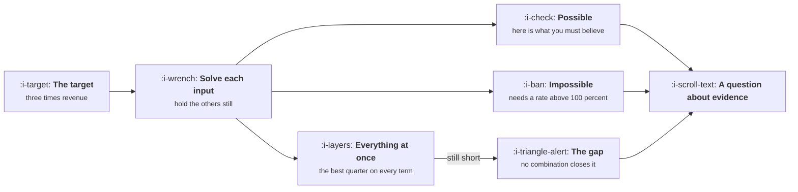

# Using the Model to Say No

```text
Level: Foundations
Prerequisites: Sensitivity
Estimated difficulty: 3/5 | Estimated time: 35 min
```

## The idea in one minute

The most valuable thing a growth model does is refuse work, and it does so without anybody having
to be the pessimist in the room. Take the target, hold everything constant except one input, and
solve for what that input would have to become. The answer is frequently a number above 100
percent, or a loop factor above 1, or a churn rate below zero, and at that point the conversation
stops being about ambition and becomes about arithmetic. The model never says no. It says what
you would have to believe, and the question of whether anybody believes it is one that a room
full of reasonable people can actually settle.

## A picture



Three outputs and all three lead to the same place: a conversation about what evidence exists,
which is a conversation that can be had without anybody defending their ambition.

## How it really works

### Invert the model

Forward, the model takes inputs and produces a number. Backwards, it takes the number somebody
has asked for and produces the inputs required. The second direction is the one that settles
arguments, and it is the same equation.

There is no clever method. Pick an input, hold everything else at today's value, and search for
the value of that input which hits the target. Fifteen lines of code, or a spreadsheet goal seek.
The output is a table with one row per input saying what it would have to become.

### What the three outcomes mean

**Impossible.** The required value is outside what the term can physically be. A rate above 100
percent, a loop factor at or above 1 when yours is 0.25, a churn rate below zero. This is the
cleanest outcome available in planning, because it is not a judgement. In the program below,
activation and churn are both impossible routes to the target on their own.

**Possible but unprecedented.** The required value is attainable in principle and far outside
anything you or anyone comparable has achieved. Tripling the signup rate from 3.5 to 10.5 percent
is arithmetically fine and would be remarkable. The useful response is not to argue about it but
to ask the evidence question: what would have to be true, and has anybody done it?

**Plausible.** The required value is within reach of things you have done before. Now you have a
plan rather than a target, and the conversation moves to what it costs.

### Then test the combination

The single input table is the first half. The second half is the one that actually ends the
argument: set every input to the best a quarter can realistically deliver, all at once, and see
whether the target is reached.

This is a deliberately generous test. It assumes activation improves 25 percent and signup 20
percent and churn falls a fifth, simultaneously, which never happens because the team only has so
many people and the terms are coupled. If the target is not reached under that assumption, it is
not reachable, and that conclusion is now arithmetic rather than opinion.

In the program below the generous combination reaches 2.48 times, against the three times asked
for, leaving a gap of about 103,000 a month that no combination of these inputs closes. The
target is not aggressive. It is outside the model.

### What to do with the answer

The point is not to win. Four responses are available and three of them are constructive.

**Change the timeline.** Most impossible targets are possible over a longer period, and the model
tells you how much longer. This is the most common resolution and the easiest to agree.

**Change the model.** If the target requires something outside the seven terms, then the plan
requires a new term: a new channel, a new product line, a new segment, an acquisition. That is a
real answer and it is a different conversation from the one that was being had, which was about
whether the growth team was being ambitious enough.

**Change the target.** Sometimes the number came from a fundraising narrative rather than from
anything about the business, and showing that it is outside the model is how that gets discovered.

**Proceed anyway, with the belief written down.** Occasionally the right call is to attempt it,
and the model's contribution is that the required assumption is recorded. When the quarter ends,
the reconciliation from lesson 03 will show whether the belief held, and the organisation learns
something instead of relitigating.

### How to present it without losing the room

The framing matters more than the arithmetic, and the arithmetic is the easy part.

Lead with the inputs, not the verdict. Show the table, let people read the required values, and
let the impossibility be noticed rather than announced. A room that works out for itself that
activation would have to exceed 100 percent arrives at a shared conclusion. A room that is told
the target is impossible arrives at a dispute about the model.

Bring the generous combination, because somebody will reasonably ask whether several smaller
improvements add up, and having run it already is the difference between a finished analysis and
a defensive one.

And offer the timeline that does work. The sentence "this target is reachable in nineteen months
rather than twelve, here is the path" is the one that gets adopted, and it requires no agreement
that anybody was wrong.

### What fills the box in 2026

Goal seek in a spreadsheet does the single input table, and the generous combination is one extra
column. The thing worth building once is the table itself as a standing output of the model, so
that it is already there when a target arrives rather than being produced in response to one.
Analysis produced in response to a target reads as resistance, and the identical analysis
produced beforehand reads as preparation.

## Run the numbers

The ask is three times revenue on the same timeline. This solves each input for what it would
have to become, then tests the generous combination.

```go
// sayno.go: the target, turned into what each input would have to become.
package main

import "fmt"

type in struct{ visitors, signup, activation, conversion, k, arpu, churn float64 }

func (i in) mrr(months int) float64 {
	n := i.visitors * i.signup * i.activation * i.conversion / (1 - i.k)
	out := 0.0
	for m := 0; m < months; m++ {
		out = out*(1-i.churn) + n*i.arpu
	}
	return out
}

type lever struct {
	name     string
	now      float64
	ceiling  float64 // the highest value physically or commercially possible
	helpUp   bool    // does raising it help
	apply    func(in, float64) in
	ceilNote string
}

// solve finds the value of one input that hits the target, or reports that
// no value inside its ceiling can.
func solve(base in, l lever, target float64, months int) (float64, bool) {
	lo, hi := 0.0, l.ceiling
	if !l.helpUp {
		lo, hi = 0.0, l.now
	}
	for i := 0; i < 200; i++ {
		mid := (lo + hi) / 2
		v := l.apply(base, mid).mrr(months)
		if (v < target) == l.helpUp {
			lo = mid
		} else {
			hi = mid
		}
	}
	got := l.apply(base, lo).mrr(months)
	return lo, got >= target*0.999
}

func main() {
	const months = 24
	base := in{120_000, 0.035, 0.420, 0.110, 0.250, 45.00, 0.032}
	b := base.mrr(months)
	target := 3 * b
	fmt.Printf("today's month %d revenue %.0f\n", months, b)
	fmt.Printf("the ask: three times that, %.0f, on the same timeline\n\n", target)

	levers := []lever{
		{"visitors", 120_000, 5_000_000, true,
			func(i in, v float64) in { i.visitors = v; return i }, "budget"},
		{"signup rate", 0.035, 1.0, true,
			func(i in, v float64) in { i.signup = v; return i }, "100%"},
		{"activation", 0.420, 1.0, true,
			func(i in, v float64) in { i.activation = v; return i }, "100%"},
		{"conversion", 0.110, 1.0, true,
			func(i in, v float64) in { i.conversion = v; return i }, "100%"},
		{"loop factor", 0.250, 0.99, true,
			func(i in, v float64) in { i.k = v; return i }, "k below 1"},
		{"price", 45.00, 10_000, true,
			func(i in, v float64) in { i.arpu = v; return i }, "none"},
		{"churn", 0.032, 0, false,
			func(i in, v float64) in { i.churn = v; return i }, "zero churn"},
	}

	fmt.Printf("%-14s %12s %16s %10s %s\n",
		"input", "today", "needed alone", "multiple", "verdict")
	for _, l := range levers {
		v, ok := solve(base, l, target, months)
		if !ok {
			fmt.Printf("%-14s %12.3f %16s %10s impossible, ceiling is %s\n",
				l.name, l.now, "no value", "", l.ceilNote)
			continue
		}
		fmt.Printf("%-14s %12.3f %16.3f %9.1fx possible, if you believe it\n",
			l.name, l.now, v, v/l.now)
	}

	fmt.Println("\nwhat a good quarter on every lever at once actually produces:")
	good := base
	good.visitors *= 1.15
	good.signup *= 1.20
	good.activation *= 1.25
	good.conversion *= 1.12
	good.k *= 1.30
	good.arpu *= 1.08
	good.churn *= 0.80
	g := good.mrr(months)
	fmt.Printf("  every input moved as far as a quarter can move it: %.0f\n", g)
	fmt.Printf("  which is %.2fx, against the %.0fx asked for\n", g/b, target/b)
	fmt.Printf("  the gap is %.0f, and no combination of these inputs closes it\n", target-g)
	fmt.Println("\nThe model does not say no. It says what you would have to believe,")
	fmt.Println("which is a conversation about evidence rather than about ambition.")
}
```

Two rows come back impossible. Activation would have to exceed 100 percent, because it is at 42
and the target needs it tripled. Churn would have to go below zero, because its elasticity at a
twenty four month horizon is only 0.33, so even eliminating churn entirely leaves you well short.
Neither of these is a judgement about the team.

The other five come back at exactly three times their current value, which is the signature of a
multiplicative model and worth recognising on sight: any single term in a pure product must
triple to triple the output. Visitors would need to go from 120,000 to 360,000, signup from 3.5
to 10.5 percent, price from 45 to 135. Each is arithmetically available and each is a different
company.

The loop factor row is the interesting one. It asks for k to move from 0.25 to 0.75, which is
only a threefold change in a number but takes the ceiling from 1.33x to 4x. That is the convexity
again, and it is the one row in the table where the required change, while enormous, is the sort
of thing a product change has occasionally achieved.

Then the combination. Every input moved as far as a good quarter moves it, all at once, produces
2.48 times, against the three asked for. The gap is 102,879 a month. There is no allocation of
the team that closes it, which is a much stronger statement than any opinion about the target and
is the sentence to take into the meeting.

## The AI layer

The most common target of this kind in 2026 arrives attached to a model: the plan assumes a new
feature with a model behind it lifts several rates at once. There is a specific and avoidable
error in how those plans are built.

The optimistic case is usually constructed by applying an improvement to activation, to
conversion and to retention simultaneously, on the grounds that a better product improves
everything. Multiplied together, three independent improvements of 20 percent produce a 73
percent lift, which is how plans of this shape reach targets that the single input table says are
unreachable. The terms are not independent: the same underlying improvement in product quality is
being counted three times.

The discipline is to name the mechanism once and let it enter the model once. If the feature
makes the first session succeed more often, that is activation. It may also show up in retention,
and if you claim both you need evidence that they are separate effects rather than one effect
observed twice.

The second thing to check is the cost term. A plan whose growth comes from a model in the product
raises cost per customer alongside revenue, and a three times revenue plan that does not state
what happens to gross margin has omitted the term most likely to make it unattractive even if it
works. That arithmetic is in
[AI Cost and Margin](../../product-management/ai-cost-and-margin/README.md).

A model is useful on the other side of this lesson too. Given a target and the inverted table, it
will competently draft the evidence question for each row: what would have to be true, and who
has done it. Treat the result as a checklist to verify rather than as findings, for the reason
the whole course keeps returning to, which is that it cannot tell you when it does not know.

## Sector lens

| Sector | What the inversion usually reveals |
|---|---|
| [Enterprise B2B SaaS](../../product-management/product-by-sector/01-enterprise-b2b-saas.md) | That the target needs more accounts than exist in the segment. Count the addressable accounts and the argument is over in one slide |
| [Fintech](../../product-management/product-by-sector/02-fintech.md) | That activation must exceed what the verification step structurally permits, which is a regulatory ceiling rather than a product one |
| [Ecommerce and D2C](../../product-management/product-by-sector/03-ecommerce-and-d2c.md) | That the required spend implies an acquisition cost above contribution margin, so the target is reachable and unprofitable |
| [Marketplaces](../../product-management/product-by-sector/04-marketplaces.md) | That one side must grow faster than the other can absorb, which single sided models hide completely |
| [Devtools and Infra](../../product-management/product-by-sector/05-devtools-and-infrastructure.md) | That the timeline is wrong rather than the target, because adoption lags mean this year's result was decided last year |
| [Healthtech](../../product-management/product-by-sector/06-healthtech-and-regulated-care.md) | That the number of procurement cycles available in the period caps the result regardless of any growth input |
| [Vertical SaaS](../../product-management/product-by-sector/07-vertical-saas.md) | That the target exceeds the number of firms in the trade. The most clear cut version of this conversation in any sector |

## Remember this

* Invert the model: hold everything constant, solve each input for the target, and read what it
  would have to become.
* Three outcomes: impossible, possible but unprecedented, plausible. The first is not a judgement
  and that is what makes it useful.
* In a multiplicative model, any single term must triple to triple the output. Recognise that
  signature.
* Always run the generous combination, every input at its best quarter simultaneously. If that
  falls short, the target is outside the model.
* Four responses: change the timeline, change the model, change the target, or proceed with the
  required belief written down.
* Lead with the inputs and let the room notice. A conclusion reached is shared; a conclusion
  announced is disputed.
* Build the table before a target arrives. The same analysis reads as preparation beforehand and
  resistance afterwards.
* Watch for plans that count one product improvement three times by applying it to three
  correlated terms.

## Try it

1. Run `sayno.go` with your own model and the most ambitious number anybody has said out loud
   this year. Note which rows come back impossible before you discuss it with anyone.
2. Build the generous combination for your own team, sourcing each achievable figure from
   something that actually happened. The sourcing is what makes it persuasive.
3. Find the timeline at which your current target becomes reachable under the generous
   combination. That sentence is the one to bring, and it should be the first thing you say.

## Check yourself

1. Why does every simple multiplicative term require exactly a threefold increase to triple the
   output, while the loop factor does not?
2. The generous combination reaches 2.48 times and the ask is three times. Why is this a stronger
   argument than any single row of the inversion table?
3. A plan claims a new feature raises activation, conversion and retention by 20 percent each.
   What should you check first, and what is the likely error?
