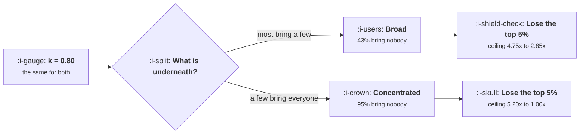

# The Viral Coefficient in Plain Words

```text
Level: Basic
Prerequisites: When Paid Is a Loop
Estimated difficulty: 3/5 | Estimated time: 35 min
```

## The idea in one minute

The loop factor is an average, and for viral loops specifically the average is a poor summary of
what is happening. Two products can report the same number and have nothing in common: in one,
most users bring a few people and the loop is broad and robust; in the other, ninety five percent
bring nobody and the entire channel rests on a small group. Both reach the same total. They
require opposite strategies, they fail differently, and only one of them can survive losing its
heaviest contributors. Before acting on a viral loop factor, look at the distribution underneath
it, because the number alone does not distinguish a business that has a loop from one that has
two hundred unusually enthusiastic people.

## A picture



One number at the top, two businesses at the bottom. The difference does not appear in any report
that quotes a mean.

## How it really works

### What the number actually is

The loop factor is new users produced per existing user, over some window, and
[Reading a Loop](../loops-and-compounding/03-reading-a-loop.md) covers how to compute it and the
three denominators that produce different answers. This lesson assumes you have it and asks what
it conceals.

It conceals the distribution. A mean of 0.8 is consistent with everybody bringing about one
person, with half the users bringing 1.6, and with five percent bringing sixteen. These are
different products with different risks and the same headline.

### The two shapes

Run the program and compare the rows.

The **even** product has 43 percent of users inviting nobody, which already sounds bad and is the
healthy case. Its top five percent of inviters account for 18 percent of invitations. Remove them
and the ceiling falls from 4.75 times to 2.85, which hurts and is survivable.

The **concentrated** product has 95 percent of users inviting nobody and its top five percent
account for 100 percent of invitations. Remove them and the ceiling falls from 5.20 times to
1.00, which is to say the loop ceases to exist.

Both report a loop factor of about 0.8. Both reach roughly 4.7 times their seed population. One
of them is a channel and the other is a relationship with a few hundred people.

### Why concentration is the norm

Most real viral loops are closer to the second shape, for the same reason most distributions of
human activity are skewed: enthusiasm is not evenly distributed, and the people who invite ten
colleagues are a different kind of person from the median user, not a more motivated version of
them.

This is not a problem to be fixed. A concentrated loop can be excellent. What it cannot be is
managed with averages, and three specific errors follow from trying.

**Optimising for the median user.** Changes designed to make the typical user invite one person
act on a population that will invite nobody regardless. The returns are concentrated in the same
place the invitations are.

**Missing the risk.** A loop resting on two hundred people is exposed to those two hundred people
in a way nothing on a dashboard reveals. They can leave, change role, or be hired by a
competitor.

**Misreading a decline.** When a concentrated loop weakens it is usually because a handful of
heavy inviters stopped, and the aggregate number falls smoothly while the cause is specific and
nameable. Teams investigate the product and the cause is forty people.

### What to do with a concentrated loop

Three things, and the first is the one that is almost never done.

**Identify them by name.** Your heaviest inviters are a list you can produce with one query and
almost nobody has. Everything else follows from having it.

**Serve them specifically.** Whatever makes inviting easier for them is worth more than any
general improvement, because they are the loop. Better sharing tools, administrative control,
the ability to invite in bulk, recognition.

**Find out why they do it.** The reason is usually structural rather than attitudinal: their role
requires bringing others in, their team adopted the tool, they run a community. Knowing the
structural reason tells you which other users have the same structure and are not yet inviting,
which is the only reliable way to grow a concentrated loop.

### Measuring the distribution

One query and one chart: invitations sent per user in a cohort, sorted descending. You are
looking for the share of invitations coming from the top one and five percent, and the share of
users sending none.

Report those two numbers alongside the loop factor permanently. They take no extra
instrumentation, they are stable enough to track quarterly, and they change the interpretation of
every other number in the topic.

### What fills the box in 2026

Nothing to buy. This is a query against the event data from
[Reading a Loop](../loops-and-compounding/03-reading-a-loop.md), and the reason it is rare is
that analytics products draw funnels and averages, not distributions. The chart has to be built
once, by hand, in whatever you use for queries.

## Run the numbers

Two populations, the same loop factor, and what each one depends on.

```go
// branching.go: two products with the same loop factor and nothing else in common.
package main

import (
	"fmt"
	"math/rand"
	"sort"
)

const (
	k     = 0.80   // both products invite 0.8 successful users per user, on average
	seeds = 20_000 // starting users
	runs  = 1      // one simulated population is enough at this size
)

// even: almost everyone brings a few. Poisson-like, drawn by summing coins.
func even(r *rand.Rand) int {
	n := 0
	for i := 0; i < 8; i++ {
		if r.Float64() < k/8 {
			n++
		}
	}
	return n
}

// concentrated: 95% bring nobody, 5% bring a crowd. Same mean.
func concentrated(r *rand.Rand) int {
	if r.Float64() >= 0.05 {
		return 0
	}
	// mean of this branch must be k/0.05 = 16
	return 1 + int(r.Float64()*31)
}

func simulate(name string, draw func(*rand.Rand) int) {
	r := rand.New(rand.NewSource(3))
	generation := seeds
	total := 0
	gens := []int{}
	var perUser []int

	for g := 0; g < 12 && generation > 0; g++ {
		next := 0
		for i := 0; i < generation; i++ {
			n := draw(r)
			next += n
			if g == 0 {
				perUser = append(perUser, n)
			}
		}
		gens = append(gens, generation)
		total += generation
		generation = next
	}

	zero := 0
	for _, n := range perUser {
		if n == 0 {
			zero++
		}
	}
	sort.Sort(sort.Reverse(sort.IntSlice(perUser)))
	topShare, sum := 0, 0
	for i, n := range perUser {
		sum += n
		if i < len(perUser)/20 {
			topShare += n
		}
	}

	fmt.Printf("%s\n", name)
	fmt.Printf("  measured k            %.3f\n", float64(sum)/float64(len(perUser)))
	fmt.Printf("  users who invited 0   %.0f%%\n", 100*float64(zero)/float64(len(perUser)))
	fmt.Printf("  share from the top 5%% %.0f%%\n", 100*float64(topShare)/float64(sum))
	fmt.Printf("  total users reached   %d from %d seeds (%.2fx)\n",
		total, seeds, float64(total)/seeds)

	// What the loop is worth if the heaviest inviters stop.
	kNow := float64(sum) / float64(len(perUser))
	kCut := float64(sum-topShare) / float64(len(perUser))
	fmt.Printf("  ceiling now           %.2fx\n", 1/(1-kNow))
	fmt.Printf("  ceiling without the top 5%%: %.2fx\n\n", 1/(1-kCut))
	_ = gens
}

func main() {
	fmt.Printf("both products have a loop factor of %.2f and %d seed users\n\n", k, seeds)
	simulate("evenly spread: most people bring a few", even)
	simulate("concentrated: a few people bring everyone", concentrated)
	fmt.Println("Same k, same total reach, completely different businesses. In the")
	fmt.Println("second one your entire loop is 5% of your users, and an average")
	fmt.Println("is the wrong summary of it.")
}
```

The two measured loop factors come out at 0.789 and 0.808, close enough that no report would
distinguish them, and the total reach is 4.59 times against 4.81 times, also close enough.
Everything a standard growth review would look at says these are the same channel.

The share from the top five percent is 18 percent against 100 percent. The share of users
inviting nobody is 43 percent against 95 percent.

The last line of each block is the one that matters for planning. Losing your heaviest inviters
costs the even product four tenths of its amplification and costs the concentrated product all
of it. A 5.20 times ceiling that becomes 1.00 times is not a weakened loop, it is the absence of
one, and the exposure is invisible until it happens.

Run it with the concentration changed from five percent to twenty percent and watch the
robustness improve without the headline number moving at all. That insensitivity is the argument
for reporting the distribution permanently.

## The AI layer

A model changes who the heavy inviters are, in a way worth checking rather than assuming.

Products where the output is shareable and generated have an unusual property: the cost of
producing something worth sharing has fallen for everybody, which tends to flatten the
distribution, moving a concentrated loop towards the even shape. More users produce something
worth showing somebody, so more users invite.

Working against that, the value of what gets shared has fallen too, which is the acceptance side
from
[Funnels Leak, Loops Compound](../loops-and-compounding/01-funnels-leak-loops-compound.md). More
people share and fewer recipients care, and the two effects can leave the loop factor unchanged
while the distribution underneath it has completely reorganised.

That is the specific thing to watch for, because it is invisible in the headline. A loop factor
that has held steady for two years while the concentration moved from 95 percent to 60 percent
is a materially more robust channel than it was, and nobody will have noticed. The reverse is
also possible and considerably worse.

Rerun the distribution chart yearly rather than once, for this reason.

## Sector lens

| Sector | What the distribution usually looks like |
|---|---|
| [Enterprise B2B SaaS](../../product-management/product-by-sector/01-enterprise-b2b-saas.md) | Extremely concentrated, and the heavy inviters are administrators doing their job. Identify them and the loop becomes manageable |
| [Fintech](../../product-management/product-by-sector/02-fintech.md) | Unusually even, because a payment has a recipient by construction rather than by enthusiasm |
| [Ecommerce and D2C](../../product-management/product-by-sector/03-ecommerce-and-d2c.md) | Very concentrated and small. A few customers recommend constantly and the median never will |
| [Marketplaces](../../product-management/product-by-sector/04-marketplaces.md) | Concentrated on the supply side, where professional sellers recruit others, and nearly flat on the demand side |
| [Devtools and Infra](../../product-management/product-by-sector/05-devtools-and-infrastructure.md) | The most concentrated of any sector. A handful of people bring entire companies, and they are identifiable by name |
| [Healthtech](../../product-management/product-by-sector/06-healthtech-and-regulated-care.md) | Concentrated among a few practitioners, and usually unmeasurable because the referral happens offline |
| [Vertical SaaS](../../product-management/product-by-sector/07-vertical-saas.md) | Concentrated and visible. The people who bring others are known figures in the trade, and the relationship is the channel |

## Remember this

* The loop factor is a mean, and for viral loops the mean is a poor summary.
* Two products at k of 0.8 can have 43 percent or 95 percent of users inviting nobody, and the
  same total reach.
* Removing the top five percent of inviters costs the broad loop four tenths of its ceiling and
  costs the concentrated loop all of it.
* Concentration is the norm, not a defect. It just cannot be managed with averages.
* Three errors follow from averages: optimising for a median who will never invite, missing a
  concentration risk, and investigating the product when the cause is forty people.
* For a concentrated loop: identify the heavy inviters by name, serve them specifically, and find
  out the structural reason they invite.
* Report two extra numbers permanently: share of invitations from the top five percent, and share
  of users sending none.

## Try it

1. Run `branching.go`, then change the concentration in the second function from 0.05 to 0.20 and
   observe that the headline loop factor is unmoved while the robustness changes completely.
2. Build the distribution chart for your own product: invitations per user, sorted. Compute the
   two numbers and put them next to your loop factor.
3. If your loop is concentrated, produce the list of your top fifty inviters and find out what
   they have in common. The structural answer is the one that tells you who else could be doing
   it.

## Check yourself

1. Two products report a loop factor of 0.8 and the same total reach. Name three ways their
   growth teams should behave differently.
2. Why does optimising the invitation flow for the median user often produce no change at all in
   a concentrated loop?
3. Your loop factor has been flat for two years. What could have changed underneath it that would
   matter, and what would you measure to find out?
