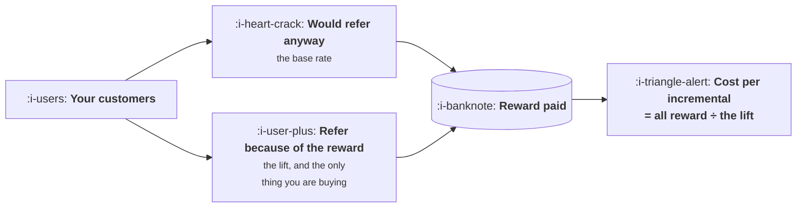

# Why Referral Programmes Do Nothing

```text
Level: Basic
Prerequisites: The Viral Coefficient in Plain Words
Estimated difficulty: 2/5 | Estimated time: 35 min
```

## The idea in one minute

The standard referral programme fails for a reason that is arithmetic rather than creative: you
pay a reward on every referral and you only buy the extra ones. Some share of your customers were
going to recommend you anyway, and the programme pays them too, so the true cost of an
incremental customer is the total reward spend divided by the lift rather than by the referrals.
When the lift is large this is a small adjustment. When the lift is small it is catastrophic, and
a programme that raises referral rates from three percent to 3.2 percent costs 800 per customer
against a bar of 421. The number that decides whether a programme can work is the organic
referral rate, measured before the programme exists, which almost nobody has because the
programme is the thing that makes anyone look.

## A picture



Two arrows into the payment and one of them produces nothing you did not already have.

## How it really works

### The arithmetic

Suppose three percent of your customers refer somebody without any programme at all. You launch
one and the rate goes to seven percent. On ten thousand customers that is 700 referrals, of which
300 would have happened regardless.

You pay the reward on all 700. At 50 per successful referral that is 35,000, and you bought 400
incremental customers, which is 88 each rather than the 50 the programme reports.

The 88 is still good against a bar of 421, and this programme is worth running. The point is not
that referral programmes never work. It is that the reported number understates the real cost by
the ratio of total referrals to incremental ones, and that ratio gets worse as the programme gets
weaker.

### Where it collapses

Run the program and read down the per incremental column: 800, 350, 200, 125, 88, 69.

The first row is a programme that lifted referrals from three percent to 3.2 percent. It produced
20 incremental customers, cost 16,000 in rewards, and bought customers at 800 each, which is
worse than almost any paid channel available. On its own reporting it produced 320 referrals at a
cost per referral of 50, which looks like the best channel in the company.

Most referral programmes are closer to this row than to the bottom one. The
[loop calculator](../loops-and-compounding/06-drawing-your-own-loop.md) in the previous topic put
a typical incentive referral loop at a ceiling of 1.01 times, which is the same finding arriving
from the other direction: six percent of users sending two invitations each at eleven percent
acceptance is a programme that converts 4,000 bought users into 4,056.

### Why the base rate is never known

To compute any of this you need the organic referral rate, and measuring it requires observing
referrals when no programme exists. Three practical ways, in descending quality.

**Measure before launching.** Instrument referral attribution first, run it for a quarter with no
programme, then launch. This is obvious, cheap, and almost never done because the instrumentation
is usually built as part of the programme.

**Hold out a group.** Exclude a random share of customers from the programme permanently and
compare their referral rate. The cleanest ongoing answer and it requires deciding before launch
that you want to know.

**Switch it off.** Suspend the programme in some regions for a quarter. Unpopular, informative,
and the only option available to a company that launched without the first two.

A programme running for two years with no holdout has no idea what it is buying, and that is the
normal condition.

### The other three failures

Beyond the base rate, three things reliably go wrong and all of them are visible in the loop
arithmetic.

**The send rate is tiny.** Typical incentive programmes move perhaps four to eight percent of
users to send anything. Since the loop factor is the product of send rate, invitations each and
acceptance, a four percent send rate caps the whole thing regardless of how generous the reward
is.

**The reward is paid for the wrong action.** Paying on signup buys signups, including worthless
ones, which is lesson 06. Paying on a genuine activation event costs more per unit and buys
customers.

**It is bolted onto a product nobody wants to recommend.** A referral programme amplifies an
existing willingness to recommend. If that willingness is near zero, multiplying it by an
incentive produces approximately zero, and no reward size fixes it. This is the honest
explanation for most failed programmes and the one that is hardest to say out loud.

### When a programme is worth running

Three conditions, and you want all three.

A measured organic referral rate that is already non trivial, because the programme multiplies
something that exists rather than creating it. A product where recommending costs the referrer
nothing socially, which rules out anything embarrassing or risky. And a reward that matches what
the user already wanted, which is lesson 05.

If you have those, the arithmetic above will usually land somewhere in the bottom half of the
table and the programme is a good use of money. If you do not, no amount of design work on the
invitation flow will rescue it.

### What fills the box in 2026

Referral platforms handle fulfilment, tracking and fraud screening competently and none of them
address anything in this lesson, because the failures here are arithmetic and structural rather
than operational. Buying one before measuring your base rate is the common sequence and it is
backwards.

The one genuinely useful thing such a platform provides is the holdout capability. Check it
exists before buying, because several make a permanent excluded group awkward and it is the only
feature in the category that answers the question this lesson asks.

## Run the numbers

Six levels of programme effectiveness, and the true cost of each.

```go
// referral.go: you pay the reward on the referrals that were going to happen anyway.
package main

import "fmt"

const (
	customers = 10_000.0
	organic   = 0.030 // share who refer somebody without any programme
	reward    = 50.00 // total paid out per successful referral, both sides
	bar       = 421.0 // the most you can pay for a customer
)

func main() {
	fmt.Printf("%.0f customers, %.0f%% refer with no programme at all\n", customers, 100*organic)
	fmt.Printf("reward %.0f per successful referral, bar %.0f\n\n", reward, bar)

	fmt.Printf("%-14s %12s %12s %14s %16s %10s\n",
		"with programme", "referrals", "incremental", "reward cost", "per incremental", "verdict")
	for _, withProg := range []float64{0.032, 0.035, 0.040, 0.050, 0.070, 0.110} {
		total := customers * withProg
		incr := customers * (withProg - organic)
		cost := total * reward
		per := cost / incr
		v := "worth it"
		if per > bar {
			v = "worse than paid"
		}
		fmt.Printf("%12.1f%% %12.0f %12.0f %14.0f %16.0f %10s\n",
			100*withProg, total, incr, cost, per, v)
	}

	fmt.Printf("\nthe naive number everyone quotes, at a %.0f%% referral rate:\n", 7.0)
	total := customers * 0.070
	fmt.Printf("  cost per referral      %6.0f   (reward cost / all referrals)\n", reward)
	fmt.Printf("  cost per incremental   %6.0f   (reward cost / referrals you caused)\n",
		total*reward/(customers*(0.070-organic)))

	fmt.Println("\nThe gap is the base rate. You are paying on every referral and")
	fmt.Println("buying only the extra ones, so the arithmetic collapses as the lift")
	fmt.Println("shrinks: a programme moving referrals from 3% to 3.2% costs 800 a")
	fmt.Println("customer, which is worse than almost any paid channel.")

	fmt.Println("\nwhat you would need to know before launching:")
	fmt.Println("  the organic referral rate, measured before the programme exists")
	fmt.Println("  which almost nobody measures, because the programme is the")
	fmt.Println("  thing that makes anyone look.")
}
```

The verdict column flips between the first and second rows, which is a lift from 0.2 percentage
points to 0.5. That is the entire difference between a programme that is worse than paid
acquisition and one that is better, and neither is distinguishable from the other on any report
the programme itself produces.

Compare the two numbers in the middle block. Cost per referral is 50 and cost per incremental
customer is 88, from the same programme in the same month. Both are correctly computed. The first
is the one that appears in the quarterly review.

Change `organic` from 0.030 to 0.055 and rerun. Several rows flip to worse than paid, because the
higher your base rate the more of your reward budget is spent on referrals you were getting free.
This is the counterintuitive part worth sitting with: **a product people already recommend is a
harder place to run a profitable referral programme**, not an easier one.

## The AI layer

Nothing about the arithmetic changes. Two operational things do, and one of them is a new risk.

Fraud detection has improved, which matters because the cheapest way to make a programme look
successful is to count claims that are not real customers. That is lesson 06, and better
detection genuinely moves the economics.

The new risk is that generating plausible referral activity has become cheap. Fake accounts with
coherent histories, plausible invitation messages and believable usage patterns are much easier
to produce than they were, which raises the fraudulent share at every reward level. The practical
consequence is that the optimal reward in lesson 06 has moved down, and a programme designed on
pre 2023 assumptions about fraud rates is probably paying more than it should.

The thing worth avoiding is using a model to write the invitation messages on the user's behalf.
It raises volume and lowers acceptance, because an invitation works precisely to the extent that
the recipient believes a specific person chose to send it to them specifically, and that belief
is the asset. Lesson 04 is about this.

## Sector lens

| Sector | Whether a programme can work |
|---|---|
| [Enterprise B2B SaaS](../../product-management/product-by-sector/01-enterprise-b2b-saas.md) | Rarely. The referrer is spending professional credibility and a voucher does not compensate for it. Relationship programmes work better than reward ones |
| [Fintech](../../product-management/product-by-sector/02-fintech.md) | Often yes, because money is the right reward for a money product and the base rate is measurable. Also the highest fraud exposure |
| [Ecommerce and D2C](../../product-management/product-by-sector/03-ecommerce-and-d2c.md) | Yes for repeat purchase products, where a discount is wanted by both sides. No for single purchase, where the referrer has left |
| [Marketplaces](../../product-management/product-by-sector/04-marketplaces.md) | Yes on the scarce side, where acquiring one supplier is worth a great deal and the base rate is low |
| [Devtools and Infra](../../product-management/product-by-sector/05-devtools-and-infrastructure.md) | Badly. The organic base rate is already high and paying for it converts a genuine recommendation into a transaction, which lowers acceptance |
| [Healthtech](../../product-management/product-by-sector/06-healthtech-and-regulated-care.md) | Frequently prohibited. Paying for patient referrals is regulated and in several jurisdictions illegal |
| [Vertical SaaS](../../product-management/product-by-sector/07-vertical-saas.md) | The base rate is high and the market is small, so a programme mostly pays for referrals that were coming. Spend the money on the trade association instead |

## Remember this

* You pay the reward on every referral and buy only the incremental ones. True cost is reward
  spend divided by the lift.
* Cost per referral and cost per incremental customer are both correctly computed and can differ
  by many times. The first is the one that gets reported.
* A lift from 3 percent to 3.2 percent costs 800 a customer. A lift from 3 to 11 costs 69. Same
  programme design, opposite verdict.
* The number you need is the organic referral rate, measured before the programme exists.
  Measure first, hold out a group, or switch it off in some regions.
* A high base rate makes a programme harder to run profitably, not easier.
* The send rate caps everything. Four percent of users sending anything limits the loop whatever
  the reward.
* A referral programme multiplies an existing willingness to recommend. If that is near zero, no
  reward size helps.
* Do not generate the invitation message. The asset is the recipient's belief that a specific
  person chose to send it.

## Try it

1. Run `referral.go` with your own numbers, then set `organic` to twice your estimate and rerun.
   If the verdicts change, your programme's value rests on a number you have not measured.
2. Find out whether your referral programme has ever had a holdout. If not, design one: a random
   five percent permanently excluded, reported quarterly.
3. Compute both numbers for your current programme, cost per referral and cost per incremental,
   and put them side by side in the next review. The conversation that follows is the point.

## Check yourself

1. Why does a higher organic referral rate make a referral programme harder to justify rather
   than easier?
2. Your programme reports a cost per referral of 40 against a bar of 421 and the team considers
   it the best channel in the company. What single number would change that assessment, and how
   would you get it?
3. A programme has run for two years with no holdout. What can you honestly say about its
   contribution, and what is the cheapest way to find out more?
