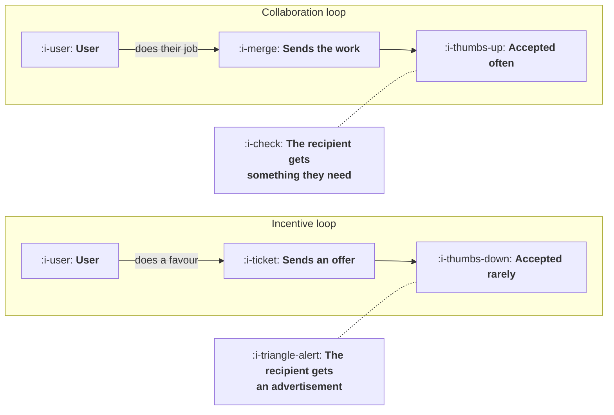

# Collaboration Loops

```text
Level: Basic
Prerequisites: Why Referral Programmes Do Nothing
Estimated difficulty: 2/5 | Estimated time: 30 min
```

## The idea in one minute

A collaboration loop is one where inviting somebody is how the user gets what they came for, and
it beats every incentive scheme by a wide margin for a structural reason: the invitation is not
a favour, it is a step in the task. Acceptance rates are several times higher because the
recipient receives something they need rather than an advertisement, and the send rate is a
property of the workflow rather than of anybody's generosity. The uncomfortable part is that
these loops cannot usually be added later. They are a consequence of what the product does, so
the decision that creates one is a product decision taken early, and a growth team arriving at a
product without one is mostly discovering a fact rather than facing a project.

## A picture



Both loops send a message. Only one of them sends something the recipient wanted before it
arrived.

## How it really works

### The structural difference

In an incentive loop the user is being asked to spend something: their time, a small amount of
social credit, the risk of recommending something that turns out to be bad. The reward exists to
compensate for that cost, which is why the whole arithmetic in the previous lesson is about
whether the compensation is worth what it buys.

In a collaboration loop the user is not spending anything. Sending a document for review,
assigning a task, splitting a bill, sharing a dashboard: the invitation is the mechanism by which
the user accomplishes the thing they opened the product to do. If they do not send it, they do
not get what they came for.

Three consequences follow and all of them are large.

**The send rate is a workflow property.** It is set by how often the task requires another
person, which can be most of the time, against the four to eight percent typical of incentive
programmes.

**Acceptance is high** because the recipient is receiving something addressed to their own
situation from somebody they know, usually with a reason to act on it today.

**There is nothing to pay.** No reward budget, no fraud, and none of the base rate problem from
the previous lesson, because the loop is the product working rather than a programme attached to
it.

### Why they cannot be retrofitted

A collaboration loop exists when the job the product does genuinely involves more than one
person. You can build sharing features into a single player product and people will not use
them, because there is nobody to share with as part of the task.

The honest test: **if you removed the invitation, would the user still get what they came for?**
If yes, you have a sharing feature and it will behave like an incentive loop without the
incentive. If no, you have a collaboration loop.

This is why the advice to build virality into your product is mostly unactionable. The decision
is about what the product is for, and it is usually taken before a growth team exists.

### What you can actually do

Three things, in descending order of how often they are available.

**Find the multiplayer part of a single player product.** Most products have one task somewhere
that already involves another person, usually buried: an approval, an export somebody else reads,
a report that gets forwarded. Making that path a first class invitation rather than a copied link
is the most common real version of this project, and it is a modest change with a loop attached.

**Remove the friction on the receiving side.** Many collaboration loops exist and perform badly
because the recipient has to create an account before seeing anything. The invitation worked and
the product refused it. Letting the recipient see the thing first and sign up second is
frequently the largest single improvement available to an existing loop, and it is lesson 04.

**Widen who counts as a collaborator.** If the product is used by one person per company, the
question is whether the output has an audience: a client, a manager, a regulator, a colleague in
a different function. Each of those is a potential recipient who is not currently receiving
anything.

What you cannot do is add an invitation to a workflow that does not need one and expect it to
behave differently from a referral programme.

### The weakness nobody mentions

Collaboration loops saturate inside the unit they operate in, and they saturate completely.

A tool shared within a team reaches that team and stops. The loop factor measured across your
whole user base looks healthy for as long as you are adding new teams, and within any given team
it has gone to zero within a few months. This is
[Why Most Loops Die](../loops-and-compounding/05-why-most-loops-die.md) with a reachable pool of
about forty people.

The practical consequence is that a collaboration loop is an expansion mechanism rather than an
acquisition one, and the acquisition of the first user in each new unit has to come from
somewhere else. Companies that mistake the within unit loop for a growth engine keep expecting
it to produce new accounts and it never does.

Measure it per unit and in aggregate, separately. The two numbers tell you different things and
the aggregate one hides the saturation entirely.

### What fills the box in 2026

The mechanics are product work rather than tooling: permissions, invitation flows, what a
recipient can see before authenticating. The one thing worth choosing deliberately is whether
recipients can act before creating an account, because that single decision usually moves
acceptance more than everything else combined and it is normally made by whoever built
authentication, for reasons that have nothing to do with growth.

## Sector lens

| Sector | Where the collaboration loop is |
|---|---|
| [Enterprise B2B SaaS](../../product-management/product-by-sector/01-enterprise-b2b-saas.md) | Approvals and shared artifacts. Strong within an account, zero between accounts, which is the saturation point exactly |
| [Fintech](../../product-management/product-by-sector/02-fintech.md) | The payment itself. The only common case where the loop crosses organisations naturally, which is why the sector grows this way |
| [Ecommerce and D2C](../../product-management/product-by-sector/03-ecommerce-and-d2c.md) | Gifting, shared baskets, group buying. Genuine but narrow, and confined to specific purchase occasions |
| [Marketplaces](../../product-management/product-by-sector/04-marketplaces.md) | A seller bringing their existing customers onto the platform, which is the strongest version available and worth designing for explicitly |
| [Devtools and Infra](../../product-management/product-by-sector/05-devtools-and-infrastructure.md) | Shared repositories, pull requests, public artifacts. Crosses organisations freely, which is unusual and valuable |
| [Healthtech](../../product-management/product-by-sector/06-healthtech-and-regulated-care.md) | Referrals between practitioners and shared patient records, both heavily constrained by consent rules |
| [Vertical SaaS](../../product-management/product-by-sector/07-vertical-saas.md) | Document exchange with clients and suppliers of the firm, which reaches other firms and is the one loop that crosses accounts |

## Remember this

* A collaboration loop is one where inviting is how the user gets what they came for, so the
  invitation costs them nothing.
* Send rate is a workflow property rather than a measure of generosity, and acceptance is high
  because the recipient needed the thing.
* There is no reward budget, no fraud, and no base rate problem.
* The test: if you removed the invitation, would the user still get what they came for? If yes,
  you have a sharing feature.
* These cannot usually be retrofitted. The decision is about what the product is for.
* What is available: find the multiplayer task buried in a single player product, remove friction
  on the receiving side, and widen who counts as a collaborator.
* Letting recipients see the thing before signing up is frequently the biggest single
  improvement, and is usually decided by whoever built authentication.
* They saturate completely inside a unit. Measure per unit and in aggregate separately, because
  the aggregate hides it.

## Try it

1. Apply the test to your product's sharing feature. If the user would still get what they came
   for without it, stop treating it as a loop and measure it as a referral programme.
2. Find the task in your product that already involves a second person and is currently handled
   by exporting something. That path is your candidate loop.
3. Measure the loop factor within a single account over its first year. If it goes to zero by
   month four, your collaboration loop is an expansion mechanism and your growth model should
   say so.

## Check yourself

1. Why does a collaboration loop have no base rate problem, when a referral programme does?
2. Your product has a share button that nobody uses. Using the test in this lesson, say what you
   have and what the realistic options are.
3. A company's aggregate loop factor has been stable at 0.6 for two years while every individual
   account saturates within four months. What is actually happening, and what does it mean for
   the growth model?
