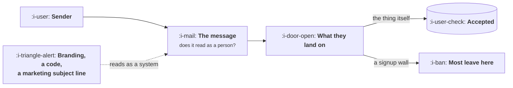

# Designing an Invite

```text
Level: Basic
Prerequisites: Collaboration Loops
Estimated difficulty: 2/5 | Estimated time: 30 min
```

## The idea in one minute

An invitation is accepted when the recipient believes a specific person chose to send it to them
for a specific reason, and almost every design decision either protects that belief or destroys
it. This is why the generic invitation with the company's branding and the referral code
performs so much worse than a plain message that looks like it came from a colleague: the first
is recognisably a system sending to a list, the second is a person. The second half of the
problem is on the landing side, where most of the loss actually happens, and the single largest
improvement available to most invitation flows is letting the recipient see the thing before
asking them to create an account.

## A picture



Two gates. Teams spend their effort on the first and lose most of the traffic at the second.

## How it really works

### The message

Four properties, and they are mostly about removing things.

**It is from a person.** A real name in the sender field, a real name in the first line, and
ideally a line the sender actually wrote. Every piece of company branding added to an invitation
moves it towards the category of mail people ignore, and the category judgement is made in under
a second.

**It says why this person, specifically.** "I am using this for the Q3 forecast and I need your
numbers in it" is an invitation. "Join me on this product" is a notification. The difference is
whether the recipient can tell they were chosen rather than included.

**It says what will happen when they click.** Recipients hesitate because the cost is unknown.
Stating it plainly, including that there is no account needed if that is true, removes most of
the hesitation.

**It is short enough to read on a phone without scrolling.** Most invitations are read in a
notification preview, and anything below the fold may as well not exist.

What to remove: the logo, the marketing subject line, the explanation of what your company does,
the referral code presented as the main content, the second call to action, and anything that
says "team" where a person's name should be.

### The landing side, where the loss is

An invitation that was accepted emotionally and then hit an account wall has not failed at
persuasion, it has failed at mechanics, and this is where most of the volume goes.

The question to settle deliberately: **what can the recipient do before creating an account?**
The answers range from nothing, through seeing the item read only, to acting on it and being
asked to sign up afterwards. Each step along that range costs engineering work and raises
acceptance substantially.

For a collaboration loop this is usually the single highest returning change available, because
the invitation itself is already working. The recipient wanted the document. You stopped them.

Three sub decisions that follow: whether the thing is visible without authentication, whether
the first action is possible before signup, and whether signing up afterwards preserves what
they just did. The third is the one most often broken, and losing somebody's work at the moment
they agree to join is the worst available outcome.

### Timing and who is asked

The moment to ask for an invitation is immediately after the user has got something out of the
product, not during setup. During setup they have nothing to recommend and the request reads as
a toll. After their first real success they have a reason and the request reads as natural.

Who to ask matters as much and is less often considered. The concentration result from lesson 01
says most users will never invite anybody, so a prompt shown to everybody is mostly shown to the
wrong people and trains them to dismiss it. Showing it to users who have reached a meaningful
milestone, or who have the structural property your heavy inviters share, is both more effective
and less annoying.

### Measuring the right thing

Invitations sent is the wrong metric and the one every dashboard shows. The useful chain is the
four terms from
[Reading a Loop](../loops-and-compounding/03-reading-a-loop.md): share who send, how many each,
acceptance, and then whether the accepted users activate.

That last term is the one that gets forgotten and the one most affected by invitation design. An
invitation that oversells produces acceptances that never activate, which looks like a successful
loop for exactly one step before dissolving. Track accepted to activated as a standing number and
compare it against your ordinary signups; if invited users activate worse, the invitation is
promising something the product does not do.

### What fills the box in 2026

Nothing to buy. The decisions are what the message contains and what the recipient can do before
authenticating, and both are product work.

The one thing worth knowing is that mailbox providers have become considerably better at sorting
bulk invitations into promotional folders, and the signals they use include the things listed
above as worth removing: heavy branding, tracking decoration, a template shared across thousands
of sends. Writing invitations that look like personal mail is now partly a deliverability
decision as well as a persuasion one.

## Sector lens

| Sector | What decides acceptance |
|---|---|
| [Enterprise B2B SaaS](../../product-management/product-by-sector/01-enterprise-b2b-saas.md) | Whether the recipient's name and the specific document are in the first line. Generic invitations are filtered before a person sees them |
| [Fintech](../../product-management/product-by-sector/02-fintech.md) | Trust within one second, which means the sender's name and the amount. Anything resembling a promotion reads as fraud |
| [Ecommerce and D2C](../../product-management/product-by-sector/03-ecommerce-and-d2c.md) | The offer and the product image. This is the one case where the incentive genuinely is the message |
| [Marketplaces](../../product-management/product-by-sector/04-marketplaces.md) | Seeing real inventory before signing up. An empty authenticated page is worse than no invitation |
| [Devtools and Infra](../../product-management/product-by-sector/05-devtools-and-infrastructure.md) | Landing on the actual artifact, readable without an account. Any wall is treated as hostile |
| [Healthtech](../../product-management/product-by-sector/06-healthtech-and-regulated-care.md) | Consent and identity verification make pre authentication viewing largely impossible, so the message has to carry everything |
| [Vertical SaaS](../../product-management/product-by-sector/07-vertical-saas.md) | The sender being somebody the recipient knows by reputation in a small trade. The name is most of the persuasion |

## Remember this

* An invitation works when the recipient believes a specific person chose to send it to them for
  a specific reason. Most design choices either protect or destroy that belief.
* Four properties: from a person, says why them specifically, says what happens on clicking, and
  readable without scrolling.
* Remove the logo, the marketing subject line, the company description and the code as the main
  content.
* Most of the loss is on the landing side, not in the message. Decide deliberately what the
  recipient can do before creating an account.
* Preserve what they did if they sign up afterwards. Losing their work at the moment of
  agreement is the worst outcome available.
* Ask after the user's first real success, never during setup.
* Ask the users with the structural property your heavy inviters share, not everybody.
* Track accepted to activated. An overselling invitation produces acceptances that dissolve.

## Try it

1. Send yourself your own product's invitation. Read it on a phone, in a notification preview.
   Decide in one second whether it looks like a person or a system.
2. Establish what a recipient can currently do before creating an account. If the answer is
   nothing, estimate the engineering work to let them see the item read only, and compare it
   against anything else in your growth backlog.
3. Compare the activation rate of invited users against ordinary signups. If invited users are
   worse, read your invitation again and find the claim the product does not support.

## Check yourself

1. Why does adding your company's branding to an invitation usually lower acceptance, when
   branding helps almost everywhere else?
2. Your invitation acceptance rate is 30 percent and the recipients who accept activate at half
   the rate of ordinary signups. What is most likely wrong, and where?
3. Why is showing the invitation prompt to every user both less effective and more costly than
   showing it to a subset, even though it reaches more people?
