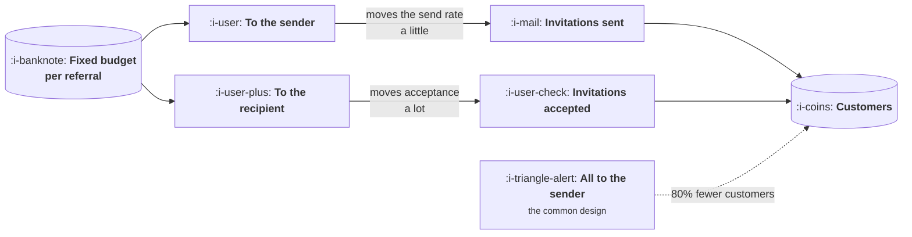

# Rewards

```text
Level: Basic
Prerequisites: Designing an Invite
Estimated difficulty: 2/5 | Estimated time: 30 min
```

## The idea in one minute

Given a fixed amount of money per successful referral, the question is how to split it between
the person sending and the person receiving, and the answer is less sensitive than the debate
about it suggests: anything from a fifth to three fifths towards the recipient lands within a
few percent of the best outcome. What is not insensitive is the decision to pay only one side.
Rewarding only the sender, which is the most common design, produces about eighty percent fewer
customers than a balanced split in the model below, because it spends the whole budget
motivating the person who was never the bottleneck. The bottleneck is the recipient deciding
whether to try an unfamiliar product.

## A picture



One budget, two recipients, and the arrows have very different thicknesses.

## How it really works

### The two sides are not symmetric

The sender is deciding whether to spend a small amount of social credit on somebody they know.
Money helps a bit and runs into a ceiling quickly, because beyond a point the obstacle is not
compensation, it is that they do not have anybody obvious to invite or do not want to be the
person who sends referral links.

The recipient is deciding whether to try a product they may not have heard of, which has a real
cost in time and attention. Money helps substantially here, because it directly offsets the
thing they are being asked to risk.

In the program, moving money to the sender takes the send rate from 4 percent to 11.5 percent,
which is a meaningful improvement. Moving the same money to the recipient takes acceptance from
6 percent to 39 percent, which is six and a half times. Both curves flatten, and they flatten at
very different heights.

### What the split does

Run the program and read the customers column: 69, 260, 334, 343, 337, 282, 156 as money moves
from entirely sender to entirely recipient.

The peak is at an even split and the middle of the range is remarkably flat. Twenty to the
recipient gives 334, twenty five gives 343, thirty gives 337. All three are within three percent
of each other, which means the argument your team is about to have about the exact split is
worth almost nothing.

The ends are where everything happens. All to the sender gives 69. All to the recipient gives
156. Both are catastrophic relative to the middle, and the first is the design most companies
actually ship.

### Why the common design is wrong

Rewarding only the sender is intuitive. They are your customer, they did you a service, you are
paying them for it. It is also an answer to the wrong question, because the send rate was never
the binding constraint.

A four percent send rate on ten thousand customers is four hundred invitations. If acceptance is
six percent, that is twenty four customers. Doubling the send rate with a generous sender reward
gets you forty eight. Raising acceptance from six percent to thirty four percent with the same
money gets you several hundred. The second lever is simply larger, and it is larger because the
recipient is the one making a decision about your product.

### What the reward should be

Three properties beyond the split.

**It should be something the recipient already wanted.** Credit towards the product is nearly
always better than cash or a voucher for something else, because it both compensates them and
commits them to trying the thing. Cash attracts people who want cash, which is lesson 06.

**It should be contingent on a real action.** Paying on signup buys signups. Paying on a
meaningful activation event, the one from
[Reading a Loop](../loops-and-compounding/03-reading-a-loop.md), buys customers and costs more
per unit, which is the correct trade.

**It should be legible before the click.** A reward the recipient learns about after signing up
has motivated nobody. It has to be in the invitation, which conflicts with the advice in the
previous lesson about keeping invitations personal, and the resolution is one plain sentence
rather than a decorated offer block.

### What size

Set the total from the arithmetic rather than by comparison with competitors. The reward plus
your fulfilment cost has to leave the cost per incremental customer below your bar, which is the
calculation in lesson 02 with your own base rate in it, and it will usually permit far less than
people assume.

Then check it against lesson 06, because fraud rises faster than the reward and the arithmetically
optimal reward is lower than the one that maximises genuine referrals alone.

### What fills the box in 2026

Fulfilment is a solved problem and the platforms are interchangeable. The decision worth making
carefully is product credit against cash, and the only real argument for cash is where your
product is not something a new user can be given more of, which is rarer than it appears.

One practical note: two sided rewards complicate your revenue reporting, because credit given to
a recipient is a discount rather than a marketing expense in most accounting treatments. Agree
that with finance before launching rather than after, since discovering it later tends to end
the programme for reasons unrelated to whether it worked.

## Run the numbers

A fixed fifty pounds per successful referral, split seven ways.

```go
// rewards.go: who should get the money, the person sending or the person receiving?
package main

import (
	"fmt"
	"math"
)

const (
	base    = 10_000.0 // customers who could refer
	total   = 50.0     // pounds available per successful referral
	sendMax = 0.12     // send rate as the referrer's share approaches everything
	accMax  = 0.40     // acceptance as the friend's share approaches everything
)

// Both sides respond to money with diminishing returns. The person receiving
// the offer is deciding whether to try a product; the person sending it is
// deciding whether to spend social credit. These are not equally movable.
func sendRate(toReferrer float64) float64 {
	return 0.040 + (sendMax-0.040)*(1-math.Exp(-toReferrer/18))
}
func acceptRate(toFriend float64) float64 {
	return 0.060 + (accMax-0.060)*(1-math.Exp(-toFriend/14))
}

func main() {
	fmt.Printf("%.0f pounds per successful referral, split between the two sides\n\n", total)
	fmt.Printf("%-10s %10s %12s %12s %12s %14s\n",
		"to friend", "to sender", "send rate", "accept", "customers", "reward spend")

	best, bestSplit := 0.0, 0.0
	for _, toFriend := range []float64{0, 10, 20, 25, 30, 40, 50} {
		toReferrer := total - toFriend
		invites := base * sendRate(toReferrer)
		got := invites * acceptRate(toFriend)
		fmt.Printf("%10.0f %10.0f %11.1f%% %11.1f%% %12.0f %14.0f\n",
			toFriend, toReferrer, 100*sendRate(toReferrer),
			100*acceptRate(toFriend), got, got*total)
		if got > best {
			best, bestSplit = got, toFriend
		}
	}

	fmt.Printf("\nmost customers at %.0f to the friend and %.0f to the sender\n",
		bestSplit, total-bestSplit)

	fmt.Println("\nEvery row costs the same per successful referral, because that is")
	fmt.Println("the number you fixed. What changes is how many you get.")
	fmt.Println("\nNotice how flat the middle is: anything between 20 and 30 to the")
	fmt.Println("friend lands within 3% of the best. The split is not the decision.")

	fmt.Println("\nwhat happens if you only pay the sender, which is the common design:")
	only := base * sendRate(total) * acceptRate(0)
	fmt.Printf("  %.0f customers, against %.0f at the best split: %.0f%% fewer\n",
		only, best, 100*(1-only/best))
}
```

The send rate column moves from 4.0 percent to 11.5 across the whole range. The acceptance
column moves from 6.0 percent to 39.0. Those two ranges are the entire argument: one lever is
worth roughly three times its starting value and the other roughly six and a half times.

The customers column peaks at 343 and the three middle rows are 334, 343 and 337. If your team
is debating twenty against thirty, the debate is worth nine customers and should be settled by
whoever speaks first.

The final line is the one worth carrying out of this lesson. Paying only the sender produces 69
customers against 343, which is eighty percent fewer, on exactly the same budget per successful
referral. That is not a tuning error, it is a structural one, and it is the most common referral
design in software.

Change `accMax` from 0.40 to 0.20, which is a product that is harder to persuade people to try,
and rerun. The optimal split moves further towards the recipient, because when acceptance is the
harder problem, more of the budget belongs where the problem is.

## The AI layer

Rewards are one of the few areas in this course where a model changes little about the design
and quite a lot about the defence.

The design is unaffected: the split, the contingency on a real action, and the preference for
product credit over cash are all unchanged.

What has changed is the fraud side, covered properly in the next lesson, with one consequence
that belongs here. Because fabricating plausible accounts is cheaper than it was, cash rewards
have become materially more expensive to run than product credit, and the gap between the two
has widened. Product credit given to a fake account costs you almost nothing, since the account
consumes a service that was going unused. Cash given to a fake account is gone.

That asymmetry was always present and used to be a secondary consideration. It is now frequently
the deciding one, and it argues for product credit even in cases where cash would otherwise be
more motivating.

## Sector lens

| Sector | What the reward should be |
|---|---|
| [Enterprise B2B SaaS](../../product-management/product-by-sector/01-enterprise-b2b-saas.md) | Often nothing transferable, since the referrer cannot personally accept a payment. Account credit or a donation works where cash does not |
| [Fintech](../../product-management/product-by-sector/02-fintech.md) | Cash, because the product is money and anything else is strange. Also the highest fraud exposure, so the amount must be set against lesson 06 |
| [Ecommerce and D2C](../../product-management/product-by-sector/03-ecommerce-and-d2c.md) | Discount on the next order for both sides, which is the one case where the reward also raises repeat purchase |
| [Marketplaces](../../product-management/product-by-sector/04-marketplaces.md) | Fee reductions on the scarce side. Paying cash to acquire supply attracts supply that does not transact |
| [Devtools and Infra](../../product-management/product-by-sector/05-devtools-and-infrastructure.md) | Usage credit, or nothing at all. Cash rewards read as beneath the relationship and can lower the organic rate |
| [Healthtech](../../product-management/product-by-sector/06-healthtech-and-regulated-care.md) | Frequently prohibited for patient referrals. Check before designing anything |
| [Vertical SaaS](../../product-management/product-by-sector/07-vertical-saas.md) | Service credit or training. The trade is small and cash payments between members become known |

## Remember this

* The split between sender and recipient is remarkably flat across the middle. The debate about
  the exact number is worth very little.
* Paying only the sender produces about eighty percent fewer customers on the same budget, and
  it is the most common design.
* The sender is deciding whether to spend social credit, which money moves a little. The
  recipient is deciding whether to try your product, which money moves a lot.
* Product credit beats cash: it compensates and commits, and it costs you almost nothing when
  claimed fraudulently.
* Pay on a real activation event, not on signup. It costs more per unit and buys customers
  rather than accounts.
* The reward must be visible before the click, in one plain sentence.
* Set the size from your own incremental cost arithmetic, then lower it for fraud.

## Try it

1. Run `rewards.go` with your own send and acceptance ceilings. The two ranges tell you which
   side your budget belongs on far more reliably than any benchmark.
2. Check what your current programme pays each side. If the recipient gets nothing, you have
   found an eighty percent improvement available without spending more.
3. Work out what your reward costs you in real terms if it is product credit rather than cash.
   For most software the answer is close to nothing, which changes what you can afford.

## Check yourself

1. Why is the recipient's side of the reward worth more than the sender's, when the sender is
   the one doing the work?
2. Your team is choosing between a 20 and 30 pound share to the recipient out of 50. How much
   does the decision matter, and what should you be discussing instead?
3. Why does product credit become relatively more attractive than cash as fraud becomes cheaper
   to commit?
