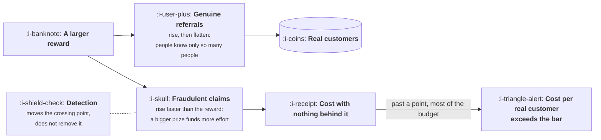

# Abuse and Fraud

```text
Level: Basic
Prerequisites: Rewards
Estimated difficulty: 3/5 | Estimated time: 35 min
```

## The idea in one minute

Every referral scheme is gamed, in proportion to what it pays, and the proportion is not linear.
Genuine referrals rise with the reward and level off, because there are only so many people your
customers know. Fraudulent claims rise faster than the reward, because gaming a scheme is a
business whose economics improve as the prize grows. The two curves cross, which means there is
a reward above which you are mostly buying fraud, and in the model below a reward of 120 produces
76 percent fraudulent claims and a real customer cost of 502 against a bar of 421. Detection
helps and does not change the shape: it moves the crossing point rather than removing it.

## A picture



Two curves out of one decision, with different shapes. Everything in this lesson follows from
the second one being steeper.

## How it really works

### Why fraud grows faster than the reward

A genuine referral is limited by how many people your customer knows who might want the product.
Raising the reward makes them try a bit harder and then they run out of people. The curve
flattens because the population is finite.

A fraudulent claim is limited by the cost of manufacturing one: an email address, a plausible
account, enough activity to clear whatever check you run. That cost is roughly fixed, so when
the prize doubles, the margin on each fake claim more than doubles, and the effort it is worth
putting in rises accordingly. The curve steepens because it is a business.

Two different mechanisms, which is why no amount of tuning makes the fast one grow slower than
the slow one.

### Reading the table

Run the program. At a reward of 10, four percent of claims are fraudulent and each real
customer costs 10. At 50, fraud is 35 percent and real customers cost 77. At 120, fraud is 76
percent and real customers cost 502, which is above the bar of 421, so the programme is now
worse than paid acquisition while appearing to produce 1,658 referrals a month.

The genuine column barely moves across the top of that range: 346 at a reward of 50, 384 at 80,
397 at 120, 400 at 200. Quadrupling the reward from 50 to 200 buys 54 extra genuine referrals
and 3,696 extra fraudulent ones.

The value maximising reward in this model is 50. That is substantially lower than most teams
would choose by instinct, and the instinct is calibrated on the genuine column alone.

### What detection actually buys

The second block holds the reward at 120 and varies how much fraud is caught. At zero detection
a real customer costs 502. At fifty percent, 311. At eighty percent, 196. At ninety five
percent, 139.

Detection is clearly worth having. Note what it does not do: even at ninety five percent
detection, a reward of 120 delivers real customers at 139, while a reward of 50 with no
detection at all delivers them at 77. **Lowering the reward beat near perfect detection**, and
it was free.

That is the practical ordering. Set the reward correctly first, then invest in detection, rather
than treating detection as the thing that lets you offer more.

### How schemes are actually gamed

Five patterns, in rough order of how much they cost people.

**Self referral.** The same person creating accounts to claim both sides. The simplest and the
most common, defeated by basic device and payment checks, which is why it is also the least
costly in practice.

**Incentivised sharing at scale.** Posting referral codes to sites that exist to aggregate them.
The referrals are from real people and are not fraud exactly; they are just worthless, because
the recipients want the reward and not the product. The tell is acceptance with near zero
activation.

**Account farms.** Manufactured identities at volume, which is the category that has become
cheaper and is the reason the optimal reward has fallen.

**Collusion rings.** Groups referring each other in rotation, each claiming legitimately under
the rules. Hard to detect because every individual action looks fine and only the graph reveals
it.

**Employees and their friends.** Rarely malicious and frequently material. Worth an explicit
rule rather than an awkward conversation later.

### The defences that are worth the effort

Four, in order of return per unit of work.

**Pay on activation, not signup.** This defeats most of the first three categories at once,
because a manufactured account will not use the product in a way that looks real, and it costs
you nothing in genuine referrals. It is by a wide margin the highest returning control here.

**Delay the payout.** A week or two between the qualifying action and the reward removes most
of the automated attempts and annoys almost no genuine referrer.

**Cap per account.** A limit of perhaps five rewarded referrals a month costs you nothing from
the concentration result in lesson 01, because your genuine heavy inviters are usually inviting
colleagues rather than hundreds of strangers, and it bounds your worst case exactly.

**Use product credit rather than cash,** from the previous lesson. A fake account consuming
service it would not otherwise consume costs you nearly nothing.

### What fills the box in 2026

Fraud screening is available from referral platforms and from general purpose risk vendors, and
the quality difference between them is smaller than the difference made by paying on activation.
Buy something, set it up, and do not expect it to substitute for the reward being the right size.

The change worth planning for is that manufactured accounts have become considerably more
convincing: coherent histories, plausible usage, messages that read naturally. Signals based on
whether an account looks real have weakened, and signals based on whether an account does
something economically meaningful have not. That is a direct argument for the first defence in
the list and against anything resembling identity checking.

## Run the numbers

Six reward levels, and what detection is worth at one of them.

```go
// fraud.go: every referral scheme is gamed in proportion to what it pays.
package main

import (
	"fmt"
	"math"
)

const (
	base = 10_000.0 // customers who could refer
	bar  = 421.0    // the most a real customer is worth paying for
)

// Genuine referrals rise with the reward and level off. Fraudulent claims
// rise faster than the reward, because gaming it is a business with its own
// economics and a larger prize attracts more effort.
func genuine(reward float64) float64 {
	return base * 0.04 * (1 - math.Exp(-reward/25))
}
func fraudulent(reward float64) float64 {
	return base * 0.004 * math.Pow(reward/25, 2.2)
}

func main() {
	fmt.Printf("%-10s %12s %12s %10s %14s %16s\n",
		"reward", "genuine", "fraudulent", "fraud", "total paid", "per real customer")
	best, bestReward := -1e18, 0.0
	for _, r := range []float64{10, 25, 50, 80, 120, 200} {
		g, f := genuine(r), fraudulent(r)
		paid := (g + f) * r
		per := paid / g
		value := g*bar - paid
		if value > best {
			best, bestReward = value, r
		}
		fmt.Printf("%10.0f %12.0f %12.0f %9.0f%% %14.0f %16.0f\n",
			r, g, f, 100*f/(g+f), paid, per)
	}
	fmt.Printf("\nmost value at a reward of %.0f\n", bestReward)

	fmt.Println("\nwhat detection is worth, at a reward of 120:")
	const r = 120.0
	g, f := genuine(r), fraudulent(r)
	fmt.Printf("  %-26s %12s %14s\n", "detection catches", "paid out", "per real customer")
	for _, caught := range []float64{0, 0.5, 0.8, 0.95} {
		paid := (g + f*(1-caught)) * r
		fmt.Printf("  %25.0f%% %12.0f %14.0f\n", 100*caught, paid, paid/g)
	}

	fmt.Println("\nFraud is not a tax you can ignore and not a reason to pay nothing.")
	fmt.Println("It is a term that grows faster than the reward, so there is an")
	fmt.Println("amount above which a larger prize buys you mostly fraud, and")
	fmt.Println("detection moves that amount rather than removing the problem.")
}
```

The fraud percentage column is the one to read first: 4, 14, 35, 57, 76, 91. At a reward of 200
more than nine in ten claims are fake, and the programme is paying out 856,020 to acquire 400
real customers at 2,141 each.

Compare the genuine and fraudulent columns at a reward of 80. You are paying for 901 claims, of
which 384 are real. More than half of every pound is going to somebody who manufactured an
account, and the programme's own reporting will show 901 referrals at 80 each, which reads as
excellent.

The detection block makes the ordering clear. Ninety five percent detection at a reward of 120
gives you real customers at 139. No detection at all at a reward of 50 gives you 77. The reward
is the larger lever and it is free to pull, which is the opposite of how most teams approach
this, since buying a fraud tool feels like action and lowering the reward feels like retreat.

Change the fraud exponent from 2.2 to 1.5, which is a scheme that is harder to game, and rerun.
The optimal reward rises considerably, which is the honest form of the conclusion: how much you
can afford to pay depends on how hard your scheme is to fake, and that is a property you can
change through the defences above.

## The AI layer

This is the lesson most affected, and the effect is one sided.

The cost of manufacturing a convincing fake account has fallen substantially. Coherent profile
histories, plausible usage sequences and natural invitation messages are all cheap to produce
now, which means the fraudulent curve in the program has become steeper at every reward level.
The practical consequence is that the optimal reward has moved down, and a programme sized on
assumptions from several years ago is likely paying above its own crossing point.

The defences split sharply on this. Anything that asks whether an account looks real has
weakened, probably permanently, and that includes profile completeness, writing style and
behavioural plausibility. Anything that asks whether an account did something economically
meaningful has not weakened at all, because faking genuine product usage at scale costs real
resources and produces no reward unless the scheme pays for signups.

So the recommendation sharpens rather than changes: pay on activation, define activation as
something that costs the faker something, and treat appearance based signals as a secondary
filter rather than a control.

One reasonable use of a model in defence: detecting collusion rings, which is a graph problem
over your own data rather than a judgement about whether an individual looks genuine. That is
the category where these tools work well, and it is the fraud pattern that is hardest to catch
by rule.

## Sector lens

| Sector | What the fraud looks like |
|---|---|
| [Enterprise B2B SaaS](../../product-management/product-by-sector/01-enterprise-b2b-saas.md) | Rare, because accounts are verified organisations. The real leakage is employees referring friends, which needs a written rule |
| [Fintech](../../product-management/product-by-sector/02-fintech.md) | The most exposed sector by a distance. Cash rewards plus identity requirements plus organised attempts. Expect a dedicated function |
| [Ecommerce and D2C](../../product-management/product-by-sector/03-ecommerce-and-d2c.md) | Code aggregation sites, where the codes are real and the recipients want the discount and nothing else |
| [Marketplaces](../../product-management/product-by-sector/04-marketplaces.md) | Fake supply claiming acquisition rewards, which also pollutes the marketplace itself. Two costs from one attack |
| [Devtools and Infra](../../product-management/product-by-sector/05-devtools-and-infrastructure.md) | Automated account creation at scale, since the users are capable of it. Usage based rewards are the only workable design |
| [Healthtech](../../product-management/product-by-sector/06-healthtech-and-regulated-care.md) | Referral payments are regulated and in several places illegal. The compliance question precedes the fraud question |
| [Vertical SaaS](../../product-management/product-by-sector/07-vertical-saas.md) | Almost none. The market is small and everybody is known, which is one of the genuine advantages of the sector |

## Remember this

* Genuine referrals flatten because people know only so many people. Fraud steepens because
  gaming a scheme is a business with improving margins.
* The two curves cross. Above that reward you are mostly buying fraud.
* In the model, a reward of 120 produces 76 percent fraud and real customers at 502 against a
  bar of 421, while reporting 1,658 referrals.
* Quadrupling the reward from 50 to 200 bought 54 extra genuine referrals and 3,696 fraudulent
  ones.
* Lowering the reward beat ninety five percent detection, and it was free. Set the reward first,
  then buy detection.
* Five patterns: self referral, code aggregation, account farms, collusion rings, and employees.
* Four defences in order: pay on activation, delay the payout, cap per account, and use product
  credit rather than cash.
* Appearance based fraud signals have weakened permanently. Economic signals have not.

## Try it

1. Run `fraud.go` with your own reward and your own estimate of the fraud exponent. If you have
   no estimate, that is the measurement to make before the next programme change.
2. Check what action your programme pays on. If it pays on signup, changing it to a real
   activation event is the highest returning thing in this lesson and costs no genuine
   referrals.
3. Compare the activation rate of referred users against ordinary signups. A large gap is either
   fraud or code aggregation, and both are the same finding for budget purposes.

## Check yourself

1. Why does fraud rise faster than linearly with the reward, while genuine referrals rise more
   slowly? Give the mechanism for each.
2. Your programme pays 120 per referral and you are offered a fraud tool that catches 80 percent.
   Using the arithmetic here, what is the alternative worth comparing it against?
3. Why have appearance based fraud checks weakened while activation based ones have not, and
   what does that imply about where to spend engineering time?
