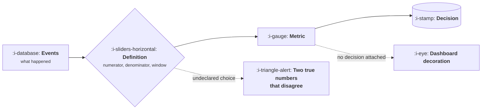

# Metrics and Models: The Numbers You Are Judged On

> Every number an operator is held to, defined once: what it measures, the formula, the denominator
> people get wrong, what a good value looks like, and a program that computes it so you can put your
> own inputs in.

This course is the definition site for the whole library. No other course defines a metric; they
link here. That rule exists because the alternative is what most companies actually have, which is
four definitions of customer acquisition cost in four documents, each defensible, producing
meetings that are really about arithmetic while appearing to be about strategy.

It assumes no statistics beyond arithmetic. It does assume you are willing to be annoyed by how
many commonly quoted numbers fall apart when you ask what the denominator was.

## The shape of the problem

Almost every metric argument is the dotted branch on the left: two people computing honestly from
the same events, having made different undeclared choices about the denominator or the window.

## How this course works

Every lesson gives the formula, names the choices hidden inside it, states what a good value looks
like with a date attached, and ends in a Go program that computes it from inputs you can change.
Where a metric is commonly misused, the misuse gets its own section, because knowing the formula
has never been the hard part.

## The topics

| Topic | You will be able to | Level |
|---|---|---|
| How to Read a Metric | Spot a bad denominator, a mix shift and a vanity metric before acting on one | Foundations |
| Funnel and Acquisition | Define conversion and acquisition cost so that two people get the same answer | Basic |
| Retention and Cohorts | Build a cohort table and read whether the curve flattens | Intermediate |
| [Revenue and Efficiency](IV-revenue-and-efficiency/README.md) | Compute payback, lifetime value, retention of revenue and capital efficiency honestly | Intermediate |
| Sales and Pipeline Math | Forecast from coverage, conversion and cycle length without lying | Advanced |
| Unit Economics With AI Costs | Put inference cost in a margin model and see where it breaks | Advanced |
| Benchmarks and Their Limits | Find a real benchmark, adjust it for stage, and build your own baseline | Expert |

## A promise about numbers

Benchmark figures in this course carry the date they were checked, which is **12 October 2026** unless
a lesson says otherwise, and the source. Where no credible public source exists, the lesson says
so rather than quoting a round number that has been circulating since a conference talk in 2019.
