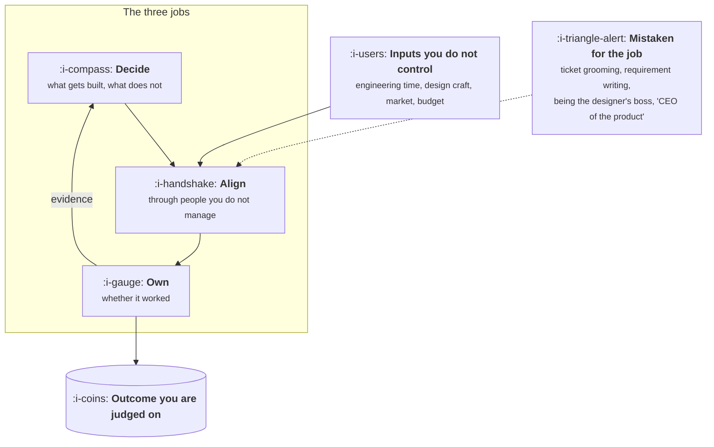

# What a Product Manager Does

```text
Level: Foundations
Prerequisites: None
Estimated difficulty: 1/5 | Estimated time: 30 min
```

## The idea in one minute

A product manager has three jobs: decide what gets built, make it happen through people who do
not report to them, and own whether it worked. Everything else attributed to the role is either a
tool used in service of those three, or somebody else's craft. The defining feature of the job is
an asymmetry: you are accountable for outcomes while controlling almost none of the inputs
directly. That asymmetry explains why the role feels ambiguous, why it is mostly writing and
conversation, and why the strongest product people are the ones whose decisions are legible enough
that other people can act on them without being supervised.

## A picture



Notice that the only arrow leaving the role points at an outcome, while every arrow entering it
comes from something you do not own. That is the whole shape of the job.

## How it really works

### Job one: decide what gets built

Deciding is not choosing from a list somebody handed you. It is constructing the list, defending
the ordering, and saying no often enough that the yes means something. A decision is complete when
three things are written down: what you are doing, what you are therefore not doing, and what
would have to be true for this to be wrong.

The last part is the one teams skip, and skipping it is what turns a decision into an opinion. A
decision that cannot be falsified cannot be learned from, which means the team will relitigate it
every quarter.

### Job two: make it happen through people you do not manage

You have no hiring power over the engineers, no veto over the designer, no authority over the
salesperson who promised a feature to a customer. What you have is information, sequencing, and
the written record. In practice, the work of job two looks like this:

* Making sure the engineer knows the *why*, so they can make fifty small decisions correctly without asking.
* Making sure the designer has the constraint, not the solution.
* Making sure the person who will support the thing hears about it before launch week.
* Making sure the decision is written somewhere a new joiner can find in six months.

### Job three: own whether it worked

Ownership means you are the person who says "this did not work" first, with numbers, before anyone
asks. Teams where the PM is the last to admit a failure have a credibility problem that compounds:
once leadership suspects the readouts are advocacy rather than measurement, every future
recommendation is discounted.

### What the job is not

| Mistaken for | The tell | What it actually is |
|---|---|---|
| Project manager | Your week is status, dependencies and a Gantt chart | Project management is a *tool* of job two. When it is the whole job, nobody is doing job one |
| Requirements scribe | You write what stakeholders ask for and hand it over | Requirements collection without a decision is order taking. The value was in the refusal |
| The designer's boss | You critique by redirecting to your own solution | You own the problem and the constraint. They own the solution space |
| CEO of the product | Quoted to justify unilateral calls | You have no firing power and no budget. The phrase describes accountability, never authority |

### Where the authority actually comes from

Four sources, in roughly descending reliability.

1. **Information asymmetry.** You have talked to more customers, read more tickets and seen more
   data than anyone else in the room. This is earned weekly and decays fast.
2. **The written artifact.** A clear document outlives a persuasive meeting. Written decisions get
   followed when you are on holiday.
3. **Sequencing.** Deciding what gets discussed, in what order, with whom, is most of what
   "driving alignment" means.
4. **Access.** Being the person who can get the answer from the person who has it.

Notice that none of these are positional. A PM who stops talking to customers loses source one
within a month, and sources two to four depend on it.

### What fills the box in 2026

Tracking and specs live in Linear, Jira or GitHub Projects. Documents live in Notion or Confluence.
Product analytics is Amplitude, Mixpanel, PostHog or Heap. Design handoff is Figma. Feedback
aggregation is Productboard, Pendo, Dovetail or a spreadsheet, and the spreadsheet is a legitimate
answer below about thirty inbound requests a week. None of these tools do job one.

## Run the numbers

The decision in job one has a price. One quarter of a small team is a six figure bet, and knowing
the number changes how carefully you want the decision written. This program computes the loaded
cost of a bet and the success probability it has to clear to be worth making.

```go
// bet.go: what a quarter of team time costs, and the odds a bet must clear.
package main

import "fmt"

type bet struct {
	name     string
	people   float64 // engineers, designer and PM actually on it
	quarters float64
	upside   float64 // annual gross profit if it works
	life     float64 // years the upside persists before it is competed away
}

// Fully loaded: salary, payroll tax, benefits, equipment, software, allocated overhead.
// Replace with your own number; it is usually 1.3 to 1.5 times base salary.
const loadedPerYear = 220_000.0

func cost(b bet) float64 { return b.people * b.quarters * loadedPerYear / 4 }

// breakEven is the probability of success at which expected value equals cost,
// assuming a failed bet returns nothing.
func breakEven(b bet) float64 { return cost(b) / (b.upside * b.life) }

func main() {
	bets := []bet{
		{"small integration", 2, 0.5, 120_000, 3},
		{"onboarding rebuild", 5, 1, 900_000, 3},
		{"new pricing tier", 4, 1.5, 2_400_000, 4},
		{"platform migration", 8, 3, 350_000, 5},
	}
	fmt.Printf("%-20s %10s %12s %10s\n", "bet", "cost", "upside/yr", "needs")
	for _, b := range bets {
		p := breakEven(b)
		verdict := "plausible"
		if p > 0.6 {
			verdict = "needs proof first"
		}
		fmt.Printf("%-20s %10.0f %12.0f %9.0f%%  %s\n", b.name, cost(b), b.upside, 100*p, verdict)
	}
	fmt.Println("\nA bet needing 70% confidence is a bet that must be tested before it is scheduled.")
}
```

The platform migration is the interesting row. Its upside is defensive, which is to say avoided
cost and future velocity, so it is both smaller and harder to measure than the upside of a feature.
That combination is what forces it above 70%: not the length of the project, but the weakness of
the number on the other side. Almost nobody runs a cheap test before committing eight people for
three quarters, and this row is the argument for doing so.

## The AI layer

A model is genuinely useful for the parts of this job that are synthesis: reading two hundred
support tickets and clustering them, turning a messy interview transcript into claims with
quotes attached, drafting the first version of a document you will rewrite, and producing the
counterargument to your own proposal on demand. At roughly 2 to 20 cents of inference per
document at 2026 frontier prices, the cost is irrelevant next to the time.

It fails in a specific and dangerous way for this job: asked what users need, a model will produce
a fluent, plausible, well structured answer drawn from the general shape of such answers rather
than from your users. It does not know that it does not know. The protection is mechanical: a
model may only summarise evidence you supply, every claim it makes must carry a quote or a row,
and anything without a citation gets deleted rather than softened.

The part it cannot touch is job three. Accountability is not a task.

## Sector lens

| Sector | What changes about the job |
|---|---|
| [Enterprise B2B SaaS](../XIX-product-by-sector/01-enterprise-b2b-saas.md) | Job two expands enormously: sales, CS and the champion all shape scope. Job one is partly done for you by contracts |
| [Fintech](../XIX-product-by-sector/02-fintech.md) | Compliance holds a real veto, so "decide" means decide within a legal envelope you must learn |
| [Ecommerce and D2C](../XIX-product-by-sector/03-ecommerce-and-d2c.md) | Feedback is same day and quantitative, so job three is fast and public |
| [Marketplaces](../XIX-product-by-sector/04-marketplaces.md) | You have two customers with opposed interests, and job one includes choosing which one loses |
| [Devtools and Infra](../XIX-product-by-sector/05-devtools-and-infrastructure.md) | Your users can read the code and will tell you precisely why you are wrong. Information asymmetry is weak |
| [Healthtech](../XIX-product-by-sector/06-healthtech-and-regulated-care.md) | Clinical risk means some decisions are not yours at all, and the artifact is a regulated document |
| [Vertical SaaS](../XIX-product-by-sector/07-vertical-saas.md) | Domain depth replaces data volume as the source of authority |

## Remember this

* Three jobs: decide, align, own. Everything else is a tool or somebody else's craft.
* The job's defining feature is accountability without control, which is why it runs on writing.
* A decision is complete only when the refusal and the falsification test are written down too.
* Authority comes from information, artifacts, sequencing and access. All four decay if you stop
  talking to customers.
* Say the thing did not work first, with numbers, before you are asked.

## Try it

1. Run `bet.go`, then change `loadedPerYear` to your company's real number and `life` to one year.
   Which bets stop being worth making?
2. Take the last significant decision your team made. Write the refusal and the falsification test
   that should have accompanied it. Was either recorded anywhere?
3. List what you did in the last five working days. Mark each item as job one, job two, job three,
   or none of them. If job one is under ten percent, who is doing it?

## Check yourself

1. Why does calling the role "CEO of the product" cause practical problems, beyond being inaccurate?
2. Your information asymmetry is the most reliable source of authority and the fastest to decay.
   What weekly habit maintains it, and what does its absence look like after two months?
3. A bet needs 70% confidence to break even. Name two things you could do for under a week of one
   person's time that would move your actual confidence enough to matter.
