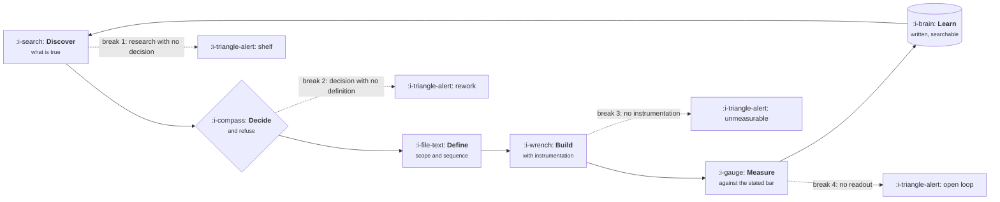

# The Product Loop

```text
Level: Foundations
Prerequisites: What a Product Manager Does
Estimated difficulty: 2/5 | Estimated time: 30 min
```

## The idea in one minute

Product work is a loop: discover, decide, define, build, measure, learn, and back into discover.
The loop is not a diagram on a wall; it is a machine with two properties that determine how good
a team gets over time. The first is **cycle time**, how long one full turn takes. The second is
**closure rate**, the fraction of things you shipped that actually received a readout. Most teams
optimise the first and ignore the second, which produces a fast open loop: a team that ships
constantly, learns nothing, and makes its tenth decision with exactly the information it had for
its first.

## A picture



The four dotted branches are the only four ways this loop fails, and the fourth is the most
common by a wide margin because nothing visibly breaks when you skip it.

## How it really works

### The five stages, and what each one owes the next

A stage is finished when it has produced the thing the next stage needs. Not a meeting, a thing.

| Stage | It is done when it has produced | Owned by |
|---|---|---|
| Discover | Claims about users and the market, each with evidence attached | Product, with design and data |
| Decide | A choice, a refusal, and a falsification test | Product |
| Define | Scope, the first version, the sequence, the measurement plan | Product, with engineering |
| Build | A working thing, instrumented before release | Engineering and design |
| Measure | A number compared against the bar you stated beforehand | Product, with data |
| Learn | A written readout that a new joiner can find in six months | Product |

### Cycle time is a real metric and almost nobody tracks it

Cycle time here means the whole turn, not engineering throughput. From "we believed this" to "we
know whether that was right" is usually four to twelve weeks for a feature sized bet. Teams that
measure anything measure the build portion, which is often the shortest leg.

The reason cycle time matters is that it sets how many times you get to be wrong per year. A team
on a twelve week loop gets four attempts. A team on a three week loop gets seventeen. If both
teams are equally smart, the second one is unrecognisably better by December, and not because it
worked harder.

### The four breaks

| Break | What it looks like | The tell | The fix |
|---|---|---|---|
| Research with no decision | Interviews, surveys, a deck, and then the roadmap is unchanged | A research document with no "therefore" | Every study ends with a decision it is meant to resolve, named before the study starts |
| Decision with no definition | "We are doing onboarding this quarter" handed to engineering | Scope discovered in standups, three weeks in | Define means scope, first version, sequence and measurement plan, written |
| Build with no instrumentation | Shipped, and the events were added afterwards or never | You cannot answer "how many people reached step three" | Instrumentation is part of the definition of done, not a followup ticket |
| Ship with no readout | Launch, celebration, next thing | Nobody can tell you whether the last three features worked | A readout is scheduled at definition time, with a date and an owner |

### Closure rate

Closure rate is the fraction of shipped work that received a written readout comparing result to
the stated bar. It is trivially measurable: list what you shipped last quarter, count how many
have a readout. Most teams discover a number between 10% and 30% the first time they look, and
the discovery itself is usually the single highest value thing this lesson produces.

Closure rate is what converts shipping into learning. Cycle time without closure is motion.

### Small loops beat big loops for a structural reason

A big bet has one measurement at the end. A sequence of small bets has a measurement after each,
and each measurement changes the next decision. This is not an argument that everything should be
small; some things cannot be cut in half. It is an argument that batch size is a choice you are
making whether or not you notice, and that the default should be the smallest version that
produces a real signal.

The failure mode on the other side is real too: slicing a bet so thin that no slice can move the
metric means every readout is noise, and you learn nothing while feeling rigorous. The test is
whether one slice can produce a statistically legible result, which is a question of traffic, not
of taste. See [A/B Testing and When It Lies](../VII-analytics-and-experimentation/04-ab-testing-and-when-it-lies.md).

### What fills the box in 2026

Delivery tracking is Linear, Jira or GitHub Projects. Readouts and decision records live in Notion
or Confluence. Instrumentation is Segment, RudderStack or direct SDKs, with Amplitude, Mixpanel,
PostHog or Heap on top. Experiment assignment is Statsig, Optimizely, LaunchDarkly or something
written in house. None of these raise closure rate, because closure is a habit rather than a
feature.

## Run the numbers

This program runs two teams for two years. They are equally talented, their bets have the same
base success rate, and the only differences are loop length and closure rate. Learning compounds:
every closed loop nudges the hit rate up a little, capped at a ceiling.

```go
// loop.go — how cycle time and closure rate compound into results.
package main

import (
	"fmt"
	"math"
)

type team struct {
	name       string
	cycleWeeks float64
	closure    float64 // fraction of shipped work that gets a written readout
	baseHit    float64 // probability a bet works, before any learning
	gainPerRun float64 // how much a closed loop improves the hit rate
	ceiling    float64 // hit rate you cannot exceed by learning alone
}

func (t team) run(years float64) (ships int, learned, wins float64) {
	hit := t.baseHit
	ships = int(52 * years / t.cycleWeeks)
	for i := 0; i < ships; i++ {
		wins += hit
		learned += t.closure
		hit = math.Min(t.ceiling, hit+t.gainPerRun*t.closure)
	}
	return ships, learned, wins
}

func main() {
	teams := []team{
		{"slow, open loop", 12, 0.20, 0.25, 0.01, 0.50},
		{"fast, open loop", 3, 0.20, 0.25, 0.01, 0.50},
		{"slow, closed loop", 12, 0.90, 0.25, 0.01, 0.50},
		{"fast, closed loop", 3, 0.90, 0.25, 0.01, 0.50},
	}
	fmt.Printf("%-19s %7s %9s %7s %9s\n", "team", "ships", "readouts", "wins", "end hit")
	for _, t := range teams {
		ships, learned, wins := t.run(2)
		endHit := math.Min(t.ceiling, t.baseHit+float64(ships)*t.gainPerRun*t.closure)
		fmt.Printf("%-19s %7d %9.0f %7.1f %8.0f%%\n", t.name, ships, learned, wins, 100*endHit)
	}
	fmt.Println("\nTwo years. Same talent, same starting hit rate.")
	fmt.Println("Speed multiplies attempts. Closure is what makes the attempts get better.")
}
```

Read the last two columns together. The fast open loop ships four times as often as the slow open
loop, and finishes at exactly the same hit rate as the slow team that shipped a quarter as much but
wrote up nearly all of it. Four times the volume bought it nothing the readouts could not have
bought at a quarter of the cost. Only the team with both reaches the ceiling, and it ends with six
times the wins of the slow open loop. Speed buys attempts, closure buys improvement, and only one
of those two is usually on anybody's dashboard.

## The AI layer

Models shorten two legs of this loop materially. In discovery, clustering several hundred tickets
or interview transcripts into themes with quotes attached takes minutes instead of a day, at a few
cents of inference per hundred documents. In measurement, drafting the readout from the event data
and the original bar is a genuine time saver, because the readout is a format problem once the
numbers exist.

It does not shorten decide, and it cannot raise closure rate. Closure fails for organisational
reasons: nobody scheduled the readout, or the result is embarrassing, or the team has already moved
on. A model does not fix any of those.

The specific failure to guard against is a fluent readout that quietly reinterprets the bar. Asked
to summarise an experiment, a model will often produce a positive framing of an ambiguous result
because positive framings are what such documents usually contain. The protection is to supply the
bar as a number and require the readout to state pass or fail against it before any prose.

## Sector lens

| Sector | What changes about the loop |
|---|---|
| [Enterprise B2B SaaS](../XIII-product-by-sector/01-enterprise-b2b-saas.md) | Measurement is slow and small sample. Closure often means three customer conversations rather than a number |
| [Fintech](../XIII-product-by-sector/02-fintech.md) | Release gates lengthen the build leg, so small batch size matters more and is harder to get |
| [Ecommerce and D2C](../XIII-product-by-sector/03-ecommerce-and-d2c.md) | Traffic makes the loop days long, so cycle time stops being the constraint and closure is everything |
| [Marketplaces](../XIII-product-by-sector/04-marketplaces.md) | Both sides must be measured, and a win on one side can be a loss overall |
| [Devtools and Infra](../XIII-product-by-sector/05-devtools-and-infrastructure.md) | Adoption is slow and voluntary, so leading signals are qualitative for months |
| [Healthtech](../XIII-product-by-sector/06-healthtech-and-regulated-care.md) | Some measurements require a study protocol, which makes the loop quarterly at best |
| [Vertical SaaS](../XIII-product-by-sector/07-vertical-saas.md) | Small customer counts mean the readout is named accounts, not percentages |

## Remember this

* The loop has five stages, and a stage is done when it has produced the artifact the next one needs.
* Cycle time sets how many times a year you get to be wrong.
* Closure rate converts shipping into learning, and it is usually between 10% and 30% when first measured.
* There are exactly four ways the loop breaks, and the silent one is shipping with no readout.
* Batch size is a decision you are making whether or not you notice it.

## Try it

1. Run `loop.go`, then set `gainPerRun` to zero. What is the argument for closure if learning does
   not compound at all, and does any of the rest of the table survive?
2. List everything your team shipped last quarter. Count how many have a written readout comparing
   outcome to a bar stated beforehand. That number over the total is your closure rate.
3. Take the next thing you plan to ship. Write the readout date, the owner and the bar now, before
   the build starts. Notice what that forces you to decide early.

## Check yourself

1. A team halves its cycle time and its results do not improve. Which break is it hitting, and
   what evidence would confirm that?
2. Why does closure rate improve decisions even when the readout says the thing worked?
3. You are told to slice a bet into four smaller bets. What question decides whether that makes
   you faster or just noisier?
