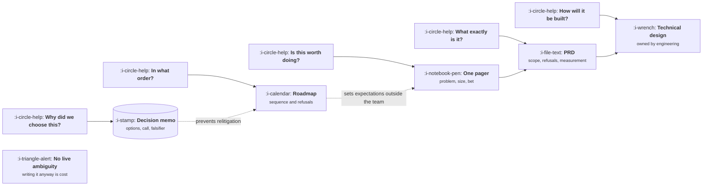

# The Artifacts

```text
Level: Foundations
Prerequisites: The Product Loop
Estimated difficulty: 2/5 | Estimated time: 30 min
```

## The idea in one minute

A document is a tool with a price, and the question is never "should we write a PRD". It is "which
ambiguity is unresolved, and which document resolves that one". Five artifacts do almost all of
the work, and each one kills a different ambiguity: whether to do it at all, what exactly it is,
how it will be built, in what order, and why it was chosen. Writing an artifact whose ambiguity
is already resolved is pure cost. Skipping one whose ambiguity is live is the single largest source
of rework in product teams, and the cost of that rework scales with the number of people building.

## A picture



Each document answers exactly one question. If you cannot name which question is open, you are
about to write something nobody needs.

## How it really works

### The five artifacts

| Artifact | Ambiguity it kills | Length | Written by | Lives for |
|---|---|---|---|---|
| One pager or brief | Whether this is worth doing at all | 1 page | Product | Until the decision is made |
| PRD | What exactly is in, what is out, how success is measured | 2 to 5 pages | Product, reviewed by engineering and design | Through the build |
| Technical design | How it will be built, and what it will cost | Variable | Engineering | Through the build and after |
| Roadmap | Order, and what is not happening now | 1 screen | Product | A quarter, refreshed |
| Decision memo | Why this option, and what would prove it wrong | 1 page | Product | Years |

Note what is absent. There is no "requirements document" separate from a PRD, no backlog grooming
artifact, and no specification that product writes and engineering implements without discussion.
Those are symptoms of a handoff model rather than a team.

### What a PRD actually needs

Five sections change what gets built.

1. **The problem**, stated so it could be wrong, with the evidence attached.
2. **What is in scope**, at the level of user visible behaviour.
3. **What is explicitly out of scope**, which is the section that prevents the three week argument.
4. **How success is measured**, with the bar stated as a number before the build.
5. **Open questions**, with an owner and a date against each.

Four sections are usually read by nobody: a feature comparison with competitors, personas restated
from a deck, a glossary, and detailed wireframe descriptions that duplicate the Figma file.
Including them is not neutral; length reduces the probability the live sections are read.

### The decision memo is the cheapest and the most skipped

A decision memo is one page: the options considered, the call, the reasoning, and what would prove
it wrong. It takes twenty minutes and it is the only artifact that pays off in years rather than
weeks, because it does three things nothing else does.

* It stops the same argument being had every two quarters by someone new.
* It makes the reasoning auditable, so when the call turns out wrong you learn which assumption
  failed rather than concluding that the team is bad at deciding.
* It is the raw material for the readout, since the falsification test is already written.

Teams with a decision log have a visibly different quality of argument within a year, because
positions become traceable to their evidence.

### The cost of an artifact

Three costs, and only the first is usually counted.

* **Writing**, which is hours of the author.
* **Reading and reviewing**, which is hours multiplied by everyone who must read it.
* **Maintenance**, which is the real killer. A document that drifts out of date is worse than no
  document, because people act on it. Anything that cannot be kept current should be a decision
  memo (frozen, dated, historical) rather than a living specification.

### When to skip

Three tests. If all three pass, skip the document and have the conversation instead.

1. Fewer than three people need to act on it.
2. The work is under about a week, so drift cannot accumulate.
3. The decision is reversible at low cost.

Most arguments about documentation are really arguments about team size, and both sides are right
about the team they are imagining.

### What fills the box in 2026

Notion and Confluence hold documents; Linear and Jira hold the work; Figma holds the design.
Decision logs work fine as a dated folder of markdown in the repository, and that version has one
real advantage: it is reviewed, versioned and searchable by the people who will inherit it. The
tooling question is irrelevant next to whether the falsification test gets written down.

## Run the numbers

A PRD is often described as overhead. Whether it is depends almost entirely on how many people
are building, because writing cost is fixed while avoided rework scales with headcount. This
program computes net hours saved for three artifacts across team sizes.

```go
// artifacts.go: when a document pays for itself.
package main

import "fmt"

// Without any written artifact, this fraction of builds hit a material
// misunderstanding of scope. Each artifact reduces it to its own residual.
const pBaseline = 0.55

// Hours one builder loses when a material misunderstanding is found mid build.
const reworkPerBuilder = 14.0

type artifact struct {
	name            string
	writeHours      float64 // author's time, once
	reviewPerReader float64 // every builder has to read it
	pResidual       float64 // chance of a material misunderstanding that survives it
}

// net is hours saved against writing nothing at all: the rework this artifact
// avoids, minus what it costs to write and to read.
func net(a artifact, builders float64) float64 {
	avoided := (pBaseline - a.pResidual) * reworkPerBuilder * builders
	cost := a.writeHours + a.reviewPerReader*builders
	return avoided - cost
}

func main() {
	as := []artifact{
		{"nothing written", 0, 0, pBaseline},
		{"one pager", 2, 0.25, 0.40},
		{"full PRD", 8, 1.00, 0.15},
	}
	fmt.Printf("%-17s", "builders")
	for b := 1; b <= 8; b++ {
		fmt.Printf("%6d", b)
	}
	fmt.Println()
	for _, a := range as {
		fmt.Printf("%-17s", a.name)
		for b := 1; b <= 8; b++ {
			fmt.Printf("%6.1f", net(a, float64(b)))
		}
		fmt.Println()
	}
	fmt.Printf("\nHours saved against writing nothing. Baseline ambiguity costs %.0f hours per builder.\n",
		pBaseline*reworkPerBuilder)
	fmt.Println("Negative means the artifact cost more than the rework it prevented.")
}
```


The crossover is the point. At one builder neither document repays its writing cost, which is why
solo work genuinely does not need a PRD. At two builders the one pager is ahead. From three
builders upward the full PRD pulls ahead and the gap widens with every person added, because
writing cost is fixed while avoided rework is multiplied by headcount. This is why the
documentation argument is irresolvable in the abstract: a two person team and a seven person team
are both correct about their own situation, and they are describing different columns of the same
table.

## The AI layer

Drafting is the obvious use and it works: given the evidence, a model will produce a competent
first PRD in a minute for well under a cent, and the real saving is that a bad first draft is much
easier to react to than a blank page. Two less obvious uses are better. First, ask for the
strongest argument against your own proposal before you circulate it; it surfaces the objection
the review would have raised a week later. Second, ask what is missing from a document against the
five sections above, which catches the absent refusals section almost every time.

The failure is consistent and specific: models write confident scope. Asked to complete a PRD, a
model fills the out of scope section with plausible exclusions it has no basis for, and fills the
success metric with a round number. Both read as authoritative. Treat any number a model produces
in a document as a placeholder that must be replaced or deleted, and never let it write the
refusals, because the refusals are the decision.

## Sector lens

| Sector | What changes about the artifacts |
|---|---|
| [Enterprise B2B SaaS](../XIX-product-by-sector/01-enterprise-b2b-saas.md) | The PRD acquires an audience outside the team: sales, CS and sometimes the customer. Refusals become contractual |
| [Fintech](../XIX-product-by-sector/02-fintech.md) | Some documents are regulated records with retention requirements, so drift is a compliance problem rather than an annoyance |
| [Ecommerce and D2C](../XIX-product-by-sector/03-ecommerce-and-d2c.md) | Cycles are short enough that the one pager plus an experiment brief replaces the PRD for most work |
| [Marketplaces](../XIX-product-by-sector/04-marketplaces.md) | Every PRD needs a section on the effect on the other side, or it will be found later |
| [Devtools and Infra](../XIX-product-by-sector/05-devtools-and-infrastructure.md) | Public API documentation is the product, so the spec and the docs converge and versioning matters |
| [Healthtech](../XIX-product-by-sector/06-healthtech-and-regulated-care.md) | Design history files and risk assessments are mandatory artifacts with defined formats |
| [Vertical SaaS](../XIX-product-by-sector/07-vertical-saas.md) | Domain workflows must be documented in the customer's own vocabulary or the review is worthless |

## Remember this

* Five artifacts, each killing exactly one ambiguity. Name the ambiguity before writing.
* A PRD's live sections are problem, in scope, out of scope, measurement and open questions.
* The out of scope section is the one that prevents the expensive argument.
* The decision memo costs twenty minutes and pays off for years. It is the most skipped.
* Writing cost is fixed; avoided rework scales with builders. That is the whole documentation debate.

## Try it

1. Run `artifacts.go`, then set `pMisread` for the PRD to 0.30 to model a badly written one. At
   what team size does it stop being worth writing?
2. Open the last PRD your team wrote. Mark each section as live or decorative using the five
   section test. What fraction is decorative?
3. Write a decision memo for a decision your team made three months ago: options, call, reasoning,
   falsifier. Then check whether the falsifier has since occurred.

## Check yourself

1. Why is a living specification that nobody maintains worse than having no document at all?
2. Two teams argue about documentation overhead and neither is wrong. What single fact about each
   team explains the disagreement?
3. A model drafts a PRD including an out of scope section and a success metric. Which of those two
   must you always rewrite, and why is that the more dangerous one to leave?
