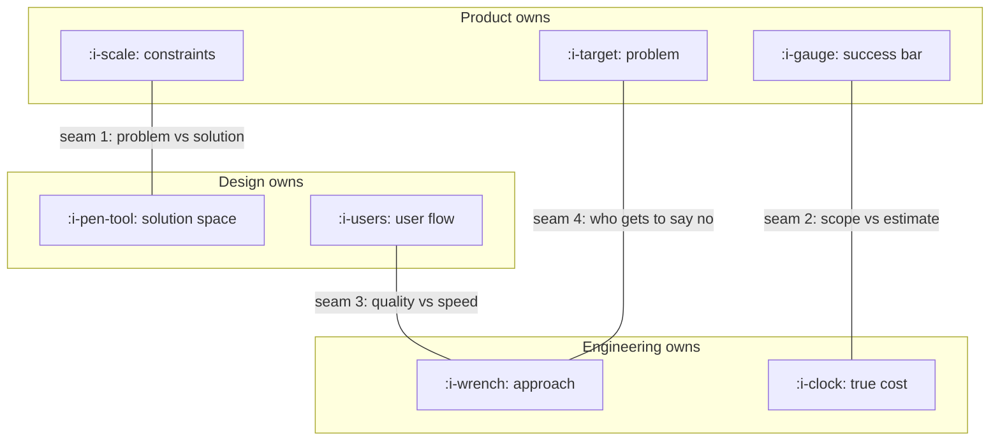

# How Product, Engineering and Design Split the Work

```text
Level: Foundations
Prerequisites: Influence Without Authority
Estimated difficulty: 2/5 | Estimated time: 30 min
```

## The idea in one minute

The three roles divide cleanly if you divide by *what each one owns the right to decide* rather
than by task. Product owns the problem and the constraints. Design owns the solution space for the
user. Engineering owns the approach and the true cost. Every recurring argument in a product team
happens at one of four seams between those ownerships, and each seam has a known leak. Teams fail
in two opposite ways: a handoff model where each role throws a finished artifact over a wall, and a
mush model where everyone has an opinion about everything and nothing is owned. Both produce the
same symptom, which is rework discovered late.

## A picture



The four labelled edges are where every recurring argument in a product team actually lives. Naming
which seam you are at usually resolves half of the argument.

## How it really works

### Who decides what

| | Product | Design | Engineering |
|---|---|---|---|
| Decides | Which problem, the constraints, the success bar | The solution for the user, the flow, the interface | How it is built, the sequence, the estimate |
| Consulted on | Solution feasibility, visual priorities | Problem framing, constraint realism | Scope cuts, technical tradeoffs with user cost |
| Must never decide alone | How it looks, how it is built | Which problem is worth solving | What the product is for |

The test for a healthy team: each role can name a decision it lost in the last month. If product
has never lost one, it is a handoff model. If nobody can name their own decisions, it is mush.

### Seam 1: problem versus solution

The classic leak. Product arrives with a solution ("we need a dashboard") instead of a problem
("account admins cannot tell which of their users are active, and they ask support twice a week").
The constraint is the legitimate thing product brings to design: the problem, the evidence, the
success bar, and the real limits such as what the data layer can serve or what the regulator
permits. Everything inside those limits belongs to design.

The honest version of the failure is that solutions are easier to say and feel more helpful. The
fix is mechanical: write the problem statement first and have design read it before any interface
is discussed.

### Seam 2: scope versus estimate

Product owns scope, engineering owns the estimate, and neither owns the schedule, which is an
outcome of the two. The leak is negotiating the estimate, which does not change how long the work
takes and does teach engineering to pad. The legitimate move is to change the scope and ask for a
new estimate.

A useful phrasing that keeps the seam intact: "if that is six weeks, what would a two week version
have in it?" This asks engineering to propose the cut, which they are better placed to do, and it
keeps the estimate honest.

### Seam 3: quality versus speed

Engineering owns the approach, which includes how much internal quality to build in. Product
cannot responsibly instruct engineering to incur technical debt, because product does not carry the
cost; but engineering also cannot unilaterally decide that every piece of work is permanent
infrastructure.

What resolves this seam is horizon. If product states honestly how long the thing is expected to
live and how likely it is to be thrown away, engineering can choose the right level of durability.
Most of this argument is caused by product not knowing or not saying.

### Seam 4: who gets to say no

Somebody must be able to refuse work. In practice three refusals are all legitimate and they refuse
different things: product refuses work that does not serve the problem, engineering refuses work
that is unsafe or unaffordable, design refuses work that makes the product incoherent. The failure
is a team where only one of those refusals is socially acceptable.

### Two opposite failure models

| Model | What it looks like | Symptom | What is missing |
|---|---|---|---|
| Handoff | Product writes a spec, design decorates it, engineering implements it | Rework found at the end, and nobody feels responsible for the outcome | Shared early context; the roles never overlapped |
| Mush | Everyone discusses everything, decisions reopen constantly | Slow, exhausting, and the loudest person wins | Named owners of specific decisions |

The cure for both is the same and it is small: write down who decides what, and then let each
person actually decide it, including when you disagree.

### Disagree and commit, done properly

The phrase is often used to end a conversation. It only works with three parts. The disagreement
is recorded, including the specific belief that differs. The decision owner is named. A review date
is set at which the disagreement is checked against what happened. Without the third part, it is
just losing with extra steps, and people stop surfacing disagreements at all.

### What fills the box in 2026

Figma is the boundary object at seam 1, and increasingly carries the constraint as well as the
solution. Linear or Jira holds scope at seam 2. Feature flags, through LaunchDarkly, Statsig or
something in house, are what actually makes seam 3 negotiable, because reversibility reduces the
cost of being wrong about durability. None of these tools assign ownership, and a team that is
mushy in person is mushy in the tool.

## The AI layer

Models have genuinely moved these seams for the first time in years, and mostly in an awkward
direction. A product manager can now produce a plausible interface and a working prototype in an
afternoon, and an engineer can produce plausible product reasoning just as easily. The seams no
longer hold because of capability limits; they have to hold because of agreed ownership.

The new failure is specific: arriving at seam 1 with a generated prototype instead of a problem
statement. It is worse than arriving with a verbal solution, because a prototype anchors hard and
is expensive to argue with. If you build one, the discipline is to present the problem first, keep
the prototype closed, and offer it only as evidence that something is possible, never as the
proposal.

The genuinely good use is at seam 2: generating three scope variants of the same problem, each with
its own cut, so the conversation about tradeoffs starts with options instead of a single number.

## Sector lens

| Sector | What changes at the seams |
|---|---|
| [Enterprise B2B SaaS](../XIX-product-by-sector/01-enterprise-b2b-saas.md) | A fifth party appears at seam 1: the customer's own administrator, whose constraints are contractual |
| [Fintech](../XIX-product-by-sector/02-fintech.md) | Compliance holds a refusal at seam 4 that outranks all three roles |
| [Ecommerce and D2C](../XIX-product-by-sector/03-ecommerce-and-d2c.md) | Merchandising and operations own parts of the solution space that design does not |
| [Marketplaces](../XIX-product-by-sector/04-marketplaces.md) | Seam 1 doubles, because there are two user groups with conflicting problems |
| [Devtools and Infra](../XIX-product-by-sector/05-devtools-and-infrastructure.md) | Engineering holds the information source as well as the approach, so product's constraint must be unusually well evidenced |
| [Healthtech](../XIX-product-by-sector/06-healthtech-and-regulated-care.md) | Clinical safety sits above seam 3: durability is not negotiable in parts of the system |
| [Vertical SaaS](../XIX-product-by-sector/07-vertical-saas.md) | Domain experts, often former practitioners, hold part of the solution space legitimately |

## Remember this

* Divide by decision rights, not by task. Product owns problem and constraints, design owns the
  solution space, engineering owns approach and cost.
* Four seams, four known leaks. Naming the seam resolves half the argument.
* Never negotiate an estimate. Change the scope and ask for a new one.
* Seam 3 is settled by stating the horizon honestly, not by instructing engineering about quality.
* Three refusals are legitimate. A team where only one of them is allowed is broken.

## Try it

1. Write down the last three arguments your team had. Label each with its seam. Do they cluster?
2. Ask each of your engineers and designers to name one decision they made in the last month that
   you would have made differently. Silence is the finding.
3. Pick a piece of work in flight and state its horizon out loud: how long it should live, and the
   chance it is deleted within a year. Watch whether the quality conversation changes.

## Check yourself

1. Why is negotiating an estimate both ineffective and actively harmful to future estimates?
2. A team ships on time and the outcome is bad, and nobody feels responsible. Which failure model
   is that, and which seam was never actually crossed?
3. Disagree and commit has three parts. Which one is usually missing, and what happens over six
   months when it is?
