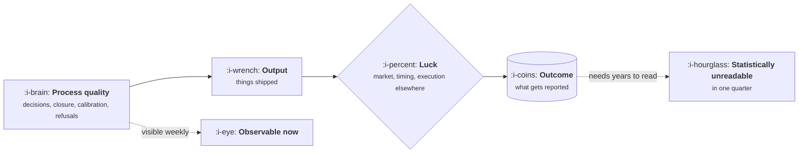

# What Good Looks Like

```text
Level: Foundations
Prerequisites: The Product Loop
Estimated difficulty: 2/5 | Estimated time: 35 min
```

## The idea in one minute

The job is judged on outcomes, and outcomes over any short window are mostly noise. A product
manager with a genuinely good hit rate of three in ten will produce a quarter with nothing to show
roughly one year in four, purely by arithmetic. That single fact has a large consequence: if you
judge the work only on results, you are substantially grading luck, and the person being graded
learns to pick safe bets and to narrate ambiguous ones as wins. What distinguishes good work is
observable on a much shorter timescale than results are: the quality of decisions, the closure rate
of the loop, the calibration of forecasts, and the existence of refusals.

## A picture



The two dotted branches are the whole problem: the thing that is easy to measure arrives too late
to be informative, and the thing that is informative immediately is the thing nobody records.

## How it really works

### Output, outcome, and the gap

Output is what shipped. Outcome is what changed because it shipped. The gap between them is partly
skill and partly everything else: a competitor's launch, a pricing change elsewhere, a sales team
that did or did not sell it, a macro quarter. Judging only output rewards motion. Judging only
outcome over a short window rewards luck and punishes the honest readout.

### Why one quarter is noise

Suppose a product manager makes four real bets a quarter and each has a 30% chance of working,
which is a good rate. The chance that none of the four works is 0.7 to the fourth power, about
24%. So one year in four, a genuinely good product manager has a quarter with nothing to point at.
Over the same period, somebody with half that hit rate will occasionally have two land at once and
look excellent.

The question that matters is how long it takes for outcomes to separate the two. The program below
computes it, and the answer is years. This is not an argument that outcomes do not matter. It is an
argument that outcomes are a slow signal, and anything evaluated quarterly has to be evaluated on
something faster.

### Calibration is the measurable skill

Calibration is whether your stated confidence matches reality: of the things you said were 70%
likely, about 70% should happen. It is directly measurable, it improves with practice, and it is
almost never tracked.

The mechanics are cheap. Before each bet, write a probability. After the readout, score it. The
standard score is the Brier score, which is the mean of `(probability stated − outcome)` squared,
where outcome is 1 or 0. Lower is better; 0.25 is what you get by always saying 50%, so anything
above that means your confidence is actively misleading.

Calibration is the single most useful thing on this page, because it converts "trust me" into a
track record that survives a bad quarter.

### The four observable signals

| Signal | How to see it | What its absence means |
|---|---|---|
| Decision quality | Decisions are written with the refusal and the falsifier | Opinions are being presented as decisions, and will be relitigated |
| Closure rate | What fraction of shipped work has a readout against a bar set beforehand | Nothing is being learned, so the tenth decision is as uninformed as the first |
| Calibration | A list of stated probabilities and what happened | Confidence is noise, and leadership is right to discount it |
| Refusals | A list of things deliberately not done, and why | No prioritisation is occurring; the backlog is being executed |

All four are visible within a month. None of them depend on the market cooperating.

### What leadership actually sees

Leadership sees launches, incidents, and whatever is in the review deck. It does not see refusals,
decision quality or closure unless you make them visible, and the natural incentive is to make only
the wins visible. The move that compounds is the opposite: report the readout of the thing that did
not work, with the number and what it changed about the plan. It is uncomfortable once and it buys
a kind of credibility that cannot be bought any other way, because it is expensive to fake.

### What changes with level

Briefly, since [Product Operations and the Org](../XV-product-operations-and-the-org/05-pm-levels-archetypes-and-hiring.md)
covers it properly. Junior work is judged on execution of a defined problem. Mid level work is
judged on choosing the problem correctly within a given strategy. Senior work is judged on the
strategy, and on whether other people made good decisions without you. The signals above do not
change; the scope of the decisions they describe does.

## Run the numbers

This program asks how many bets it takes before outcomes can reliably tell a good product manager
from a mediocre one. It computes the exact chance of ranking them wrongly: the probability that the
one with a 30% hit rate produces fewer wins than the one with 15%, counting ties as half a mistake.

```go
// judging.go: how long outcomes take to separate skill from luck.
package main

import (
	"fmt"
	"math"
)

// pmf is the exact binomial probability of k successes in n trials at rate p.
func pmf(n, k int, p float64) float64 {
	c := 1.0
	for i := 0; i < k; i++ {
		c = c * float64(n-i) / float64(i+1)
	}
	return c * math.Pow(p, float64(k)) * math.Pow(1-p, float64(n-k))
}

// misrank is the chance that the better operator shows fewer wins than the worse one.
func misrank(n int, good, weak float64) float64 {
	total := 0.0
	for i := 0; i <= n; i++ {
		for j := 0; j <= n; j++ {
			pr := pmf(n, i, good) * pmf(n, j, weak)
			switch {
			case i < j:
				total += pr
			case i == j:
				total += 0.5 * pr
			}
		}
	}
	return total
}

func main() {
	const good, weak, perQuarter = 0.30, 0.15, 4
	fmt.Printf("empty quarter for the good operator: %.0f%%\n\n", 100*math.Pow(1-good, perQuarter))
	fmt.Printf("%9s %7s %14s\n", "quarters", "bets", "ranked wrongly")
	for _, q := range []int{1, 2, 4, 8, 12, 20, 40} {
		n := q * perQuarter
		fmt.Printf("%9d %7d %13.0f%%\n", q, n, 100*misrank(n, good, weak))
	}
	fmt.Println("\nFour bets a quarter, 30% against 15%. A coin flip is 50%.")
	fmt.Println("Outcomes are a real signal and a slow one. Judge the process weekly.")
}
```

Read down the right hand column. After one quarter there is close to a one in three chance of
ranking the two operators the wrong way round on results alone. It takes two full years of bets to
push that under ten percent, and five years to approach certainty. Meanwhile all four process
signals were available in week three. That asymmetry is the practical case for writing decisions
down: it is the only evidence that arrives while it can still change anything.

## The AI layer

There is one strong use here and it is underrated: a model is a competent calibration partner.
Give it your proposal and ask for a probability with the reasoning, then record both yours and its
estimate and score both over a year. It costs cents and it gives you a second series to compare
against, which makes drift in your own confidence visible much sooner than it otherwise would be.

It is also useful for drafting the uncomfortable readout, because the hard part of writing "this
did not work" is tone rather than content.

The failure to watch for is that models are poorly calibrated in a flattering direction. Asked how
likely a plan is to succeed, they tend to return numbers in the 70% to 85% band almost regardless
of the plan, because confident prose is what such text usually looks like. Use the estimate as a
second opinion to argue with, never as an input to a decision, and score it so you learn how wrong
it is for your domain.

## Sector lens

| Sector | What changes about judging the work |
|---|---|
| [Enterprise B2B SaaS](../XIII-product-by-sector/01-enterprise-b2b-saas.md) | Outcomes arrive on renewal cycles, so the lag is a year or more and process signals carry almost all the weight |
| [Fintech](../XIII-product-by-sector/02-fintech.md) | Avoided losses are a real outcome that never appears in a dashboard, so refusals must be reported explicitly |
| [Ecommerce and D2C](../XIII-product-by-sector/03-ecommerce-and-d2c.md) | Traffic makes outcomes fast and clean, which is the one case where quarterly outcome judging is defensible |
| [Marketplaces](../XIII-product-by-sector/04-marketplaces.md) | A win on one side can be a loss overall, so single metric judging is actively misleading |
| [Devtools and Infra](../XIII-product-by-sector/05-devtools-and-infrastructure.md) | Adoption lags release by quarters, and the leading signals are qualitative |
| [Healthtech](../XIII-product-by-sector/06-healthtech-and-regulated-care.md) | Some outcomes are measured in clinical studies, which puts the lag beyond any review cycle |
| [Vertical SaaS](../XIII-product-by-sector/07-vertical-saas.md) | Small customer counts mean every number is a named account, and n is too small for statistics at all |

## Remember this

* A good operator has an empty quarter roughly one year in four. That is arithmetic, not failure.
* Outcomes are a real signal and a slow one. After one quarter they are close to a coin flip.
* Four signals are observable within a month: decision quality, closure, calibration, refusals.
* Calibration is the one skill here you can score. Write a probability before, score it after.
* Report the readout of the thing that failed, first and with numbers. It is expensive to fake.

## Try it

1. Run `judging.go`, then set `perQuarter` to 12 to model a high traffic team. How much does volume
   buy you, and does it ever reach certainty?
2. Write a probability against the next five decisions you make, sealed. Score them in a quarter
   with the Brier formula and compare against 0.25.
3. Write your list of refusals for this quarter: things deliberately not done, and why. If the list
   is empty, you are executing a backlog rather than prioritising.

## Check yourself

1. Why does judging purely on outcome push an operator towards safe bets and generous readouts?
2. A Brier score of 0.30 is worse than always saying 50%. What does that tell you about the
   person's stated confidence, and what should they do about it?
3. Which of the four process signals would you check first when inheriting a team, and what would
   its absence predict about the next two quarters?
