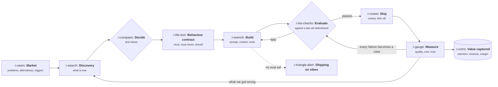
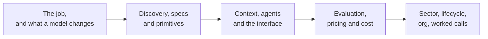

# Product Management: Building Products With a Model Inside Them

> Learn the product function as a mechanism rather than a vocabulary, then learn what changes once
> the product contains something slow, expensive, probabilistic and occasionally wrong: how to
> specify behaviour you cannot pin down, how to know it works, what to charge for it, what it costs
> to run, and how all of that bends by sector.

Most product writing teaches artifacts. You learn what a PRD is, what RICE stands for, what a
roadmap should look like, and you are left holding templates with no theory of when each one is the
wrong tool. Most AI product writing is worse: it teaches vocabulary for a field that changes every
quarter. This course inverts both. Every lesson starts with the mechanism, shows the arithmetic
where arithmetic decides the answer, and only then names the artifact or the tool.

**Metrics live here too.** Every number this course refers to is defined inside it, in its own
topics, with the formula, the denominator people get wrong and a program that computes it. There is
no separate metrics course to cross reference, because in practice the measurement and the decision
are the same conversation.

It assumes you have worked near software and can read a table of numbers. It does **not** assume you
have shipped anything, run a research study, owned a price, written a prompt, or managed a person.

The course is long on purpose. Product management touches strategy, engineering, design, data,
pricing, abuse, economics and the organisation itself, and a short course on it can only be a
glossary.

## What the job looks like now

Two loops, not one. The outer loop is the product loop that has always existed. The inner loop,
build to evaluate and back, is the one a model adds, and the dotted branch is what happens when a
team never builds the eval set: it still ships, it just stops being able to tell whether it is
getting better.

## How this course works

Every lesson follows the same shape.

1. **The idea in one minute.** The argument, in a few sentences.
2. **A picture.** The mechanism. Press **Expand** on any diagram to open it full size.
3. **How it really works.** The precise version, with names and numbers.
4. **Run the numbers.** Where arithmetic decides, a small Go program using only the standard
   library, so you can put your own inputs in.
5. **The AI layer.** What a model changes about this specific piece of work, what it costs, and how
   it fails.
6. **Sector lens.** The same mechanism in enterprise software, fintech, ecommerce, marketplaces,
   devtools, healthtech and vertical software.
7. **Remember this**, **Try it**, **Check yourself.**

Two rules hold throughout. A metric is defined in exactly one lesson and linked everywhere else.
Market shape is defined once, in [Product by Sector](product-by-sector/README.md), and every
other sector mention states only the delta.

## The topics

| Topic | You will be able to | Level |
|---|---|---|
| [The Product Function](the-product-function/README.md) | Say what the job is, where the loop breaks, and how the work is actually judged | Foundations |
| Product Strategy | Write a one page strategy that names the bets and the refusals, and tell a real moat from a story | Foundations |
| Discovery and Problem Framing | Tell a real problem from a loud one, size it, and kill ideas before they cost anything | Foundations |
| Definition and Delivery | Write a PRD that gets built, scope a first version, and get it launched | Foundations |
| Prioritisation and Roadmapping | Order the work, commit enough to be trusted, and defend the refusals | Foundations |
| Pricing and Packaging | Choose a value metric, build tiers, discover willingness to pay, and change a price safely | Foundations |
| Technical Foundations | Read a system well enough to know which requests are cheap, which are expensive, and why | Basic |
| Design and User Experience | Run a critique, test with five users, and name the information architecture problem | Basic |
| [What a Model Changes](what-a-model-changes/README.md) | Name the five facts, pick the product shape you are building, and argue for not using a model | Basic |
| Discovery for AI Products | Tell a demo from a product, decompose work into tasks, and size by error tolerance | Intermediate |
| Specs for Non Deterministic Systems | Write a behaviour contract and a rubric instead of a pixel spec | Intermediate |
| Model Primitives | Reason about tokens, latency, cost and structured output well enough to make the call | Intermediate |
| Context and Knowledge | Decide what goes in the window, ground an answer, and make it checkable | Intermediate |
| Agents and Autonomy | Place a product on the autonomy spectrum and contain what it can get wrong | Intermediate |
| AI Product UX | Spend a trust budget, show uncertainty, and design for the wrong answer | Intermediate |
| Evaluation and Quality | Build the dataset, grade it, gate a release on it, and read production traces | Advanced |
| AI Pricing and Packaging | Price a feature whose cost scales with use, through credits, usage or outcomes | Advanced |
| Trust, Safety and Guardrails | Predict the abuse, build the guardrail stack, and run the incident | Advanced |
| Data Moats and Feedback Loops | Test honestly whether your data is a moat, and build the flywheel | Advanced |
| Model Lifecycle and Drift | Survive a model upgrade, pin versions, and detect drift before users do | Advanced |
| How to Read a Metric | Spot a bad denominator, a mix shift and a vanity metric before acting on one | Expert |
| Funnel, Retention and Experiments | Build a cohort table, read whether the curve flattens, and know when a test is lying | Expert |
| [Revenue and Efficiency](revenue-and-efficiency/README.md) | Compute payback, lifetime value and retention of revenue honestly | Expert |
| AI Quality Metrics | Measure groundedness, task success, acceptance, intervention and trust | Expert |
| AI Cost and Margin | Put inference in cost of revenue and find where the margin breaks | Expert |
| Agent and Task Metrics | Measure steps, tool errors, autonomy and reliability as a compound number | Expert |
| Benchmarks and Their Limits | Find a real benchmark, adjust it for stage, and build your own baseline | Expert |
| AI Product Org and Process | Shape the team, run the review, and triage traces as a weekly habit | Expert |
| Worked AI Products | Produce and defend a complete build, with the numbers and the falsification test | Expert |
| [Product by Sector](product-by-sector/README.md) | Work in enterprise, fintech, ecommerce, marketplaces, devtools, healthtech or vertical software | Sectors |

## How the six levels are meant to be read

**Foundations** is the whole product function, in detail and with no model in it. Everything there
would be true if generative models had never shipped, and it is the part that stays true longest.

**Basic** is literacy: enough of a systems mental model and enough design craft to hold your side of
the conversation, plus the first contact with what a model changes.

**Intermediate** is building with a model in the product: discovery, behaviour specs, primitives,
context, agents and the interface.

**Advanced** is shipping it safely and keeping it working: evaluation, pricing it, the guardrails,
whether you have a moat, and surviving the next model release.

**Expert** is measurement and construction. Every metric the job is judged on is defined here, and
the topics that build real things end to end sit alongside them, because a number you cannot
compute is a number you do not have.

**Sectors** comes last on purpose. It is the same job bent by the market it runs in, and it only
makes sense once the job itself is familiar.

## What you need

Go 1.22 or newer if you want to run the programs, and a terminal. Every program runs offline with
no account, no key and no network.

## A promise about names and numbers

Tool names, benchmark figures and regulatory dates in this course were checked on
**12 October 2026**, and each lesson lists where its dated facts live. Benchmarks rot within a year
and model capabilities rot faster. Mechanisms do not, and every lesson separates the two so you know
which half to recheck.
