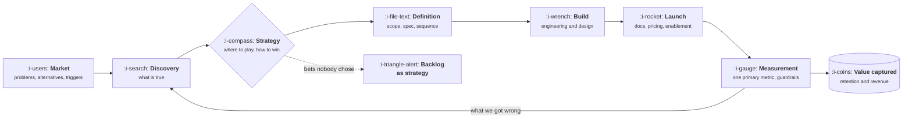
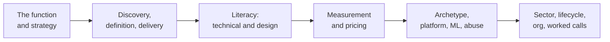

# Product Management: From a Problem to a Priced Product

> Learn the product function as a mechanism rather than a vocabulary: how to tell a real problem
> from a loud one, how to choose a strategy and write it down, how to get something built, how to
> know whether it worked, what to charge for it, and how all of that bends depending on the shape
> of your product and the market it sells into.

Most product writing teaches artifacts. You learn what a PRD is, what RICE stands for, what a
roadmap should look like, and you are left holding templates with no theory of when each one is
the wrong tool. This course inverts that. Every lesson starts with the mechanism, shows the
arithmetic where arithmetic decides the answer, and only then names the artifact.

It assumes you have worked near software and can read a table of numbers. It does **not** assume
you have shipped anything, run a research study, owned a price, or managed a person.

The course is long on purpose. Product management is the function that touches strategy,
engineering, design, data, pricing, abuse, operations and the organisation itself, and a short
course on it can only be a glossary.

## What the job looks like

The arrow back from measurement into discovery is the job. Everything else is other people's
craft that you are accountable for. The dotted branch is the common failure: a prioritised list
of features standing in for a decision about where to compete.

## How this course works

Every lesson follows the same shape.

1. **The idea in one minute.** The argument, in a few sentences.
2. **A picture.** The mechanism. Press **Expand** on any diagram to open it full size.
3. **How it really works.** The precise version, with names and numbers.
4. **Run the numbers.** Where arithmetic decides, a small Go program using only the standard
   library, so you can put your own inputs in.
5. **The AI layer.** What a model changes about this specific piece of work, what it costs, and how
   it fails.
6. **Sector lens.** The same mechanism in enterprise software, fintech, ecommerce, marketplaces,
   devtools, healthtech and vertical software.
7. **Remember this**, **Try it**, **Check yourself.**

Two rules hold across the library. Metrics are defined once, in
[Metrics and Models](../metrics-and-models/README.md), and linked everywhere else. Market shape is
defined once, in [Product by Sector](XIII-product-by-sector/README.md), and every other sector
discussion states only the delta.

## The topics

| Topic | You will be able to | Level |
|---|---|---|
| [The Product Function](I-the-product-function/README.md) | Say what the job is, where the loop breaks, and how the work is actually judged | Foundations |
| [Product Strategy](II-product-strategy/README.md) | Write a one page strategy that names the bets and the refusals, and tell a real moat from a story | Foundations |
| Discovery and Problem Framing | Tell a real problem from a loud one, size it, and kill ideas before they cost anything | Basic |
| Definition and Delivery | Write a PRD that gets built, scope a first version, and sequence work you do not control | Basic |
| Technical Foundations | Read a system well enough to know which requests are cheap, which are expensive, and why | Basic |
| Design and User Experience | Run a critique, test with five users, and name the information architecture problem | Intermediate |
| Analytics and Experimentation | Instrument before you ship, pick one primary metric, and know when a test is lying | Intermediate |
| Pricing and Packaging | Choose a value metric, build tiers, discover willingness to pay, and change a price safely | Intermediate |
| Product Archetypes | Recognise which shape of product you have, and stop borrowing playbooks from another shape | Advanced |
| Platform and API Products | Decide whether to be a platform, design an API as a product, and price it | Advanced |
| Data and ML Products | Own a ranker, a risk score or a forecast, and set the threshold as a product decision | Advanced |
| Trust, Safety and Abuse | Predict how your product will be abused and design the enforcement ladder before it is | Advanced |
| Product by Sector | Work in enterprise, fintech, ecommerce, marketplaces, devtools, healthtech or vertical software | Expert |
| Lifecycle, Migrations and Sunsets | Run a migration, a breaking change and a sunset without losing the users | Expert |
| Product Operations and the Org | Aggregate feedback, run the rituals, and know what changes at each level of the job | Expert |
| Worked Product Decisions | Produce and defend a complete decision, with the numbers and the falsification test | Expert |

## How it connects to the other courses

This course stays at the level of decisions, mechanisms and arithmetic. When a box deserves a
whole course, it gets one.

* Every formula, denominator and benchmark: [Metrics and Models](../metrics-and-models/README.md).
* How demand is actually manufactured: `growth-engineering`, coming soon.
* How the thing reaches a buyer: `gtm-engineering`, coming soon.
* The systems and processes underneath: `revenue-operations`, coming soon.
* Building a feature with a model inside it: `ai-engineering`, coming soon.

## What you need

Go 1.22 or newer if you want to run the programs, and a terminal. Every program runs offline with
no account, no key and no network.

## A promise about names and numbers

Tool names, benchmark figures and regulatory dates in this course were checked on
**12 October 2026**, and each lesson lists where its dated facts live. Benchmarks rot within a
year. Mechanisms do not, and every lesson separates the two so you know which half to recheck.
