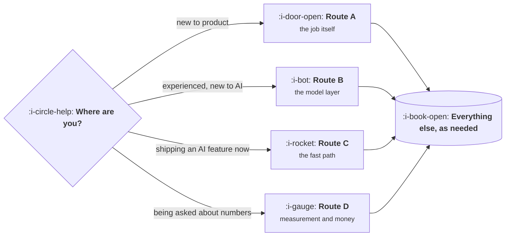

# Roadmap

Six levels and thirty four topics is too much to read in order unless you have a year. This page
gives four routes through it, chosen by where you are rather than by what the sidebar happens to
list first, plus an honest estimate of what each one costs in hours.

Every route assumes the same working method: read a lesson, run its program with your own numbers,
and do the third exercise, which is always the one that applies the lesson to your own product.
Skipping the programs halves the value, because the thing most lessons teach is that a number you
assumed is wrong.

## Which route

## Route A: new to product management

About 20 hours. Read in this order and do not skip the first topic, which is the one that makes
the rest legible.

| Order | Topic | Why here |
|---|---|---|
| 1 | The Product Function | What the job is, and why its authority is informal |
| 2 | Starting in Product | The week, the routes in, and the first ninety days |
| 3 | Customers and Users | Buyer, user and blocker, before any technique |
| 4 | Discovery and Problem Framing | Finding something worth building |
| 5 | Definition and Delivery | Getting it built and launched |
| 6 | How to Read a Metric | Before any specific number reaches you |
| 7 | Roadmapping and Prioritisation | Ordering work once there is more of it than capacity |
| 8 | The Cross Functional Loop | The machine around the team |

Then stop and work for a quarter. Strategy, pricing and the AI levels will mean more once you have
shipped something and watched it not go as planned.

## Route B: experienced, new to building with models

About 14 hours, and it assumes the Foundations material is already familiar.

| Order | Topic | Why here |
|---|---|---|
| 1 | What a Model Changes | The five facts, and which product shape you are building |
| 2 | Model Primitives | Tokens, latency, cost, structured output |
| 3 | Discovery for AI Products | Why demos convert and products churn |
| 4 | Specs for Non Deterministic Systems | What replaces the spec |
| 5 | Evaluation and Quality | What replaces the test suite. Do not defer this one |
| 6 | Context and Knowledge | Retrieval, grounding and the context budget |
| 7 | Agents and Autonomy | The autonomy spectrum and blast radius |
| 8 | AI Product UX | Designing for an answer that is sometimes wrong |

The jump from four to five is deliberate. Most teams do discovery and specs, then build, then
discover they cannot tell whether a change helped.

## Route C: you are shipping an AI feature in the next month

About 6 hours, in this order, and it is a deliberate subset rather than a summary.

1. **What a Model Changes, lesson 01 and 04.** The five facts, and the product shape, which sets
   the accuracy you need.
2. **Model Primitives, lesson 02 and 03.** Latency and cost per request, computed before design.
3. **Evaluation and Quality, lessons 01 to 03 and 06.** A dataset, graders, and a release gate.
4. **AI Product UX, lesson 01 and 04.** The trust budget and designing for wrong answers.
5. **AI Cost and Margin, lesson 01.** Cost per task, including the parts nobody counts.
6. **Trust, Safety and Guardrails, lesson 01.** Prompt injection, if the feature reads anything a
   user or a third party supplied.

If you only do one of these, do the third. A feature without an eval set cannot be improved on
purpose.

## Route D: you are being asked about numbers

About 12 hours. Start with how to read a metric even if the question is about revenue, because
most disputes resolve there.

| Order | Topic | Why here |
|---|---|---|
| 1 | How to Read a Metric | Denominators, averages, windows, mix shift |
| 2 | Funnel, Retention and Experiments | The three skills used weekly |
| 3 | Revenue and Efficiency | Payback, lifetime value, retention of revenue |
| 4 | Business Fundamentals for Product | What the review already assumes you know |
| 5 | AI Cost and Margin | What a model does to the economics |
| 6 | AI Quality Metrics | If the product has a model in it |
| 7 | Benchmarks and Their Limits | Before quoting any outside number |

## Reading the whole thing

About 90 hours of reading, plus the programs and exercises, which roughly doubles it. In level
order it works, because the levels were ordered for exactly that. The one adjustment worth making
is to read **Evaluation and Quality** early rather than at Advanced, since almost everything in
Intermediate is easier to judge once you can measure it.

## What to do after each level

| After | Do this before continuing |
|---|---|
| Foundations | Write one decision memo and one problem statement for real work |
| Basic | Compute cost per request and the required accuracy for a feature you are considering |
| Intermediate | Build thirty eval cases for something already shipped and run them |
| Advanced | Price one AI feature from cost per task to a value metric |
| Expert | Produce one unit economics figure with its five assumptions written down |
| Sectors | Write the five structural facts for the market you actually sell into |

Each of those takes an afternoon and is worth more than the next ten lessons.
