# Roadmap

One path, in order, through everything that is written. It runs from the job itself to the markets
you sell into, and each stage assumes the one before it.

**This page lists only lessons that exist.** Topics that are planned but unwritten are left out
entirely rather than listed as gaps, so you can follow this top to bottom without hitting a dead
link. It currently covers **59 lessons, about 30 hours of reading**, and it will grow as topics are
finished.

The working method matters more than the order. Read a lesson, run its program with your own
numbers, and do the third exercise, which is always the one that applies the lesson to your own
product. Skipping the programs halves the value, because what most lessons actually teach is that
a number you assumed was right is wrong.

## The path

```mermaid
flowchart LR
  A[":i-user: <b>1. The job</b><br/><small>8 lessons</small>"] --> B[":i-users: <b>2. Users and problems</b><br/><small>4</small>"]
  B --> C[":i-wrench: <b>3. Building it</b><br/><small>6</small>"]
  C --> D[":i-compass: <b>4. Deciding and sequencing</b><br/><small>8</small>"]
  D --> E[":i-handshake: <b>5. The organisation</b><br/><small>6</small>"]
  E --> F[":i-gauge: <b>6. Reading numbers</b><br/><small>6</small>"]
  F --> G[":i-coins: <b>7. Money</b><br/><small>9</small>"]
  G --> H[":i-bot: <b>8. What a model changes</b><br/><small>5</small>"]
  H --> I[(":i-building-2: <b>9. The market</b><br/><small>7</small>")]
  class A,B neutral
  class C,E compute
  class D queue
  class F,G io
  class H compute
  class I memory
```

Nine stages, fifty nine lessons. The first six are the job with no model in it, which is deliberate:
everything in stage eight is easier to judge once you can already tell a real problem from a loud
one and read a number without being fooled by it.

## Stage 1: The job

**8 lessons, about 4 hours.** Start here even if you have done the job for years. The second topic
is written for somebody arriving at it, and the first is written for everybody.

| | Lesson |
|---|---|
| 01 | [What a Product Manager Does](the-product-function/01-what-a-product-manager-does.md) |
| 02 | [The Product Loop](the-product-function/02-the-product-loop.md) |
| 03 | [The Artifacts](the-product-function/03-the-artifacts.md) |
| 04 | [Influence Without Authority](the-product-function/04-influence-without-authority.md) |
| 05 | [How Product, Engineering and Design Split the Work](the-product-function/05-how-product-engineering-and-design-split-the-work.md) |
| 06 | [What Good Looks Like](the-product-function/06-what-good-looks-like.md) |
| 07 | [The Job on a Tuesday](starting-in-product/01-the-job-on-a-tuesday.md) |
| 08 | [How People Actually Get In](starting-in-product/02-how-people-actually-get-in.md) |

**Before moving on:** run the week audit from lesson 07 on your own last week. The preparation
figure is the one to look at.

## Stage 2: Users and problems

**4 lessons, about 2 hours.** Who the product is for, and how to tell a real problem from a loud
one.

| | Lesson |
|---|---|
| 01 | [The Buyer, the User and the Blocker](customers-and-users/01-the-buyer-the-user-and-the-blocker.md) |
| 02 | [Research That Changes Decisions](customers-and-users/02-research-that-changes-decisions.md) |
| 03 | [Finding a Problem Worth Solving](discovery-and-problem-framing/01-finding-a-problem-worth-solving.md) |
| 04 | [Interviews That Are Not Useless](discovery-and-problem-framing/02-interviews-that-are-not-useless.md) |

**Before moving on:** find three workarounds among your own customers. Ask what they do in a
spreadsheet that they wish they did in your product.

## Stage 3: Building it

**6 lessons, about 3 hours.** Getting something specified, designed and built, plus enough systems
literacy to know which requests are cheap.

| | Lesson |
|---|---|
| 01 | [Writing a PRD That Gets Built](definition-and-delivery/01-writing-a-prd-that-gets-built.md) |
| 02 | [Scoping and the First Version](definition-and-delivery/02-scoping-and-the-first-version.md) |
| 03 | [What Designers Actually Do](design-and-user-experience/01-what-designers-actually-do.md) |
| 04 | [Running a Design Critique](design-and-user-experience/02-running-a-design-critique.md) |
| 05 | [How a Request Actually Travels](technical-foundations/01-how-a-request-actually-travels.md) |
| 06 | [APIs for Product Managers](technical-foundations/02-apis-for-product-managers.md) |

**Before moving on:** write only the out of scope paragraph for something in flight, and circulate
just that. Count the surprised replies.

## Stage 4: Deciding and sequencing

**8 lessons, about 4 hours.** Choosing what to do, and ordering it once there is more work than
capacity.

| | Lesson |
|---|---|
| 01 | [Strategy, Vision and Roadmap](product-strategy/01-strategy-vision-and-roadmap.md) |
| 02 | [Where to Play and How to Win](product-strategy/02-where-to-play-and-how-to-win.md) |
| 03 | [Prioritisation That Survives Contact](roadmapping-and-prioritisation/01-prioritisation-that-survives-contact.md) |
| 04 | [Scoring Without Fooling Yourself](roadmapping-and-prioritisation/02-scoring-without-fooling-yourself.md) |
| 05 | [The Roadmap Problem](roadmapping-and-prioritisation/03-the-roadmap-problem.md) |
| 06 | [Now, Next, Later or Dates](roadmapping-and-prioritisation/04-now-next-later-or-dates.md) |
| 07 | [Capacity Allocation](roadmapping-and-prioritisation/05-capacity-allocation.md) |
| 08 | [Dependencies and the Critical Path](roadmapping-and-prioritisation/06-dependencies-and-the-critical-path.md) |

**Before moving on:** run the capacity program with your team's real numbers. The share of the
headline figure actually available for new work is usually a surprise.

## Stage 5: The organisation

**6 lessons, about 3 hours.** The machine around the product team, and where work dies between
functions.

| | Lesson |
|---|---|
| 01 | [Who You Actually Depend On](the-cross-functional-loop/01-who-you-actually-depend-on.md) |
| 02 | [The Operating Cadence](the-cross-functional-loop/02-the-operating-cadence.md) |
| 03 | [The Handoffs That Break](the-cross-functional-loop/03-the-handoffs-that-break.md) |
| 04 | [Working With Sales](the-cross-functional-loop/04-working-with-sales.md) |
| 05 | [Working With Support](the-cross-functional-loop/05-working-with-support.md) |
| 06 | [Working With Data](the-cross-functional-loop/06-working-with-data.md) |

**Before moving on:** ask a support lead what happened to the last three things they escalated.
Their answer is your closure score.

## Stage 6: Reading numbers

**6 lessons, about 3 hours.** Do this before any topic that quotes a figure at you. It prevents
most of the errors the money and model stages would otherwise walk into.

| | Lesson |
|---|---|
| 01 | [What a Metric Is For](how-to-read-a-metric/01-what-a-metric-is-for.md) |
| 02 | [The Denominator Problem](how-to-read-a-metric/02-the-denominator-problem.md) |
| 03 | [Rates, Ratios and Averages](how-to-read-a-metric/03-rates-ratios-and-averages.md) |
| 04 | [Windows, Cohorts and Snapshots](how-to-read-a-metric/04-windows-cohorts-and-snapshots.md) |
| 05 | [Simpson's Paradox and Mix Shift](how-to-read-a-metric/05-simpsons-paradox-and-mix-shift.md) |
| 06 | [Leading, Lagging and Vanity](how-to-read-a-metric/06-leading-lagging-and-vanity.md) |

**Before moving on:** apply the doubling test to every number on your main dashboard and count how
many survive.

## Stage 7: Money

**9 lessons, about 5 hours.** What you charge, what it costs, and the vocabulary a review already
assumes you have.

| | Lesson |
|---|---|
| 01 | [What Pricing Actually Is](pricing-and-packaging/01-what-pricing-actually-is.md) |
| 02 | [The Value Metric](pricing-and-packaging/02-the-value-metric.md) |
| 03 | [CAC Payback, and LTV](revenue-and-efficiency/01-cac-payback-and-ltv.md) |
| 04 | [How Your Company Makes Money](business-fundamentals-for-product/01-how-your-company-makes-money.md) |
| 05 | [Reading a Profit and Loss](business-fundamentals-for-product/02-reading-a-profit-and-loss.md) |
| 06 | [Gross Margin and Cost of Revenue](business-fundamentals-for-product/03-gross-margin-and-cost-of-revenue.md) |
| 07 | [Unit Economics in Practice](business-fundamentals-for-product/04-unit-economics-in-practice.md) |
| 08 | [Burn, Runway and What They Permit](business-fundamentals-for-product/05-burn-runway-and-what-they-permit.md) |
| 09 | [Capital Efficiency](business-fundamentals-for-product/06-capital-efficiency.md) |

**Before moving on:** write the six answers for your own company from memory, then check each one
and note how far off you were.

## Stage 8: What a model changes

**5 lessons, about 3 hours.** The product work that only exists because there is a model in the
product.

| | Lesson |
|---|---|
| 01 | [The Five Facts](what-a-model-changes/01-the-five-facts.md) |
| 02 | [Deterministic and Probabilistic Products](what-a-model-changes/02-deterministic-and-probabilistic-products.md) |
| 03 | [AI Product Shapes](what-a-model-changes/04-ai-product-shapes.md) |
| 04 | [Tokens and the Context Window](model-primitives/01-tokens-and-the-context-window.md) |
| 05 | [Cost Per Request](model-primitives/02-cost-per-request.md) |

**Before moving on:** price an AI feature you are considering, per task, including retries,
guardrails and human escalation. Compare that to whatever was quoted in the proposal.

## Stage 9: The market

**7 lessons, about 4 hours.** The same job bent by the market it runs in. Read your own sector
first, then one that is structurally opposite to it, which is where the contrast teaches most.

| | Lesson |
|---|---|
| 01 | [Enterprise B2B SaaS](product-by-sector/01-enterprise-b2b-saas.md) |
| 02 | [Fintech](product-by-sector/02-fintech.md) |
| 03 | [Ecommerce and D2C](product-by-sector/03-ecommerce-and-d2c.md) |
| 04 | [Marketplaces](product-by-sector/04-marketplaces.md) |
| 05 | [Devtools and Infrastructure](product-by-sector/05-devtools-and-infrastructure.md) |
| 06 | [Healthtech and Regulated Care](product-by-sector/06-healthtech-and-regulated-care.md) |
| 07 | [Vertical SaaS](product-by-sector/07-vertical-saas.md) |

**Before moving on:** write the five structural facts for the market you actually sell into, and
show them to somebody in sales.

## If you are in a hurry

Six lessons that carry most of the value, in this order. About three hours.

1. [The Product Loop](the-product-function/02-the-product-loop.md), because closure rate is the
   habit everything else depends on.
2. [Finding a Problem Worth Solving](discovery-and-problem-framing/01-finding-a-problem-worth-solving.md),
   because a workaround is worth more than any feature request.
3. [The Denominator Problem](how-to-read-a-metric/02-the-denominator-problem.md), because most
   metric arguments end here.
4. [Scoping and the First Version](definition-and-delivery/02-scoping-and-the-first-version.md),
   because shipping at the flattening point buys months.
5. [AI Product Shapes](what-a-model-changes/04-ai-product-shapes.md), because it converts "is the
   model good enough" into arithmetic.
6. [Cost Per Request](model-primitives/02-cost-per-request.md), because the quoted cost of an AI
   feature is usually a fraction of the real one.

## Then

Use [Workflows](workflows.md) when you have to actually do something, [References](references.md)
when a lesson stopped short of a question you now need answered, and [Glossary](glossary.md) when a
term appears and you want the definition this course uses.
