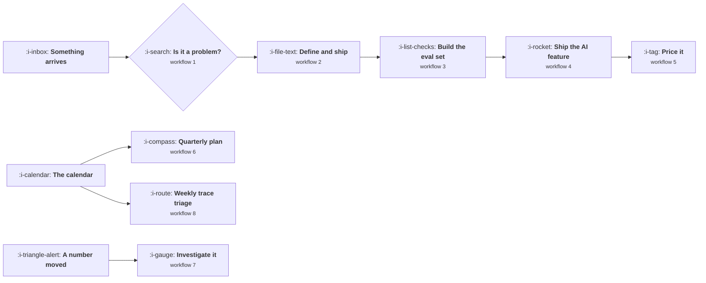

# Workflows

Nine procedures you can run. Each one names when it fires, the steps in order, what exists at the
end, and roughly how long it takes. They are deliberately short, because a workflow nobody can hold
in their head is a workflow nobody runs.

Every step links to the lesson that explains why it is there. If a step seems arbitrary, the lesson
is the argument for it.

## When each one fires

Three triggers: something arrives, the calendar turns, or a number moved. Almost all product work
starts at one of those.

## 1. Deciding whether something is a problem

**Fires when** a request, complaint or idea reaches you. **Takes** 30 minutes, or a week if it
survives step 4. **Produces** either a closed loop with the requester, or a problem statement.

1. Record it in the register with its source: which customer, which deal, which ticket cluster.
   See [Working With Sales](the-cross-functional-loop/04-working-with-sales.md).
2. Ask what they do today. The answer prices the problem.
   See [Finding a Problem Worth Solving](discovery-and-problem-framing/01-finding-a-problem-worth-solving.md).
3. Score reach, cost to them, and the strength of the evidence. Any one near zero stops here.
4. If it survives, talk to five people who have it, asking about past episodes rather than future
   intent. See [Interviews That Are Not Useless](discovery-and-problem-framing/02-interviews-that-are-not-useless.md).
5. Write the problem statement: one page, falsifiable, containing no solution.
6. Close the loop with whoever raised it, including when the answer is no.

## 2. Defining and shipping a feature

**Fires when** a problem has been accepted into the plan. **Takes** the length of the build, plus
two hours of writing at the start and one at the end. **Produces** a shipped change and a readout.

1. Write the five live sections: problem, in scope, out of scope, success bar as a number, open
   questions. See [Writing a PRD That Gets Built](definition-and-delivery/01-writing-a-prd-that-gets-built.md).
2. Slice vertically and pick the first version at the flattening point.
   See [Scoping and the First Version](definition-and-delivery/02-scoping-and-the-first-version.md).
3. Review with engineering for feasibility, design for the problem, support for what they will be
   asked. Three different questions, asked separately.
4. Confirm the measurement plan exists and the events are instrumented before the build, not after.
5. Ship behind a flag, to a small share first.
6. Write the readout at seven and thirty days against the bar you set in step 1, whether or not it
   worked. This step is the one that gets skipped and the one that compounds.

## 3. Building an eval set from nothing

**Fires when** an AI feature exists and nobody can tell whether a change helped. **Takes** one day
for the first version. **Produces** a pass rate you can gate releases on.

1. Collect thirty real cases, not synthetic ones. Typical in the proportions you actually see,
   plus edge cases and anything adversarial.
2. Add every production failure you can remember, each with the date it was found.
3. Write code graders for everything code can decide: schema validity, required and forbidden
   strings, latency, cost.
4. Write a rubric for what code cannot judge, then have a person score twenty cases against it
   before any model does.
5. Run each case several times, because a case that passes two runs in three is not passing.
6. Report the pass rate with a confidence interval, and set the bar well below your current rate
   or the gate will be noisy. See
   [Deterministic and Probabilistic Products](what-a-model-changes/02-deterministic-and-probabilistic-products.md).
7. Add the gate to whatever runs on a prompt change.

## 4. Shipping an AI feature end to end

**Fires when** you have decided to build something with a model in it. **Takes** the build, plus
about a day of the work below. **Produces** a feature you can defend.

1. Name the product shape, which sets the accuracy you need.
   See [AI Product Shapes](what-a-model-changes/04-ai-product-shapes.md).
2. Compute cost per request and the latency a user will feel, before design.
   See [Cost Per Request](model-primitives/02-cost-per-request.md).
3. Check which of the five facts binds first. If it is cost or latency, change the design now.
   See [The Five Facts](what-a-model-changes/01-the-five-facts.md).
4. Write the behaviour contract: must, must never, should, may.
5. Run workflow 3 and build the eval set before the feature is finished.
6. Design the wrong answer path: undo, edit, escalate, cite.
7. Decide what the model may touch, and what requires a person to say yes.
8. Roll out gradually, because early quality decides whether users ever trust it.
9. Schedule the weekly trace read, which is workflow 8.

## 5. Pricing a feature

**Fires when** something is about to ship that could be charged for, or when margin is slipping.
**Takes** half a day. **Produces** a price with its reasoning written down.

1. Establish the alternative the customer uses today and what it costs them. That sets the ceiling.
   See [What Pricing Actually Is](pricing-and-packaging/01-what-pricing-actually-is.md).
2. Compute cost to serve, including inference, retries, judging and human escalation.
3. Choose the value metric against the three tests: grows with their success, cheap to start,
   tracks your cost. See [The Value Metric](pricing-and-packaging/02-the-value-metric.md).
4. Model margin across the usage distribution, by decile, not on the average.
5. Decide packaging: included, add on, or a new tier.
6. Write the five assumptions next to the number, then take it to finance in their vocabulary.
   See [Reading a Profit and Loss](business-fundamentals-for-product/02-reading-a-profit-and-loss.md).

## 6. Quarterly planning

**Fires** once a quarter. **Takes** two days of preparation and one session. **Produces** a plan,
a list of refusals, and an allocation.

1. Measure what actually happened last quarter by category: new work, keeping it working, debt,
   obligation. See [Capacity Allocation](roadmapping-and-prioritisation/05-capacity-allocation.md).
2. Compute available capacity from the headline number, after leave, meetings and the three
   unplanned categories.
3. Score candidates with ranges rather than points, and read the result as tiers.
   See [Scoring Without Fooling Yourself](roadmapping-and-prioritisation/02-scoring-without-fooling-yourself.md).
4. Mark dependencies, obligation and strategic work separately, because scoring cannot see them.
5. Commit only to the near work. Size the middle. Write the far horizon as problems.
6. Publish the refusals, by name, with one clause of reason each.
7. Give each audience its own view of the same single list.

## 7. Investigating a number that moved

**Fires when** a metric jumps and somebody asks why. **Takes** an hour if you do these in order.
**Produces** a cause, or a defensible statement that it was noise.

1. Check the definition first: did the denominator, the window, the unit or the population change?
   See [The Denominator Problem](how-to-read-a-metric/02-the-denominator-problem.md).
2. Check the mix. Look at segment rates and segment sizes together, never the aggregate alone.
   See [Simpson's Paradox and Mix Shift](how-to-read-a-metric/05-simpsons-paradox-and-mix-shift.md).
3. Check whether it is a snapshot, a window or a cohort number, and whether it was compared to the
   same kind.
4. Check instrumentation: did a release change what gets logged?
5. Only now look for a product cause.
6. Write what you found, including when the answer is that the move was within normal variation.

## 8. Weekly trace triage

**Fires** every week, for any live AI feature. **Takes** 45 minutes. **Produces** new eval cases
and a short list of fixes.

1. Sample twenty production traces, weighted toward ones with a retry, a thumbs down or an
   escalation.
2. Read them. Actually read them, including the context that was retrieved.
3. Classify each: correct, wrong and cheap, wrong and expensive, or refused when it should not have.
4. Turn every wrong one into an eval case, dated.
5. Note anything that is a pattern rather than an instance, and take those to planning.
6. Report the counts weekly, because the trend matters more than any single trace.

## 9. Entering a sector you do not know

**Fires when** the company moves upmarket, into a new industry, or into a new geography.
**Takes** two weeks of part time work. **Produces** a one page brief that prevents a quarter of
wrong assumptions.

1. Answer the six questions in order: who signs and who uses, what is the cycle, what is forbidden,
   what does the data layer permit, where does the margin come from, how will it be abused.
   See [Product by Sector](product-by-sector/README.md).
2. Identify the product shape first, because shape usually matters more than market.
3. Read the sector lesson, then talk to three people who have sold into it.
4. Write the five structural facts that differ from your current market.
5. List what this means for the roadmap, specifically, as items rather than themes.
6. Name what you will refuse to do for this sector, and for how long.
