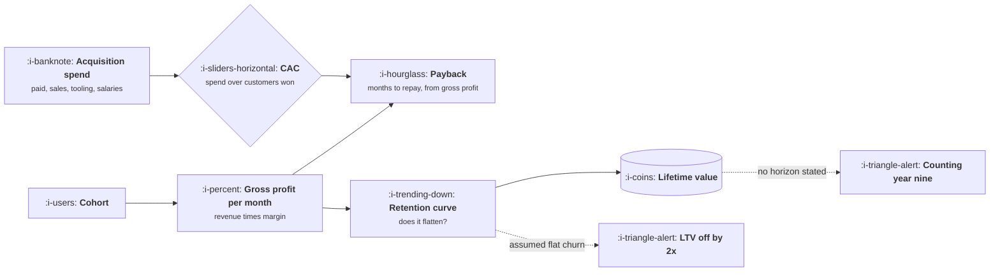

# CAC Payback, and LTV

```text
Level: Intermediate
Prerequisites: How to Read a Metric
Estimated difficulty: 3/5 | Estimated time: 45 min
```

## The idea in one minute

Customer acquisition cost is a measurement. Lifetime value is a forecast wearing the costume of a
measurement, and the forecast rests on three choices that are almost never stated: which margin you
used, which churn you assumed, and how far into the future you were willing to count. Change those
three and the same cohort of customers is worth anywhere from about 1,200 to about 4,000, a factor
of more than three, without anybody lying. Payback period survives this, because it depends on
fewer assumptions and because it is denominated in a thing nobody can argue about, which is months.
Lead with payback, quote lifetime value as a range, and state the three choices out loud.

## A picture



Payback has two inputs. Lifetime value has two inputs and two unstated assumptions, and both of
the dotted branches are standard practice.

## How it really works

### CAC, defined so that two people get the same answer

```
CAC = fully loaded acquisition spend in a period / new customers won in that period
```

The arguments are all about what goes in the numerator and which customers go in the denominator.
Three choices to state explicitly.

* **Numerator scope.** Paid media only is "paid CAC". Add sales and marketing salaries, tooling,
  content production and agency fees and you have "fully loaded CAC". The second is the real number
  and the first is the one that gets quoted.
* **Denominator scope.** All new customers, including the ones who arrived organically, gives
  "blended CAC", which flatters you in proportion to how much organic traffic you already had.
  Paid customers against paid spend is the comparable figure.
* **Lag.** Spend in January wins customers in March. At short cycles the mismatch is noise; at a
  six month enterprise cycle, dividing this quarter's spend by this quarter's wins can be wrong by
  a factor of two in either direction while growing or shrinking.

The rule that resolves most disputes: match the numerator to the denominator. Paid spend against
paid customers, total spend against total customers, never one of each.

### Payback, which is the number to lead with

```
payback months = CAC / (monthly revenue per customer × gross margin)
```

Gross margin, not revenue. Repaying a 1,200 cost out of 100 a month of revenue takes twelve months
only if serving the customer is free, which it is not.

There are two honest versions of this and the difference matters. The quoted version assumes the
customer is present every month. The retained version repays the cost out of profit that actually
survives churn, which is slower. In the model below, the same business reads fifteen months on the
first definition and twenty one on the second. Neither is wrong; stating which one you used is the
whole of the integrity requirement.

### Lifetime value, and the three formulas people mean by it

**The geometric formula**, which is what textbooks give:

```
LTV = monthly revenue × gross margin / monthly churn rate
```

It assumes churn is memoryless, that a customer in month forty is exactly as likely to leave as a
customer in month one. That assumption is false for nearly every product, and it is also the entire
content of the formula, since the result is just the monthly profit divided by it.

**The cohort formula**, which is what you should compute:

```
LTV = Σ (monthly profit × share of the cohort still present in month m), for m = 1 to your horizon
```

This needs a retention curve rather than a single churn number, which is why people avoid it, and
it is the only version that reflects a curve that flattens. Building the curve is covered in
Retention and Cohorts.

**The discounted version**, which caps the fantasy. Profit arriving in month fifty is worth less
than profit arriving next month, and discounting at your cost of capital makes the far tail stop
dominating the answer.

### The three load bearing assumptions

State these three every time, in the same sentence as the number.

1. **Which margin.** Gross, contribution after support and payment fees, or revenue pretending to
   be margin. The spread between these is routinely twenty points.
2. **Which churn, from which window.** Churn measured over the first three months of a cohort is
   much higher than the long run rate, and using it extrapolates an early loss across a lifetime.
   Using a mature cohort's churn on a young cohort does the reverse.
3. **What horizon.** An uncapped geometric formula is implicitly counting revenue in year nine from
   a company that is four years old. A thirty six month cap is defensible; infinity is not.

### What a good value looks like

The widely repeated targets are payback under twelve months for a volume motion, under twenty four
for enterprise, and a lifetime value to acquisition cost ratio above three. These are rules of
thumb that have circulated in venture benchmarking for over a decade rather than sourced
measurements, and this course does not treat them as benchmarks. Note what the model below shows:
the same business produces a ratio between 1.0 and 3.3 depending only on definitional choices, so
a target expressed as "above three" is satisfiable by arithmetic rather than by performance. Real
figures, taken from public filings with dates attached, are in Benchmarks and Their Limits.

The one comparison that is always valid is your own number against your own number last quarter,
computed the same way.

## Run the numbers

One business: a hundred a month of revenue, eighty percent gross margin, twelve hundred to acquire
a customer, and a retention curve that falls steeply and then flattens with about forty five
percent of each cohort still present. The program computes payback both ways and lifetime value six
ways.

```go
// ltv.go: payback is one number; lifetime value is a range.
package main

import (
	"fmt"
	"math"
)

const (
	arpa        = 100.0  // average revenue per account, per month
	grossMargin = 0.80   // after cost of revenue, including inference
	cac         = 1200.0 // fully loaded cost to acquire one customer
	annualDisc  = 0.10   // cost of capital, used only where stated
)

func profit() float64 { return arpa * grossMargin }

// paybackSimple is the number every deck quotes: CAC divided by monthly gross profit.
// It silently assumes the customer is still there every month.
func paybackSimple() float64 { return cac / profit() }

// paybackRetained repays CAC out of profit that actually survives, at constant churn.
func paybackRetained(churn float64) int {
	cum := 0.0
	for m := 1; m <= 600; m++ {
		cum += profit() * math.Pow(1-churn, float64(m))
		if cum >= cac {
			return m
		}
	}
	return -1 // the cohort never repays
}

// ltvGeometric is the textbook formula. It assumes churn never changes with tenure.
func ltvGeometric(churn float64) float64 { return profit() / churn }

// survival is a declining hazard curve: early churn is high, survivors stay.
// floor is the share still present at the end of any realistic horizon.
func survival(m int, floor, k float64) float64 {
	return floor + (1-floor)*math.Exp(-k*float64(m))
}

// ltvCohort sums the profit a real cohort actually delivers, capped at a horizon
// you are willing to forecast, optionally discounted.
func ltvCohort(months int, floor, k float64, discount bool) float64 {
	monthlyRate := math.Pow(1+annualDisc, 1.0/12) - 1
	total := 0.0
	for m := 1; m <= months; m++ {
		v := profit() * survival(m, floor, k)
		if discount {
			v /= math.Pow(1+monthlyRate, float64(m))
		}
		total += v
	}
	return total
}

func main() {
	const floor, k = 0.45, 0.35
	fmt.Printf("monthly gross profit per customer: %.0f\n", profit())
	fmt.Printf("payback, as usually quoted:        %.0f months\n", paybackSimple())
	fmt.Printf("payback, out of retained profit:   %d months at 3%% monthly churn\n\n", paybackRetained(0.03))

	fmt.Printf("%-38s %8s %9s\n", "how lifetime value was computed", "LTV", "LTV/CAC")
	rows := []struct {
		label string
		value float64
	}{
		{"geometric, 2% monthly churn", ltvGeometric(0.02)},
		{"geometric, 3% monthly churn", ltvGeometric(0.03)},
		{"geometric, 4% monthly churn", ltvGeometric(0.04)},
		{"real cohort curve, 60 month cap", ltvCohort(60, floor, k, false)},
		{"real cohort curve, 36 month cap", ltvCohort(36, floor, k, false)},
		{"real cohort curve, 36 months, discounted", ltvCohort(36, floor, k, true)},
	}
	lo, hi := math.Inf(1), 0.0
	for _, r := range rows {
		fmt.Printf("%-38s %8.0f %8.1f\n", r.label, r.value, r.value/cac)
		lo, hi = math.Min(lo, r.value), math.Max(hi, r.value)
	}
	fmt.Printf("\nSame customers, same revenue, same margin. Range %.0f to %.0f, a factor of %.1f.\n", lo, hi, hi/lo)
	fmt.Println("Payback moved six months, or forty percent, between its two definitions. Lead with payback.")
}
```

Two results matter. Payback reads fifteen months or twenty one months depending on whether you
repay out of nominal or retained profit, a difference of forty percent from a choice that is
usually invisible. Lifetime value spans 1,225 to 4,000, a factor of three and a third, and the
resulting ratio against acquisition cost spans 1.0 to 3.3. That range straddles the famous target
of three, which means this single business can be presented as comfortably above the bar or as
barely breaking even, truthfully, by selecting a formula. That is the reason to lead with payback.

Notice also which direction each choice pushes. The geometric formula with a low churn figure is
the most generous, an uncapped horizon is the next most generous, and discounting a capped cohort
is the most conservative. If somebody quotes a lifetime value without stating the three
assumptions, the overwhelming likelihood is that the generous end was chosen, because that is what
happens when nobody has to say.

## The AI layer

There is one direct effect on this lesson and it belongs in the margin. If your product calls a
model, inference is cost of revenue, which means it reduces the gross margin in both formulas above.
A feature costing six cents of inference per active user per month against a twenty five a month
price is a quarter of a point of margin and does not matter. The same feature at ninety cents per
user per month is over three points, which moves payback by a month and lifetime value by several
percent, and nobody notices because inference is usually booked to an engineering budget rather
than to cost of revenue. Unit Economics With AI Costs covers the full model.

The second effect is subtler and worth naming. Usage based inference cost scales with engagement,
so a successful feature increases cost per customer at exactly the moment the retention curve looks
best. A cohort that engages twice as much is more valuable and more expensive, and the geometric
formula quietly assumes the cost side is flat.

Using a model to compute any of this is fine for pulling numbers together and wrong for choosing
the assumptions, for the reason the whole lesson is about: asked for a lifetime value, a model will
pick a formula and a churn rate and present the result without flagging that it chose both.

## Sector lens

| Sector | What changes about these numbers |
|---|---|
| [Enterprise B2B SaaS](../XIX-product-by-sector/01-enterprise-b2b-saas.md) | The cost of winning a deal is close to fixed, so payback is driven by contract size more than by efficiency. Lag between spend and win is months |
| [Fintech](../XIX-product-by-sector/02-fintech.md) | Revenue is often a spread or a per transaction fee, so margin varies with customer behaviour rather than being a constant |
| [Ecommerce and D2C](../XIX-product-by-sector/03-ecommerce-and-d2c.md) | Contribution margin after shipping, payment fees and returns is the only margin worth using. Repeat rate replaces churn |
| [Marketplaces](../XIX-product-by-sector/04-marketplaces.md) | Acquisition cost exists separately for each side, and lifetime value on one side depends on liquidity provided by the other |
| [Devtools and Infrastructure](../XIX-product-by-sector/05-devtools-and-infrastructure.md) | Adoption is free and long before payment, so acquisition cost per paying customer is a small fraction of users and the lag is quarters |
| [Healthtech](../XIX-product-by-sector/06-healthtech-and-regulated-care.md) | Contracts run for years with institutional renewal, so the horizon is genuinely long but the cohort count is tiny |
| [Vertical SaaS](../XIX-product-by-sector/07-vertical-saas.md) | Services revenue at low margin is often bundled in, which inflates revenue and destroys the margin assumption |

## Remember this

* Acquisition cost is a measurement; lifetime value is a forecast. Treat them differently.
* Match the numerator to the denominator: paid spend against paid customers, total against total.
* Payback uses gross margin, never revenue, and there are two honest versions that differ by a
  third or more.
* Three assumptions carry the whole of lifetime value: which margin, which churn from which window,
  and what horizon. Say all three in the same sentence as the number.
* The same business can show a ratio of 1.0 or 3.3 against acquisition cost. A target of "above
  three" is therefore not a bar, it is an invitation.

## Try it

1. Run `ltv.go`, then set `floor` to zero so the retention curve decays to nothing. Which of the six
   lifetime value figures changes most, and why is that the one people quote?
2. Compute your own payback both ways. If the two differ by more than a third, your churn is high
   enough that the quoted version is misleading and you should stop using it.
3. Find the last lifetime value figure quoted in your company. Determine which margin, which churn
   window and which horizon produced it. If you cannot find out within fifteen minutes, that is the
   finding.

## Check yourself

1. Why does blended acquisition cost flatter a company with a large existing organic channel, and
   what comparison does it make impossible?
2. The geometric formula assumes churn is memoryless. For a product whose retention curve flattens,
   does that overstate or understate lifetime value, and what does the answer depend on?
3. A usage based AI feature succeeds and engagement doubles. Name the two numbers in this lesson
   that move, and say which direction each one goes.
