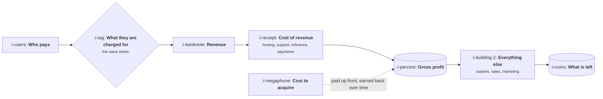

# How Your Company Makes Money

```text
Level: Expert
Prerequisites: What Good Looks Like
Estimated difficulty: 2/5 | Estimated time: 25 min
```

## The idea in one minute

A surprising number of product managers cannot describe, in two minutes and with numbers, how
their own company turns product into cash. Not approximately, specifically: who pays, what they are
charged for, what it costs to earn that, and what is left. Without that description every
prioritisation argument is conducted on intuition about value, and intuition about value is exactly
what the description replaces. It is also the fastest way to find out that your product's revenue
comes from somewhere other than where your roadmap is pointed, which is common enough to be worth
checking before anything else in this topic.

## A picture



Five boxes and one arrow that crosses time. The acquisition cost is spent now and recovered later,
which is where most of the interesting arithmetic lives.

## How it really works

### The six questions

Answer these about your own company. If you cannot, the rest of this topic is theoretical.

1. **Who pays?** The named role or segment, not "our customers".
2. **What are they charged for?** Seats, usage, transactions, a flat fee, a share of something.
3. **How much, on average?** The real average including discounts, not the list price.
4. **What does it cost to serve them?** Hosting, support, payment fees, inference, third party
   licences.
5. **What does it cost to acquire them?** Sales and marketing spend divided by customers won.
6. **How long do they stay?** Which decides whether question five was affordable.

Six numbers. Most companies will give them to you if you ask, and the asking is itself useful,
because the person who owns each number is the person to talk to when a product decision moves it.

### Revenue is not one thing

Most companies have several revenue lines with very different economics: a core subscription, an
expansion line, perhaps services, perhaps payments or a marketplace take. They carry different
margins and grow at different rates, and the one that looks largest is often not the one that
matters at the margin.

The question to ask is where the next dollar comes from, which is frequently a different line from
where the last hundred came from. A roadmap pointed at the historical line while the business grows
on another is a common and quiet misalignment.

### Where product actually moves the number

Product has leverage on four of the six: what they are charged for, how much, what it costs to
serve, and how long they stay. It has indirect influence on acquisition cost, through conversion
and through what the product makes provable in a sales conversation.

That list is worth internalising because it tells you which business arguments you can make
credibly. "This improves retention, which extends payback" is a product argument. "This reduces
sales cost" usually is not, unless you can name the mechanism.

### The timing problem

Acquisition is paid now and earned back over months. That single mismatch generates most of the
financial vocabulary in this topic: payback period, runway, burn, capital efficiency. All of them
are different ways of asking whether you can afford the gap between spending and earning.

### What fills the box in 2026

The numbers live in the billing system, the warehouse and the finance team's model, and the three
frequently disagree for the reasons in
[Working With Data](../the-cross-functional-loop/06-working-with-data.md). Ask finance for their
version and use that one in any conversation with them, while keeping your own for product
reasoning. Arguing about whose number is right is almost never the valuable conversation.

## Sector lens

| Sector | Where the money actually comes from |
|---|---|
| [Enterprise B2B SaaS](../product-by-sector/01-enterprise-b2b-saas.md) | Annual contracts plus expansion, where expansion is usually the growth engine |
| [Fintech](../product-by-sector/02-fintech.md) | A spread or a per transaction fee, so revenue scales with customer behaviour |
| [Ecommerce and D2C](../product-by-sector/03-ecommerce-and-d2c.md) | Contribution margin per order, with repeat purchase deciding whether it works |
| [Marketplaces](../product-by-sector/04-marketplaces.md) | Take rate on volume, plus increasingly payments and advertising |
| [Devtools and Infrastructure](../product-by-sector/05-devtools-and-infrastructure.md) | Usage, which grows with the customer's own success and lags adoption by quarters |
| [Healthtech](../product-by-sector/06-healthtech-and-regulated-care.md) | Institutional contracts, with reimbursement rules setting the ceiling |
| [Vertical SaaS](../product-by-sector/07-vertical-saas.md) | Subscription plus payments, where payments often becomes the larger line |

## Remember this

* Six questions: who pays, for what, how much, cost to serve, cost to acquire, how long they stay.
* Revenue is several lines with different economics. Ask where the next dollar comes from.
* Product moves four of the six directly. Know which arguments you can make credibly.
* Acquisition is paid now and earned later, and that mismatch generates the rest of the vocabulary.
* Use finance's numbers when talking to finance. Arguing about whose figure is right rarely helps.

## Try it

1. Write the six answers for your company from memory. Then check each one and note how far off you
   were.
2. Ask finance which revenue line is growing fastest. Compare that to where your roadmap points.
3. For your last three roadmap items, name which of the six numbers each one moves. Any that move
   none are worth questioning.

## Check yourself

1. Why does the gap between the historical revenue line and the marginal one matter to a roadmap?
2. Which of the six numbers can product move directly, and which can it only influence?
3. Why does the timing mismatch between acquisition and earning generate so much financial
   vocabulary?
