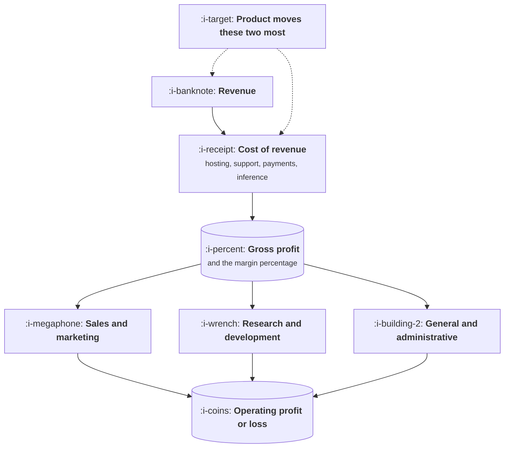

# Reading a Profit and Loss

```text
Level: Expert
Prerequisites: How Your Company Makes Money
Estimated difficulty: 3/5 | Estimated time: 30 min
```

## The idea in one minute

A profit and loss statement is a short list of numbers in a fixed order, and once you know what
each line means you can read your own company's in about ninety seconds. The reason it is worth
learning is not fluency for its own sake: it is that product decisions land on specific lines, and
knowing which one tells you who will care and what argument will work. A feature that moves gross
margin is a different conversation from one that moves sales efficiency, even when both are worth
the same amount, because they are owned by different people and judged on different timescales.

## A picture



Revenue minus cost of revenue is gross profit. Three expense categories come out of that. Product
has the most direct effect on the top two boxes.

## How it really works

### The lines, and what belongs in each

| Line | What it contains | Who owns it |
|---|---|---|
| Revenue | What customers are billed, recognised over the period they receive the service | Sales and finance |
| Cost of revenue | Hosting, third party services, payment fees, support, inference, customer success | Engineering and product |
| Gross profit | Revenue minus the above, usually quoted as a percentage | Everyone argues about this one |
| Sales and marketing | Salaries, commission, advertising, events | Sales and marketing |
| Research and development | Engineering, product, design salaries. Mostly people | Engineering |
| General and administrative | Finance, legal, office, insurance | Operations |
| Operating profit | What is left | The board |

The line that causes most confusion is cost of revenue. The test is whether the cost scales with
customers served. Hosting does, so it belongs there. An engineer building a new feature does not,
so they belong in research and development. Inference almost always does, and is the line most
often put in the wrong place.

### Why gross margin is the number that gets quoted

Because it describes the shape of the business rather than its current size. A company at
eighty percent gross margin can spend a lot to acquire customers and still work. One at thirty
percent cannot, no matter how fast it grows, which is why hardware and services businesses are
valued differently from software ones.

When a model goes into the product and inference lands in cost of revenue, gross margin falls. That
is the single most consequential financial effect of AI on software companies, and it is treated
properly in [AI Cost and Margin](../ai-cost-and-margin/README.md).

### Which line your work lands on

* A feature that reduces support contacts moves **cost of revenue**.
* A feature that improves conversion moves **revenue** and makes **sales and marketing** more
  efficient.
* A feature that lets you charge more moves **revenue** directly, with no cost increase, which is
  the best shape available.
* Reducing inference cost moves **cost of revenue**, and is worth more per dollar than reducing an
  engineering cost, because it scales with customers.
* Engineering productivity work moves **research and development**, which is real but rarely what
  the board is asking about.

Naming the line before making the argument is what turns a product proposal into a business one.

### Recognition, briefly

Revenue is recognised as the service is delivered, not when cash arrives. An annual contract paid
up front is recognised across twelve months. This matters to product in one practical way: a
pricing or packaging change can alter when revenue appears without altering how much there is, and
finance will care about that even when the total is identical.

## Run the numbers

A small company's statement, with a product change applied, to see which lines move.

```go
// pandl.go: where a product change lands.
package main

import "fmt"

type pandl struct {
	revenue, hosting, support, inference, payments float64
	salesMarketing, randD, admin                   float64
}

func (p pandl) cogs() float64  { return p.hosting + p.support + p.inference + p.payments }
func (p pandl) gross() float64 { return p.revenue - p.cogs() }
func (p pandl) opex() float64  { return p.salesMarketing + p.randD + p.admin }
func (p pandl) op() float64    { return p.gross() - p.opex() }

func show(label string, p pandl) {
	fmt.Printf("%-26s %10.0f %10.0f %8.0f%% %10.0f\n",
		label, p.revenue, p.gross(), 100*p.gross()/p.revenue, p.op())
}

func main() {
	base := pandl{
		revenue: 12_000_000, hosting: 900_000, support: 1_100_000,
		inference: 260_000, payments: 340_000,
		salesMarketing: 5_400_000, randD: 3_800_000, admin: 1_300_000,
	}
	deflect := base
	deflect.support -= 420_000 // a feature that removes a class of ticket

	aiFeature := base
	aiFeature.inference += 1_150_000 // a model in the main workflow
	aiFeature.revenue += 900_000     // and the upsell it enables

	pricing := base
	pricing.revenue += 840_000 // a packaging change, no new cost

	fmt.Printf("%-26s %10s %10s %9s %10s\n", "", "revenue", "gross", "margin", "operating")
	show("baseline", base)
	show("support deflection", deflect)
	show("AI feature with upsell", aiFeature)
	show("packaging change", pricing)
	fmt.Println("\nThe packaging change adds less revenue than the AI feature and more operating profit,")
	fmt.Println("because it arrives with no cost of revenue attached.")
}
```

Read the revenue column and the operating column together. The AI feature adds the most revenue of
the three and is the only one that makes the company worse off, because nine hundred thousand of
upsell arrives with one and a bit million of inference attached. It also costs seven points of
gross margin, which is the number a board will ask about.

Meanwhile the packaging change adds slightly less revenue and nearly a million of operating profit,
because it carries no cost of revenue at all. And the support deflection adds no revenue
whatsoever, which makes it invisible in the way product work is usually described, while improving
margin by four points.

Three proposals, each defensible as "worth about a million", and they do completely different
things to the business. Presenting any of them without naming the line it lands on is how a good
proposal loses to a clearer one.

## Sector lens

| Sector | The line that dominates |
|---|---|
| [Enterprise B2B SaaS](../product-by-sector/01-enterprise-b2b-saas.md) | Sales and marketing, which is usually the largest expense line by a distance |
| [Fintech](../product-by-sector/02-fintech.md) | Cost of revenue, since payment and risk costs scale directly with volume |
| [Ecommerce and D2C](../product-by-sector/03-ecommerce-and-d2c.md) | Cost of revenue, which includes goods and shipping and leaves thin margins |
| [Marketplaces](../product-by-sector/04-marketplaces.md) | Revenue recognition, since gross volume and net revenue differ enormously |
| [Devtools and Infrastructure](../product-by-sector/05-devtools-and-infrastructure.md) | Hosting, especially where you resell compute at a thin markup |
| [Healthtech](../product-by-sector/06-healthtech-and-regulated-care.md) | Compliance and implementation costs, which are large and often misclassified |
| [Vertical SaaS](../product-by-sector/07-vertical-saas.md) | Services inside cost of revenue, which is what drags the margin down |

## Remember this

* Revenue, cost of revenue, gross profit, three expense lines, operating profit. That is the whole
  structure.
* Cost of revenue is anything that scales with customers served. Inference belongs there.
* Gross margin describes the shape of the business and decides how much you can afford to spend
  acquiring customers.
* Name the line your work lands on before making the argument.
* Revenue with no cost attached is the best shape available, which is why pricing work is
  underrated and why an AI upsell can add revenue while losing money.

## Try it

1. Run `pandl.go` with your company's real figures. What is your gross margin, and where does
   inference sit?
2. Find your company's actual statement, or the closest thing to it, and locate every line in the
   table above.
3. For your top three roadmap items, name the line each one moves. Then check whether the person
   who owns that line knows the work exists.

## Check yourself

1. What is the test for whether a cost belongs in cost of revenue?
2. An AI feature adds nine hundred thousand of revenue and makes the company worse off. What does
   that tell you to check before approving one?
3. Why does putting inference in the wrong line matter, given the total is unchanged?
