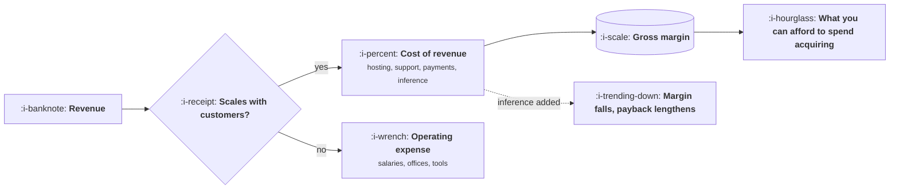

# Gross Margin and Cost of Revenue

```text
Level: Expert
Prerequisites: Reading a Profit and Loss
Estimated difficulty: 3/5 | Estimated time: 30 min
```

## The idea in one minute

Gross margin decides how much a company can afford to spend to win a customer, which makes it the
number that determines what kind of business you are allowed to run. Software has historically
carried eighty percent or better, which is why software companies can spend a year's revenue
acquiring a customer and still work. A model in the product changes that, because inference is a
cost that scales with use and belongs in cost of revenue. A few points of margin sounds abstract
until you see what it does to how long you can afford to wait for a customer to pay you back.

## A picture



One test decides which box a cost goes in, and the consequence runs all the way to how much you can
spend on marketing.

## How it really works

### The classification test

Does this cost rise when we serve more customers? If yes, cost of revenue. If no, operating
expense. Hosting rises, so it is cost of revenue. An engineer's salary does not rise when a
thousand more customers sign up, so it is operating expense, even though that engineer built the
thing being served.

The borderline cases are support and customer success. Both usually scale with customers, so both
usually belong in cost of revenue, and companies that put them in operating expense report a
flattering margin that falls apart the moment anybody normalises it.

### What belongs there for a modern software product

Hosting and infrastructure, third party services consumed per customer, payment processing fees,
support and customer success, data and content licensing, and inference. The last one is new,
is frequently booked to an engineering budget, and is the one most likely to be in the wrong place
in your company right now.

### Why margin determines what business you can run

Gross profit is the money available to pay for everything else, including acquiring the next
customer. At eighty percent margin a customer paying a thousand a year contributes eight hundred
toward that. At sixty percent they contribute six hundred, so every acquisition decision that was
marginal is now negative and the whole sales model has to shrink.

This is why the same product, sold at the same price, is a viable company at one margin and not at
another, and why a few points matters far more than it sounds.

### Inference is the live issue

Unlike hosting, inference scales with engagement rather than with customer count, which means it
rises fastest among your best customers. The practical effects are covered in
[The Value Metric](../pricing-and-packaging/02-the-value-metric.md) and in AI Cost and Margin; what
belongs here is the accounting point. Book it in cost of revenue, watch the margin, and notice that
a successful AI feature shows up as a margin decline before it shows up as revenue, because usage
precedes the upsell.

### Margin by segment, not in aggregate

A blended margin hides a lot. Heavy users, large accounts and customers on legacy pricing can each
be materially different, and in a product with usage based costs the spread is wide. Computing
margin per decile of usage, as in the value metric lesson, routinely reveals that a tenth of
customers are unprofitable and nobody knew.

## Run the numbers

What a margin change does to how long you can afford to wait for a customer to repay acquisition.

```go
// margin.go: what a few points of margin do to what you can afford.
package main

import "fmt"

const (
	annualRevenue = 1_200.0 // per customer
	cac           = 1_350.0 // fully loaded cost to acquire one
	targetMonths  = 18.0    // payback the business can tolerate
)

func main() {
	fmt.Printf("%9s %14s %14s %16s\n", "margin", "gross/year", "payback", "max affordable CAC")
	for _, m := range []float64{0.85, 0.80, 0.72, 0.65, 0.55} {
		gross := annualRevenue * m
		months := cac / (gross / 12)
		maxCAC := gross / 12 * targetMonths
		verdict := ""
		if months > targetMonths {
			verdict = "  over the tolerance"
		}
		fmt.Printf("%8.0f%% %14.0f %12.1f mo %16.0f%s\n", 100*m, gross, months, maxCAC, verdict)
	}
	fmt.Printf("\nSame product, same price, same acquisition cost of %.0f.\n", cac)
	fmt.Println("Margin alone decides whether the acquisition model works.")
}
```

Read the payback column against the eighteen month tolerance. The product is identical in every
row, the price is identical, and the acquisition cost is identical. Only the margin changes, and
between eighty and seventy two percent the business stops working at a cost it was comfortably
affording two rows up.

The last column is the practical version of the same fact. It is the most you could pay to win a
customer and still be repaid inside eighteen months, and it falls by over five hundred across the
range. That is why a seven point margin decline from an AI feature is not an accounting detail: it
is a direct reduction in how much marketing the company is allowed to buy, and nobody in the
marketing team will be told that is why.

## Sector lens

| Sector | Typical margin shape |
|---|---|
| [Enterprise B2B SaaS](../product-by-sector/01-enterprise-b2b-saas.md) | High, often above eighty percent, which funds an expensive sales motion |
| [Fintech](../product-by-sector/02-fintech.md) | Thin on payments, better on software. Mix determines the blended figure |
| [Ecommerce and D2C](../product-by-sector/03-ecommerce-and-d2c.md) | Low, since goods and shipping dominate. Contribution margin is the working number |
| [Marketplaces](../product-by-sector/04-marketplaces.md) | High on take rate, but gross volume makes the headline misleading |
| [Devtools and Infrastructure](../product-by-sector/05-devtools-and-infrastructure.md) | Depends entirely on whether you resell compute, which can halve it |
| [Healthtech](../product-by-sector/06-healthtech-and-regulated-care.md) | Compressed by implementation and compliance costs that scale with customers |
| [Vertical SaaS](../product-by-sector/07-vertical-saas.md) | High on software, dragged down by services, which is the whole tension |

## Remember this

* One test: does the cost rise when you serve more customers? That decides the line.
* Support and customer success usually belong in cost of revenue. Moving them out flatters margin.
* Inference belongs in cost of revenue and is the line most often misplaced today.
* Margin decides how much you can afford to spend acquiring a customer, which decides the business
  model.
* A successful AI feature shows up as a margin decline before it shows up as revenue.
* Compute margin by usage decile. A blended figure hides unprofitable customers.

## Try it

1. Run `margin.go` with your own revenue per customer and acquisition cost. At which margin does
   your model stop working?
2. Find where inference is booked at your company. If it is in engineering, compute what moving it
   does to the reported margin.
3. Compute margin for your top usage decile separately. Compare it to the blended number.

## Check yourself

1. Why do support costs usually belong in cost of revenue, and what does moving them out achieve?
2. Why does a few points of gross margin change what kind of company you can run?
3. Why does a successful AI feature look like a margin problem before it looks like a win?
