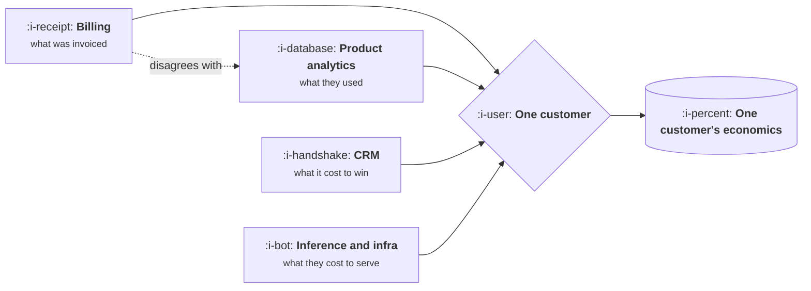

# Unit Economics in Practice

```text
Level: Expert
Prerequisites: Gross Margin and Cost of Revenue
Estimated difficulty: 3/5 | Estimated time: 30 min
```

## The idea in one minute

Unit economics means the profit and loss of one customer rather than the whole company, and the
reason to compute it is that the company level view averages away everything interesting. The hard
part is not the arithmetic, which is covered in
[CAC Payback, and LTV](../revenue-and-efficiency/01-cac-payback-and-ltv.md). It is getting the
inputs out of systems that were built for other purposes and disagree with each other. Most teams
never produce the number because the first attempt collides with that, concludes the data is bad,
and stops. The data is bad. You produce a defensible number anyway, by writing down which source
you used and why.

## A picture



Four systems, one customer, and no two of them agree on who that customer is. Resolving that is
most of the work.

## How it really works

### The four inputs and where they live

**Revenue per customer** comes from billing, which is the authoritative source and is usually the
easiest. Watch for discounts, annual versus monthly, and multi entity customers that appear as
several records.

**Cost to serve** is hosting, support, payments and inference. Hosting and inference are rarely
attributed per customer by default, and the attribution is often an estimate based on usage share.
That is acceptable. Say so.

**Cost to acquire** comes from the CRM and the marketing spend, divided appropriately. The join
between a marketing channel and a closed deal is where most of the disagreement lives.

**Lifetime** comes from the billing history, and requires a decision about how far forward you are
willing to project, which is the single biggest lever on the answer.

### The identity problem

Billing has accounts, product analytics has users and workspaces, the CRM has opportunities and
companies. A single customer is usually several records in each, and the mapping is incomplete.
This is the real reason unit economics is hard, and it does not get solved by trying harder on the
arithmetic.

Two practical responses. Pick a grain and declare it, usually the billing account, and map
everything else to it even imperfectly. And compute for a subset where the mapping is clean, which
gives a defensible answer for part of the business sooner than a perfect answer for all of it.

### Write the assumptions next to the number

A unit economics figure without its assumptions is not reusable, and six weeks later nobody
including you can remember whether support was included. The minimum is five lines: which margin,
which cost sources, which acquisition costs, what horizon, and which customers were in scope.

This single habit is what separates a number people act on from one they quietly recompute from
scratch, and recomputing is where most of the time goes.

### Segment before you average

A blended figure across a business with multiple segments is usually true of nobody. Self serve and
enterprise customers have different acquisition costs by an order of magnitude and different
retention, and averaging them produces a number that describes a customer who does not exist.

The minimum useful split is by acquisition channel and by segment. In a product with usage based
costs, add a split by usage decile, because that is where unprofitable customers hide.

### Good enough beats precise

A figure with stated assumptions and a thirty percent error band, available now, changes more
decisions than a perfect figure available next quarter. Finance will object to the method; the
response is to use their number for anything external and yours for product reasoning, and to be
explicit about which is which.

## Sector lens

| Sector | The input that is hardest to get |
|---|---|
| [Enterprise B2B SaaS](../product-by-sector/01-enterprise-b2b-saas.md) | Acquisition cost, because the sales cycle spans quarters and channels |
| [Fintech](../product-by-sector/02-fintech.md) | Cost to serve, since risk and fraud losses vary enormously per customer |
| [Ecommerce and D2C](../product-by-sector/03-ecommerce-and-d2c.md) | Lifetime, because repeat purchase behaviour is long tailed and slow to observe |
| [Marketplaces](../product-by-sector/04-marketplaces.md) | Everything twice, since each side has its own economics and they interact |
| [Devtools and Infrastructure](../product-by-sector/05-devtools-and-infrastructure.md) | Attribution, because adoption is bottom up and the payer appears later |
| [Healthtech](../product-by-sector/06-healthtech-and-regulated-care.md) | Cost to serve, dominated by implementation that is hard to attribute |
| [Vertical SaaS](../product-by-sector/07-vertical-saas.md) | Separating software revenue from services revenue, which nobody tracked separately |

## Remember this

* Unit economics is the profit and loss of one customer. The company view averages away the
  interesting parts.
* The hard part is identity across billing, analytics and the CRM, not the arithmetic.
* Pick a grain, declare it, and compute for a clean subset rather than waiting for perfect mapping.
* Write five lines of assumptions next to the number or it is not reusable.
* Segment before averaging. A blended figure often describes nobody.
* Good enough now beats precise next quarter. Use finance's number externally and yours internally.

## Try it

1. Compute unit economics for the cleanest segment you have, with the five assumption lines
   written down. Time how long it takes.
2. Find out how your company maps a billing account to a product workspace. If the answer is
   complicated, you have located the real obstacle.
3. Split your blended figure by acquisition channel. How different are the two ends?

## Check yourself

1. Why is identity mapping, rather than arithmetic, the reason most teams never produce this number?
2. What are the five assumptions that must accompany a unit economics figure, and what happens
   without them?
3. Why is a blended figure across segments often true of no actual customer?
