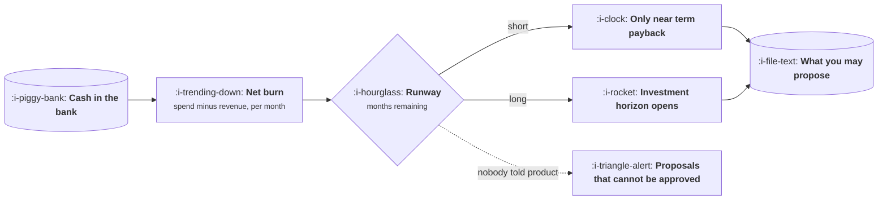

# Burn, Runway and What They Permit

```text
Level: Expert
Prerequisites: Unit Economics in Practice
Estimated difficulty: 3/5 | Estimated time: 30 min
```

## The idea in one minute

Runway is how many months the company survives at the current rate of spending, and it silently
sets the boundary of what you are allowed to propose. A team with thirty months of runway can
invest in something that pays off in eighteen. A team with ten months cannot, and a product manager
who proposes it anyway is not being bold, they are demonstrating that they do not know the
constraint. Knowing the number explains a great deal of otherwise confusing leadership behaviour,
and it lets you shape proposals that can actually be approved rather than ones that are obviously
correct and obviously impossible.

## A picture



The dotted branch is the common case: the constraint exists, product does not know it, and
proposals keep being rejected for reasons that sound like disagreement about value.

## How it really works

### The three numbers

**Gross burn** is total monthly spend. **Net burn** is spend minus revenue, which is what actually
depletes the bank. **Runway** is cash divided by net burn, in months.

A company with growing revenue has a shrinking net burn even at constant spend, which is why
runway is not a fixed number and why a plan that assumes it is will be wrong in both directions.

### What each runway band permits

| Runway | What it means | What product can propose |
|---|---|---|
| Over 24 months | Comfortable | Investments with payback inside roughly 18 months, including platform work |
| 12 to 24 months | Normal | Payback inside a year. Platform work needs an explicit case |
| 6 to 12 months | Tight | Only work that moves revenue or retention this quarter or next |
| Under 6 months | Critical | Nothing speculative. The question becomes which costs to cut |

These bands are why a proposal that was obviously right in March is rejected in September with no
change in its merits. The constraint moved.

### Burn multiple, and why it is the question behind the question

Burn multiple is net burn divided by net new recurring revenue over the same period. It asks how
much cash was consumed to produce a dollar of new recurring revenue, which is the question an
investor is really asking when they ask about efficiency. A figure around one is strong, two is
normal, and above three suggests growth is being bought rather than earned.

Product moves it from both ends: by increasing net new revenue, and by reducing cost of revenue so
more of that revenue survives.

### What this means for how you write a proposal

Three practical adjustments once you know the runway:

1. **State the payback period**, not just the benefit. A proposal without one cannot be assessed
   against the constraint.
2. **Offer a smaller version.** In a tight band, a six week version that pays back in four months
   beats a six month version that pays back in twelve, even if the second is worth more.
3. **Say what you would stop.** In a constrained company, proposing something is proposing to stop
   something else, and naming it yourself is far better than having it named for you.

### Ask for the number

Runway is usually not secret, and asking is normal. If it genuinely cannot be shared, ask which
band you are in, which is almost always answerable and tells you what you need.

## Run the numbers

Runway under a few plausible trajectories, and what each one permits.

```go
// runway.go: how long the company lasts, and what that allows.
package main

import "fmt"

const (
	cash         = 14_000_000.0
	monthlySpend = 1_450_000.0
	monthlyRev   = 720_000.0
	revGrowth    = 0.035 // month on month
	spendGrowth  = 0.012
)

func runway(revG, spendG float64) (months int, endRev float64) {
	c, rev, spend := cash, monthlyRev, monthlySpend
	for c > 0 && months < 120 {
		c += rev - spend
		rev *= 1 + revG
		spend *= 1 + spendG
		months++
	}
	return months, rev
}

func band(m int) string {
	switch {
	case m > 24:
		return "comfortable: payback inside 18 months is fine"
	case m > 12:
		return "normal: payback inside a year"
	case m > 6:
		return "tight: revenue or retention, this quarter"
	default:
		return "critical: nothing speculative"
	}
}

func main() {
	fmt.Printf("cash %.0f, spend %.0f a month, revenue %.0f a month\n\n", cash, monthlySpend, monthlyRev)
	cases := []struct {
		name         string
		revG, spendG float64
	}{
		{"as planned", revGrowth, spendGrowth},
		{"growth halves", revGrowth / 2, spendGrowth},
		{"hiring freeze", revGrowth, 0},
		{"growth halves, freeze", revGrowth / 2, 0},
	}
	fmt.Printf("%-24s %12s   %s\n", "scenario", "runway", "what product may propose")
	for _, c := range cases {
		m, _ := runway(c.revG, c.spendG)
		if m >= 120 {
			fmt.Printf("%-24s %12s   %s\n", c.name, "profitable", "reaches break even before the cash runs out")
			continue
		}
		fmt.Printf("%-24s %9d mo   %s\n", c.name, m, band(m))
	}
	fmt.Println("\nTwo assumptions, neither of them a product decision, and the company is")
	fmt.Println("comfortable, constrained, or never runs out of money at all.")
}
```

Notice how far the answer moves on two assumptions, neither of which is a product decision. The
plan gives twenty six months and room to fund platform work. Halving growth takes seven months off
and moves the company into a band where an eighteen month payback is no longer fundable. And a
hiring freeze, by itself, means the company reaches break even before the cash runs out at all.

That last row is worth sitting with, because it is the lever leadership actually has and product
does not. It is also why leadership behaviour appears to change without explanation: they are
watching a number that moves faster than the roadmap does, and the roadmap is usually the last
thing to be told.

## Sector lens

| Sector | What moves runway fastest |
|---|---|
| [Enterprise B2B SaaS](../product-by-sector/01-enterprise-b2b-saas.md) | One or two large deals landing or slipping, which makes the number lumpy |
| [Fintech](../product-by-sector/02-fintech.md) | Regulatory capital requirements, which lock up cash that looks available |
| [Ecommerce and D2C](../product-by-sector/03-ecommerce-and-d2c.md) | Inventory, which converts cash into goods long before revenue |
| [Marketplaces](../product-by-sector/04-marketplaces.md) | Subsidy spend, which is a deliberate burn with a liquidity thesis attached |
| [Devtools and Infrastructure](../product-by-sector/05-devtools-and-infrastructure.md) | Free tier compute, which is a real cost carried before any revenue |
| [Healthtech](../product-by-sector/06-healthtech-and-regulated-care.md) | Long sales cycles, which mean revenue arrives far after the spend to earn it |
| [Vertical SaaS](../product-by-sector/07-vertical-saas.md) | Services headcount, which scales with customers and consumes cash |

## Remember this

* Gross burn is spend, net burn is spend minus revenue, runway is cash over net burn.
* Runway bands set what you may propose. A proposal that ignores the band reads as not knowing it.
* Burn multiple asks how much cash bought a dollar of new recurring revenue. Around one is strong.
* State the payback period, offer a smaller version, and name what you would stop.
* Ask for the number. If it cannot be shared, ask which band you are in.

## Try it

1. Run `runway.go` with your company's figures. Which band are you in, and what does halving
   growth do to it?
2. Take a proposal you are preparing and add its payback period. Does it fit the band?
3. Ask your manager what the runway is. Note whether you already knew.

## Check yourself

1. Why does runway change even when spending is flat?
2. Why does a proposal without a stated payback period read badly in a constrained company,
   regardless of its merits?
3. What does a burn multiple above three suggest, and how can product move it from two directions?
