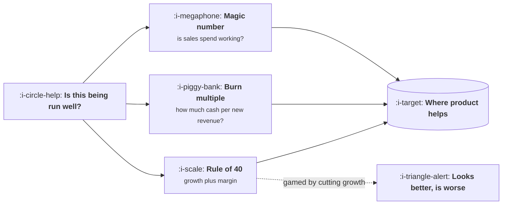

# Capital Efficiency

```text
Level: Expert
Prerequisites: Burn, Runway and What They Permit
Estimated difficulty: 3/5 | Estimated time: 30 min
```

## The idea in one minute

Three ratios get quoted whenever somebody senior asks whether the company is being run well: the
magic number, the burn multiple, and the Rule of 40. They are not interchangeable. Each one tests
a different thing, each is gameable in a different direction, and knowing which is being quoted
tells you what the person asking is worried about. For a product manager the practical value is
that two of the three are movable by product work, and knowing which lets you say so in terms the
room accepts rather than claiming a general improvement nobody can price.

## A picture



Three answers to one question. Each is a different worry wearing a formula.

## How it really works

### The three ratios

| Ratio | Formula | It asks | Good is roughly |
|---|---|---|---|
| Magic number | New recurring revenue in a quarter, annualised, divided by prior quarter sales and marketing spend | Is the sales machine returning more than it costs? | Above 0.75 |
| Burn multiple | Net cash burned divided by net new recurring revenue, same period | How much cash did a dollar of new revenue cost? | Below 2, ideally near 1 |
| Rule of 40 | Growth rate percentage plus profit margin percentage | Is the tradeoff between growing and earning acceptable? | 40 or above |

These are rules of thumb circulated in venture benchmarking rather than sourced measurements, and
this course does not treat them as benchmarks. They are useful as a common vocabulary, which is
most of their value.

### What each one is really worried about

The **magic number** worries that sales is spending more than it returns, which is a question about
the go to market motion rather than the product. Product affects it indirectly, by improving
conversion and by making the product easier to prove in an evaluation.

The **burn multiple** worries about the whole company, because it includes every cost rather than
just sales. It is the broadest of the three and the hardest to game, which is why investors
increasingly prefer it.

The **Rule of 40** worries about balance, and it is the most gameable, because growth and margin
are substitutable in the formula but not in reality. A company can improve its Rule of 40 by
cutting growth investment, which raises margin and looks like discipline for about a year.

### Which ones product can move

Burn multiple, directly, from two sides. More net new revenue through better conversion, retention
and expansion. And less cash consumed per dollar of it, primarily through cost of revenue, which is
where the inference argument lands.

Rule of 40, directly, through the margin half. Reducing cost of revenue raises margin points one
for one, and a product manager who can name the margin effect of their work is making a Rule of 40
argument whether or not they use the phrase.

Magic number, indirectly. Claiming otherwise without naming the mechanism is the kind of claim
that gets a proposal discounted.

### Why retention sits underneath all three

All three ratios improve when customers stay longer, and none of them has retention in the formula.
Net new revenue is net of churn, so reducing churn raises it without winning a single new customer.
This is the most reliable route a product manager has into any of these numbers, and it is
invisible if you only look at the formulas.

### When to use them

In a proposal, pick the one the person deciding already quotes. Finance tends toward burn multiple,
boards toward Rule of 40, sales leadership toward magic number. Translating your work into their
ratio is a presentation decision, not an analytical one, and it changes how proposals land more
than the underlying argument does.

## Run the numbers

The same company, two quarters, measured three ways, including a scenario that improves one ratio
by making the business worse.

```go
// efficiency.go: three ratios, and one of them can be gamed.
package main

import "fmt"

type quarter struct {
	name                    string
	newARR, churnedARR      float64
	salesMarketing, netBurn float64
	growthPct, profitPct    float64
}

func (q quarter) netNew() float64 { return q.newARR - q.churnedARR }
func (q quarter) magic(prevSM float64) float64 {
	if prevSM == 0 {
		return 0
	}
	return q.netNew() / prevSM
}
func (q quarter) burnMultiple() float64 { return q.netBurn / q.netNew() }
func (q quarter) rule40() float64       { return q.growthPct + q.profitPct }

func main() {
	qs := []quarter{
		{"baseline", 2_400_000, 900_000, 1_900_000, 2_100_000, 38, -14},
		{"churn halved", 2_400_000, 450_000, 1_900_000, 2_100_000, 44, -12},
		{"growth cut to save cash", 1_300_000, 900_000, 900_000, 600_000, 17, 9},
	}
	prevSM := 1_900_000.0
	fmt.Printf("%-26s %12s %10s %10s %10s\n", "scenario", "net new ARR", "magic", "burn mult", "rule of 40")
	for _, q := range qs {
		fmt.Printf("%-26s %12.0f %10.2f %10.2f %10.0f\n",
			q.name, q.netNew(), q.magic(prevSM), q.burnMultiple(), q.rule40())
	}
	fmt.Println("\nHalving churn improves all three without winning one new customer.")
	fmt.Println("Cutting growth improves the Rule of 40 and makes the burn multiple worse.")
}
```

The second row is the product argument and the third row is the warning. Halving churn moves every
ratio in the right direction while winning nothing new, which is why retention work is the most
reliable financial contribution a product team makes and why it is consistently underweighted
against features that are easier to describe.

The third row is the gaming case. Cutting growth investment raises the profit half of the Rule of
40 and the headline improves, while the burn multiple gets worse because far less new revenue was
produced for the cash spent. Any time somebody celebrates a Rule of 40 improvement, the burn
multiple is the number to check alongside it.

## Sector lens

| Sector | Which ratio dominates the conversation |
|---|---|
| [Enterprise B2B SaaS](../product-by-sector/01-enterprise-b2b-saas.md) | Magic number, because sales spend is the largest line |
| [Fintech](../product-by-sector/02-fintech.md) | Burn multiple, because regulatory capital makes cash especially precious |
| [Ecommerce and D2C](../product-by-sector/03-ecommerce-and-d2c.md) | Contribution margin and payback rather than these three, which assume recurring revenue |
| [Marketplaces](../product-by-sector/04-marketplaces.md) | Burn multiple, since subsidy spend is the defining cash question |
| [Devtools and Infrastructure](../product-by-sector/05-devtools-and-infrastructure.md) | Rule of 40 once at scale, because growth and margin genuinely trade off |
| [Healthtech](../product-by-sector/06-healthtech-and-regulated-care.md) | Burn multiple, given long cycles between spend and revenue |
| [Vertical SaaS](../product-by-sector/07-vertical-saas.md) | Rule of 40, where services revenue drags margin and the tension is visible |

## Remember this

* Three ratios, three different worries. Magic number is about sales, burn multiple about the whole
  company, Rule of 40 about balance.
* Product moves burn multiple and Rule of 40 directly, magic number only indirectly.
* Retention improves all three and appears in none of the formulas.
* The Rule of 40 is gameable by cutting growth. Check the burn multiple alongside it.
* Use the ratio the decision maker already quotes. It is a presentation decision.

## Try it

1. Run `efficiency.go` with your company's figures. Which ratio does your work move most?
2. Compute what halving churn would do to each of the three. Compare that to your largest planned
   feature.
3. Find out which of the three your leadership quotes most. Use that one in your next proposal.

## Check yourself

1. Why do all three ratios improve when retention improves, despite none containing retention?
2. How can a company improve its Rule of 40 while becoming less efficient, and which number
   exposes it?
3. Why is the burn multiple harder to game than the other two?
