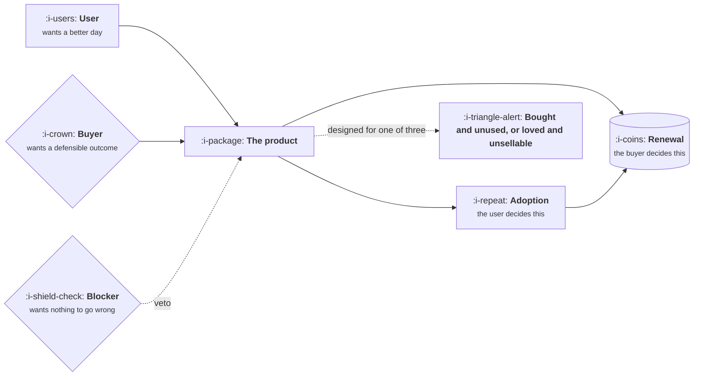

# The Buyer, the User and the Blocker

```text
Level: Basic
Prerequisites: Finding a Problem Worth Solving
Estimated difficulty: 2/5 | Estimated time: 30 min
```

## The idea in one minute

In most products that anybody pays for, at least three different people decide whether it succeeds,
and they want different things. The user wants their day to be better. The buyer wants an outcome
they can defend to somebody else. The blocker wants nothing to go wrong, and has a veto they will
use. Designing for one of the three and discovering the other two at the end is the most reliable
way to build something good that cannot be sold, or something sellable that nobody opens. The work
is knowing which of the three each piece of feedback came from, because the same sentence means
different things depending on who said it.

## A picture



Note the chain at the bottom. The user controls adoption, the buyer controls renewal, and adoption
is what the buyer looks at when deciding. Neither can be skipped.

## How it really works

### The three roles, and what each one is actually asking

| Role | Their question | What they say | What they mean |
|---|---|---|---|
| User | Does this make my work better today? | "It is confusing" | I will stop using it, quietly |
| Buyer | Can I justify this to my boss in twelve months? | "What is the ROI?" | Give me a number I can repeat |
| Blocker | What could go wrong, and would it be my fault? | "How is the data handled?" | I need a document, not reassurance |

These are roles, not job titles. One person can be all three in a small company, and in a large one
the buyer may never open the product. The number of distinct people is a property of the deal size
more than the sector.

### The two failure modes

**Bought and unused.** You sold to the buyer, the user never adopted, and the renewal conversation
in twelve months has no usage data to point at. This is slow and quiet and the first warning is a
renewal that stalls.

**Loved and unsellable.** Users adore it, nobody can articulate the business case, and it never
grows past a credit card. This looks healthier than it is, because the engagement metrics are good.

Both come from the same mistake, which is hearing from one role and assuming the others agree.

### Whose feedback is this?

The practical habit is to tag every piece of input with the role it came from. A sales loss reason
is buyer feedback. A support ticket is user feedback. A security questionnaire is blocker feedback.
They are not interchangeable, and averaging them produces a roadmap that serves nobody.

The specific trap is sales relaying user complaints as buyer requirements, or a buyer relaying what
they imagine users want. Both are common and both are second hand. Ask who said it.

### The blocker is a product requirement arriving sideways

Security, legal, compliance and IT are not obstacles to route around. They are a set of product
requirements being delivered through an unusual channel, usually late. The teams that handle this
well keep a register of what has been asked for, how often, and the value of the deals behind it,
which converts an irritation into the best prioritised list in the company. Covered properly in
[Enterprise B2B SaaS](../product-by-sector/01-enterprise-b2b-saas.md).

### When the three collapse into one

In consumer products and in small business software, the user often is the buyer and there is no
blocker. That simplifies everything, and it is why consumer product intuitions transfer badly
upward: the techniques that work when one person decides stop working when three do, and the thing
that changes is not the design, it is the number of people who have to be satisfied.

### What fills the box in 2026

Nothing tool shaped solves this. The habit that does is a field on every piece of feedback saying
which role it came from, whether that lives in Productboard, a spreadsheet or the ticket system.
Clustering feedback with a model is useful and will happily merge the three roles into one theme,
so the role has to be part of what gets clustered rather than discovered afterwards.

## Sector lens

| Sector | How the three split |
|---|---|
| [Enterprise B2B SaaS](../product-by-sector/01-enterprise-b2b-saas.md) | All three distinct, plus procurement and legal. The user is furthest from the decision |
| [Fintech](../product-by-sector/02-fintech.md) | Risk and compliance are a blocker with a genuine veto, not an influencer |
| [Ecommerce and D2C](../product-by-sector/03-ecommerce-and-d2c.md) | Usually one person, which is why decisions are fast and the funnel is the product |
| [Marketplaces](../product-by-sector/04-marketplaces.md) | Two users who are each other's supply, and neither is a buyer in the usual sense |
| [Devtools and Infrastructure](../product-by-sector/05-devtools-and-infrastructure.md) | The user adopts first and the buyer appears quarters later, which inverts the usual order |
| [Healthtech](../product-by-sector/06-healthtech-and-regulated-care.md) | Four roles, since the payer is separate from the buyer, and the patient is a fifth |
| [Vertical SaaS](../product-by-sector/07-vertical-saas.md) | Often the owner is buyer and user both, which is why these sales are fast for their size |

## Remember this

* Three roles: user wants a better day, buyer wants a defensible outcome, blocker wants no risk.
* They are roles, not titles, and the number of people depends on deal size.
* The user controls adoption, the buyer controls renewal, and adoption is the evidence at renewal.
* Two failure modes: bought and unused, loved and unsellable. Both come from hearing one role.
* Tag every piece of feedback with the role it came from. Second hand reports are the common trap.
* The blocker is a product backlog arriving through the wrong channel.

## Try it

1. Take the last twenty pieces of feedback that reached you and tag each with its role. What is the
   distribution, and which role is missing entirely?
2. For your product, write one sentence per role saying what they want. Show it to someone in sales
   and someone in support and see whether they agree.
3. Find a request you have heard second hand and go to the original person. Note how much the
   request changes.

## Check yourself

1. Why does the bought and unused failure only become visible at renewal, and what would reveal it
   earlier?
2. Why are user feedback and buyer feedback not interchangeable, even when they describe the same
   feature?
3. A consumer product manager moves to enterprise and their instincts stop working. What exactly
   changed?
