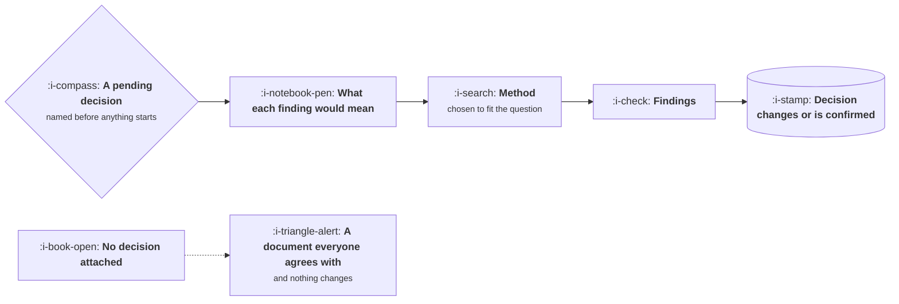

# Research That Changes Decisions

```text
Level: Basic
Prerequisites: The Buyer, the User and the Blocker
Estimated difficulty: 2/5 | Estimated time: 30 min
```

## The idea in one minute

Research earns its cost when a decision would have gone one way and goes the other way because of
it. That is a demanding test and most research fails it, not because it was done badly but because
no decision was named before it started. A study with no pending decision attached produces a
document that is read, agreed with and filed. The fix is procedural rather than methodological:
write down the decision and what each possible finding would mean for it, before you talk to
anybody, and refuse to start until somebody can tell you what they would do differently.

## A picture



The top path and the bottom path use identical methods and produce identical quality. Only one of
them was worth doing.

## How it really works

### Write the decision first

Before any study, one short paragraph: what is being decided, who decides it, when, and what the
current leading option is. Then, for each plausible finding, what it would imply. If every finding
leads to the same action, do not run the study.

This single habit removes most wasted research, and it has a second effect: it makes stakeholders
commit in advance, which prevents the familiar outcome where a finding is accepted intellectually
and then ignored because it was inconvenient.

### Match the method to the question

| The question | Method that answers it | Method that does not |
|---|---|---|
| Why do people abandon at this step? | Watch five people do it | A survey asking why they abandoned |
| How many people have this problem? | Behavioural data, or a survey with a real sample | Interviews, which cannot count |
| Would they pay for it? | What they pay for the alternative today | Asking whether they would pay |
| Which of these two is clearer? | A comparison test with a task | Asking which they prefer |
| What is going wrong for our heaviest users? | Talk to them, then check the data | Either one alone |

The recurring error is using a qualitative method to answer a quantitative question, or the
reverse. Interviews tell you what exists and why; they cannot tell you how common it is. Data tells
you how common and where; it cannot tell you why.

### Sample composition beats sample size

Who you include decides the answer more than how many you include. Three groups are routinely
missing and each one changes conclusions: people who churned, people who evaluated you and chose
otherwise, and people who use a workaround instead of any product at all. A study of happy current
users will reliably recommend making the product more like itself.

### The readout is the deliverable, and it is short

One page: the decision this affects, the claim, the evidence for the claim with a quote or a
number, the confidence, and what would change your mind. Anything longer is read by the person who
wrote it.

A finding with no evidence attached is an opinion with better formatting, and a finding without a
stated confidence invites everyone to assume whatever confidence suits them.

### Ongoing beats episodic

A research project that happens twice a year produces two moments of insight and ten months of
decay. A standing habit, five customer conversations a week and a sampled set of session
recordings, produces a continuously refreshed picture and costs less in total. The episodic version
exists because it is easier to schedule, not because it works better.

### What fills the box in 2026

Recruiting through Respondent or your own user base. Sessions through Dovetail, Grain or the call
tool you have. Replay through FullStory, Hotjar or PostHog. Models are genuinely good at clustering
transcripts and surfacing themes you did not ask about, and genuinely dangerous at inventing a
theme that reads well. The discipline is that every theme carries a real quote, and a theme without
one is deleted.

## Sector lens

| Sector | What makes research hard here |
|---|---|
| [Enterprise B2B SaaS](../product-by-sector/01-enterprise-b2b-saas.md) | Access is via the buyer, so the sample skews away from the people who actually use it |
| [Fintech](../product-by-sector/02-fintech.md) | People misreport money behaviour. Ask about process, verify in data |
| [Ecommerce and D2C](../product-by-sector/03-ecommerce-and-d2c.md) | Data answers most questions faster, so research is for why, after the data says where |
| [Marketplaces](../product-by-sector/04-marketplaces.md) | Two samples always, and a finding on one side is not a finding |
| [Devtools and Infrastructure](../product-by-sector/05-devtools-and-infrastructure.md) | Users give you solutions. Steer back to what they were doing when it broke |
| [Healthtech](../product-by-sector/06-healthtech-and-regulated-care.md) | Time is scarce and observation beats interviews. One shadowing session is worth five calls |
| [Vertical SaaS](../product-by-sector/07-vertical-saas.md) | Access is easy and generous. The constraint is your own domain fluency |

## Remember this

* Research earns its cost when it changes a decision. Name the decision before starting.
* If every possible finding leads to the same action, do not run the study.
* Interviews tell you what and why, never how many. Data tells you how many and where, never why.
* Sample composition beats sample size. Churned, lost and workaround users are usually missing.
* The readout is one page with evidence and a stated confidence.
* Continuous contact beats a project twice a year, and costs less.

## Try it

1. Take the last study your team ran. Write down the decision it was meant to change. If you
   cannot, you have found the pattern.
2. For your next question, write the two or three possible findings and what each would imply.
   Circulate that before doing the work.
3. Check your last research sample for the three missing groups. Add one churned customer this week.

## Check yourself

1. Why does naming the decision in advance prevent a finding from being accepted and then ignored?
2. You want to know how many users hit a problem. Why are interviews the wrong instrument, and what
   would you use?
3. A study of current active users recommends extending the product in the direction it already
   goes. What is wrong with the sample, and what would you add?
