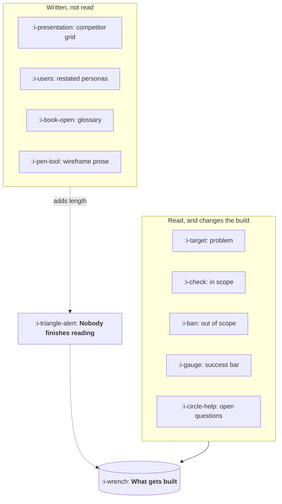

# Writing a PRD That Gets Built

```text
Level: Foundations
Prerequisites: The Artifacts
Estimated difficulty: 2/5 | Estimated time: 30 min
```

## The idea in one minute

A requirements document has five sections that change what gets built and four that are read by
nobody, and the four are not harmless: length reduces the probability that the five are read at all.
The section that does most of the work is the one most often missing, which is what you are
explicitly not building. Scope arguments in week three are nearly always the absence of that
paragraph in week one. The document is not a contract and it is not a specification of the
interface; it is the smallest thing that lets a team make a hundred small decisions the way you
would have made them, without asking.

## A picture



The dotted path is the cost of the second box. It does not merely waste your writing time, it
degrades the first box by burying it.

## How it really works

### The five live sections

**The problem**, stated so it could be wrong, with its evidence. One paragraph. If an engineer
cannot restate it, nothing downstream will go well.

**What is in scope**, described as user visible behaviour rather than implementation. Bullet points
are fine. The test is whether two people would build roughly the same thing from it.

**What is explicitly out of scope.** The highest value paragraph in the document. List the things a
reasonable person would assume are included and say they are not, with one clause of reason each.
This is where you spend your refusals.

**How success is measured**, with the number stated before the build. Not "improve conversion", but
the metric, the current value, the bar, and when you will look. Without this the readout is an
argument about interpretation.

**Open questions**, each with an owner and a date. A document with no open questions is either
trivial or dishonest.

### The four that are not read

A competitor comparison grid, personas restated from a research deck, a glossary of terms the team
uses daily, and prose describing wireframes that exist in the design file. Each was written for a
reader who does not exist. If somebody genuinely needs them, they belong in a linked appendix where
they do not cost the live sections their attention.

### Length is a cost, not a signal of effort

The probability that the out of scope section is read falls with every page before it. A two page
document that is fully read beats a nine page document that is skimmed to the third heading, and
the nine page version feels more diligent, which is why it keeps getting written.

A useful discipline: write the document, then delete everything that would not change a decision.
Most first drafts lose a third.

### It is not a contract

Two failure modes come from treating it as one. Engineering treats scope as fixed and builds the
wrong thing accurately rather than raising the issue. Product treats the document as the deliverable
and stops participating once it is written. The document is a starting position that a team changes
as it learns, and the changes belong in the document rather than in a thread nobody can find.

### Who reviews it, and for what

Engineering reviews for feasibility and for what the document leaves ambiguous. Design reviews the
problem and the constraints, not the solution. Support reviews for what they will be asked. Each
of those is a different question, and asking for general feedback gets you none of them.

### What fills the box in 2026

Notion or Confluence, linked from the issue tracker. Models are genuinely useful here for two
things: producing a first draft you will rewrite, which beats a blank page, and checking a finished
document against the five sections, which catches the missing out of scope paragraph almost every
time. Never let a model write the out of scope section itself, because that section is the decision
and it will invent plausible exclusions you never made.

## Sector lens

| Sector | What changes about the document |
|---|---|
| [Enterprise B2B SaaS](../product-by-sector/01-enterprise-b2b-saas.md) | It acquires readers outside the team, and refusals can become contractual |
| [Fintech](../product-by-sector/02-fintech.md) | Some documents are regulated records with retention rules, so drift is a compliance issue |
| [Ecommerce and D2C](../product-by-sector/03-ecommerce-and-d2c.md) | Cycles are short enough that a one pager plus an experiment brief usually replaces it |
| [Marketplaces](../product-by-sector/04-marketplaces.md) | Needs a standing section on the effect on the other side, or it is found later |
| [Devtools and Infrastructure](../product-by-sector/05-devtools-and-infrastructure.md) | The public interface is the product, so the document and the docs converge |
| [Healthtech](../product-by-sector/06-healthtech-and-regulated-care.md) | Intended use and risk assessment are mandatory artifacts with defined formats |
| [Vertical SaaS](../product-by-sector/07-vertical-saas.md) | Must use the industry's vocabulary exactly, or the domain review is worthless |

## Remember this

* Five live sections: problem, in scope, out of scope, success bar, open questions.
* Out of scope is the highest value paragraph and the most often missing.
* The success bar is a number stated before the build, or the readout is an argument.
* Length is a cost. Delete anything that would not change a decision.
* It is not a contract. Changes belong in the document, not in a thread.

## Try it

1. Open your team's last requirements document. Mark each section live or decorative. What share is
   decorative, and how far down the page is the out of scope section?
2. For a feature in flight now, write only the out of scope paragraph. Circulate just that. Count
   the surprised replies.
3. Write the success bar for the next thing you ship, as a number, before the build starts. Notice
   what that forces you to decide early.

## Check yourself

1. Why is the out of scope section worth more than the in scope section, given that the in scope
   section describes what gets built?
2. How does a longer document make the build worse, mechanically?
3. A team builds exactly what the document said and the outcome is bad. Which failure mode is that,
   and what should have happened in week two?
