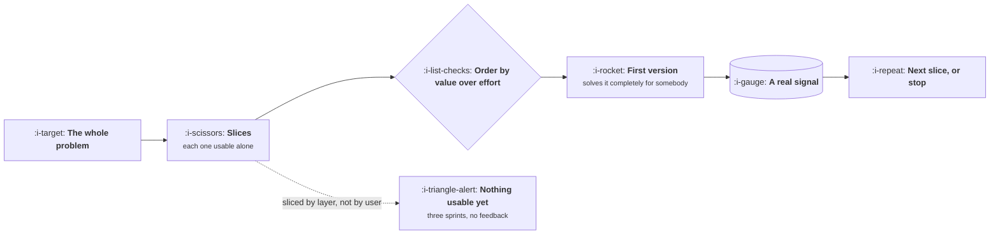

# Scoping and the First Version

```text
Level: Foundations
Prerequisites: Writing a PRD That Gets Built
Estimated difficulty: 2/5 | Estimated time: 30 min
```

## The idea in one minute

A first version is not a worse version of the finished thing, it is the smallest slice that
produces a real signal, and the two are different in a way that matters. Minimum does not mean
low quality, it does not mean a prototype, and it does not mean removing the parts that are hard.
It means choosing the subset of the problem you will solve completely for somebody. The arithmetic
that makes this concrete is ordering candidate slices by value over effort and reading where the
curve flattens, which for most features is well before the halfway point, and the slices after
that point are the ones nobody will miss.

## A picture



The dotted branch is the most common scoping error: cutting horizontally, by technical layer, so
that nothing is usable until everything is done.

## How it really works

### Cut vertically, not horizontally

A horizontal cut builds the data model this sprint, the API next, the interface after. Nothing is
usable until the last one lands, so you learn nothing for a month and the plan cannot be changed
without waste.

A vertical cut takes a narrower problem and does all the layers for it. One customer segment, one
file format, one country, one of the four things the feature eventually does. It is usable
immediately, which means it produces a signal, which means the next decision is better informed.

The test: at the end of the first slice, can a real person do a real thing end to end? If not, it
was a horizontal cut wearing a vertical label.

### What minimum does not mean

* **Not low quality.** The slice you ship is the whole product to the person using it. Rough is
  acceptable, broken is not.
* **Not a prototype.** A prototype answers a question and is thrown away. A first version is kept.
* **Not just the easy parts.** If the hard part is the part that creates the value, a version
  without it tests nothing, and a positive result would be misleading.

That last one is the expensive mistake. Removing the difficult half and shipping the rest produces
a result that cannot be interpreted either way.

### Ordering slices

Value over effort, with value estimated as reach times how completely it solves the problem for
those reached. Then read the cumulative curve. The point is not the exact numbers, which are
guesses, but that the ordering makes the flattening visible, and the flattening is where the first
version should end.

Two cautions. Slices are not independent, so an early slice can make a later one cheaper, and
occasionally a low ranking slice is a prerequisite for a high ranking one. Note those dependencies
explicitly, because a pure ranking hides them.

### Who the first version is for

Narrowing by user is usually better than narrowing by functionality. Solving the whole problem for
one segment gives you people who love it and will tell you why. Solving a third of the problem for
everybody gives you a lot of people who are mildly unsatisfied and cannot articulate what is
missing.

### When the cut is too thin

There is a failure on the other side, and it is real. A slice so small that it cannot move any
metric produces a readout that is noise, and the team concludes the feature does not work when the
honest conclusion is that the test had no power. The test is whether this slice, if it works, would
produce a result you could distinguish from nothing, given your traffic. That is a question about
sample size, not about taste.

### What fills the box in 2026

Feature flags are what make aggressive slicing safe, through LaunchDarkly, Statsig or something in
house, because a slice behind a flag can go to two percent of traffic and be removed without a
release. Flags are the single biggest practical enabler of small first versions, and teams without
them cut conservatively for sound reasons.

## Run the numbers

Eight candidate slices, ordered by value over effort, with the cumulative curve. The question is
where to draw the line for version one.

```go
// slices.go: where the first version should end.
package main

import (
	"fmt"
	"sort"
)

type slice struct {
	name   string
	reach  float64 // share of affected users this slice serves
	solves float64 // how completely it solves the problem for them
	weeks  float64 // engineering weeks
}

func (s slice) value() float64 { return s.reach * s.solves }
func (s slice) ratio() float64 { return s.value() / s.weeks }

func main() {
	ss := []slice{
		{"single file import", 0.70, 0.60, 1.5},
		{"field mapping UI", 0.70, 0.25, 2.0},
		{"scheduled sync", 0.30, 0.50, 3.0},
		{"error reporting", 0.65, 0.15, 1.0},
		{"bulk import", 0.25, 0.40, 2.5},
		{"two more formats", 0.20, 0.30, 2.0},
		{"audit history", 0.10, 0.20, 2.0},
		{"custom transforms", 0.08, 0.35, 4.0},
	}
	sort.Slice(ss, func(i, j int) bool { return ss[i].ratio() > ss[j].ratio() })

	totalValue := 0.0
	for _, s := range ss {
		totalValue += s.value()
	}
	fmt.Printf("%-22s %7s %7s %10s %11s\n", "slice", "value", "weeks", "cum weeks", "cum value")
	cv, cw := 0.0, 0.0
	for _, s := range ss {
		cv += s.value()
		cw += s.weeks
		fmt.Printf("%-22s %7.2f %7.1f %10.1f %10.0f%%\n", s.name, s.value(), s.weeks, cw, 100*cv/totalValue)
	}
	fmt.Printf("\nEverything: %.1f weeks.\n", cw)
	fmt.Println("Find the row where cumulative value stops rising faster than cumulative weeks.")
	fmt.Println("That row is the end of version one, and the rows under it are a later conversation.")
}
```

Read the two cumulative columns together. The first three slices are four and a half weeks and
carry two thirds of the value. The fourth adds fourteen more points for three weeks, which is still
clearly worth having. From the fifth row down, each week buys two to four percent, and the last
four weeks of the eighteen buy three. That is the shape nearly every feature has, and the argument for stopping early is not
that the remaining slices are worthless but that shipping at the flattening point gets you a real
signal months before the full build would, and the signal frequently changes what the remaining
slices should be.

## Sector lens

| Sector | What changes about the first version |
|---|---|
| [Enterprise B2B SaaS](../product-by-sector/01-enterprise-b2b-saas.md) | Narrow by customer, not by functionality. One account live beats a partial feature for all |
| [Fintech](../product-by-sector/02-fintech.md) | Some slices cannot ship alone for regulatory reasons, so the minimum is larger than it looks |
| [Ecommerce and D2C](../product-by-sector/03-ecommerce-and-d2c.md) | Traffic is high, so thin slices still produce readable signals. Slice aggressively |
| [Marketplaces](../product-by-sector/04-marketplaces.md) | Narrow to one segment where liquidity already exists, or the slice cannot work at all |
| [Devtools and Infrastructure](../product-by-sector/05-devtools-and-infrastructure.md) | A narrow first version is fine, a breaking change later is not. Design the surface for growth |
| [Healthtech](../product-by-sector/06-healthtech-and-regulated-care.md) | Clinical safety sets a floor on completeness that is not negotiable by slicing |
| [Vertical SaaS](../product-by-sector/07-vertical-saas.md) | Narrow to one sub trade or one region, and solve it entirely. Depth is the product |

## Remember this

* Cut vertically. If a real person cannot do a real thing at the end of the slice, it was horizontal.
* Minimum is not low quality, not a prototype, and never means removing the hard part that creates
  the value.
* Order slices by value over effort and ship at the flattening point.
* Narrow by user rather than by functionality. People who love it tell you more than people who are
  mildly unsatisfied.
* A slice too thin to move a metric produces noise, and the team misreads it as failure.

## Try it

1. Run `slices.go` with your current feature's slices. Where does the curve flatten, and how many
   weeks earlier is that than your plan?
2. Take your planned first version and ask whether a real person can do a real thing with it. If
   not, re slice it.
3. For the slice you would ship first, estimate whether it could move your primary metric
   detectably given your traffic. If not, it is too thin.

## Check yourself

1. Why does a horizontal cut cost you more than time, and what specifically do you lose?
2. Why is removing the hard part the most expensive way to shrink a first version?
3. A slice ships and the metric does not move. Name the two very different explanations, and what
   distinguishes them.
