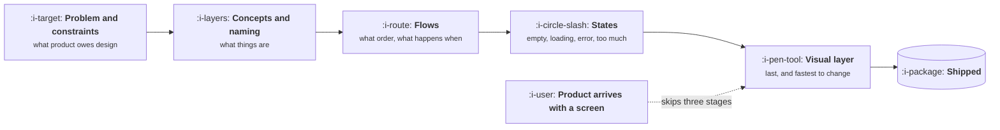

# What Designers Actually Do

```text
Level: Foundations
Prerequisites: How Product, Engineering and Design Split the Work
Estimated difficulty: 1/5 | Estimated time: 25 min
```

## The idea in one minute

Design is not the part where the screens get made attractive. It is the work of turning a problem
and a set of constraints into a structure a person can move through: what the concepts are, what
they are called, what order they appear in, what happens when things go wrong, and only then what
it looks like. Product managers interfere with this in three predictable ways, all of them well
intentioned: arriving with a solution instead of a constraint, reviewing the visual layer before
the structure is settled, and treating the design file as a specification rather than a stage in a
conversation. Knowing what the craft consists of is most of what it takes to stop doing those.

## A picture



The dotted arrow is the most common interference. A product manager who opens with a sketch has
answered the last question first and quietly foreclosed the three that mattered.

## How it really works

### The five stages, and which ones are expensive to change

**Concepts and naming.** What objects exist in this product, how they relate, and what they are
called. This is the most durable layer and the most expensive to change later, because the names
end up in the database, the API, the documentation and the customer's vocabulary.

**Flows.** What sequence a person moves through, where decisions happen, and what the product does
when they stop halfway.

**States.** Empty, loading, partial, error, far too much data, no permission. The states nobody
designs are the ones users meet on day one, when they have no data and nothing works yet.

**Visual layer.** Hierarchy, spacing, type, colour. Genuinely skilled work, genuinely the cheapest
to change, and the only layer most reviews discuss.

**Interaction detail.** Transitions, affordances, micro copy. Last, and it is where a competent
product becomes a pleasant one.

### What product owes design

A problem, the evidence for it, the constraint, and the success bar. Not a solution. The constraint
is the genuinely valuable contribution: what the data layer can serve, what the regulator forbids,
what has to work on a phone, how many of these a heavy user has, what engineering has said is
expensive. Those are things design cannot know and must have.

### The three ways product managers interfere

1. **Arriving with a solution.** It feels helpful and it collapses the solution space to one
   option, which is usually the first one that occurred to a non specialist.
2. **Reviewing the visual layer too early.** Commenting on spacing while the concepts are unsettled
   trains everyone that the review is about appearance, and the structural problem ships.
3. **Treating the file as a specification.** The design file is a shared current understanding. When
   it is treated as a contract, questions stop being asked and ambiguities become whatever the
   engineer guessed.

### What good collaboration looks like

Design sees the problem statement before any interface exists. Product reviews structure before
appearance and says which layer it is commenting on. Engineering is in the conversation early
enough that feasibility shapes the design instead of invalidating it. And somebody writes down
what was decided, because a design conversation that leaves no record gets had again.

### What fills the box in 2026

Figma is where this happens, and increasingly carries constraint and documentation alongside the
visual work. The change worth noting is that generating a plausible interface is now trivially
cheap, which has made the first interference mode far more tempting: a product manager can arrive
with a working prototype rather than a sketch. That anchors harder and is more expensive to argue
with, so the discipline is to present the problem first and keep the prototype closed unless it is
needed as evidence that something is possible.

## Sector lens

| Sector | What changes about design |
|---|---|
| [Enterprise B2B SaaS](../product-by-sector/01-enterprise-b2b-saas.md) | Density and keyboard efficiency beat elegance. Power users live here all day |
| [Fintech](../product-by-sector/02-fintech.md) | States matter more than anywhere: pending, settled, reversed, disputed must all be visible |
| [Ecommerce and D2C](../product-by-sector/03-ecommerce-and-d2c.md) | The visual layer genuinely converts, so it is less safe to deprioritise than elsewhere |
| [Marketplaces](../product-by-sector/04-marketplaces.md) | Two products in one, and the two sides need different structures |
| [Devtools and Infrastructure](../product-by-sector/05-devtools-and-infrastructure.md) | Naming is the product. Error messages are read more than any screen |
| [Healthtech](../product-by-sector/06-healthtech-and-regulated-care.md) | Designed around an existing workflow under time pressure, never a new one |
| [Vertical SaaS](../product-by-sector/07-vertical-saas.md) | Concepts must match the industry's own objects and words exactly |

## Remember this

* Design is concepts, flows, states, visuals, detail, in that order of durability.
* Naming is the most expensive layer to change, because it escapes into everything else.
* The states nobody designs are the ones users meet first.
* Product owes design a problem and a constraint, never a solution.
* Say which layer you are commenting on, or the review becomes about appearance.
* A generated prototype anchors harder than a sketch, which makes it more dangerous to open with.

## Try it

1. For a feature in flight, write the constraint list design actually needs. Count how many items
   you had never told them.
2. In your next review, open by saying which layer you are commenting on. Note whether the
   conversation changes.
3. Find the empty state of your most used screen. Was it designed, or is it whatever happened?

## Check yourself

1. Why is naming the most expensive design decision to reverse?
2. What specifically is lost when a product manager opens with a solution rather than a constraint?
3. Why is treating the design file as a specification harmful, given that it does describe what to
   build?
