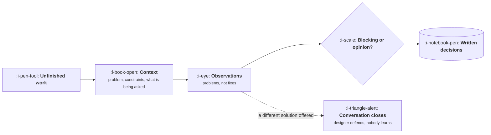

# Running a Design Critique

```text
Level: Basic
Prerequisites: What Designers Actually Do
Estimated difficulty: 2/5 | Estimated time: 25 min
```

## The idea in one minute

A critique is not a review and it is not approval. It is a structured attempt to find problems in
work that is deliberately unfinished, and it fails in one predictable way: somebody offers a
different solution instead of naming a problem. The difference matters because a solution shuts the
conversation down, while a problem opens it. Three habits carry most of the value: say which layer
you are discussing, describe the problem rather than the fix, and state whether what you are
raising is blocking or merely an opinion. Teams that do those three get better work and shorter
meetings, and they stop having the same discussion three times.

## A picture



The dotted branch is what goes wrong, and it is almost always well intentioned.

## How it really works

### Set the frame before anyone speaks

The person presenting says three things: the problem this addresses, the constraints they were
working inside, and what kind of feedback they want right now. That last one matters most. "I am
exploring structure, ignore the visuals" prevents twenty minutes of comments about spacing on work
that will be redrawn tomorrow.

Without the frame, everybody comments on whatever they notice, which is disproportionately the
visual layer because it is the easiest to see.

### Describe the problem, not the fix

| Instead of | Say |
|---|---|
| "Make that a dropdown" | "I would not know these options exist" |
| "Move this to the top" | "I missed this entirely on first look" |
| "Use a different colour" | "These two things look equally important and they are not" |
| "Add a confirmation step" | "If I get this wrong, I cannot tell and I cannot undo it" |

The right hand column leaves the solution with the person who owns it, and it is also more useful,
because the designer frequently knows three fixes you do not. The left hand column is a negotiation
about your idea.

### Say whether it is blocking

Every observation should carry one of three weights: this is a problem we must solve before
shipping, this is worth considering, or this is my preference and you should feel free to ignore
it. Teams that skip this treat all feedback as equally weighted, which means either everything gets
addressed, which is slow, or the designer guesses which comments were serious, which is worse.

Being explicit that something is merely your taste is the single most useful thing a senior person
can do in a critique.

### Who should be there

Small. The designer, the product manager, an engineer, and anyone with information the work needs,
such as a support lead who knows what people get wrong today. Large critiques produce consensus
rather than insight, and consensus on an unfinished design is worthless.

### Write down what was decided

A critique that leaves no record gets repeated in two weeks with the same comments from the same
people. One short note: what was raised, what was decided, what is still open. It takes four
minutes and saves the meeting from recurring.

### What product specifically brings

Not taste. Product brings the problem, the constraints, evidence about users, and the ability to
say that something is out of scope. If your only contributions in a critique are preferences, you
are attending as an additional opinion rather than as the person who owns the problem.

### What fills the box in 2026

Figma comments for asynchronous rounds, which work well for detail and badly for structure. Live
conversation is still better for anything conceptual. Recording the critique and summarising it
with a model is a legitimate use, with the usual caution that a summary will smooth over the
disagreement, and the disagreement was the valuable part.

## Sector lens

| Sector | What critique needs to focus on |
|---|---|
| [Enterprise B2B SaaS](../product-by-sector/01-enterprise-b2b-saas.md) | Density, keyboard paths, and what an administrator sees that a user does not |
| [Fintech](../product-by-sector/02-fintech.md) | Whether every money state is distinguishable, and whether errors are recoverable |
| [Ecommerce and D2C](../product-by-sector/03-ecommerce-and-d2c.md) | The visual layer is load bearing here, so it deserves real critique time |
| [Marketplaces](../product-by-sector/04-marketplaces.md) | Always ask what this does to the other side. It is the question nobody asks |
| [Devtools and Infrastructure](../product-by-sector/05-devtools-and-infrastructure.md) | Naming and error text deserve more critique time than layout |
| [Healthtech](../product-by-sector/06-healthtech-and-regulated-care.md) | Does it fit the existing workflow, and what happens under time pressure |
| [Vertical SaaS](../product-by-sector/07-vertical-saas.md) | Does it use the industry's words correctly. A domain expert should be present |

## Remember this

* A critique finds problems in unfinished work. It is not a review and not approval.
* The presenter frames it: problem, constraints, and what feedback is wanted now.
* Describe the problem, never the fix. The fix belongs to the person who owns the work.
* Label every observation blocking, worth considering, or preference.
* Keep it small. Large critiques produce consensus instead of insight.
* Write down what was decided, or you will have the meeting again.

## Try it

1. In your next critique, convert each comment you were about to make into the problem form before
   you say it. Note how many you drop entirely.
2. Label everything you say as blocking, considering or preference. Count how much was preference.
3. Write the four minute note afterwards and circulate it. See whether the topic comes back.

## Check yourself

1. Why does offering a fix close the conversation while naming a problem opens it?
2. What goes wrong when feedback carries no indication of weight?
3. Why does a large critique produce consensus rather than insight, and why is that bad on
   unfinished work?
