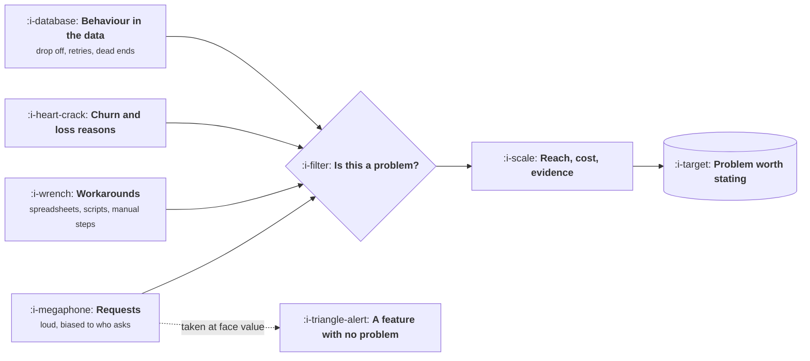

# Finding a Problem Worth Solving

```text
Level: Foundations
Prerequisites: The Product Loop
Estimated difficulty: 2/5 | Estimated time: 30 min
```

## The idea in one minute

Companies do not lack ideas, they lack a way of telling which signals mean anything. A problem is
worth solving when three things are true at once: enough people have it, it costs them enough to be
worth paying to remove, and they are already doing something awkward about it. The last one is the
strongest signal and the most ignored, because a workaround is proof of demand in a way that a
feature request never is. Most of what reaches a roadmap arrives as a request from whoever was
loudest, and the job is to convert that stream into something you can rank honestly.

## A picture



Four inputs, and they are not equal. The loudest one is the weakest, and the one that requires
effort from the customer is the strongest.

## How it really works

### The four signals, in order of strength

**Workarounds** are the strongest. When somebody maintains a spreadsheet, writes a script, employs
a person, or exports your data to do something elsewhere, they have already paid for the solution
in time. The problem is real, they have quantified it themselves, and the price is bounded by what
the workaround costs them. Go looking for these deliberately; they are rarely volunteered, because
the customer has stopped noticing.

**Behaviour in the data** is next. Repeated retries, abandoned flows, people using a feature for
something it was not built for, support tickets clustering on one screen. This tells you where,
accurately, and never why.

**Churn and loss reasons** are strong but late and biased. People rationalise after leaving, and
the reason given is often the most socially acceptable one. Useful in volume, misleading
individually.

**Requests** are the weakest. They are biased toward whoever has access to you, they arrive as
solutions rather than problems, and the request is usually the customer's guess at an
implementation. That does not make them worthless; it makes them a starting point for a
conversation, not an input to a roadmap.

### Reach, cost and evidence

A problem worth solving scores on three axes, and all three must be non trivial:

* **Reach.** How many people have it, as a share of the users you care about. One customer with a
  severe problem is a services engagement, not a product.
* **Cost to them.** What it costs now, in money, time or risk. If nobody can state this, the
  problem is probably an irritation rather than a problem.
* **Evidence.** What exists beyond someone's opinion: a workaround, a number, a recording, a
  cancelled contract.

The multiplication matters more than any one of them. Wide and cheap is a polish item. Narrow and
expensive is a consulting job. Wide, expensive and evidenced is a product.

### The question that does most of the work

For anything that reaches you, ask what they do today. The answer separates real problems from
preferences faster than any framework:

* "Nothing, we live with it" means it is cheap. Deprioritise, regardless of how often you hear it.
* "We have a spreadsheet" means it is expensive and you now know its shape.
* "We pay someone" means you know the price.
* "We use your competitor for that part" means you know the price and the alternative.

### Why the loudest input dominates anyway

Three structural reasons, all worth naming because they are fixable. Requests arrive through
channels with no cost to the sender. The people with access to a product manager are
unrepresentative by construction. And a request is concrete while a problem is abstract, so it is
easier to put in a plan.

The counterweight is a pipeline that makes the other three signals arrive automatically rather than
requiring you to go looking: ticket clusters surfaced weekly, loss reasons in a channel, a standing
sample of session recordings.

### What fills the box in 2026

Feedback aggregation through Productboard, Dovetail, Enterpret or a spreadsheet, and the spreadsheet
is correct below roughly thirty inbound items a week. Session replay through FullStory, Hotjar or
PostHog. Clustering ticket text with a model is one of the genuinely good applications in this
area, because the volume is beyond reading and the verification is cheap: you can always go and read
the cluster.

## Run the numbers

Three candidate problems, scored on the three axes, with the annual value of solving each. The
point is how often the loudest one ranks last.

```go
// worth.go: scoring problems on reach, cost and evidence.
package main

import "fmt"

type problem struct {
	name      string
	reach     float64 // share of users affected
	hoursLost float64 // hours a year lost by one affected user
	hourly    float64 // what an hour of theirs is worth
	requests  int     // how often it is asked for
	evidence  string  // the strongest evidence that exists
	weight    float64 // credibility of that evidence, 0 to 1
}

const users = 8_000.0

func (p problem) annualValue() float64 {
	return users * p.reach * p.hoursLost * p.hourly * p.weight
}

func main() {
	ps := []problem{
		{"bulk editing", 0.34, 9, 55, 4, "spreadsheet workaround", 0.9},
		{"dark mode", 0.22, 0, 0, 31, "requests only", 0.2},
		{"faster export", 0.12, 2, 55, 11, "data: retries", 0.7},
		{"audit log", 0.06, 20, 90, 2, "two lost deals", 0.8},
	}
	fmt.Printf("%-16s %8s %10s %10s %14s  %s\n", "problem", "reach", "requests", "weight", "annual value", "evidence")
	for _, p := range ps {
		fmt.Printf("%-16s %7.0f%% %10d %10.1f %14.0f  %s\n",
			p.name, 100*p.reach, p.requests, p.weight, p.annualValue(), p.evidence)
	}
	fmt.Println("\nRequests and value are close to unrelated. The most asked for item is worth nothing here,")
	fmt.Println("because nobody loses an hour to it, and the item with two mentions protects real revenue.")
}
```

Read the requests column against the value column. The most requested item scores zero, not because
preferences do not matter but because nobody loses anything measurable to its absence, so it cannot
be defended on this basis and has to be argued for on another. Meanwhile the item mentioned twice
is attached to lost deals. Neither result is surprising once computed, and neither is visible in a
list sorted by request count, which is how most backlogs are ordered.

## Sector lens

| Sector | Where the strongest signal lives |
|---|---|
| [Enterprise B2B SaaS](../product-by-sector/01-enterprise-b2b-saas.md) | Security questionnaires and lost deal reasons. Both are evidenced and attached to revenue |
| [Fintech](../product-by-sector/02-fintech.md) | Operations team workarounds, especially around reconciliation breaks |
| [Ecommerce and D2C](../product-by-sector/03-ecommerce-and-d2c.md) | Behaviour in the data, because the volume answers faster than people do |
| [Marketplaces](../product-by-sector/04-marketplaces.md) | Failed searches and off platform messaging. Both are visible and both are demand |
| [Devtools and Infrastructure](../product-by-sector/05-devtools-and-infrastructure.md) | Public issues, forum posts and the wrappers people write around your API |
| [Healthtech](../product-by-sector/06-healthtech-and-regulated-care.md) | Watch a clinician work. The workarounds are physical and nobody mentions them |
| [Vertical SaaS](../product-by-sector/07-vertical-saas.md) | The spreadsheet that runs the business. There is always one and it is the roadmap |

## Remember this

* Four signals, and the loudest is the weakest. A workaround is the strongest.
* Reach times cost times evidence. Any one of them near zero makes the product case fail.
* Ask what they do today. The answer prices the problem for you.
* Requests dominate because they are cheap to send and concrete to plan. Build a pipeline that
  surfaces the other three automatically.
* A backlog sorted by request count is sorted by who has access to you.

## Try it

1. Run `worth.go` with four real candidates from your backlog. Does the order match the order you
   would have given them?
2. Find three workarounds among your customers this month. Ask directly: what do you do in a
   spreadsheet that you wish you did in our product?
3. Take your most requested item and try to state its cost to a user in hours or money. If you
   cannot, say so in the next planning conversation.

## Check yourself

1. Why is a workaround stronger evidence than a feature request, and what does it tell you that a
   request cannot?
2. Reach, cost and evidence multiply. Describe the product failure mode of ignoring each one in
   turn.
3. Why does a backlog sorted by request volume systematically misrank problems, and what does it
   actually rank?
