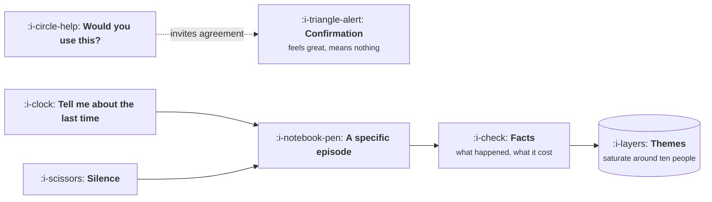

# Interviews That Are Not Useless

```text
Level: Foundations
Prerequisites: Finding a Problem Worth Solving
Estimated difficulty: 2/5 | Estimated time: 30 min
```

## The idea in one minute

Most customer interviews produce agreement rather than information, because the questions asked
invite speculation about the future and people are generous and bad at it. The fix is mechanical
rather than artistic: ask about specific past episodes instead of general preferences, make it easy
to say the unflattering thing, and stop talking. The second question people get wrong is how many
interviews are enough, and that has an actual answer: about ten finds nearly every theme that
affects a fifth of your users or more, while the long tail needs hundreds and is usually not worth
chasing.

## A picture



Two questions, two outcomes. The first is the one everybody asks and it can only return a yes.

## How it really works

### Past behaviour, not future intent

People cannot predict what they will do, and they will not tell a stranger that their idea is bad.
So the question has to be about something that already happened, where there is a fact to recall
rather than a preference to invent.

| Instead of | Ask |
|---|---|
| Would you use this? | Tell me about the last time you had this problem |
| How important is this to you? | What did you do about it? How long did that take? |
| Would you pay for it? | What have you already spent on solving it? |
| What features do you want? | Walk me through your last week doing this |
| Do you like this design? | Where would you click to do X? (then be silent) |

The right hand column produces facts that can be wrong, which is the whole point. The left hand
column produces agreement, which cannot be.

### Make the unflattering answer easy

People protect your feelings and their own self image, and both distort the answer. Two habits
help. Signal early that you want the bad version: "we are trying to work out whether this is worth
building at all, so the most useful thing you can tell me is why it would not be". And ask about
the problem long before mentioning any solution, because once you describe a solution, the
conversation becomes about your idea rather than their life.

### Shut up

The single largest improvement available to most interviewers is silence after an answer. People
fill a pause with the part they were not sure they should say, and that part is usually the
interesting one. Aim to speak for well under a third of the call.

### How many people

There is a real answer and it depends on how common a theme is. A theme affecting half your users
appears in the first few conversations. A theme affecting one in twenty needs many more. The
program below computes it, and the practical summary is that around ten interviews finds nearly
everything common, twenty is comfortable, and beyond that you are buying the long tail slowly.

The corollary is that stopping early is a specific error: if you are still hearing things you have
never heard before, you are not finished, whatever the number is.

### Who you talk to matters more than how many

Ten conversations with people who all found you the same way tells you about that channel. The
sample is the decision: include people who churned, people who evaluated you and chose something
else, and people who use a workaround instead of any product. The last group is the hardest to
reach and the most informative.

### Writing it down

An interview that is not written up decays to a vague impression within a week, and vague
impressions are how one memorable customer ends up driving a roadmap. The readout format that
works is short: the claim, the evidence for it, and which decision it affects. Quotes attached,
because a claim with a quote survives challenge and one without it does not.

### What fills the box in 2026

Recording and transcription through Grain, Gong, Dovetail or the meeting tool you already have.
Clustering transcripts with a model is a genuine time saver and a genuine hazard: it is excellent
at grouping and summarising what is there, and it will confidently produce a theme that nobody
said. The rule is that every theme must carry at least one real quote, and anything without one is
deleted rather than softened.

## Run the numbers

How many interviews before you have heard everything worth hearing. The program computes the
expected number of distinct themes discovered, by theme frequency, as the sample grows.

```go
// saturation.go: how many interviews are enough.
package main

import (
	"fmt"
	"math"
)

// Each theme affects some share of users. Common themes surface immediately,
// rare ones take a long time, and the tail never fully arrives.
var themes = []float64{0.60, 0.45, 0.30, 0.25, 0.20, 0.15, 0.10, 0.08, 0.05, 0.03, 0.02, 0.01}

// found is the expected number of themes seen after n interviews.
func found(n int, min float64) (seen, total float64) {
	for _, p := range themes {
		if p < min {
			continue
		}
		total++
		seen += 1 - math.Pow(1-p, float64(n))
	}
	return seen, total
}

func main() {
	fmt.Printf("%12s %22s %22s\n", "interviews", "themes over 20%", "all themes")
	for _, n := range []int{3, 5, 8, 10, 15, 20, 40, 80} {
		c, ct := found(n, 0.20)
		a, at := found(n, 0.0)
		fmt.Printf("%12d %13.1f of %-6.0f %13.1f of %-6.0f\n", n, c, ct, a, at)
	}
	fmt.Println("\nThemes affecting a fifth of users are essentially all found by ten interviews.")
	fmt.Println("The tail is still arriving at eighty, which is why saturation is judged by")
	fmt.Println("whether you are still hearing new things, not by reaching a number.")
}
```

The two columns answer different questions. If you want the themes that affect a meaningful share
of your users, ten conversations gets you almost all of them and the fifteenth adds very little. If
you want everything, including the issue that affects one user in a hundred, you are not going to
interview your way there and should be using the data instead. Most teams stop at three, which the
first row shows is genuinely too few even for the common themes.

## Sector lens

| Sector | What changes about interviewing |
|---|---|
| [Enterprise B2B SaaS](../product-by-sector/01-enterprise-b2b-saas.md) | Easy to reach buyers, hard to reach the actual users. Insist on the user, separately |
| [Fintech](../product-by-sector/02-fintech.md) | People are guarded about money behaviour. Ask about process rather than about them |
| [Ecommerce and D2C](../product-by-sector/03-ecommerce-and-d2c.md) | Interviews are slow next to the traffic. Use them for why, after the data has told you where |
| [Marketplaces](../product-by-sector/04-marketplaces.md) | Two samples, always. Supply side will talk for an hour, demand side will not |
| [Devtools and Infrastructure](../product-by-sector/05-devtools-and-infrastructure.md) | Users are articulate and will give you a design. Steer them back to what they were doing |
| [Healthtech](../product-by-sector/06-healthtech-and-regulated-care.md) | Clinician time is scarce, so observation beats interviewing and one hour is worth five |
| [Vertical SaaS](../product-by-sector/07-vertical-saas.md) | Customers are generous with time, and domain vocabulary earns you a better conversation |

## Remember this

* Ask about specific past episodes. Future intent questions can only return agreement.
* Describe the problem before any solution, or the conversation becomes about your idea.
* Silence after an answer is the highest leverage interviewing skill.
* Around ten interviews finds nearly every theme affecting a fifth of users. Three is too few.
* Judge saturation by whether you are still hearing new things, not by hitting a number.
* Who you sample decides the answer. Include churned, lost and workaround users.

## Try it

1. Run `saturation.go`, then change the theme list so the most common theme affects only a quarter
   of users. How many interviews does that need?
2. Take your last interview and count the share of words you spoke. Anything over a third is a
   target for next time.
3. Rewrite five questions from your current script using the right hand column of the table above.

## Check yourself

1. Why does "would you use this" produce an answer that cannot be wrong, and why is that a problem?
2. Ten interviews is enough for common themes and useless for rare ones. What should you use for
   the rare ones instead?
3. You interviewed fifteen people and heard one consistent story. What about the sample would make
   you distrust it anyway?
