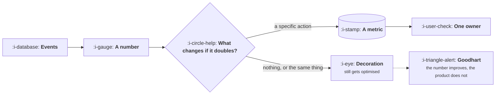

# What a Metric Is For

```text
Level: Expert
Prerequisites: What Good Looks Like
Estimated difficulty: 2/5 | Estimated time: 25 min
```

## The idea in one minute

A metric exists to change a decision. If no decision would be made differently at any value the
number could take, it is decoration, and decoration is not free: it occupies a dashboard, it gets
quoted in reviews, and somebody eventually optimises it. The test is cheap to apply and almost
never applied. Ask what you would do if the number doubled, and what you would do if it halved. If
the two answers are the same, or if neither is an action, you have found something to delete. Most
dashboards shrink by half under this test, and the half that remains gets looked at properly for
the first time.

## A picture



One question separates the two paths, and the lower path is where most dashboard content lives.

## How it really works

### The doubling test

For every number on a dashboard, write the two sentences: if this doubled we would do X, if this
halved we would do Y. Three outcomes are possible.

**X and Y are different actions.** Keep it. This is a metric.

**X and Y are the same, or both are "investigate".** It is a diagnostic, not a decision input.
Diagnostics are useful and belong somewhere you look when something else has already told you to
look, not on the main dashboard.

**Neither is an action.** Delete it. Somebody put it there because it was available.

### Availability is why dashboards fill up

Numbers end up on dashboards because they were easy to produce, not because they were needed.
Signups, page views, total registered users and cumulative anything are the usual examples: all
easy, all monotonically increasing, none capable of telling you to do something different.

Cumulative metrics deserve a particular mention because they can only go up, which means they
always look like progress and can never indicate a problem. A chart that cannot deliver bad news is
not an instrument.

### Every metric needs one owner

Not a team, a person. The owner is who explains a change and who is asked when it moves. Metrics
without an owner are nobody's job to investigate, so they drift and are eventually ignored, which
is the same end state as deleting them but with more dashboard real estate consumed on the way.

### Goodhart, specifically

Once a number becomes a target, people optimise it, including by routes you did not intend. This
is not cynicism about colleagues; it is what happens when you ask a system for a number. The
practical defence is a counter metric that captures what you are afraid of losing: speed paired
with quality, volume paired with retention, containment paired with satisfaction.

A target without a counter metric is an invitation, and the person who accepts it is usually doing
exactly what they were asked.

### Fewer, and looked at properly

A dashboard of forty numbers is read as a texture rather than as information. Five to seven,
each with an owner and a decision attached, gets read. The discipline is not arranging the forty
better, it is deleting thirty three of them, and the resistance to that is always that somebody
might want one some day.

## Sector lens

| Sector | The decoration that persists longest |
|---|---|
| [Enterprise B2B SaaS](../product-by-sector/01-enterprise-b2b-saas.md) | Total registered users, which is unrelated to revenue or renewal |
| [Fintech](../product-by-sector/02-fintech.md) | Cumulative volume processed, which can only rise and tells you nothing |
| [Ecommerce and D2C](../product-by-sector/03-ecommerce-and-d2c.md) | Sessions, which move with spend rather than with the product |
| [Marketplaces](../product-by-sector/04-marketplaces.md) | Total listings, which says nothing about whether anything matches |
| [Devtools and Infrastructure](../product-by-sector/05-devtools-and-infrastructure.md) | Signups and stars, neither of which predicts adoption or revenue |
| [Healthtech](../product-by-sector/06-healthtech-and-regulated-care.md) | Logins, which are mandated and therefore say nothing about value |
| [Vertical SaaS](../product-by-sector/07-vertical-saas.md) | Feature usage counts, where the customer count is too small for them to mean anything |

## Remember this

* A metric exists to change a decision. Ask what you do if it doubles and if it halves.
* Same answer, or no action, means delete it or demote it to a diagnostic.
* Cumulative metrics can only go up and can never deliver bad news.
* One named owner per metric, or it drifts unexamined.
* Every target needs a counter metric, because a target will be optimised by whatever route works.
* Five to seven numbers get read. Forty get glanced at.

## Try it

1. Apply the doubling test to every number on your main dashboard. Count how many survive.
2. For each survivor, name the owner. Any without one are already unowned in practice.
3. For your current primary metric, write the counter metric. If you cannot think of one, you have
   not identified how it could be gamed.

## Check yourself

1. Why is a cumulative metric structurally incapable of being useful as a decision input?
2. Why does a target without a counter metric produce behaviour you did not intend, without anybody
   acting badly?
3. What is the difference between a metric and a diagnostic, and where does each belong?
