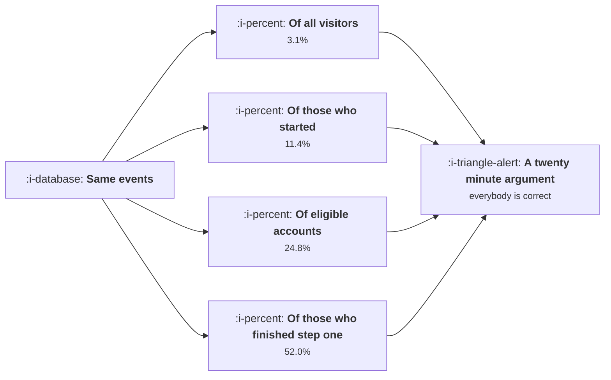

# The Denominator Problem

```text
Level: Expert
Prerequisites: What a Metric Is For
Estimated difficulty: 2/5 | Estimated time: 30 min
```

## The idea in one minute

Most metric disputes are two people dividing by different things and both being right. Conversion
rate is the canonical case: it has at least four defensible denominators, and on the same data they can
differ by more than tenfold, and nobody states which one they used because within their own
team it is obvious. The effect is that a meeting spends twenty minutes on what looks like a
disagreement about performance and is actually a disagreement about a definition. The fix is
mechanical and permanent: write the denominator into the name of the metric, so that it cannot be
dropped in transmission.

## A picture



One set of events, four correct answers, no stated definitions. This is the single most common
measurement failure in product work.

## How it really works

### The four choices hiding inside a rate

**The numerator population.** Which event counts as success, and does a partial completion count?

**The denominator population.** Everyone, everyone eligible, everyone who started, or everyone who
reached a given step. Each is defensible and each answers a different question.

**The window.** Same session, same day, within seven days, ever. A seven day window will always
report a higher rate than a same session window on the same data.

**The unit.** Per user, per account, per session, per device. An account with forty users converts
once; forty users converting once each is a very different story.

Four choices, each with several options, and the product of them is dozens of defensible numbers
for one apparently simple question.

### Name the denominator in the metric

The permanent fix is naming. Not "conversion rate" but "trial to paid conversion, per account,
within 30 days". It is clumsy and it ends the argument, because the definition travels with the
number instead of being lost at the first retelling.

Where a team cannot do this everywhere, do it for the five to seven metrics that reach a review.
Those are the ones where a misunderstanding costs the most.

### Which denominator to pick

Pick the population you can act on. If you are improving an onboarding step, the denominator is
people who reached that step, because people who never arrived cannot be helped by changing it. If
you are evaluating a marketing channel, the denominator is everybody that channel sent, because
their failure to arrive is exactly what you are measuring.

Most disputes dissolve once both people say what decision they are trying to make, because the
decision determines the denominator.

### Watch for the moving denominator

A rate can change because the numerator moved or because the denominator did, and the second is
frequently misread as the first. A conversion rate that improves because a marketing campaign ended
and low intent traffic stopped arriving has not improved anything about the product. Always look at
both series, not the ratio alone.

This is the mechanism behind a large share of experiment results that evaporate on inspection.

### The eligibility trap

"Eligible" usually hides a judgement. Eligible for what, decided by whom, and measured when?
Eligibility rules that are computed at the time of reporting rather than at the time of the event
produce rates that change retroactively, which is one of the stranger ways a dashboard can lose
trust.

## Run the numbers

One cohort, one question, four denominators, and the resulting arguments.

```go
// denominator.go: the same conversion, four correct answers.
package main

import "fmt"

const (
	visitors        = 48_200.0
	eligible        = 6_050.0 // met the plan and region criteria
	startedSignup   = 13_150.0
	finishedStepOne = 2_880.0
	converted       = 1_498.0
)

func main() {
	rows := []struct {
		name string
		den  float64
		use  string
	}{
		{"of all visitors", visitors, "judging a marketing channel"},
		{"of those who started", startedSignup, "judging the signup flow"},
		{"of eligible accounts", eligible, "judging product market fit in a segment"},
		{"of those past step one", finishedStepOne, "judging the last step of onboarding"},
	}
	fmt.Printf("%-26s %12s %9s   %s\n", "denominator", "count", "rate", "the question it answers")
	lo, hi := 1.0, 0.0
	for _, r := range rows {
		rate := converted / r.den
		if rate < lo {
			lo = rate
		}
		if rate > hi {
			hi = rate
		}
		fmt.Printf("%-26s %12.0f %8.1f%%   %s\n", r.name, r.den, 100*rate, r.use)
	}
	fmt.Printf("\nsame %.0f conversions, rates from %.1f%% to %.1f%%, a factor of %.1f\n",
		converted, 100*lo, 100*hi, hi/lo)
	fmt.Println("Nobody is wrong. Nobody said which one they meant.")
}
```

The spread is the point, and it is larger than almost any improvement you will ever ship. A team
celebrating a move from three percent to four has achieved less than the gap between two
definitions of the same metric, which means a conversation that does not begin by stating the
denominator cannot distinguish a real improvement from a different question.

## Sector lens

| Sector | The denominator argument that recurs |
|---|---|
| [Enterprise B2B SaaS](../product-by-sector/01-enterprise-b2b-saas.md) | Per user or per account, which differ by the average seat count |
| [Fintech](../product-by-sector/02-fintech.md) | Per attempt or per customer, where retries after a decline inflate attempts |
| [Ecommerce and D2C](../product-by-sector/03-ecommerce-and-d2c.md) | Per session or per visitor, which differ by how often people return before buying |
| [Marketplaces](../product-by-sector/04-marketplaces.md) | Per search or per searcher, and whether a zero result search counts at all |
| [Devtools and Infrastructure](../product-by-sector/05-devtools-and-infrastructure.md) | Per signup or per organisation, since one developer may create several |
| [Healthtech](../product-by-sector/06-healthtech-and-regulated-care.md) | Per encounter or per patient, which are very different populations |
| [Vertical SaaS](../product-by-sector/07-vertical-saas.md) | Per location or per business, where a franchise is both |

## Remember this

* Four choices hide in every rate: numerator, denominator, window and unit.
* The same data supports rates differing by more than tenfold, all of them correct.
* Write the denominator into the metric name. It is clumsy and it ends the argument.
* Pick the population you can act on. The decision determines the denominator.
* A rate can move because the denominator moved. Always look at both series.

## Try it

1. Run `denominator.go` with your own funnel. What is the spread between your widest and narrowest
   definition?
2. Rename your top three metrics to include denominator, window and unit. Circulate the new names.
3. For the last rate improvement your team reported, check whether the denominator moved.

## Check yourself

1. Why do two people reporting different conversion rates usually both have correct numbers?
2. Which denominator should you choose, and what determines it?
3. Why is a rate improvement caused by a shrinking denominator so often misread as a product win?
